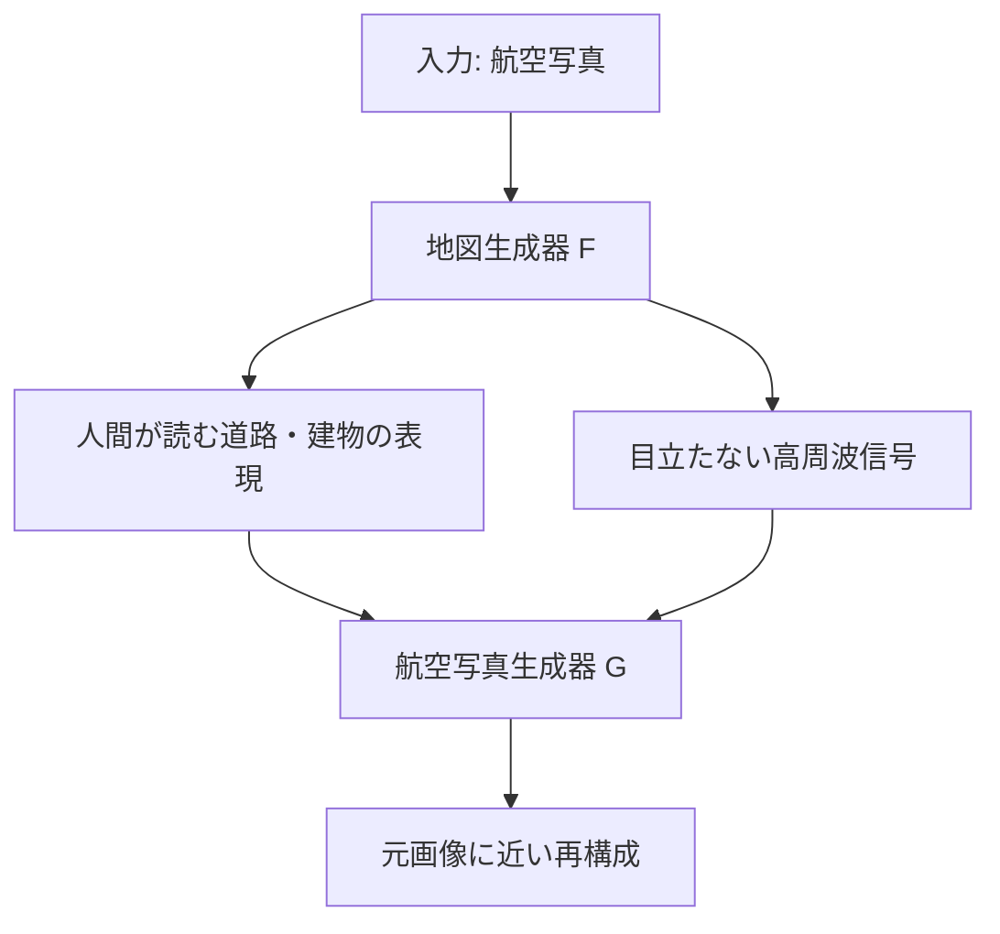

# 第1章：消えたはずの情報が復元された

作成日：2026-11-15 / 更新日：2026-11-15

## 航空写真から地図を作る

航空写真には、屋根の色や模様、車の位置、樹木の細かい枝葉、路面の陰影など、多くの視覚情報がある。一方、地図は道路・建物・土地利用などの特徴を抽出した表現であり、それらの細部を大幅に省略している。

そのため、「航空写真 → 地図」という変換から、同じ建物配置の地図を得られたとしても、元の航空写真を細部まで一意に復元できるとは限らない。白い屋根に黒い点が並んでいたのか、真っ白だったのかは、一般的な地図の記号からは分からない。

ところが、2017年の論文 *CycleGAN, a Master of Steganography* で、Casey Chu、Andrey Zhmoginov、Mark Sandlerらは、その直感に反する結果を見いだした。[原論文](https://arxiv.org/abs/1712.02950)

## 実験の流れ

彼らは、航空写真約1,000枚と地図約1,000枚からなる「maps」データセットを用い、500エポック学習したCycleGANを調べた。CycleGANは航空写真と地図の**対応済みペアを学習時に必要としない**画像間変換の枠組みである。元データに対応関係があることと、学習時にそのペア関係を教師信号として利用することは別である。[Chu et al., §1](https://arxiv.org/html/1712.02950v2)

学習で見せていない航空写真を入力すると、生成地図の見た目からは読み取れない細部まで、再構成画像に現れた。見かけ上、細部が復元されたことだけでは、その情報が中間画像に符号化されていたと断定できない。ここから、生成地図の画素を詳しく調べることになる。

論文の[Figure 1（PDFの2ページ目）](https://arxiv.org/pdf/1712.02950#page=2)では、航空写真の白い屋根に見える黒い点の模様が、復元後にも残っている。一方、中間の地図では同じ部分が一様な灰色に見える。

**地図に描かれた道路や建物から推定しただけなのか。それとも、画素の中に別の情報が残っていたのか。** 著者らは後者を検証した。

## 「地図の見た目」と「地図画像の画素」は違う

人間が地図を見るとき、道路の線や区画の色、建物の輪郭などの意味的な構造を読む。しかし画像データは、それだけではない。画素値の非常に小さな差、隣接画素の細かな変化、人間が通常気づかない高周波成分も含んでいる。

生成された地図を拡大し、局所的なコントラストを強調すると、通常の学習用地図よりも細かな変動が見えてきた。これは論文の[Figure 2（PDFの2ページ目）](https://arxiv.org/pdf/1712.02950#page=2)に示されている。著者らは適応的ヒストグラム平坦化を使って、この差を可視化した。

これだけで「すべての画素変動が元画像の情報を符号化している」と証明したことにはならない。しかし、後に行われるノイズ付加実験と合わせると、復元器が見えにくい高周波信号を利用しているという説明が有力になる。

## 何が異例だったのか

本来の期待は、地図の内容を通じて意味的に変換することだった。ところが、実際に学習された挙動は次のように理解できる。

この図は**論文の発見を説明する模式図**であり、ネットワーク内部が実装上2本の独立した出力チャンネルに分かれていたという意味ではない。意味的な地図と隠れた信号は、同じ画素配列に重なって存在する。

次章では、こうした一見奇妙な振る舞いをなぜ学習できたのか、CycleGANの損失関数を確認する。

**出典**：[Chu et al., 2017, §§1–2, Figures 1–2](https://arxiv.org/html/1712.02950v2)。

[次章：CycleGANとCycle Consistency Loss](02-cycle-consistency.md)
