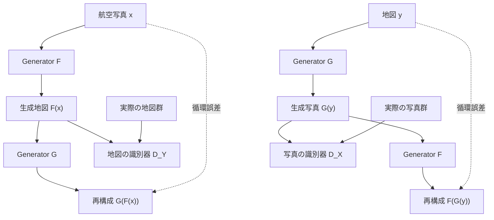

# 第2章：CycleGANとCycle Consistency Loss

作成日：2026-11-15 / 更新日：2026-11-15

## 対応ペアがなくても画像を変換する

通常、ある航空写真とそれに対応する地図の組が学習データとして分かっていれば、「この入力ならこの地図が正解」という教師信号を与えられる。一方、CycleGANは、航空写真の集合と地図の集合が別々に与えられ、対応関係が未知でも画像間変換を学習できるよう設計された。[Zhu et al., 2017](https://arxiv.org/abs/1703.10593)

この仕組みでは、2つのGeneratorを学習する。

- \\(F:X\to Y\\)：航空写真の画像領域 \\(X\\) から地図の画像領域 \\(Y\\) へ変換する。
- \\(G:Y\to X\\)：地図の画像領域 \\(Y\\) から航空写真の画像領域 \\(X\\) へ変換する。

同時に、出力がそれぞれの画像分布らしく見えるかを判定する2つのDiscriminatorも学習する。

図では読みやすさのため、共有されるGenerator \\(F,G\\) を上段と下段に重複して描いている。**2組の別々のGeneratorがあるわけではない**。2つのDiscriminatorは、それぞれの領域の画像分布らしさを判定する。

## 「地図らしさ」と「元画像への復元」の両立

Generatorの学習には、大きく2種類の目的がある。

**第1に、敵対的損失（Adversarial Loss）。** 生成画像が、対象領域の本物の画像に見えるようにする。これだけでは、入力の道路配置と出力地図の道路配置が意味的に一致する保証はない。

**第2に、循環一貫性損失（Cycle Consistency Loss）。** 変換してから元へ戻したとき、入力とできるだけ一致するようにする。

代表的な形は次式である（\\(\|\cdot\|_1\\) は画素ごとの絶対差の総和）。

\\[
\\mathcal{L}&#95;{\\mathrm{cycle}}(F,G)
= \\mathbb{E}&#95;{x\\sim p_X}\\left[\\|G(F(x))-x\\|&#95;1\\right]
\\quad + \\mathbb{E}&#95;{y\\sim p_Y}\\left[\\|F(G(y))-y\\|&#95;1\\right].
\\]

最適化する目的は概略として、

\\[
\\mathcal{L}&#95;{\\mathrm{total}}
= \\mathcal{L}&#95;{\\mathrm{GAN}}(F,D_Y)
\\quad + \\mathcal{L}&#95;{\\mathrm{GAN}}(G,D_X)
\\quad + \\lambda\\mathcal{L}&#95;{\\mathrm{cycle}}(F,G).
\\]

ここで \\(\lambda\\) は循環一貫性を重視する度合いを調整する係数である。\\(\mathcal{L}_{\mathrm{GAN}}\\) はDiscriminatorとの敵対的学習を表す項であり、式はGenerator側から見た目的を概略的にまとめている。元のCycleGANにはIdentity Lossなどの追加項を採用する選択肢もある。ここでは情報隠蔽に直接関わる2種類の損失に焦点を絞る。

## 失われるべき情報まで戻すように求めている

ここに不整合が潜む。

航空写真を普通の地図にすれば、屋根の模様や車の位置は捨てられる。ところが循環一貫性損失は、そうした細部も含めて \\(G(F(x))\\) を \\(x\\) に近づけるよう圧力をかける。しかも、敵対的損失は生成地図の**画像分布らしさ**を評価するが、各画素の微小変化が意味的に正しい地図情報だけを表すよう明示的に要求しているわけではない。

したがって、Generatorには次の2つを両立させる方法を探索する余地がある。

1. 人間やDiscriminatorには地図らしく見える画像を作る。
2. 復元器 \\(G\\) には元の写真の細部を伝える。

後者の情報は、道路や建物の意味的な表現に限って載せなければならない、という制約がない。そこで見えにくい画素変動が情報経路になり得る。もちろん敵対的損失に制約がまったくないわけではない。重要なのは、実験したモデルのDiscriminatorと学習条件では、その微小信号が十分に抑制されなかったことだ。

CycleGANは「隠れたメッセージを作れ」とプログラムされたわけではない。**損失関数を下げる解の中に、人間が想定していなかった情報表現が存在した**のである。

## 成功した学習と、成功した意味変換は別物

循環一貫性が小さいことは、変換を往復した際の再構成誤差が小さいことを示す。しかし、生成された地図が意図した「地理情報の抽象表現」であることまで自動的に証明しない。

たとえば、同じ枚数の航空写真と地図からなる有限の学習集合だけを考える。すべての写真を、**任意に並べ替えた**地図へ1対1に対応付け、逆変換で元の写真へ戻す仕組みでも、学習集合上の往復誤差は0にできる。出力が本物の地図の集合に属していても、個々の道路や建物の対応が正しいとは限らない。これは**意味的対応の識別不能性を示す思考実験**であり、元論文のCycleGANが実際にこの置換を学習したという意味ではない。

つまり問題は2層ある。**（1）往復できても意味が一致するとは限らないこと、（2）往復に必要な情報を中間画像の微小信号へ逃がせること。** 後者が、次章で見るステガノグラフィーの発見である。

**出典**：[Zhu et al., 2017, CycleGAN原論文](https://arxiv.org/abs/1703.10593)、[Chu et al., 2017, §1](https://arxiv.org/html/1712.02950v2)。

[前章](01-the-missing-information.md) ｜ [次章：地図に埋め込まれた高周波信号](03-hidden-information.md)
