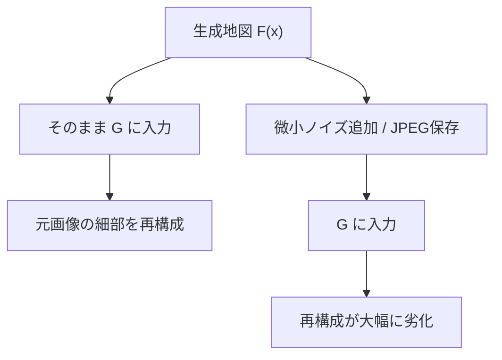

# 第3章：地図に埋め込まれた高周波信号

作成日：2026-11-15 / 更新日：2026-11-15

## 見えない信号は本当に復元に使われていたのか

第1章で見た「地図に描かれていない細部が復元された」という事実だけなら、ネットワークの強い生成能力で説明できるかもしれない。そこでChuらは、生成した地図 \\(F(x)\\) に人工的なノイズを加え、復元器 \\(G\\) の出力がどう変わるか調べた。[Chu et al., 2017, §3](https://arxiv.org/html/1712.02950v2)

この介入実験は画像の見た目を観察するより一歩踏み込む。地図の意味的構造をほぼ変えない摂動が復元を大きく変えるなら、復元器が微細な画素信号に依存している疑いが強まる。ただし、その感度は一般的な入力脆弱性でも生じ得るため、単独では情報隠蔽を証明しない。

ノイズ感度は、埋め込まれた符号の内容や容量を直接測る指標ではない。実際の地図との対照比較については第6章で検討する。

## ノイズ付加実験

著者らは、ノイズを加える前後の再構成の差を測る指標を次のように定義した。

\\[
V=\\mathbb{E}&#95;{x,z}\\big[\\|G(F(x)+z)-G(F(x))\\|&#95;1\\big].
\\]

\\(z\\) は人工的に加えたノイズである。実験ではガウスノイズの振幅（標準偏差 \\(\varepsilon\\)）と空間相関（\\(\sigma\\)）を変え、50枚の航空写真にわたって評価した。\\(V\\) が大きいほど、復元器の出力がノイズに影響されたことを意味する。**重要なのは、\\(V\\) が「ノイズなしの再構成」と「ノイズありの再構成」の距離であって、元画像 \\(x\\) を正解とした復元誤差ではない点だ。** したがって、\\(V\\) の上昇だけで「正解画像から何画素分遠ざかったか」や、隠された情報量を直接測ることはできない。

原論文の[Figure 3](https://arxiv.org/html/1712.02950v2)は、次の傾向を示している。

| 操作 | 原論文の観測 | 読み取れること |
| --- | --- | --- |
| 空間的に独立した小振幅のガウスノイズを加える | 標準偏差が約 \\(3/256\\) に達すると、実験で観測された \\(V\\) の飽和値に近づいた | 見た目には目立たない微細な変動が復元を大きく左右する |
| ノイズの空間相関を高める | \\(\sigma\\) が約2以上になると \\(V\\) が小さくなった | 低周波の変化より、高周波成分の攪乱に敏感だった |
| 生成地図をJPEG形式で保存する | 著者らは再構成が壊れたと報告 | 高周波・小振幅成分が再構成に重要であることを補強する |

画素値を0〜1程度に正規化した表現で、\\(3/256\\) は8-bit画素スケールの約3階調に相当する**ノイズ標準偏差**であり、全画素を一様に3階調ずらした実験ではない。**「3階調しか変わらないのだから常に不可視」という意味ではない**が、画像全体の大きな構造を変えずに再構成が崩れることが重要である。

また、ここでの \\(\sigma\\) はノイズ生成時の空間的な平滑化・相関のパラメータであり、確率変数の一般的な標準偏差の記号と単純に同一視しない。原論文は \\(\varepsilon\\)（振幅）と \\(\sigma\\)（空間相関）を別々に操作しており、ノイズの「強さ」と「周波数特性」を区別した点が重要である。

## 3種類の証拠を組み合わせる

一連の実験は、それぞれ別の問いに答えている。

| 証拠 | 分かること | これだけでは分からないこと |
| --- | --- | --- |
| Figure 1：再構成の細部が入力に一致 | 中間地図の見た目では説明しにくい精密な再現が起きた | その細部がどこに保持されたか |
| Figure 2：高周波成分を強調すると生成地図に変動が見える | 生成地図に通常の地図と異なる微細信号が含まれる | 微細信号が再構成に実際に必要か |
| Figure 3：微小なノイズ・JPEGで再構成が変化する | 復元器が入力の微小変化に強く依存すること | 信号の正確な符号形式・総情報量、正解画像に対する誤差の大きさ |

重要なのは、**細部の再現・微細信号の可視化・周波数に応じた感度・目標画像への誘導**を合わせて読むことだ。ノイズへの感度だけなら、隠蔽がなくても入力に脆弱な復元器で起こり得る。単一の結果ではなく、複数の介入と観測の整合性が本研究の説得力を支えている。

## JPEGで保存すると復元はどう変わるか

生成地図を非可逆JPEG形式で保存してから復元器へ渡すと、再構成が大きく損なわれたと著者らは報告した。JPEG保存は、見た目の地図をおおむね保ちながら微細な画素信号を変える**介入操作**として役立つ。ただし、JPEGでは量子化に加えて色変換や丸めなども生じ得るため、「高周波成分だけを取り除いた」とは断定できない。

ここでJPEGを取り上げる目的は、画像形式の比較ではない。**生成地図の意味的な見た目が大きく変わらなくても、復元器が依存する信号は変化し得る**という点を確かめるためである。

## 信号は局所的とは限らない

原論文では、航空写真に木を描き足してから地図へ変換し、生成地図の差を調べる実験も行われた。[Figure 4（PDFの3ページ目）](https://arxiv.org/pdf/1712.02950#page=3)。ある局所的な変更に対応する地図画像の差は、その場所の周辺だけでなく広い範囲に現れた。ただし、**差分が広範囲に現れることと、その全画素が復元に必須であることは別**である。論文の脚注では、離れた位置の差分をマスクしても木を復元できたと報告している。

著者らは、2か所に追加した木に対応する地図の摂動を組み合わせた際、再構成画像にも両方の木が現れることを確認した。これは、少なくとも実験した入力と摂動の範囲では、復元器 \\(G\\) の応答が近似的に線形に振る舞い得ることを示唆する。一方、同じ摂動を無関係な別画像に加えても、必ず木を生成できるわけではない。**どの入力にも通じる独立した「木のコード」が見つかったわけではない**点に注意したい。

ここで「ネットワークが人間の設計した透かし方式と同じ符号化を学習した」とまでは言えない。符号形式や容量が特定されたわけではないためだ。それでも、**画像の見た目とは異なるレベルで情報が運ばれている**ことを示す証拠として十分に印象的である。

## 原論文が示した範囲

Figure 4の編集実験とFigure 5の目標画像への誘導実験も含め、原論文は**復元器が見えにくい信号を利用する**という説明を支持している。一方、ビット列の内容や総符号容量を測定したものではなく、別のデータや学習条件で同じ振る舞いが必ず生じると示したものでもない。

次章では、なぜ「地図らしく見せながら、地図が捨てるはずの情報まで維持する」解法が、最適化上魅力的だったのかを情報理論から考える。

**出典**：[Chu et al., 2017, §3, Figures 3–4](https://arxiv.org/html/1712.02950v2)。

[前章](02-cycle-consistency.md) ｜ [次章：情報理論で考える「隠すこと」の合理性](04-information-theory.md)
