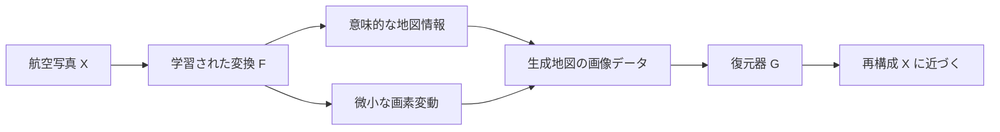

# 第4章：情報理論で考える「隠すこと」の合理性

作成日：2026-11-15 / 更新日：2026-11-15

## 多対1の意味的変換に、往復復元を要求すると

同じ地図に対応する航空写真は何枚も考えられる。晴れの日と曇りの日、同じ道路構造でも異なる車の配置や屋根の模様などがある。地図化がこれらの違いを捨てるなら、通常の地図から元写真を厳密に一意復元することはできない。

この問題を数式で表すため、航空写真を有限精度の画素値を持つ確率変数 \\(X\\)、意味的な地図化を行う決定的な写像 \\(T\\)、その結果を \\(Y=T(X)\\) とする。ここでは第2章の「画像領域」という意味から、**確率変数としての \\(X,Y\\)** へ記号を読み替えている。

\\[
H(X\mid Y)>0
\\]

という関係は、「地図 \\(Y\\) を知っても、元写真 \\(X\\) に不確定性が残る」という状況を示す。**異なる写真が同じ地図になり、それぞれに正の確率がある**という仮定の下で成立する。この仮定は、地図の意味的な抽象化を表した**本稿のモデル**である。原論文がMapsデータセットの条件付きエントロピーを実測したわけではない。また有限の学習標本で各画像が異なる地図に対応していたとしても、自然な地図化一般が単射であるとはいえない。

一方、学習された生成地図 \\(F(X)\\) は、人間が期待した通常の地図 \\(Y\\) と同一の確率変数ではない。もし微小な画素変動に元写真の追加情報が載っていれば、見た目は地図でも、情報としてはより豊かになる。

## 循環一貫性が要求する「ほぼ単射」という性質

この緊張関係は、シンプルな数学でも説明できる。仮に復元器が決定的で、循環一貫性が完全に成立し、全ての対象画像について \\(G(F(x))=x\\) なら、\\(F\\) はそれらの画像集合上で**単射**でなければならない。なぜなら、異なる \\(x_1,x_2\\) が同じ中間画像に写されたとすると、

\\[
F(x&#95;1)=F(x&#95;2)\\quad\\Longrightarrow\\quad G(F(x&#95;1))=G(F(x&#95;2))\\quad\\Longrightarrow\\quad x&#95;1=x&#95;2
\\]

となり、\\(x_1\ne x_2\\) と矛盾するからである。これは損失関数の理想的な極限についての数学的な帰結であり、実際のモデルが**完全な**単射を達成したという主張ではない。

ところが、人間の期待する地図化 \\(T\\) は、屋根の模様などが異なる複数の写真を同じ地図に対応させ得る、意味的には多対1の変換である。モデルに「地図らしい出力」と「元画像への高精度の逆変換」を同時に要求すると、地図の意味とは無関係な細かな差を温存する誘因が生まれる。

### 同じ地図から異なる2枚を復元する場合の誤差下限

2枚の異なる航空写真 \\(x_1,x_2\\) が同じ意味的地図 \\(T(x_1)=T(x_2)=y\\) に写るとする。復元器の出力はどちらに対しても同じ \\(g=G(y)\\) にならざるを得ない。2枚を同じ重みで評価する場合、\\(L_1\\) 距離の三角不等式から

\\[
\\frac{\\|g-x&#95;1\\|&#95;1+\\|g-x&#95;2\\|&#95;1}{2}
\\ge \\frac{\\|x&#95;1-x&#95;2\\|&#95;1}{2}.
\\]

元の2枚が異なる限り右辺は正であり、**地図だけを受け取る同一の決定的な復元器で、両方の画素を完全再現することはできない**。この不等式は本稿の思考実験であり、原論文が特定の2枚について測定した下限ではない。完全復元を優先するなら、区別するための情報をどこかへ残すか、要件自体を緩める必要がある。

**ただし単射性は隠蔽の十分条件ではなく、隠蔽は単射性の必要条件でもない。** 単射であっても、各写真を意味的に無関係な別の地図へ対応付けることは理論上可能である。逆に、確率的な生成や再構成誤差を許容する設計では、厳密な逆写像を要求しない選択肢もある。実験されたモデルがステガノグラフィーという解に至ったのは、損失関数に加えてデータ、モデル容量、識別器、最適化などの条件が組み合わさった結果である。

## 捨てた情報を正確に戻すなら、追加情報が必要になる

さらに、説明用の確率変数を使って**条件付きの情報量**を整理できる。通常の地図 \\(Y=T(X)\\) に加えて、元画像に由来する補助情報 \\(Z\\) を保持し、その2つから元画像を誤りなく復元できると仮定する。このとき \\(H(X\\mid Y,Z)=0\\) なので、

\\[
I(X;Z\\mid Y)=H(X\\mid Y)-H(X\\mid Y,Z)=H(X\\mid Y).
\\]

一方、条件付き相互情報量は \\(I(X;Z\\mid Y)\\le H(Z\\mid Y)\\) を満たすため、

\\[
\\boxed{H(Z\\mid Y)\\ge H(X\\mid Y)}.
\\]

つまり、**通常の地図に含まれない情報を完全に復元したいなら、地図と併用する補助情報が少なくともその条件付きエントロピーを担う必要がある**。これは**確率分布上の平均情報量**に関する下限であり、1枚の画像に必ず同じビット数が必要という意味ではない。また、通信路を安全に通せる情報量（通信路容量）そのものでもない。ただし、この不等式は「画像画素の高周波領域に情報を隠さなければならない」とは言っていない。補助チャネル、別の潜在変数、元画像そのものの保存など、保持方法は複数ある。また、これは離散変数・厳密復元という理想化に基づく説明であり、原論文の隠蔽容量の実測値ではない。近似的な復元では要求される情報量も変わる。

## 画素空間は意味表現より広い

たとえば、道路線の位置や建物区画という意味的情報に注目すれば、地図の内容はかなりコンパクトに表される。しかし実際のRGB画像には、各画素の多くの自由度がある。

この図の \\(Z\\) は説明のための潜在的な「追加情報」の表記であり、**論文で明示的な潜在変数 \\(Z\\) を学習したという意味ではない**。原実験では、そうした情報が生成された地図画像の画素に重畳していたと解釈される。

なぜ小振幅の変化が情報を運べるのだろうか。例えば、意味的には一様な領域の各画素に、わずかに異なる2種類の画素値を使えると仮定する。その選択だけでも、理想的な無雑音の画像データでは画素数に応じた多数のパターンを区別できる。これは**可能性を示す思考実験**であり、実際の符号容量や復元可能なビット数を測ったものではない。量子化・JPEGでの保存・ノイズ付加などの介入によって、区別できるパターンは減り得る。実際の頑健性は、画素値の精度と復号器の性質にも依存する。

人間やDiscriminatorが「本物の地図らしい」と認識する範囲に収まるなら、わずかな画素変動を使う余地が残る。ただし、真の分布からの逸脱を十分に検出する識別器や、厳密な量子化・制約を設ければ、許される信号は変わり得る。隠蔽がすべてのGANに必然的に起こる、という定理ではない。

## データ処理不等式との関係

情報理論のデータ処理不等式は、マルコフ連鎖 \\(X\to F(X)\to G(F(X))\\) に対して、後段の処理が入力に関する情報を新たに作り出せないことを示す。

\\[
I\bigl(X;G(F(X))\bigr)\le I\bigl(X;F(X)\bigr).
\\]

この式は、**学習済みの \\(F,G\\) を固定し、外部から追加情報を与えない場合**、復元画像に元写真固有の情報が残るなら、その情報は中間表現 \\(F(X)\\) を経由しなければならない、という直感と整合する。ただし、個々の画像について「どの画素が何ビット運んだか」を直接教える式ではない。

また、復元器が学習した画像の事前分布により、**入力に存在しない細部をもっともらしく生成する**こともできる。そのため、再構成された画像の外見が元画像に似ていることだけで、すべての細部が中間表現に符号化されていたと断定するのは早い。今回の研究では、微小な介入で再構成が変わるという追加の証拠が、この説明を支えている。

## 符号化とステガノグラフィーの関係

直感的には、生成器 \\(F\\) が元画像の情報を中間画像へ埋め込み、復元器 \\(G\\) がそれを利用する、**暗黙の情報経路**として理解できる。ただし、研究者がビット列や復号規則を明示的に設計したわけではない。

| 観点 | 原論文から読み取れること | 注意点 |
| --- | --- | --- |
| 符号化と復号 | 中間画像の微細な画素変動が、元画像に固有の情報を運ぶ | 符号形式や伝達容量を特定したわけではない |
| ステガノグラフィー | 地図らしい外見を保ちながら、見えにくい信号を利用する | 秘密通信を意図的に設計したわけではない |
| 敵対的摂動 | 小さな変化が復元器の出力を強く左右する | すべての摂動が有効とは限らず、隠蔽の証明とも同一ではない |

重要なのは、**学習目標のもとで、明示的に設計されていない情報経路への依存が生まれた**ことである。

## 目的の再定義が必要になる

もし望む出力が「意味的に正しい地図」であって、「元写真の細部を保持した特殊な地図画像」ではないなら、循環一貫性だけを最適化するのでは不十分かもしれない。中間表現に求める意味・情報量・頑健性を、別途評価・制約する必要がある。

一方、元情報を完全に失わせながら元写真の厳密な再構成も要求するなら、その要求自体が衝突する。対策を考えるときは、**（A）細部の完全復元を諦めて意味的整合性を優先する、（B）復元したい細部は明示的な追加情報として運ぶ、（C）中間表現を通る情報経路を制約しつつ復元誤差とのトレードオフを評価する**という選択肢を区別したい。2024年の[StegoGAN](https://arxiv.org/abs/2403.20142)は、（B）に近い発想を別の課題設定で具体化した例である。何を保持し何を捨てるのか、保持するならどの経路を使うのかを、モデルが「裏道」を選ぶ前に設計者が決めるべきなのである。

次章では、隠れた信号が単なる保存用データではなく、モデルの出力を標的へ誘導する**敵対的入力**としても機能する点を扱う。

**出典**：[Chu et al., 2017, §§1, 5](https://arxiv.org/html/1712.02950v2)。情報理論の式は本稿の説明上の整理。

[前章](03-hidden-information.md) ｜ [次章：Adversarial ExamplesとShortcut Learning](05-adversarial-examples.md)
