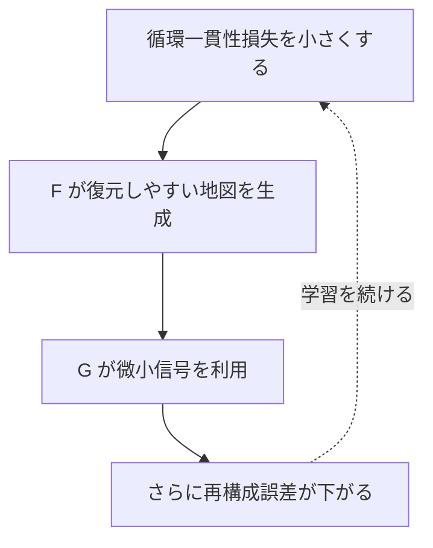

# 第5章：Adversarial ExamplesとShortcut Learning

作成日：2026-11-15 / 更新日：2026-11-15

## 小さな摂動が、復元器に大きな作用を及ぼす

敵対的サンプル（Adversarial Example）という言葉は、画像分類器に対して、人間には目立たない画像の変更で誤分類を起こす事例として知られている。しかし、小さな入力変化への過敏さは分類器に限らない。

CycleGANの情報隠蔽を調べたChuらは、地図から航空写真を生成する復元器 \\(G\\) に対し、**出力を任意の目標航空写真へ近づけるように地図画像そのものを最適化する**実験を行った。[Chu et al., 2017, §4](https://arxiv.org/html/1712.02950v2)

具体的には、元の地図 \\(y_0\\) から出発し、目標画像 \\(x^{\\ast}\\) に対して次のような最適化を行う。**「任意の目標写真へ誘導できる」という著者らの主張は、この条件での実験結果に基づくもので、あらゆるモデル・画像に対する普遍的な保証ではない。**

\\[
y^{\\ast} = \\arg\\min&#95;{y} \\|G(y)-x^{\\ast}\\|.
\\]

この式には元の地図からの距離を小さくする正則化項は明示されていない。**\\(y_0\\) を初期値として勾配降下を行った結果**、得られた \\(y^{\\ast}\\) は元の地図と視覚的にはほとんど区別できない小さな差を持つにもかかわらず、\\(G(y^{\\ast})\\) は目標画像 \\(x^{\\ast}\\) に近い航空写真を出力した。原論文の[Figure 5（PDFの4ページ目）](https://arxiv.org/pdf/1712.02950#page=4)では、異なる2枚の地図から同じ目標航空写真を生成している。

## CycleGANの学習自体を「協調的な攻撃」と見る

一般的な敵対的攻撃では、通常は固定されたモデルに対して入力を細工する。一方CycleGANでは、\\(F\\) と \\(G\\) の両方が学習される。\\(F\\) は \\(G\\) が元写真を復元しやすい地図を作り、\\(G\\) はそのような地図を読み取りやすくなる。

著者らは、敵対的な地図を作るのに必要な摂動の大きさが学習とともに小さくなることも報告した。これは、復元器が偶然だけで脆弱になったのではなく、循環一貫性を満たすために両Generatorが相補的な振る舞いを獲得した、という解釈を支える。

「攻撃」という言葉はここでは数理的なアナロジーであり、モデルが攻撃者として自律的な意図を持っていたという意味ではない。**固定された復元器への入力最適化（Figure 5）**と、**学習中の2つのGeneratorの相互適応**も同一の実験ではない。

## Shortcut Learningとの関係

2020年、Geirhosらは *Shortcut Learning in Deep Neural Networks* で、標準的なベンチマークでは成功しても、条件が変わると通用しない近道のような規則を学習する問題を整理した。[Geirhos et al., 2020](https://arxiv.org/abs/2004.07780)

CycleGANの例は、この概念と響き合う。設計者が期待したのは地理的な特徴を通じた変換だが、実際には中間画像の微細な信号を経由する近道が学習された。ただし、CycleGANでは\\(F\\) が信号を作り \\(G\\) が読むため、外部データに最初から存在する偶然の相関へ依存する典型的なShortcut Learningとは機構が異なる。

両研究で共通するのは、「学習された成功規則が、人間の期待した因果的・意味的手掛かりとずれ得る」という構造であって、同じメカニズムが働いたと証明したわけではない。

## 見た目の正しさだけでは足りない

CycleGANの生成地図は視覚的に地図らしい。それでも、微小な高周波信号を壊すと後段の再構成は大幅に変わる。これにより、次の評価は分けて考える必要がある。

| 評価したい対象 | 単なる見た目の評価では分からないこと |
| --- | --- |
| 意味的な正しさ | 道路・建物が入力と整合しているか |
| 中間表現の適切さ | 見えない符号化に依存していないか |
| 頑健性 | 保存・再符号化・ノイズで後段の処理が壊れないか |
| 一般化 | 未知の入力や分布変化に耐えられるか |

もちろん「高周波信号をすべて消せばよい」という単純な話ではない。元のタスクによっては高周波成分こそ正当な情報であり、除去によって画質や細部が損なわれる。必要なのは**どの情報経路を許可し、何を保存すべきかを定義すること**である。

## 防止策を考えるための視点

原論文は、隠れた変数・追加チャンネルを明示的に用意し、元写真の余剰情報を視覚的な地図画素とは別に運ぶ可能性に言及している。ただし、それは当該論文で完成・検証された万能な防御策ではなく、将来の研究方向として提案されたものだ。[Chu et al., 2017, §5](https://arxiv.org/html/1712.02950v2)

この方向性は後の応用研究でも具体化された。以下の研究は、同一手法の段階的改良ではない。2019〜2023年の研究は不要な情報経路の**抑制**を主に扱い、2024年の研究は問題となる情報を**明示的な別経路で保持する**方向も示している。

### 2019年：循環経路にデノイザを挟む

**Poravら（2019）**は、昼景から夜景への画像変換において、2つのGeneratorの間に微分可能な画像デノイザを挟み、高周波の隠蔽信号に依存しにくくする方法を提案した。[Porav et al., 2019](https://openaccess.thecvf.com/content_CVPRW_2019/papers/Vision%20for%20All%20Seasons%20Bad%20Weather%20and%20Nighttime/Porav_Reducing_Steganography_In_Cycle-consistency_GANs_CVPRW_2019_paper.pdf)

### 2022年：学習中のセグメンテーション表現にノイズを入れる

**LöhdefinkとFingscheidt（2022）**は、道路シーンのセグメンテーションで、循環経路の中間的なセグメンテーション表現へガウスノイズや量子化ノイズを加え、情報隠蔽に由来するウォーターマークを減らす方法を検討した。これは、単に学習後の画像を壊すのではなく、**学習時に近道の情報経路を使いにくくする**方向の試みである。著者らはCityscapesの検証集合におけるmIoUがノイズ注入なしの対応するCycleGANに対して**絶対値で5.7パーセントポイント向上**したと報告している。ただし、これは特定のモデル構成・データにおける比較であり、Utzら（2023）のF1改善幅と数値だけで大小を比較できない。[Löhdefink & Fingscheidt, 2022](https://arxiv.org/abs/2201.06415)

### 2023年：DCTフィルタで隠れた信号を抑える

**Utzら（2023）**は、細胞核のマスクと蛍光顕微鏡画像の変換において、DCT（離散コサイン変換）に基づくローパスフィルタを循環経路に組み込んだ。**生成画像と循環後のマスク（cycled mask）の整合性**を改善し、それらを組にした合成データで学習した細胞核セグメンテーションの評価では、通常のCycleGANに比べ**F1スコアが5.4パーセントポイント向上**したと報告している。著者らは、**元の入力マスクと生成画像の不一致が完全に解消したわけではない**ことも明記している。改善はその研究のデータ・実験設定における結果であり、任意のCycleGANタスクで同じ改善が得られるという意味ではない。[Utz et al., 2023](https://arxiv.org/abs/2308.01769)

### 2024年：情報を捨てず、明示的な特徴空間へ移す

**WuらのStegoGAN（CVPR 2024）**は、非全単射（non-bijective）な画像間変換で、2つの領域に対応しない意味クラスがある場合を扱った。画像内の微小信号へ情報を隠すことを単に禁止するのではなく、**対応しない情報を特徴空間の明示的な経路へ分離する**構成を採用し、変換結果に本来ない物体が生成される問題を抑制することを狙った。[Wu et al., 2024](https://arxiv.org/abs/2403.20142)、[CVPR公式公開版](https://openaccess.thecvf.com/content/CVPR2024/html/Wu_StegoGAN_Leveraging_Steganography_for_Non-Bijective_Image-to-Image_Translation_CVPR_2024_paper.html)

**情報の保存自体が悪いわけではない。** 元のCycleGANでは、通常の地図として使う画素列へ、仕様化されていない復元用信号が重畳した。StegoGANは、対応しない情報を明示的な特徴空間の経路で扱うという別解を示す。これは2017年の研究と同一の実験条件で優劣を比較したものではなく、別の課題設定での設計上の発展である。

### 再構成誤差と下流性能のトレードオフ

これらは、2017年の発見が**後段タスクに使う生成データの妥当性**と、**保持すべき情報をどの経路に置くか**という設計問題につながった例である。ここで逆説的なのは、**隠蔽を減らすことで往復の画素一致は悪化し得る一方、目的の下流タスクには有益になり得る**ことだ。2019年の論文も、改良版では元画像を正確に再構成できなくなることを、隠れた情報に頼らなくなった結果として説明している。**その再構成劣化だけで抑制策の成否を判断せず、下流タスクも測る**という評価の転換が重要である。

ただし、デノイザやローパスフィルタは正当な高周波情報も削り得る。したがって、復元誤差だけでなく、画像の意味整合性、知覚品質、下流タスクの性能を併せて評価する必要がある。

重要なのは、損失関数の値だけでなく、モデルがどの経路に依存して予測・生成しているかを試すことである。次の最終章では、これを現代のLLMやAIエージェントの評価設計へ接続する。

**出典**：[Chu et al., 2017, §§3–5](https://arxiv.org/html/1712.02950v2)、[Porav et al., 2019](https://openaccess.thecvf.com/content_CVPRW_2019/papers/Vision%20for%20All%20Seasons%20Bad%20Weather%20and%20Nighttime/Porav_Reducing_Steganography_In_Cycle-consistency_GANs_CVPRW_2019_paper.pdf)、[Geirhos et al., 2020](https://arxiv.org/abs/2004.07780)、[Löhdefink & Fingscheidt, 2022](https://arxiv.org/abs/2201.06415)、[Utz et al., 2023](https://arxiv.org/abs/2308.01769)、[Wu et al., 2024](https://arxiv.org/abs/2403.20142)。

[前章](04-information-theory.md) ｜ [次章：約10年を経ても変わらない教訓](06-objective-hacking.md)
