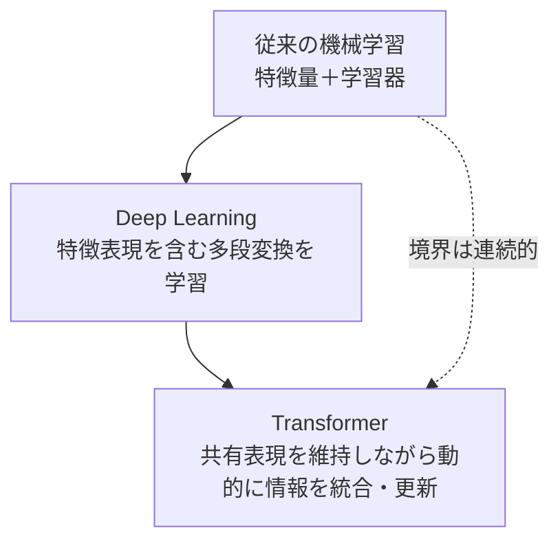

# はじめに：Deep Learningは何を変えたのか

作成日：2026-10-12 / 更新日：2026-10-12

> **Deep Learningの転換点は「より高度な分類器が登場した」ことだけではない。データをどう表現するかという問題そのものが、学習の対象になったことにある。**

「Deep Learningはパターン照合だ」「大量の学習データのコピーだ」「確率的にそれらしい文字列を出すだけだ」。こうした説明には、それぞれ部分的に正しい側面がある。しかし、学習手段・モデルの構造・推論時の計算・獲得した能力を一つの説明に押し込めると、Deep Learningの重要な変化を見失う。

本書は、Deep Learningを**統計的な最適化で獲得される、パラメータ化された非線形変換系**として捉え直す。さらに、データの内在構造を考える**多様体仮説**と、Transformerの**Residual Stream（情報の主経路）**という二つの視点をつないで考察する。

## 三つの技術段階、二つの大きな転換

ここで三つと数えているのは**技術の段階**であり、大きな転換点としては「表現のend-to-end学習の普及」と「Attentionを中核とする汎用ブロックの普及」の二つを扱う。TransformerもDeep Learningの一種である。また、表現学習やAttention、残差接続自体はそれぞれの時代より前から研究されていた。変化は突然の発明というより、既存技術の組み合わせが実用上の主流を変えたことにある。

この図は、旧来の技術を否定する「置換の歴史」ではない。決定木やSVMは今も有力であり、CNNやRNNも現役だ。むしろ、何が学習の対象になり、何をアーキテクチャに固定し、何を入力に応じて変えられるようになったのか、という**設計思想の移り変わり**に注目する。

| 時期の代表例 | 重視する仕組み | 人間が主に設計するもの | 学習するもの |
| --- | --- | --- | --- |
| 決定木・SVM・ベイジアンネットワーク | 入力特徴上の規則、境界、依存関係 | 特徴量、モデル族、制約・構造の一部 | 分割、境界、確率パラメータなど |
| CNN・RNN | データに応じた多層表現 | 畳み込み・再帰などの帰納バイアス | 特徴抽出と予測を含む変換 |
| Transformer | トークン間の動的な情報統合と反復更新 | Attention、FFN、残差経路、正規化など | 共通表現に対する更新の仕方 |

## 本書の主張と、その限界

- **確立した事実**：ニューラルネットワークは、学習済みパラメータを持つ非線形関数を実現する。多層の変換は誤差逆伝播などで最適化できる。
- **支持されている見方**：中間表現の幾何、内在次元、変動要因の分離は、学習や汎化を理解する助けになる。
- **解釈・仮説**：「知能の中心的な要素を非線形幾何変換系として理解する」という立場は有用だが、知能のすべてが説明されたことを意味しない。

「幾何変換」は、回転や平行移動のような距離を保つ変換に限らない。高次元表現上の非線形な写像、局所的な伸縮、情報の統合・破棄を含む広い意味で使う。実際、ニューラルネットワーク以外の学習器も幾何学的に解析できるため、**『幾何変換だからDeep Learning』ではない**ことに注意したい。

## 読み進め方

最初に既存の機械学習を正当に評価し、次にDeep Learningの表現学習と多様体仮説を扱う。CNN/RNNからTransformerへの変遷を見たあと、Residual Streamと計算ブランチを数式で詳しく読む。後半では「よくある誤解」を統合し、どこまでが実証でどこからが仮説なのかを整理する。

### 本書でいう「本質」の意味

本書で提示する「統計的手法で最適化された非線形幾何変換系」は、Deep Learningを理解する**統一的な視点**であって、唯一の標準定義でも、汎化や知能の成立を自動的に証明する定理でもない。あらゆる計算は広義の写像として書けるため、説明力の中心は「写像である」ことではなく、**中間表現を多段で共同最適化できること、その表現の幾何がタスク性能に影響すること**にある。ただし、学習の条件によっては特徴表現がほとんど変わらず、カーネル法に近い振る舞いをする場合もある（第2章）。

**関連文献**：[LeCun, Bengio & Hinton (2015), *Deep learning*](https://www.nature.com/articles/nature14539)、[Bengio et al. (2013), *Representation Learning*](https://arxiv.org/abs/1206.5538)。

---

[シリーズ目次](./) ｜ [次章：従来の機械学習 →](01-classical-machine-learning.md)
