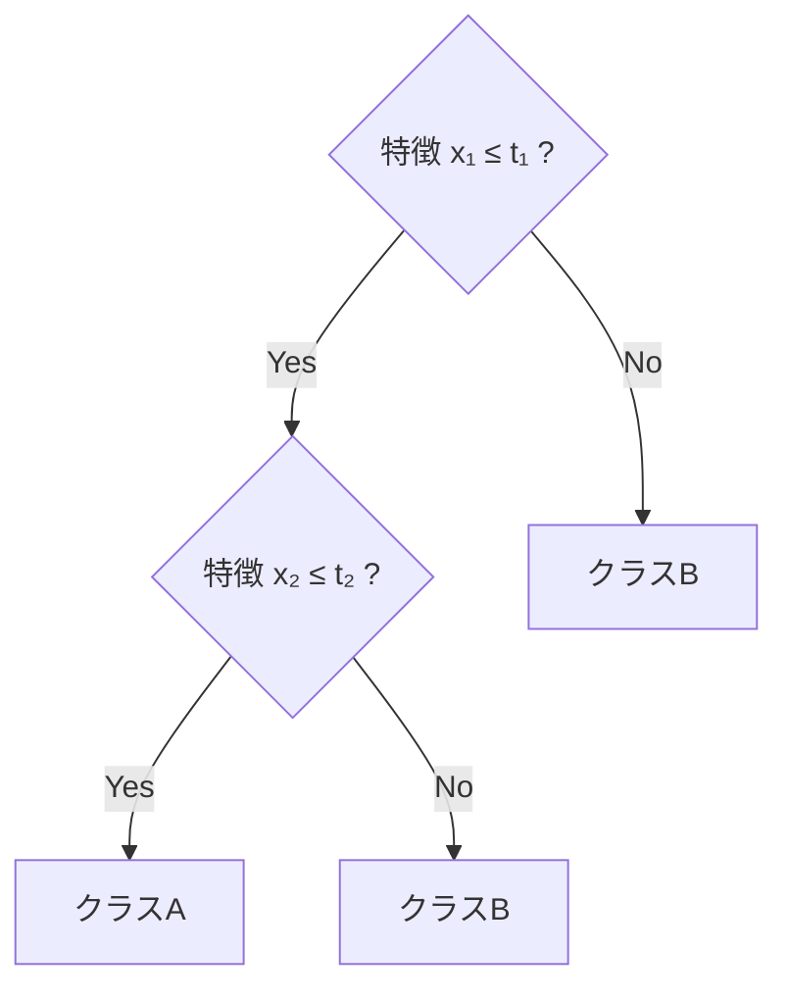
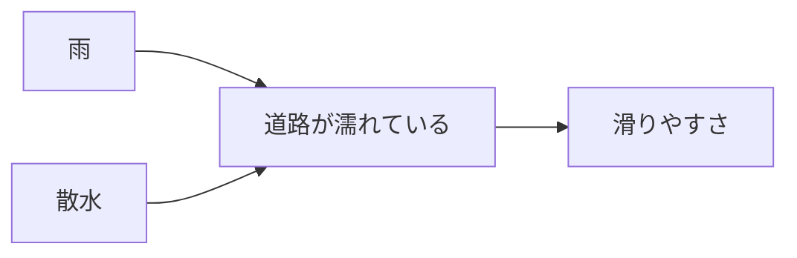

# 第1章 従来の機械学習は何を学んでいたのか

作成日：2026-10-12 / 更新日：2026-10-14

Deep Learning以前の機械学習を「単純なパターン照合」と片付けるのは、歴史的にも数学的にも正しくない。決定木は入力空間を再帰的に分割し、SVMは幾何学的な分類境界を求め、ベイジアンネットワークは確率的な依存関係を扱う。**多様な学習の方法が、すでに存在していた**。

## 1.1 決定木：入力空間を条件分岐で分割する

決定木は「もし特徴量 \\(x_j\\) が閾値 \\(t\\) 以下なら左、そうでなければ右」という分岐を学習する。2次元なら、軸に平行な線で空間を繰り返し分割するイメージである。

分割は学習される。単なる手書きルールではない。ただし、単体の木は軸方向の条件の組み合わせで境界を表し、深さやサンプル数への感度を持つ。[Quinlan (1986)](https://doi.org/10.1007/BF00116251) は決定木の帰納学習を体系化した。

**Random Forest** は多数の木を集約し、予測の分散を抑える働きをする。[Breiman (2001)](https://doi.org/10.1023/A:1010933404324)。**勾配ブースティング決定木（GBDT）** は、損失関数の負の勾配（残差に一致する場合を含む）を木で近似し、予測関数を段階的に更新する。[Friedman (2001)](https://doi.org/10.1214/aos/1013203451)。XGBoostはその考え方を大規模化した実装例である ([Chen & Guestrin (2016)](https://arxiv.org/abs/1603.02754))。いずれも表形式データで有力な選択肢だが、適性はデータや評価条件によって異なる。

## 1.2 SVM：既に幾何学的な機械学習だった

線形SVMは、クラスを分離する超平面

\\[
 w^\top x+b=0
\\]

を、マージンを大きくするように学習する。カーネルSVMでは、特徴写像 \\(\phi(x)\\) に対する内積を

\\[
K(x,x')=\langle\phi(x),\phi(x')\rangle
\\]

として扱い、非線形な境界も実現できる。[Cortes & Vapnik (1995)](https://doi.org/10.1007/BF00994018) の研究自体が、高次元特徴空間への非線形写像を中心に据えている。

判別関数は、例えばサポートベクトルを用いて

\\[
f(x)=\operatorname{sign}\\!\left(\sum_{i\in\mathcal S}\alpha_i y_i K(x_i,x)+b\right)
\\]

と書ける。学習済みモデルは単なるパターン照合ではないが、カーネルを通じた訓練点との関係を推論時に評価する。一般的な深層ネットワークの「入力へ多層写像を適用する」方式とは計算上の構造が異なる。

したがって「古典的機械学習は幾何変換を使わず、Deep Learningで初めて幾何が登場した」は誤りである。

**違いは主として、特徴空間の設計と学習の結合度**にある。一般的なカーネルSVMではカーネル族を事前に選び、そのもとで境界を最適化する。一方、Deep Learningでは多層の特徴写像 \\(\phi_\theta\\) 自体をタスクに合わせて調整できる。ただし、深層カーネル学習のような中間的手法もあり、境界は明確な二分法ではない。さらに、深いネットワークでも学習条件によっては**固定カーネルに近い振る舞い**が現れる（第2章）。

## 1.3 ベイジアンネットワーク：確率的依存を構造化する

ベイジアンネットワークは、有向非巡回グラフ（DAG）によって確率変数の依存関係を記述する。例えば

という因果的に解釈しやすい例を考えられる。ただし**矢印があること自体で因果関係が証明されるわけではない**。通常の確率モデルとしては、グラフに沿った同時分布の分解

\\[
p(x_1,\ldots,x_n)=\prod_{i=1}^n p(x_i\mid \mathrm{Pa}(X_i))
\\]

が重要である。\\(\mathrm{Pa}(X_i)\\) は節点の親集合を表す。構造を専門知識で与える場合も、構造自体をデータから学習する場合もある。基礎として[Pearl (1988)](https://doi.org/10.1016/C2009-0-27609-4) を参照。

**単純ベイズ（Naive Bayes）** は条件付き独立の強い仮定を採用する分類器であり、**ベイジアンネットワーク一般**とは区別したい。

## 1.4 ほかの代表的手法

| 手法 | 学習・推論の中心 | 表現に関する特徴 | 注意点 |
| --- | --- | --- | --- |
| k近傍法（k-NN） | 近い事例から推定 | 距離・特徴量の選択が重要 | 高次元では距離の性質に注意 |
| 線形/ロジスティック回帰 | 線形結合と損失最適化 | 特徴設計が表現力を左右 | 解釈しやすい基準モデル |
| 決定木 | 条件分割 | 空間を再帰的に分割 | 単体木は不安定な場合がある |
| Random Forest/GBDT | 多数の木の集約・逐次加算 | 非線形な特徴相互作用を学習 | 表形式データで有力 |
| SVM | マージン・カーネル | 幾何学的な境界と写像 | カーネル設計とスケールに依存 |
| ベイジアンネットワーク | 条件付き分布と依存関係 | 明示的な変数間構造 | グラフ構造・条件付き確率の仮定が重要 |
| PCA | 分散の大きい線形部分空間 | 教師なしの線形次元削減 | 非線形構造は一般に表現しない |
| HMM | 潜在状態と時間遷移 | 時系列の確率的状態モデル | Markov性などの構造仮定 |

## 1.5 何を人が固定し、何をデータから学ぶか

ここまでの比較を、パラメータ数や「昔／今」という年代だけで整理することはできない。むしろ**帰納バイアス（inductive bias）**、すなわちデータを見る前にモデルへ組み込まれた仮定の違いが重要である。

- 決定木は、入力特徴への段階的な条件分割を仮定する。
- カーネルSVMは、類似性を測るカーネルを通じて決定境界を構成する。
- ベイジアンネットワークは、条件付き独立性をグラフで表現する。
- CNNは局所結合と重み共有を、TransformerはAttentionによる動的な情報統合を主要部品として採用する。

古典手法にも学習可能な特徴表現はあり、深層モデルにも設計者が固定する制約はある。違いは白黒ではなく、**どこを設計し、どこを学習に委ねるか**の比重にある。

## 1.6 「Deep Learning以前は特徴を学ばなかった」は間違い

PCA、辞書学習、クラスタリング、カーネル法、潜在変数モデルなど、特徴や潜在表現を学ぶ技術は以前からあった。従来型の機械学習も幅広く、**明示的な特徴量設計が必須だった**と一括りにできない。

それでも実用上は、画像処理ではSIFT/HOG、音声処理ではスペクトル関連特徴、言語処理ではn-gramなど、手設計の表現と学習器を組み合わせるパイプラインが広く利用されてきた。

従来の主流パターンを単純化すれば、

\\[
x\xrightarrow{\phi_{\mathrm{designed}}}z\xrightarrow{g_\theta}y
\\]

となる。次章で見る変化は、\\(g_\theta\\) だけでなく \\(\phi\\) も学習系の中心へ組み込むことである。

> **比較の要点**：古典的機械学習に幾何や非線形性がなかったわけではない。Deep Learningの転換点は、複雑な表現変換を多層に組み立て、それらを同じ目的関数で大規模に調整できるようにしたことにある。

---

[← 前章：はじめに](00-introduction.md) ｜ [次章：表現学習という転換 →](02-representation-learning.md)
