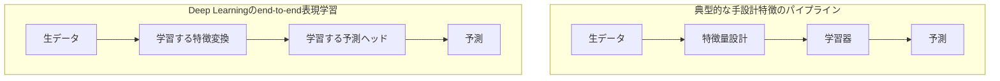

# 第2章 Deep Learningが起こした最初のパラダイムシフト

作成日：2026-10-12 / 更新日：2026-10-12

## 2.1 分類器の改善から、表現の共同最適化へ

典型的なニューラルネットワークでは、特徴抽出と予測を一体として学習する。

\\[
f_\theta(x)=g_{\theta_g}(\phi_{\theta_\phi}(x))
\\]

ここで \\(\phi\\) は特徴を作る関数、\\(g\\) は予測関数だ。学習によって \\(\theta_\phi\\) と \\(\theta_g\\) の双方を調整できる。特徴抽出と予測を一体の目的で訓練する場合、これを **end-to-end learning** と呼ぶことがある。

単なる「入力から出力への近道」ではない。従来、人間が独立に設計していた「どんな特徴を見るべきか」という判断のかなりの部分が、**目的関数に応じて最適化できる対象**になった。

これは傾向の比較であり、従来手法に学習済み特徴がなかったわけでも、Deep Learningで特徴設計が不要になったわけでもない。入力形式、トークナイザ、ネットワーク構造、損失関数などは人間が設計する。

## 2.2 非線形変換を積み重ねる意味

層を \\(h_{l+1}=\sigma(W_lh_l+b_l)\\) と簡略化すると、多層ネットワークは

\\[
f_\theta=f_L\circ f_{L-1}\circ\cdots\circ f_1
\\]

という合成関数になる。線形層だけを合成しても一つの線形写像にまとめられるが、非線形性を挟むことで入力領域ごとに異なる振る舞いを表現できる。

例えば、入力が \\(x_1,x_2\in\{-1,+1\}\\) で、二つの符号が一致するかどうかを分類したいとする。ラベルを \\(y=x_1x_2\\) とすれば、元の二次元入力を一本の直線では分類できない。しかし \\(z=x_1x_2\\) という特徴を追加すれば、

\\[
 y=\operatorname{sign}(z)
\\]

という単純な境界で分離できる。**有用な非線形特徴を作ると、後段の問題が簡単になる**という例である。もちろん、決定木や多項式カーネルSVMでもこの問題は解ける。Deep Learningの特徴は、こうした変換を手動指定しなくても、多層の写像としてタスクと合わせて学習できる点にある。

ただし、**深さが増えれば必ず良い表現を獲得するわけではない**。勾配消失、過学習、計算資源、データ分布などの問題がある。このため活性化関数、正規化、残差接続、学習率設計などの工夫が発展した。

## 2.3 誤差逆伝播は「膨大な変換を調整する」仕組み

損失関数を

\\[
\mathcal{J}(\theta)=\frac1N\sum_{i=1}^N\mathcal L(f_\theta(x_i),y_i)
\\]

とすると、誤差逆伝播は計算グラフの連鎖律を使い、多数のパラメータに対する勾配を効率よく求める。

\\[
\theta\leftarrow\theta-\eta\nabla_\theta\mathcal J(\theta)
\\]

これは勾配を計算する仕組みであり、更新にはSGDやAdamなどの最適化法が用いられる。逆伝播が効率的でも、最適解への到達や汎化性能が保証されるわけではない。

こうした表現学習の発想は近年突然生まれたものではない。[Rumelhart, Hinton & Williams (1986)](https://doi.org/10.1038/323533a0) は、逆伝播によって中間層が課題に有用な特徴を獲得することを明示しており、[LeCun et al. (1989)](https://direct.mit.edu/neco/article/1/4/541/5515/Backpropagation-Applied-to-Handwritten-Zip-Code) は画像から分類までを一つのネットワークで学習する事例を示した。2010年代の転換は、原理の発明だけでなく、その**大規模な実用化**でもあった。

学習は統計的なデータからパラメータを調整する処理だが、推論では獲得された関数 \\(f_{\theta^*}\\) を入力へ適用する。**「統計で訓練した」ことと「推論時にデータを単純集計している」ことを混同してはいけない。**

また、勾配を計算できることは目的関数の妥当性を保証しない。学習系が高度でも、データ・報酬・損失の選び方に誤りがあれば、望ましい振る舞いにならない。

## 2.4 パラダイムシフトは、三つの技術の組み合わせだった

1. **表現を学習するアーキテクチャ**：CNN/RNNなどが画像や時系列に適した帰納バイアスを与える。
2. **勾配ベースの大規模最適化**：深いネットワークのパラメータを共同で更新する。
3. **データと計算資源**：大規模データセット、GPUなどの並列計算基盤が実用性を変えた。

さらに重要なのが、**自己教師あり学習**や事前学習の進展である。正解ラベルをすべて人間が付けなくても、入力の一部を隠す、次を予測する、異なる見え方を整合させるといった目的を通じて、再利用可能な表現を学習できる。自己教師あり学習はTransformer固有ではなく、深層表現学習全体に関わる転換である。

画像分類では[Krizhevsky, Sutskever & Hinton (2012)](https://papers.nips.cc/paper_files/paper/2012/hash/c399862d3b9d6b76c8436e924a68c45b-Abstract.html) のAlexNetが象徴的だった。より広い成果は[LeCun, Bengio & Hinton (2015)](https://www.nature.com/articles/nature14539) がまとめている。

## 2.5 「非線形幾何変換系」という見方

学習済みモデルの働きを一言で整理すれば、**入力を別の表現へ写す非線形関数を、データから最適化して獲得すること**になる。

ただし「写像」という言葉は一般的すぎる。Deep Learningの特徴を述べるには、*多層合成、学習可能な表現、パラメータ共有、最適化、汎化性能*まで含める必要がある。

## 2.6 例外も重要：特徴学習とLazy Training

「Deep Learningは表現を学習する」という説明は、その**能力と代表的な成功要因**を述べたものであり、あらゆる学習で中間特徴が大きく変わるという主張ではない。

実際、非常に幅の広いネットワークと特定のパラメータ化・学習スケーリングの極限では、訓練中の関数変化が初期値周辺の線形化や**Neural Tangent Kernel（NTK）**によって記述され、実質的にカーネル法へ近づく場合がある。[Jacot et al. (2018)](https://papers.neurips.cc/paper_files/paper/2018/hash/5a4be1fa34e62bb8a6ec6b91d2462f5a-Abstract.html)、[Chizat, Oyallon & Bach (2019)](https://arxiv.org/abs/1812.07956)。これを**Lazy Training**の一形態として論じる研究がある。

一方、特徴が訓練によって有意に変化する **feature-learning regime** も研究されており、両者は同一ではない。[Yang & Hu (2021)](https://proceedings.mlr.press/v139/yang21c.html)。この区別は本書の主張を弱めるだけでなく、何が本当の転換点なのかを精密にする。**多段の学習可能な特徴変換を備えること**と、**ある訓練でその特徴変換をどれほど更新するか**は別の問いなのである。

| 観点 | カーネルに近い学習領域 | 特徴学習が強い領域 |
| --- | --- | --- |
| 主な近似 | 初期化近傍の関数・カーネル | 訓練に伴って表現も変化 |
| 中間特徴 | 変化が小さい条件がある | タスクに応じて大きく変化し得る |
| 重要な注意 | 特定の極限・条件の理論 | すべての実モデルで保証されない |

次章では、高次元データに対して有用な表現変換が機能し得る理由の一つを、多様体仮説から考える。

---

[← 前章：従来の機械学習](01-classical-machine-learning.md) ｜ [次章：多様体仮説と幾何変換 →](03-manifold-geometric.md)
