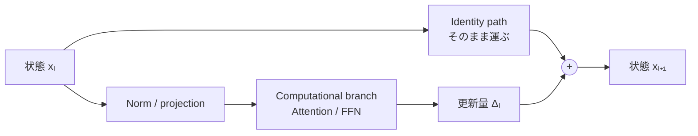

# 第6章 Transformerの現代的解釈：Residual StreamとComputational Branch

Transformerを「AttentionとFFNを順に通すネットワーク」とだけ説明すると、もっとも重要な設計の一つが見えなくなる。それは、**情報を運ぶ主経路**と**情報の更新量を計算する経路**が分かれていることである。

この観点は、[Elhage et al. (2021), *A Mathematical Framework for Transformer Circuits*](https://transformer-circuits.pub/2021/framework/index.html) で提示された **Residual Streamを共通の通信経路として読む**分析と親和的である。

## 6.1 まず用語を固定する

Residualという語は文献によって指す場所が異なる。

| 本書の用語 | 指すもの | 近い別名 |
| --- | --- | --- |
| **Residual Stream** | 層をまたいで受け継がれる表現 \\(x_l\\) | residual pathway, main stream |
| **Identity / Skip path** | \\(x_l\\) をそのまま加算点へ運ぶ経路 | shortcut branch |
| **Computational / Update branch** | \\(x_l\\) を読み、更新量 \\(\Delta_l\\) を計算する経路 | transform branch, *residual function* \\(F_l\\) |

特に**ResNet論文で「residual branch」と言えば、しばしば \\(F_l\\) 側を意味する**。そのため「residual branchとcomputational branch」を別物のように呼ぶと、用語の衝突が起こり得る。本書では、主経路を **Residual Stream**、更新側を **Computational Branch** と呼び分ける。**Computational Branchは本書で説明上用いる呼び名**であり、全論文に共通する標準用語というわけではない。ここでいう*Residual Stream*は、深層にまたがる情報の状態表現を指し、ResNetの*residual branch*（残差関数側）とは異なる。

| 図や議論で見かける名称 | 典型的に指す側 |
| --- | --- |
| shortcut / identity path | \\(x_l\\) をそのまま加算点へ渡す側 |
| residual function / residual branch（ResNet文脈） | \\(F_l(x_l)\\) を計算する側 |
| residual stream（Transformer解析文脈） | 加算によって層をまたぎ受け継がれる \\(x_l\\) の系列 |
| computational / update branch（本書） | Attention/FFN等を用いて \\(\Delta_l\\) を生成する側 |

## 6.2 基本式は「状態＋更新量」

もっとも単純な残差ブロックは、

\\[
x_{l+1}=x_l+F_l(x_l)
\\]

で表せる。\\(F_l\\) は入力を読み、出力へ加える差分を計算する。

主経路と計算経路は、別々に学習された二つの独立モデルではない。計算経路は現在の主経路から入力を読み、その結果を同じ主経路へ戻す。したがって**互いに依存しながら更新を反復する単一の計算系**を形成する。

ここで**「主経路が情報を保持し、計算経路が何を修正するかを提案する」**と捉えると理解しやすい。ただし、これは機能的な解釈であって、内部で人間のような提案・採否判断が行われることを意味しない。

## 6.3 Transformerブロックは二種類の更新器を使う

Pre-Norm型の一般的なブロックでは、

\\[
\begin{aligned}
u_l &= x_l + A_l\bigl(N_a(x_l)\bigr),\\\\
x_{l+1} &= u_l + M_l\bigl(N_m(u_l)\bigr)
\end{aligned}
\\]

となる。

- \\(A_l\\)：Attentionによる**トークン間の情報交換・統合**。Self-Attentionなら同じ系列内、Cross-Attentionなら別系列から情報を読む。
- \\(M_l\\)：FFN/MLPによる**各トークン表現のチャネル方向の変換**。通常の位置ごとのFFN自体は、他トークンを直接参照しない。
- \\(N_a,N_m\\)：LayerNormやRMSNormなどの正規化。

AttentionもFFNも、主経路そのものを置き換えるのでなく、**同じ主経路へ書き込む更新器**として見ることができる。もちろんブロックの実装にはPost-Norm、Parallel Attention/MLP、Mixture-of-Expertsなどの変種がある。

## 6.4 AttentionのQKとOV：「どこを読むか」と「何を書き込むか」

線形写像を列ベクトルへ作用させる約束で、バイアスや正規化などを省いたあるAttention headの出力を簡略化して

\\[
\Delta_i^{(h)}=\sum_j a_{ij}^{(h)} W_O^{(h)}W_V^{(h)}x_j
\\]

と表す。重み \\(a_{ij}^{(h)}\\) はQueryとKeyから求める。

\\[
a&#95;{ij}^{(h)}=\operatorname{softmax}&#95;j
\left(\frac{q&#95;i^\top k&#95;j}{\sqrt{d&#95;k}}+m&#95;{ij}\right)
\\]

このとき、概念的には二つの役割に分けられる。

1. **QK側**：どの位置 \\(j\\) をどれだけ参照するかを決める。
2. **OV側**：参照した位置の情報をどのような更新ベクトルに変換して書き込むかを決める。

なお、SoftmaxによるAttention重みが非負で和が1であっても、Value/Output射影後の更新ベクトルは正負の成分を持てる。そのため**Attention重みの大小だけから最終出力への寄与の大小・符号を読み取ることはできない**。

これは[Transformer Circuits](https://transformer-circuits.pub/2021/framework/index.html) による代表的な解析視点である。*位置を選ぶ*ことと*書き込む内容*を概念上区別できる点が重要だ。ただし実モデルでは入力・正規化・学習パラメータを通じて相互依存し、完全に独立した機能モジュールではない。

また、Multi-Head Attentionの複数headは、それぞれの出力を射影して最終的に和へまとめられる。**headごとに異なる更新を提案し、主経路へ加算する**と捉えると、Transformerの加法的な構造が見える。

### 更新が読み書きするのは共通の座標空間

主経路の幅を \\(d\\) とすると、各トークンの状態は通常 \\(x_i\in\mathbb R^d\\) であり、Attention/FFNの内部では異なる幅へ投影されても、残差加算の直前には再び \\(d\\) 次元へ戻る。概念的に、計算経路は

\\[
\Delta x = W_{\mathrm{out}}\\,G\\!\left(W_{\mathrm{in}}\\,N(x)\right)
\\]

と書ける。実装には複数の線形変換やAttentionなどが入り、必ずこの二行列へ正確に分解できるわけではないが、**主経路から読み出して、同じ座標空間に書き戻す**点を示している。

この共有空間では、異なる層が異なる特徴方向・部分空間を用い得る。一方、有限の幅に複数の情報を書き込むため干渉も起こり、値がそのまま永続保存されるわけではない。Residual Streamは学習済み重みや外部メモリと同義ではない。

## 6.5 全層にわたる「蓄積」の数式

**各サブレイヤーが \\(x_{l+1}=x_l+\Delta_l\\) の形で書ける場合**、一つのResidual Streamへ連続して更新を書き込むなら、

\\[
x_L=x_0+\sum_{l=0}^{L-1}\Delta_l
\\]

と表せる。これは再帰式を展開した**正確な恒等式**である。ただし、\\(x_l\\) を加算後に正規化・置換するPost-Normなどには、そのまま同じ展開を適用できない。

ただし、\\(\Delta_l\\) は一般にそれまでの状態 \\(x_l\\) に依存する。したがって、**各層の更新が互いに独立に計算され、意味のある特徴がただ足し合わされる**とまでは言えない。前の層が書いた表現は、次の層のAttentionやFFNに影響する。

ここでいう「蓄積」は**加算の代数的な性質**を表す語であり、意味のある情報が層を越えて単調に増えると保証するものではない。後続層の書き込みが、前層の効果を打ち消すこともある。

この観点では、Residual Streamを固定された「知識データベース」と考えるよりも、**現在の入力に対応する一時的な共有作業領域**と考える方が近い。パラメータは別途、更新規則そのものを符号化している。

## 6.6 なぜ残差接続は深い学習を助けるのか

\\(x_{l+1}=x_l+F_l(x_l)\\) のJacobianは

\\[
\frac{\partial x_{l+1}}{\partial x_l}=I+J_{F_l}(x_l)
\\]

となる。勾配がIdentity pathを通って伝わる成分を持つため、深いブロックの最適化を助け得る。複数層の勾配は一般には \\(I+J_{F_l}\\) の積を通るので、恒等項が存在することだけで勾配消失・爆発の完全な回避は保証されない。

また \\(F_l\approx0\\) なら、そのブロックは概ね恒等写像として振る舞う。これは、各層が全状態を毎回作り直すのでなく、必要な修正を学ぶという設計を可能にする。

ただし、層を重ねれば必ず勾配が安定するわけではない。更新量の増大、正規化の位置、初期化、残差スケーリングなどによって学習は変わる。

## 6.7 Pre-NormとPost-Normの意味

**Pre-Norm** は、正規化を更新計算の入力側に置く。

\\[
x_{l+1}=x_l+F_l(N(x_l))
\\]

この形では加算後の主経路にIdentity pathが直接残る。一方、原論文で用いられた代表的な**Post-Norm** は、

\\[
x_{l+1}=N(x_l+F_l(x_l))
\\]

である。両者は**等価ではない**。特に正規化を通る勾配や初期の学習安定性が変わる。[Xiong et al. (2020)](https://proceedings.mlr.press/v119/xiong20b.html) はこの違いを理論・実験の両面から検討している。

「Residual Streamは何も処理しない加算器」という表現は、**Pre-Norm型で正規化を更新ブランチの内部へ位置づけるときに特に直感的**である。Post-Normや特殊なブロックまで含めて主経路が必ず完全なIdentityであると一般化すべきではない。

## 6.8 GateとAdaLN：更新を書き込む量を制御する

更新に係数を掛ければ、

\\[
x_{l+1}=x_l+g_l\odot F_l(N(x_l))
\\]

となる。\\(g_l\\) はスカラーでもチャネルごとのベクトルでもよく、固定値の場合も、条件入力から生成する場合もある。

- \\(g_l=0\\)：更新は加算されず、主経路を維持する。
- \\(g_l\approx1\\)：通常の残差加算に近い。
- \\(g_l\\) が負や大きな値を許す設計：方向の反転や強い更新も表現できる。ただし安定性は別問題。

**AdaLN** は条件入力から正規化後のシフト・スケールなどを生成する仕組みであり、**adaLN-Zero** はさらに更新ブランチの出力Gateをゼロ初期化して、条件付き残差ブロックを初期状態でIdentityに近づける（実装の初期化方法による）。[Peebles & Xie (2023)](https://www.wpeebles.com/DiT)。

ここで注意したいのは、Attention内部のスコア・重みと、**残差出力へ加える更新量のGateは制御対象が異なる**ことだ。

- **Attention重み**：どのトークン由来の情報を集約するか。
- **Residual Gate**：計算された更新を主経路へどれだけ反映するか。

両者は代替物ではなく、役割の異なる制御機構である。

## 6.9 動的系とのアナロジー

形式を

\\[
x_{l+1}=x_l+\Delta t\\,F_l(x_l)
\\]

とすれば、オイラー法による状態更新と似ている。深さ方向の反復を**表現空間上の状態遷移**として見る視点には価値がある。しかし、一般的なTransformerに、共通の連続時間ベクトル場や厳密なODE極限が存在するとは限らない。これは設計・理解のためのアナロジーであり、すべてのTransformerの数学的同一性を意味しない。

> **この章の結論**：Transformerの本質をAttentionの重み行列だけに求めず、**共通のResidual Stream、そこから情報を読む複数の計算経路、更新の加算と制御**という全体構造として捉えると、より一貫した理解が得られる。

---

[← 前章：Transformerの転換](05-transformer-shift.md) ｜ [次章：Transformerの構成要素と応用 →](07-modern-transformers.md)
