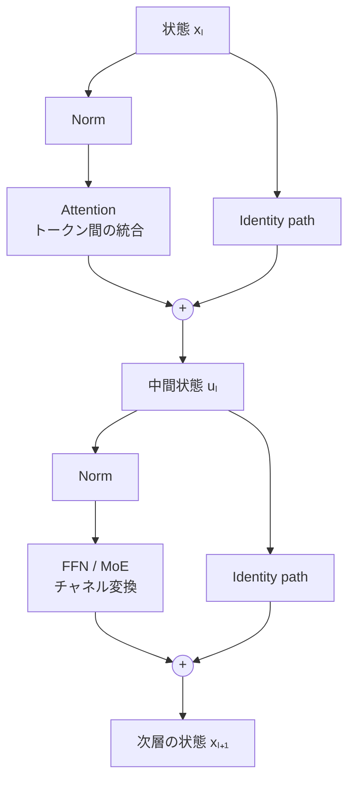

# 第7章 Transformerの構成要素と応用

作成日：2026-10-12 / 更新日：2026-10-13

ここまで扱ったのは、2017年の原型から引き継がれた基本思想である。現代のTransformerには、学習安定性、生成速度、多様な条件付け、モダリティ統合などに合わせた多くの変種がある。

## 7.1 「Transformer＝Self-Attention」ではない

基本構造を要約すれば、次のようになる。

Pre-Norm型の**二つの加算点**を明示した概念図である（実装によってはGate、並列ブランチ、Post-Norm等が追加・変更される）。詳細な逐次式は[第6章](06-residual-stream.md)を参照。

Attentionは入力に依存して情報を混ぜ、FFNは各位置のチャネル表現を変形し、Residual Streamは更新結果を層間へ運ぶ。NormalizationとGateは更新の条件・大きさを調整する。**知能をAttentionだけに還元しない**ことが重要だ。

## 7.2 Decoder-only、Encoder-only、Encoder-Decoder

| 構成 | 主なAttentionの関係 | 主な用途の例 |
| --- | --- | --- |
| Encoder-only | 双方向Self-Attention | 文脈表現、分類、検索 |
| Decoder-only | Causal Self-Attention | 自己回帰の文章・コード生成 |
| Encoder-Decoder | Encoder側双方向＋Decoder側Causal＋Cross-Attention | 条件付き系列変換、翻訳 |

これらの差は「知能の有無」ではなく、**どのトークンがどのトークンを参照できるか**という情報流の設計にある。BERTは双方向表現学習の代表例である。[Devlin et al. (2019)](https://arxiv.org/abs/1810.04805)。

さらに、画像と文章などを一系列へ並べてマスクを設計する方法もあれば、Cross-Attentionで別の条件系列を参照する方法もある。**マスクは計算可能な依存関係を規定する設計要素**である。

## 7.3 現代的な構成要素

| 要素 | 何を変えるか | 誤解しやすい点 |
| --- | --- | --- |
| Pre-Norm / RMSNorm | 正規化の位置・方式 | すべてのネットワークに同じ構成が最良とは限らない |
| RoPE | Attentionの位置関係表現 | 位置情報が不要になるわけではない |
| MHA / GQA / MQA | Query headとKey/Value headの構成 | KV共有はAttentionの原理そのものの変更ではない |
| FFN / SwiGLU | トークンごとの非線形なチャネル変換 | FFNを単純な保存済み知識の検索表と同一視できない |
| MoE | 入力に応じて一部の計算器を選ぶ | 条件付き計算とResidual Streamは両立する |
| FlashAttention | Attentionの計算・メモリI/O実装 | 原則として近似モデルへの置換ではない |
| AdaLN / Residual Gate | 条件付き変調、更新の寄与量 | Attention重みとは役割が違う |

参考：[RMSNorm](https://arxiv.org/abs/1910.07467)、[RoPE](https://arxiv.org/abs/2104.09864)、[SwiGLUなどのGLU変種](https://arxiv.org/abs/2002.05202)、[GQA](https://aclanthology.org/2023.emnlp-main.298/)、[FlashAttention](https://papers.neurips.cc/paper_files/paper/2022/hash/67d57c32e20fd0a7a302cb81d36e40d5-Abstract-Conference.html)。

### GQAとKV Cacheの関係

Decoder型モデルが生成済みトークンのKey/Valueを再利用する場合、KV Cacheの保存量が推論メモリに影響する。GQAは複数のQuery headでKey/Value headを共有し、品質とキャッシュ量・帯域のバランスを調整する。[Ainslie et al. (2023)](https://aclanthology.org/2023.emnlp-main.298/)。ただし、KV Cacheの存在自体はGQA固有ではない。

### FFNは「知識の貯蔵庫」だけではない

位置ごとのFFNは、入力表現 \\(x\\) に対して非線形関数 \\(F(x)\\) を計算する。特定のニューロンと知識の対応を分析する研究はあるものの、FFNを事実の単純な辞書、Attentionを検索エンジンと固定的に解釈するのは過度の単純化だ。Attentionも内容を変換し、FFNも関係性の表現に寄与する。

## 7.4 「トークン間統合」と「状態更新」が多モダリティへ拡張した

ViTは画像パッチをトークンとして扱い、Transformerの基本ブロックを画像分類へ適用した。[Dosovitskiy et al. (2021)](https://arxiv.org/abs/2010.11929)。DiTは画像潜在表現のパッチをTransformerで処理し、条件付き生成へ展開した。[Peebles & Xie (2023)](https://openaccess.thecvf.com/content/ICCV2023/html/Peebles_Scalable_Diffusion_Models_with_Transformers_ICCV_2023_paper.html)。

画像生成を例にすれば、同じTransformerブロックが文章生成の次トークン予測ではなく、ノイズや時間条件から速度場・ノイズ・別の生成ターゲットを推定することもある。すなわち、**Transformerの計算基盤は特定の出力形式に固定されていない**。

### 機能の区別は、モジュールの完全分離を意味しない

「Attentionは情報を運び、FFNは情報を変換する」という言い方は、典型的な計算構造の分担を示す近似的な説明である。Attention内部にもValue/Output射影というチャネル変換があり、FFNの出力も後続層のAttentionを通じてトークン間相互作用へ影響する。Residual Streamも無制限の記憶領域ではない。こうした注意を置くことで、各部品を独立した擬人的エージェントのように扱う誤解を避けられる。

## 7.5 CNN/RNNは時代遅れになったのか

そうとは言えない。たとえばConvNeXtは、Vision Transformerの設計上の知見を取り入れてResNetを現代化した純粋なConvNetである。論文の比較実験では、ImageNet分類やCOCO物体検出、ADE20KセマンティックセグメンテーションでTransformer系モデルと競争力のある結果を示した。[Liu et al. (2022)](https://openaccess.thecvf.com/content/CVPR2022/html/Liu_A_ConvNet_for_the_2020s_CVPR_2022_paper.html)。ConvNeXt V2は、畳み込みモデルとMasked Autoencoderによる事前学習を組み合わせた後続例である。[Woo et al. (2023)](https://openaccess.thecvf.com/content/CVPR2023/html/Woo_ConvNeXt_V2_Co-Designing_and_Scaling_ConvNets_With_Masked_Autoencoders_CVPR_2023_paper.html)

RNN系も、系列を逐次処理する必要がある用途では候補になり得る。どの構造が適するかは、入力の長さ、データ量、遅延、計算資源などに応じて判断する。

また、Transformerを使えば必ず多様体上の理想的な幾何変換が獲得されるわけではない。**Transformer時代とは、ひとつの演算がすべてを解決する時代ではなく、汎用的な更新計算を再利用する設計が大きく発展した時代**だと理解したい。

---

[← 前章：Residual StreamとComputational Branch](06-residual-stream.md) ｜ [次章：Deep Learningをめぐる誤解 →](08-misconceptions.md)
