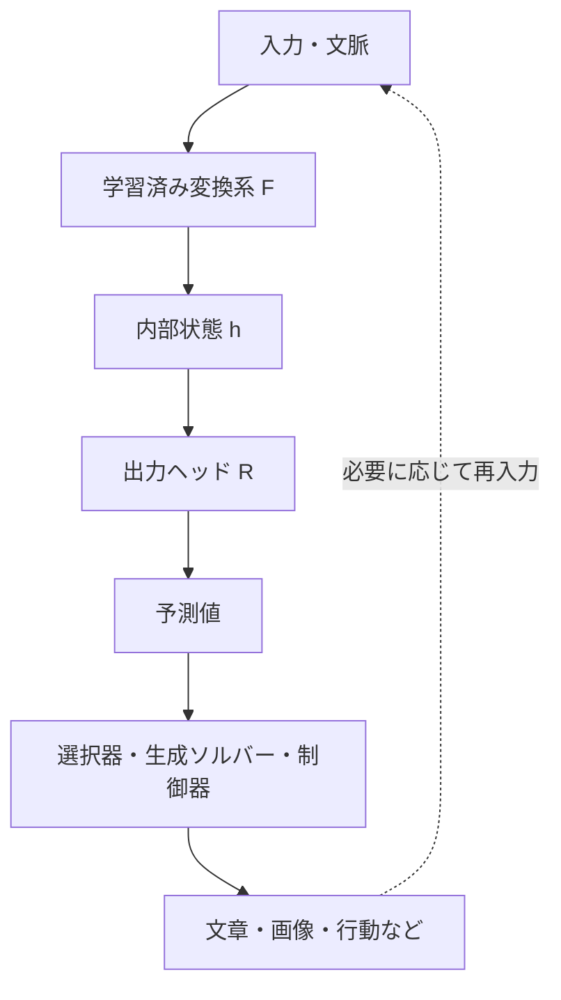

# 第1章：出力をインターフェイスとして読む

「LLMは結局、次のトークンを予測するだけだ」という表現には、確かな技術的背景がある。自己回帰型言語モデルの代表的な事前学習目標は、次トークンの条件付き確率を学ぶことだからだ。GPT-3も、自己回帰的な次トークン予測で事前学習された例である[Brown et al. (2020)](https://arxiv.org/abs/2005.14165)。しかし、この説明だけでモデルが行う複雑な計算や獲得した能力を語り尽くすことはできない。

出発点として、**何を出力するか**と、**その出力に必要な内部計算は何か**を切り分けよう。

## 1.1 四つの階層を区別する

| 階層 | 問い | 典型例 |
| --- | --- | --- |
| **学習目標** | どの振る舞いを改善するのか | 次トークンのCross Entropy、ノイズ・速度の二乗誤差、報酬に基づく目的 |
| **内部計算** | 予測のために何を処理するのか | Attention、FFN、Residual Stream、潜在状態の更新 |
| **予測インターフェイス** | 他の処理へ何を返すのか | ロジット、ノイズ推定、速度ベクトル、行動トークン |
| **外部での結果** | 人間や環境は何を受け取るのか | 文章、画像、音声、ロボットの動作、ツールの実行結果 |

「出力」は一つの層だけを指す言葉ではない。たとえば画像生成モデルの速度推定は、**モデルと数値積分器の境界**にあるインターフェイスであり、利用者に見せる最終画像ではない。ここでいう「一回の出力が単純」とは、**何を返すかという役割・形式が比較的明確**という意味であり、値の次元、計算量、学習課題まで小さいという意味ではない。LLMでも、内部で得られるのは典型的には語彙全体のロジットで、デコーダがトークンを確定し、さらに表示系が文章へ変換する。

この図は役割の模式図で、すべてのモデルが厳密にこのモジュール構成を持つという意味ではない。

## 1.2 LLMが一度に「出す」のは、正確には何か

典型的な自己回帰生成では、文脈 \\(x_{<t}\\) からモデルが語彙 \\(V\\) にわたるロジットを計算する。

\\[
 h_t=F_\theta(x_{<t}),\qquad a_t=R_\theta(h_t)\in\mathbb R^{|V|}
\\]

\\[
 p_\theta(x_t=i\mid x_{<t})=\operatorname{softmax}(a_t)_i
\\]

生成器はこの分布と選択規則に従って通常一つのトークンを確定する。確定するのは記号一つでも、その前に計算するロジットは語彙全体に対応し、入力文脈の処理には多数の層を使う。**一度に確定する記号が一つ**でも、\\(F_\theta\\) が文脈全体について計算すること、\\(a_t\\) が高次元であることは変わらない。並列に系列各位置の損失を計算する訓練処理とも区別したい。

極端な例として、\\(n\\) ビットのXOR

\\[
 y=x_1\oplus x_2\oplus\cdots\oplus x_n\in\{0,1\}
\\]

を考える。出力は一ビットだが、すべての入力ビットが答えに影響し得る。この例は高度な知能の証明ではない。**出力のサイズだけでは、必要な依存関係の広さや計算内容が分からない**ことを示す例である。

## 1.3 画像生成の「単純さ」は、出力サイズの小ささではない

拡散・Flow Matching系モデルが返す予測ノイズや速度は、通常、画像や潜在表現と対応する**高次元テンソル**である。

\\[
 \epsilon_\theta(x_t,t,c)\in\mathbb R^D,\qquad
 v_\theta(x_t,t,c)\in\mathbb R^D
\\]

ここで単純なのは、各ステップの**仕事の定義**――「現在の状態と条件からノイズ／速度を推定する」――であって、予測自体の演算量やテンソルの次元ではない。推定結果はソルバーによる更新に使われ、複数回の更新の末に画像が得られる。[Ho et al. (2020)](https://arxiv.org/abs/2006.11239)、[Lipman et al. (2023)](https://arxiv.org/abs/2210.02747)。

## 1.4 Readoutとしての出力ヘッド

一般化すれば、次の見方ができる。

\\[
 h=F_\theta(x),\qquad o=R_\theta(h)
\\]

- \\(F_\theta\\)：複雑な内部表現を構成・更新する変換系。
- \\(h\\)：その計算で得られた内部状態。
- \\(R_\theta\\)：外部や別のモジュールが受け取れる形式への読み出し。
- \\(o\\)：読み出し結果。必ずしも人間に直接見える最終出力ではない。

**解釈**として重要なのは、出力ヘッドが内部表現のすべてを言語化・可視化する必要はない点だ。人間が文章を書くときも、心的過程のすべてを一文に詰め込むわけではない。しかし、LLMの言語生成を人間の思考と同一視したり、Hidden Stateに人間型の内的体験があると主張したりする根拠にはならない。このアナロジーは[第8章](08-analogy-and-evidence.md)で扱う。

## 1.5 インターフェイスは単なる「内部の覗き窓」ではない

出力ヘッドは内部状態のすべてを人間に公開するわけではない。しかし、だからといってHidden Stateに完全な思考が先に存在し、それをヘッドが忠実に翻訳しているとも限らない。**何を学習で評価するかが、内部計算の形成そのものに影響する**からだ。

学習時には、読み出し結果の誤差が微分可能な計算経路を逆に伝わり、内部の重みも調整される。推論時には、選ばれたトークンやソルバーが更新した状態が次の入力を変える。前者は**パラメータの学習**、後者は通常**固定重みのもとでの状態更新**であり、同じフィードバックではない。

また、「外界」という語にも段階がある。出力ヘッドが渡すロジットはモデル内部の部品間インターフェイスであり、文章は人間との情報交換、ツール呼び出しはデジタル環境への操作、ロボットの行動指令は物理環境への作用につながる。**接続先が違えば、正しさを測る方法や失敗時の危険性も違う。**

## 1.6 「出力」という一語の落とし穴

この比喩が有用なのは、**内部計算の結果と、その結果の使われ方を分ける**ためである。しかし、次の四つは同列の数値ではない。

| 例 | 直接の数値・記号 | 受け取る主体 | 注意点 |
| --- | --- | --- | --- |
| LLM | 語彙ロジット／分布 | トークン選択器 | 選ばれたトークンは次の文脈になり得る |
| Flow Matching | 速度場の推定 | 数値積分器 | 速度は完成画像そのものではない |
| VLMによるGUI操作 | 操作候補の記号・座標など | 実行ツール | 実行権限と実行結果はモデル外にある |
| ロボットの方策 | 行動・行動分布 | 制御器・実機 | センサー・遅延・安全制約の影響を受ける |

行動モデルの出力は**行動を選ぶための値**であり、常に「未来を予測した値」とは限らない。また、Hidden Stateは一般に入力と計算時点に依存する状態で、モデルの重みに蓄えられた全能力をそのまま表す「持続的な意識状態」とは異なる。

## 1.7 この視点がもたらす問い

出力をインターフェイスと捉えると、問うべきことは「出力が単純か」から「**出力のために、内部でどのような関係が学習されるのか**」へ移る。さらに、インターフェイスを文字以外の画像・音声・行動へ拡張すれば、共通のTransformerの役割と、世界との接続が見えてくる。

---
