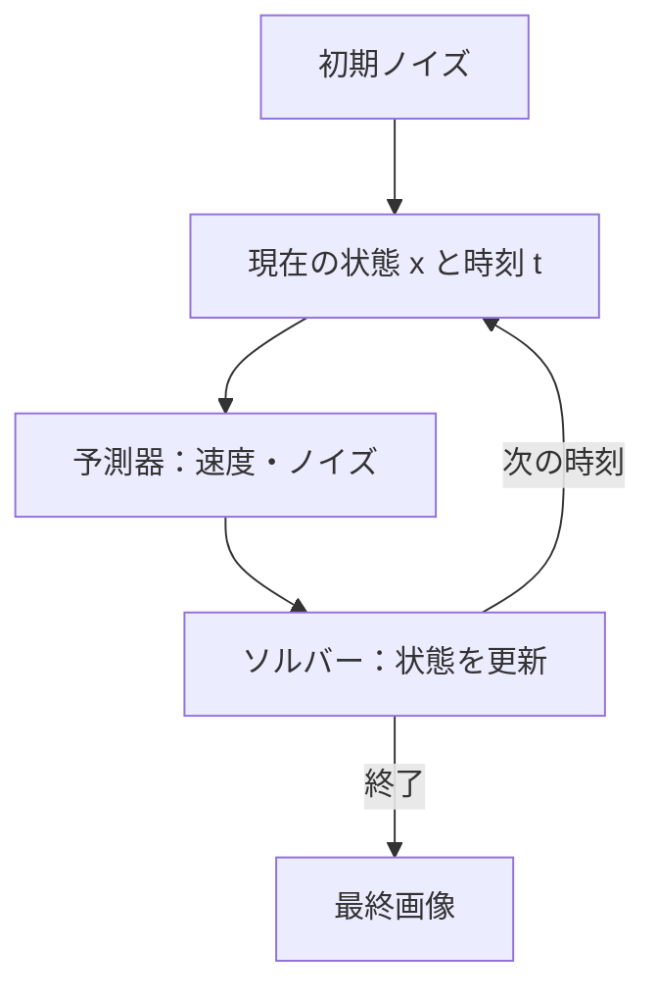
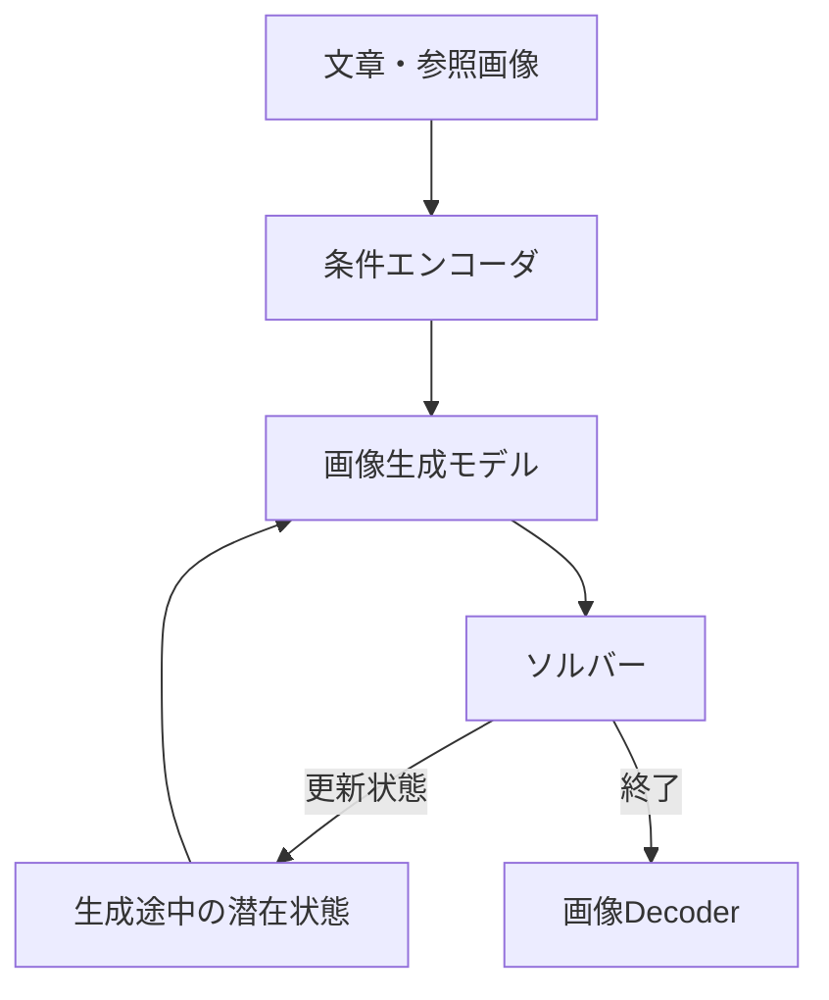

# 第3章：一回の予測から長い推論と画像生成へ

一度の予測結果を、その後の計算で再利用する。これが長い文章・複雑な画像を生み出す重要な構成要素だ。ただし、LLMの自己回帰生成と拡散系の反復更新は、**同じアルゴリズムではない**。

## 3.1 深さ方向の更新と、実行回数の増加

Transformerの典型的な残差更新は、単純化すると

\\[
 h_{\ell+1}=h_\ell+F_\ell(h_\ell)
\\]

と表せる。これは**一回の前向き計算の内部**で行われる層方向の反復である。一方、生成で同じモデルを繰り返し使用することは別の時間方向の反復だ。前者は[Residual Streamの解説](../deep-learning-paradigm-shifts/06-residual-stream.md)とつながる。

## 3.2 LLM：出力が次の文脈になる

自己回帰生成では、時刻 \\(t\\) のトークン \\(y_t\\) を選び、既存文脈へ加える。

\\[
 y_t\sim p_\theta(\cdot\mid c_t),\qquad
 c_{t+1}=\operatorname{append}(c_t,y_t)
\\]

出力された中間式や推論文は、次の予測で読まれる文脈にもなる。この意味では、**外部に見える表現が計算を支えるメモリとしても働く**。ただし、生成された思考過程が内部計算を忠実に記述しているとは限らない。[Chain-of-Thought研究](https://arxiv.org/abs/2201.11903)で扱われる段階的出力と、モデルが実際にどの表現を使ったかは区別したい。

さらに、数式処理ツールや定理証明器に問い合わせる場合は、モデル単体ではなく**モデル＋ツール＋実行ランタイム**が結果を生んでいる。

## 3.3 数学研究：出力形式だけで能力の限界は決められない

高度な数学的成果も、外部へ出す形式は文章や証明候補である。ただし、**発見・数学的正当性・形式的検査**は同じ工程ではない。公開事例を分けておく。

| 事例 | 報告されたAIの役割 | 検証と留保 |
| --- | --- | --- |
| [Erdős Problem #848（OpenAI, 2025）](https://openai.com/index/accelerating-science-gpt-5/) | GPT-5が鍵となる密度評価を提案 | 人間の数学者が修正・精密化して証明を完成。先行する人間の議論もあった |
| [離散幾何学の特定予想への反例（2026）](https://openai.com/index/model-disproves-discrete-geometry-conjecture/) | モデルが反例となる構成を提示したとの発表 | 発表では外部数学者による確認を説明。ただし平面単位距離問題全体の解決ではない |
| [形式証明探索（Tsoukalas et al., 2026）](https://arxiv.org/abs/2605.22763) | AIエージェントが候補生成とLeanでの検査を反復 | 論文は未解決問題への成果を報告。Leanが検査するのは形式化された命題で、元の自然言語問題との対応は別途確認が必要 |

こうした事例を、すべて同じ「AIが数学を解いた」という一文にまとめるのは不正確である。論文や研究発表ごとに、発見の新規性、証明の完成者、形式化された命題、独立した検査の範囲を確認する必要がある。

これらは、能力が**短い単発の前向き計算だけで発揮された**という証拠ではない。事前学習、事後学習、長い探索、外部ツール、人間の協働が異なる役割を担う。

このような成果は「一トークンを出すだけだから数学研究へ貢献できない」という議論への反例になり得る。しかし、**次トークン予測による事前学習だけが唯一の原因**という証明にはならない。事後学習、探索、長い生成、検証器、人間との協働の寄与を分けて理解する。

## 3.4 画像生成：予測値をソルバーが利用する

拡散モデルでのガウス摂動の一例は

\\[
 x_t=\alpha_t x_0+\sigma_t\epsilon,\qquad
 \epsilon\sim\mathcal N(0,I)
\\]

である。モデルは\\(\epsilon\\)などを推定できるように学習される。[DDPM](https://arxiv.org/abs/2006.11239)。ノイズ \\(\epsilon\\) をデータ \\(x_0\\) と条件 \\(c\\) から独立にサンプリングする標準的な設定を考える。二乗誤差の理想的な予測器は、条件付き期待値

\\[
 \epsilon^*(x,t,c)=\mathbb E[\epsilon\mid x_t=x,t,c]
\\]

を返す。ノイズが独立なガウス分布で、\\(\sigma_t>0\\) かつ必要な正則性条件を満たすなら

\\[
 \epsilon^*(x,t,c)=-\sigma_t\nabla_x\log p_t(x\mid c)
\\]

が成り立つ。したがって「MSEで予測したから完成画像の平均しか出せない」という理解は誤りだ。予測対象は完成画像でなくノイズであり、その条件付き平均は**分布のScore**と結びつく。[Song et al. (2021)](https://arxiv.org/abs/2011.13456)。

## 3.5 Flow Matching：局所的な速度が分布の変換を構成する

線形経路の一例として、\\(x_0\\) を初期分布のサンプル、\\(x_1\\) をデータ分布のサンプルとし、その**結合分布（ペアの取り方）**を定める。

\\[
 x_t=(1-t)x_0+t x_1,\qquad
 u_t=x_1-x_0
\\]

と置く。この例の二乗回帰では

\\[
 v^*(x,t,c)=\mathbb E[u_t\mid x_t=x,t,c]
\\]

が理想解になる。十分な正則性の下で、密度\\(p_t\\)と周辺速度\\(v^*\\)は連続の方程式

\\[
 \frac{\partial p_t}{\partial t}+\nabla\\!\cdot(p_t v^*)=0
\\]

により接続される。推論時には

\\[
 \frac{dx_t}{dt}=v_\theta(x_t,t,c)
\\]

を数値的に解き、初期分布からデータ分布に近い状態へ移す。これは理想的な速度場が目標の確率経路と整合し、常微分方程式の解・対応する流れが適切に定義できる場合の説明である。学習誤差やソルバー誤差があれば生成分布にも差が生じる。[Lipman et al. (2023)](https://arxiv.org/abs/2210.02747)。この説明は線形補間を使う一例で、全てのFlow Matchingの経路が線形という意味ではない。

重要なのは、各画素を独立して処理しているわけではないことだ。予測場はモデル内部で画像全体の文脈や条件と相互作用して計算される。反復数が多いことだけで品質が保証されるのでもなく、モデル近似、初期分布、ソルバー誤差、条件付けが影響する。蒸留などを用いる少数ステップ・一ステップ生成もあり、**画像生成に多数回のモデル呼び出しが論理的に必須**という主張ではない。

## 3.6 条件理解と画像生成を分業する設計

画像生成システムでは、指示文・参照画像を理解する**条件エンコーダ**と、画像の潜在状態からノイズ・速度を推定する**生成モデル**を、別のネットワークとして組み合わせることもできる。

これは設計パターンの**模式図**であり、すべての画像生成モデルがこのように分離されるわけではない。重要なのは、**視覚条件の意味を扱う表現**と、**画像を生成するための数値的な更新**を、必要に応じて別のインターフェイスで接続できる点である。複数のモダリティをどう共有するかは第4章で扱う。

## 3.7 一つの視点に統合する

|  | LLM | 拡散・Flow Matching系 |
| --- | --- | --- |
| モデルの役割 | 文脈からトークン分布を推定 | 現在状態からノイズ・速度などを推定 |
| 次段階へ渡す値 | 確定したトークン | 予測テンソル |
| 反復の機構 | 文脈の追加と次トークン選択 | サンプラーによる状態更新 |
| 終了結果 | 文章・コード・証明候補 | 画像・動画等のサンプル |

共通点は「**複雑な内部計算の結果を、定められたインターフェイスを通じて次の処理へ渡す**」こと。違いは、そのインターフェイスの数学的な意味と反復アルゴリズムにある。

注意したいのは「反復」に少なくとも三種類あることだ。**層方向の更新**は一回の推論内部の処理、**生成の反復**はトークン確定・ソルバー更新の繰り返し、**環境との反復**は外部ツールや実世界から新しい観測を受け取る過程を指す。これらを同じ「思考時間」として足し合わせることはできない。

---
