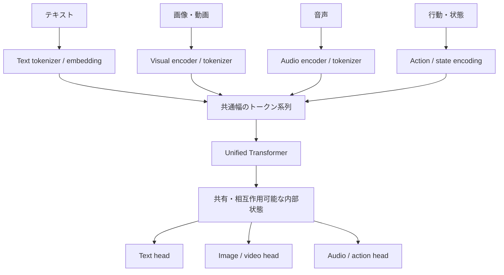

# 第4章：マルチモーダルを統合するTransformer

作成日：2026-10-14 / 更新日：2026-10-14

文字、画像、音声、動画、行動。外界への接続形式は異なっていても、共通の計算基盤で取り扱えるのではないか。**Unified Transformer**と呼ばれる方向性は、この問いをアーキテクチャ上の設計として探る。ただし、「すべてを同じトークン空間に入れる」には、少なくとも3つの意味がある。

## 4.1 「同じトークン空間」の3つの意味

| 統合のレベル | 何が共通か | 共通とは限らないもの |
| --- | --- | --- |
| **共通系列** | 画像・文章などの要素を順序付き系列で扱える | 各モダリティのTokenizer、時間・空間構造 |
| **共通Hidden幅** | トークン表現が \\(\mathbb R^d\\) に写され、同じAttentionなどへ入力できる | 表現の意味、統計分布、最適な特徴抽出方法 |
| **共通意味空間** | 異なるモダリティ間で関連する意味が対応するよう学習される | 完全な1対1対応や全能力の共有 |

最初の2つは**設計上の性質**であり、3つ目は**学習結果としての性質**である。表現の次元が共通でも、座標系や統計的な構造が一致するとは限らない。意味的な整合は、対応付けの学習や未見の組合せでの評価によって確かめる必要がある。さらに、共通の中核モデルを持つ設計にも、トークンを初期段階から混ぜる**Early Fusion**、別々のエンコーダやCross-Attentionで統合する設計、複数モジュールを連携させる**システムレベルの統合**がある。「Unified Transformer」は1つの厳密な標準アーキテクチャ名ではない。トークンの次元が同じだからといって、画像のパッチと日本語の単語が同じ座標の意味を持つとは限らない。学習目標やデータによって、モダリティ間の整合が促される。

## 4.2 典型的なパイプライン

各モダリティ固有の処理で入力をトークン状の表現に変換し、共通の幅\\(d\\)へ投影する。

\\[
 Z^{(m)}=P_m\bigl(E_m(x^{(m)})\bigr)
 \in\mathbb R^{n_m\times d}
\\]

ここで \\(m\\) はモダリティ、\\(E_m\\) はTokenization・Encoding、\\(P_m\\) は投影である。これらは便宜的な分離で、実装によって統合されることもある。

\\[
 Z=\operatorname{concat}_{\mathrm{seq}}\left(
 Z^{(\mathrm{text})},Z^{(\mathrm{image})},Z^{(\mathrm{audio})},\ldots\right)
\\]

これはモダリティごとに並べた**単純化した例**である。実際には文章と画像を交互に配置したり、音声と動画の時刻に合わせてトークンを挿入したりする。得られた系列を共通のTransformerに入力する。

すべてのモデルがこれらの入出力を備えるわけではない。**入口と出口は専用でも、中央の計算を共有できる**という模式図だ。異なる画像エンコーダ、時刻符号化、Attention Mask、デコーダを併用する構成もある。

## 4.3 1つの場面で考える：赤い球を押す

以降の研究例をつなぐため、**「机の上の赤い球を右へ押す」**という仮想的な場面を考える。これは実際に各モデルで試した実験ではなく、**何を入出力できるか**を切り分ける思考実験である。

| 問い | 必要となる入出力 | モデルの種類・システムの例 |
| --- | --- | --- |
| 「球はどこにある？」 | 画像 → 位置を説明する文章 | 画像理解型のVLM |
| 「球を右に動かした画像を描いて」 | 文章＋参照画像 → 画像 | 条件付き画像生成システム |
| 「押すと次にどうなる？」 | 現在状態＋力・行動 → 未来状態 | 行動条件付き世界モデル |
| 「実際に押して」 | 観測 → 制御指令 → 再観測 | ロボット・実行器を持つエージェント |

同じ場面を記述できても、**描画、将来予測、実際の行動**は別の能力である。後半の世界モデルの章で、この違いを再び利用する。

## 4.4 テキスト・画像を同じ離散トークン列へ写す

[Chameleon（2024）](https://arxiv.org/abs/2405.09818)は、テキストと画像の**離散トークン**を混在した系列として扱い、理解・生成の双方を目指した初期融合（early fusion）の代表例である。画像を離散表現へ量子化すれば、言語に近い自己回帰形式で画像のトークンも生成できる。

利点は系列処理の形式を統一しやすい点だ。一方、画像トークンの大量化、量子化誤差、連続的な視覚詳細の表現などの設計上の負担がある。**文字と画像の情報が同じ仕組みで処理できること**と、**同一のTokenizerが理想的であること**は別だ。

## 4.5 中央のTransformerを共有し、生成方式は分ける

[Transfusion（2024）](https://arxiv.org/abs/2408.11039)は、1つのTransformerで**言語の次トークン学習と画像の拡散生成**を組み合わせる方式を示した。画像は連続的なパッチ表現を持ち得るため、すべてを無理に離散トークンへ量子化する必要はない。

[Show-o（2024）](https://arxiv.org/abs/2408.12528)も、自己回帰と離散拡散を単一Transformer内に統合する提案である。ここから見えるのは、**「Unified」は出力分布や生成手順まで一律にするという意味ではない**ということだ。

## 4.6 エンコーダをあえて分離する統合

[Janus（CVPR 2025）](https://openaccess.thecvf.com/content/CVPR2025/html/Wu_Janus_Decoupling_Visual_Encoding_for_Unified_Multimodal_Understanding_and_Generation_CVPR_2025_paper.html)は、画像の**理解**と**生成**では適切な特徴の粒度が異なり得るとして、視覚エンコーディングを分離しつつ共通Transformerを活用する構成を示した。

同じ画像でも、物体を識別するための意味的特徴と、生成するために必要な高周波の形状・質感では、保持すべき情報が異なる。統合と分離は矛盾せず、**何を共有し、何を特化するか**が設計の中心となる。

関連する[JanusFlow（CVPR 2025）](https://openaccess.thecvf.com/content/CVPR2025/html/Ma_JanusFlow_Harmonizing_Autoregression_and_Rectified_Flow_for_Unified_Multimodal_Understanding_CVPR_2025_paper.html)は、自己回帰型の言語処理とRectified Flowによる画像生成を1つの枠組みで組み合わせた。JanusとJanusFlowは**生成方式が同じモデル**ではなく、統合する基盤と画像生成の出口を分けて考える上で有益な対照例となる。

## 4.7 実在するモデルの短い例：Qwen系

具体例として、Qwen系にも異なる統合範囲のモデルがある。[Qwen3-VL](https://arxiv.org/abs/2511.21631)は視覚特徴を言語モデル側の計算へ接続し、主に文章を出力する。[Qwen3-Omni](https://arxiv.org/abs/2509.17765)は音声入力・出力を含むマルチモーダルな対話を扱う。[Qwen-Image-2.1](https://github.com/QwenLM/Qwen-Image-2.1)は視覚言語モデルによる条件表現と別の画像生成DiTを組み合わせる。

ここでのQwen系は代表的な**アーキテクチャの対照例**であり、網羅的な比較ではない。これらにはマルチモーダルな単一モデルもあるが、全モダリティを1つの共通Transformerだけで処理する設計として一括りにはできない。[Qwen3-Omni](https://arxiv.org/abs/2509.17765)はThinker–Talker構成を採り、[Qwen-Image-2.1](https://github.com/QwenLM/Qwen-Image-2.1)はQwen3-VLの条件表現と画像生成DiTを組み合わせる。入力の統合、計算基盤の共有、専用の生成機構との連携は、異なる設計の選択肢として理解できる。

## 4.8 音声・時間方向への拡張

音声のストリーミング生成には、音響的な時間構造と整合する専用経路を使う設計がある。**マルチモーダルだから何でも単一ヘッドへ統合されるわけではない**。

動画では、画像間の位置関係だけでなく**時刻の整合性**が重要になる。音声と動画の同期、異なるサンプリングレート、長い時系列をどう圧縮・参照するかは、単にトークンを連結するだけでは解けない課題だ。

## 4.9 代表的な設計を比較する

| 研究・構成 | 主な統合の発想 | 特徴的な出力・入口 | 注意点 |
| --- | --- | --- | --- |
| Chameleon | 文字・画像を離散トークン系列として初期融合 | 自己回帰的な混合系列 | 量子化と長系列コスト |
| Transfusion | 共通Transformerで言語モデルと画像拡散を併用 | 離散テキスト＋連続画像 | モダリティ別生成損失・ヘッド |
| Show-o | 自己回帰と離散拡散を統合 | タスクで異なる予測形式 | 全モダリティが同じ復号方式とは限らない |
| Janus | 理解・生成の視覚入口を分離 | 共有Transformer＋専用視覚経路、自己回帰生成 | 統合しすぎない設計 |
| JanusFlow | 自己回帰とRectified Flowを統合 | 共有・連携する表現＋連続画像生成 | Janusとは生成の定式化が異なる |

これらは異なる年・規模・評価条件の提案であり、この表は性能順位表ではない。

## 4.10 なぜこの構造が「外界とのインターフェイス」を広げるのか

文字しか出力しないモデルでも、内部で多くの関係を表現し得る。さらに画像・音声・行動の出力形式を接続できれば、**共通の内部状態を異なる外部表現へ読み出す**設計が可能になる。逆に、画像・音声から共通状態を更新する入口も増える。

これは1つの「知能が完成した」という証拠ではない。**出力契約の数や種類を増やすこと**と、**世界に関する正しい因果知識を獲得すること**の間には、次章以降で扱うギャップが残る。

---
