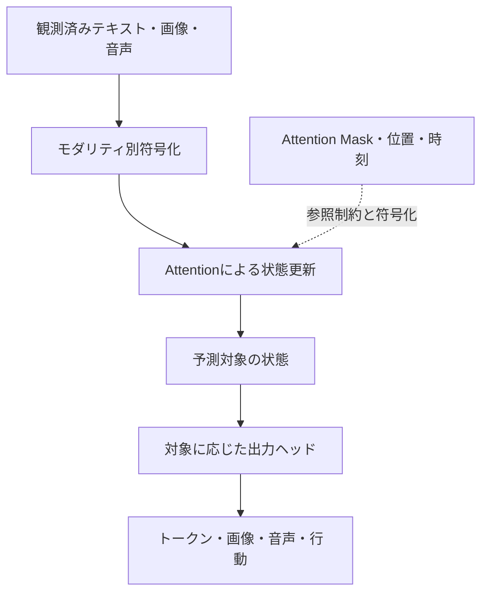
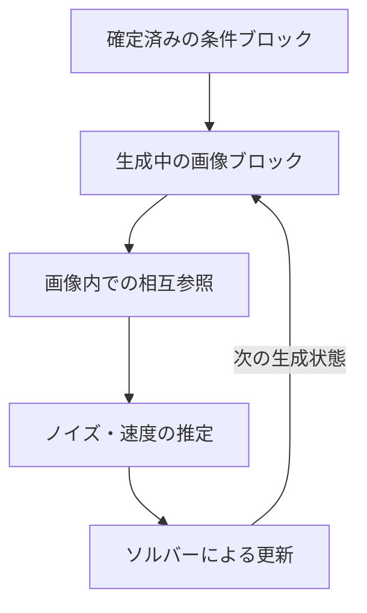

# 第5章：共通状態・異なる出力ヘッド・注意マスク

複数のモダリティを同じTransformerで扱うためには、**どのトークンが何を参照できるのか**、**何をどの形式で予測するのか**、**訓練中の情報漏洩をどう防ぐか**を具体的に決めなければならない。統合モデルの難しさは、単にテンソルを連結する実装ではない。

## 5.1 共通Residual Streamという読み方

AttentionやFFNの更新を模式化すると、共通状態 \\(H_\ell\in\mathbb R^{n\times d}\\) は

\\[
 H_{\ell+1}=H_\ell+\Delta_\ell(H_\ell,C,M)
\\]

と表せる。\\(C\\) は条件、\\(M\\) はマスクなどの構造を表す。これは**典型的な残差型Transformerを抽象化した式**であり、すべてのモデルで全層が完全に共有されるという意味ではない。

同じHidden幅のトークンが、Attentionを通じて互いの情報を読み書きできる設計なら、文字で示された「赤い球」という条件と画像中の領域との関連を学習する余地がある。ただし、Attentionで接続されるだけで対応が正しく学習されるとは限らない。

## 5.2 Maskは「何を学べるか」の条件になる

トークン系列 \\(H\\) のSelf-Attentionを単純化すると

\\[
 \operatorname{Attn}(H)
 =\operatorname{softmax}\\!\left(
   \frac{QK^\top}{\sqrt{d_k}}+M
  \right)V
\\]

である。\\(M_{ij}=-\infty\\) とした位置は（数値実装上の近似を除けば）注意対象から外される。どの位置を遮断するかで、モデルに許す情報経路が変わる。

例として、\\(C\\)を観測済みの条件、\\(Y\\)を予測対象とする**因果的な生成課題**を考える。予測側が条件を参照することは許し、条件の表現に未来の正解が漏れないよう、必要な情報流を制限する。ただし、条件側と対象側をどう相互参照させるかはモデルと学習目標に依存する。実際の画像拡散では、**同一のノイズレベルの画像パッチ間に双方向Attention**を使う設計も多く、全トークンを単純な左から右へのCausal Maskにするのが唯一の正解ではない。



**図の読み方**：マスクは独立した計算ユニットとは限らず、Attentionで許可する情報の構造を表す。図は設計上の役割を分離している。

例えば「観測済み条件を固定し、将来の対象ブロックを生成する」設計では、次のような**方向付きの情報流**が一つの候補となる。表の行は情報を読むQuery側、列は読まれるKey/Value側を表す。この情報経路の表は、**生成時に既知の条件と、まだ存在しない正解を混同しない**ためのものであり、学習で使うノイズ化ターゲットなどを参照することを一律に禁止するものではない。

| Query側 ＼ Key/Value側 | 観測済み条件C | 生成中の対象Y |
| --- | --- | --- |
| 条件C | 許可（条件内の双方向参照など） | 原則として禁止（未来の正解の漏洩を防ぐ） |
| 対象Y | 許可 | 対象の生成方式に応じて制御 |

この表は**正解を観測済み条件へ逆流させない**ための模式例であって、すべてのUnified TransformerがこのMaskを使うわけではない。訓練中に画像のノイズ化状態\\(x_t\\)を入力して同じノイズレベルのパッチ同士に双方向Attentionを許すことと、推論時には未知のクリーン画像\\(x_0\\)を読み取れないことは両立する。**学習時に与えられる破損入力**と**推論時に存在しない正解**を区別する必要がある。

## 5.3 ブロック間の因果順序と、ブロック内の双方向処理

テキストの自己回帰と、画像パッチの双方向Attentionは両立し得る。例えば**説明用の設計**として、入力を `[文章T][参照画像I][生成画像Y]` の3ブロックに並べ、生成中の画像ブロックには一括の状態更新を許すとしよう。

| Query ↓ / Key・Value → | 文章T | 参照画像I | 生成画像Y |
| --- | --- | --- | --- |
| **文章T** | 過去のトークンのみ | 不可 | 不可 |
| **参照画像I** | 可 | ブロック内は双方向 | 不可 |
| **生成画像Y** | 可 | 可 | ブロック内は双方向 |

この表は、**前段ブロックを後段ブロックから独立に計算する**という設計例であり、文章Tの因果方向と画像Iの双方向処理をあえて混在させている。実モデルの必須構成や、すべての学習課題に適した唯一のマスクを示しているわけではない。生成画像Yの各位置にはノイズ化された画像状態などが入力され得るが、未知の正解画像が条件側へ漏れてよいわけではない。



ブロック間の方向付き参照が正しく成立し、前段の状態が後段の生成状態に依存しない場合、条件側の中間表現やKey/Valueを再利用しやすい。ただし、**KV Cacheの正当性はマスクだけでは決まらず、時刻条件・位置符号化・生成中の状態への依存性**にも左右される。

## 5.4 一つのHeadで全モダリティを処理する必要はない

内部状態を共有したとしても、出力ヘッドはタスク別にできる。

\\[
 o^{(m)}=R_m(H,\tau_m)
\\]

ここで \\(m\\) はモダリティ、\\(\tau_m\\) は時刻や生成条件である。例えば、文章には語彙ロジット、画像にはノイズ・速度場、音声にはCodec Token、ロボットには行動値・行動列を用いる。**統合されるのは計算の一部であって、出力の表現形式ではない**。

画像は連続的な潜在表現のまま扱う方が有利な場合がある。画像理解用の視覚特徴と画像生成用の詳細情報を別経路にする構成もある。[Transfusion](https://arxiv.org/abs/2408.11039)、[Janus](https://arxiv.org/abs/2410.13848)。

## 5.5 Lossも一つの式に揃える必要はない

説明用の例として、複合的な目的は

\\[
 \mathcal L
 =\lambda_{\rm text}\mathcal L_{\rm AR}
 +\lambda_{\rm image}\mathcal L_{\rm diffusion}
 +\lambda_{\rm action}\mathcal L_{\rm action}
\\]

のように書ける。各項はデータ・学習段階によって使い分けられ、係数や実装方法に普遍的な正解はない。**単純な損失で高度な表現が育つこと**と、**複数モダリティの学習目的を同一の数式に統一しなければならないこと**は無関係だ。

違う学習目標を共有パラメータへ同時に適用する場合、勾配の競合、データ比率、モダリティの優先順位、表現容量の分配が問題になる。逆に、共通基盤によって有益な表現の共有が起こる可能性もある。どの利点が現れるかは設計と実験で確認すべきである。

## 5.6 一つ先の「トークン」から、一つ先の「モダリティブロック」へ

Unified Transformerを構想するとき、すべての予測単位が**一文字・一画像パッチ**である必要はない。説明のため、観測や生成のまとまりを\\(B_t\\)という**モダリティブロック**として表す。

```text
[ユーザーの文章] → [観測画像] → [モデルの文章] → [行動] → [新しい観測画像] → …
```

この時系列をモデル化する方針の一例は

\\[
 p(B_{1:T})=\prod_{t=1}^{T}p(B_t\mid B_{<t})
\\]

である。離散値なら確率、連続値なら適切な密度または条件付き分布の記法として読む。これは確率の連鎖律による抽象的な分解で、**各ブロックを同じ分布族・同じ損失関数・同じ長さで生成する**ことを要求しない。

- **文章ブロック**なら、内部でさらに次トークン予測を繰り返す。
- **画像ブロック**なら、そのブロックの内部で拡散・Flow Matchingの数値積分を行う構成も考えられる。
- **行動ブロック**なら、連続値や離散コードを予測して制御器に渡す。
- **観測ブロック**はモデルが勝手に生成するとは限らず、実際のセンサーやツールから返ってくる。

この**ブロック単位の因果順序**と、**一つの画像ブロック内部の双方向Attention**は両立し得る。ただし、分解式は生成プロセスを整理するための確率的な記述であり、すべての処理を一個の自己回帰型Softmaxが担当することを意味しない。注意マスクを工夫する理由の一つはここにある。ただし、これは本稿の構成例であって、紹介した全研究がこの厳密なブロック分解を採用しているという主張ではない。

マルチターン画像編集を考えると、文章で画像を生成し、その画像への追加指示を受け、編集結果を画像として再び出力する、といった形式で状態を更新できる。世界モデルへ進むにはさらに、**行動が観測の原因になる**という構造と、それを検証できるデータが重要になる。

## 5.7 「内部表現の統合」と「世界の理解」を混同しない

画像と言葉を相互参照して質問に答えられるモデルは、クロスモーダルな対応を扱う能力を示す。しかし、それだけで「この物体を押したら何が起きるか」を予測できるとは限らない。**観測情報を統合すること**と、**行動による未来の変化をモデル化すること**には追加の要求がある。

次章では、後者を「世界モデル」という観点から整理する。

---
