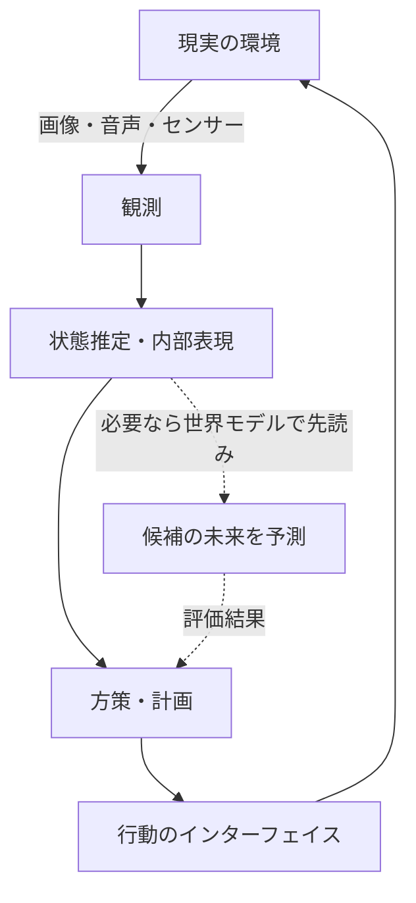

# 第7章：知覚・予測・行動の閉ループ

作成日：2026-10-14 / 更新日：2026-10-14

予測モデルの出力が単に表示されるのではなく、**現実へ作用する行動**に使われると、インターフェイスの意味は一段変わる。文章の生成では生成済みトークンが次の文脈になる。ロボットでは行動が実際の環境を変え、**外部から新たな観測が返ってくる**。

## 7.1 オープンループ生成とクローズドループ行動

文章生成では、モデルの出力を次の入力へ加えることはできるが、それだけでは外界が実際にどう変化したか分からない。これに対し、実体を持つエージェントでは

\\[
 o_t\longrightarrow h_t\longrightarrow a_t
 \longrightarrow \text{環境}\longrightarrow o_{t+1}
\\]

という閉ループが成立する。現実のロボットでは観測・推定・制御・通信遅延が並列に進むこともあり、この式は論理的な順序の模式形である。

**モデルの出力を環境へ作用させる**と、その結果が次回の入力となり、単なる系列生成では得られない訂正・探索・学習の機会が生まれる。これはロボットに限らない。コード実行器、ブラウザ、検索器を使うソフトウェアエージェントも、ツール実行によって変わった環境を再観測できる。ただし、**観測を文脈に追加して振る舞いを修正すること**と、**ネットワークの重みをオンライン更新すること**は別である。

## 7.2 予測と計画は違う

ある状態\\(z_t\\)から、候補となる行動列\\(a_{t:t+H-1}\\)ごとの未来を予測できるとする。モデルに基づく計画は、例えば

\\[
 a^{\ast}&#95;{t:t+H-1}
 =\operatorname{argmax}&#95;{a_{t:t+H-1}}
 \mathbb E\\!\left[\sum_{k=0}^{H-1}\gamma^k r_{t+k}
 \mid z_t,a_{t:t+H-1}\right]
\\]

のように書ける。これは一般的な目的関数の例であり、全エージェントがこの数式を直接最適化するわけではない。予測は**行動の結果を見積もる**役割、計画は**候補の中から行動を選ぶ**役割を担う。

現実で使う場合には、報酬予測だけでなく安全制約、機体の運動学、遅延、接触の不確実性、権限制限も必要になる。学習モデルの予測結果を無条件に実行してよいわけではない。

## 7.3 Vision–Language–Action：出口としての行動

[Gemini Robotics（2025）](https://deepmind.google/blog/gemini-robotics-brings-ai-into-the-physical-world/)は、視覚・言語の理解からロボットの行動へ接続するVision–Language–Action（VLA）という方向性を示している。テキスト、画像、音声などに加えて**行動も出力モダリティとなる**。

**VLAが行動を出力できることと、行動の結果を内部で明示的にシミュレーションできることは同義ではない。** 方策が観測から直接行動を選ぶ構成もあり、世界モデルを使う方式でも、動力学モデルと行動方策が別モジュールである場合がある。

ここで出力は、文章のような人間向け記号とは限らない。関節制御値、エンドエフェクタの移動量、動作チャンク、離散化された行動トークンなど、制御器が扱える形式であればよい。モデルの頭脳部分を完全に共通化する必要はなく、知覚・計画・低レベル制御を階層化してもよい。

## 7.4 GUI操作と音声対話にも存在する閉ループ

GUIエージェントは、**画面を観測 → 操作候補を選ぶ → ツールが操作を実行 → 新しい画面を観測**という流れを作る。モデルがクリックに相当する指示を生成しても、実際の操作・権限・実行結果の取得は外部システムの役割だ。したがって、エージェント全体の成功をモデル一回の予測と同一視できない。

音声対話も、入力の時刻、発話区間、応答のストリーミング、割り込み、相手の反応を考慮する必要がある。ここでも、**適切な音声を一度に合成できること**と、**継続的な対話の時間的要求を満たすこと**は別の性能である。

## 7.5 時間方向の違いは、統合の難しい部分

言語モデルのトークン生成は離散ステップで記述される。一方、人間やロボットのセンサーは、異なる周期で継続的な信号を生み、制御には実時間の期限がある。理想化して書けば

\\[
 \dot{s}(t)=f(s(t),a(t),w(t)),\qquad
 o(t)=g(s(t),\nu(t))
\\]

という連続時間の動力学があり、デジタルシステムはそれをサンプリングして処理する。\\(w,\nu\\)は外乱・観測ノイズを表す。**離散トークンで表現できること**と、**継続的な制御を十分な精度・頻度で実行できること**は別の課題だ。

動画・音声・行動を単一系列へ入れる設計では、タイムスタンプ、位置情報、因果マスク、非同期入力、遅延の取り扱いが本質的になる。

## 7.6 三つの時間スケールを混同しない

| スケール | 状態を進めるもの | 学習済み重みの更新は必要か |
| --- | --- | --- |
| **モデル内部の深さ** | 層ごとのResidual Stream更新 | 通常は不要 |
| **生成・推論のステップ** | 次トークン確定、画像の数値積分、ツールの結果の取り込み | 通常は不要 |
| **環境との相互作用** | 行動・実行・再観測、必要なら計画の修正 | なくても閉ループは成立する |

人間との比較で重要なのは、AIにこれら複数の時間スケールが存在する一方、**推論のたびに重みが変化しているわけではない**点である。オンライン学習やパラメータ更新を導入する場合は、さらに別の適応ループが加わる。

## 7.7 人工的な思考・出力・作用の区別

知覚した内容を内部状態に保持し、候補の未来を予測し、外界へ行動して結果を再観測する。この構造は、人間の知能を**知覚と行動の連続的な相互作用**として捉える立場と機能的な類似を持つ。ただし、通常の自己回帰LLMは生成の各段階で重みを更新しない。時間を通じたモデル内の状態保持、環境の観測、学習による可塑性は、別々に記述する必要がある。

しかし、ここから「Transformerの内部状態＝人間の意識」「生成された言葉＝人間の思考の完全な記録」といった主張は導けない。アーキテクチャの機能的な対応と、脳の生理機構や主観経験に関する主張は区別すべきだ。

---
