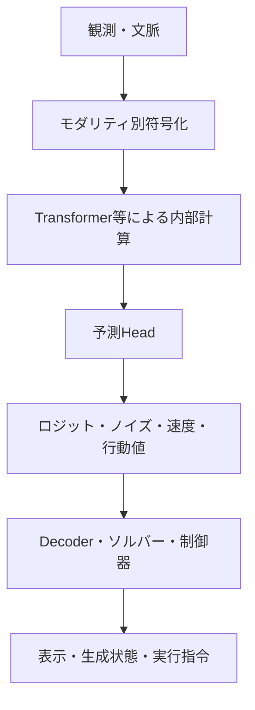
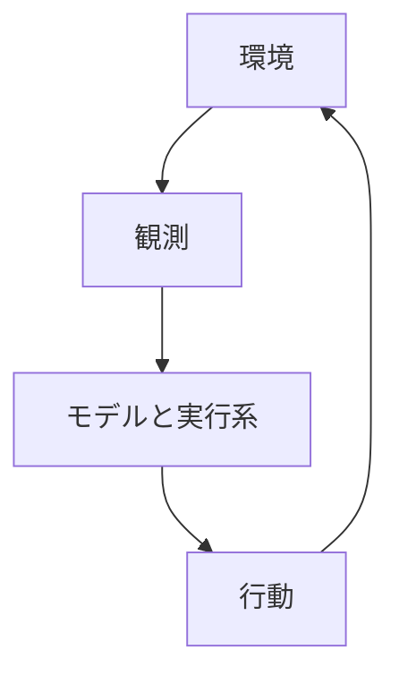

# 第9章：統合的な見取り図と未解決の問い

次トークン予測、ノイズ・速度推定、行動指令には、**異なる形式の出力を次の計算へ渡す**という共通点がある。一方、表現学習、マルチモーダル統合、世界モデル、身体的なエージェントへ至る道筋は一つではなく、複数の設計軸に分かれる。ここで示すのは研究を整理する**統一的な見方**であり、全モデルが同じアーキテクチャや知能理論へ収束するという主張ではない。

## 9.1 二つの図でつなぐ

ここでは**一回のモデル呼び出しの情報経路**と**外部環境との閉ループ**を別図にする。同じ矢印で層更新、生成反復、外界の状態遷移を表すと、異なる仕組みを混同しやすいからだ。

次の図は、必要な場合に**その出力が実環境を変え、新しい観測が返る**という、より外側の反復だけを示す。

LLMで生成済みトークンを次の文脈へ加える反復や、画像のノイズ状態をソルバーが更新する反復は、上段の処理を**推論系の内部で繰り返す**仕組みとして別途考える。外側の環境ループが存在しても、モデル重みが毎回更新されるとは限らない。

## 9.2 「統合」と「境界」を同時に見る

重要な境界は次の四つである。

| 境界 | 何をつなぐか | 注意すべきこと |
| --- | --- | --- |
| **入力** | 外界の信号 → トークン／潜在表現 | 情報損失、位置・時刻、センサーの偏り |
| **内部状態** | 異なる情報源・モダリティの関係 | 共通次元と共通意味は同じでない |
| **出力** | 内部表現 → 予測可能・実行可能な値 | Head・ソルバー・表示系・制御器は別レイヤー |
| **環境との相互作用** | 行動 → 世界の変化 → 再観測 | 因果的妥当性、安全性、長期安定性が必要 |

これらは「知能の境界」というより、**設計と検証で区別すべき責務**だ。共通モデルを巨大化するだけで各境界の問題が消えるわけではない。

## 9.3 最も興味深い仮説

本稿の中心的な解釈は、次のように表せる。

> **AIの出力形式は、獲得した内部計算能力の全体ではない。** 比較的簡潔な予測課題は、複雑な依存関係を持つデータに向き合うようモデルを訓練できる。内部で形成された表現を、文字・画像・音声・行動など異なるインターフェイスから読み出すこともできる。さらに、行動と観測の関係を学び、閉ループで利用するなら、世界モデルやエージェントとしての能力へ接続する。

ただし、これは**可能性と設計原理の説明**であって、「予測だけで汎用知能が必然的に生じる」「世界モデルは必ず共通Transformerになる」といった定理ではない。

## 9.4 統合の範囲は、目的に応じて選ぶ

モデルやシステムを統合する方法には、少なくとも三つの方向がある。

- **入力側の統合**：画像・音声などを符号化し、言語や共通表現へ接続する。
- **内部計算の共有**：異なるモダリティの情報を共通Transformerなどで相互参照・更新する。
- **生成・行動系の連携**：画像のソルバー、音声Decoder、行動器などの専用の出口を組み合わせる。

第4章の赤い球の例に戻ると、**位置を言語で答える、画像を編集する、押した後の結果を予測する、実際に押す**は異なる契約である。必要な部分の共有は可能だが、単純に出力ヘッドを差し替えるだけですべての能力が得られるとは限らない。

重要なのは、**すべてを一個のTransformerへ統合することを目的化せず、何を共有し、何を専用化するかを設計・検証すること**である。単一モデルによる統合と、複数モデルがインターフェイスを介して協調するシステム統合は、どちらも選択肢となる。

## 9.5 今後の研究上の問い

1. **内部表現の形成**：どのデータと予測目標が、どの状態変数・関係・不変性の獲得を促すのか。
2. **共有すべき範囲**：モダリティ別Encoder、共有Transformer、専用Decoderのどこが最適な分割か。
3. **予測の粒度**：次トークン、画素、動画、潜在状態、未来の報酬、行動のどの組み合わせが有効か。
4. **世界モデルの信頼性**：観測だけから学ぶ関係を、行動による介入や未経験の環境でどこまで使えるか。
5. **時間と計算**：前向き計算の深さ、生成の反復、継続的な状態更新、オンライン学習をどう組み合わせるか。
6. **理解の検証**：Probeの読み出し、内部介入、転移性能、環境での計画成功をどう関連づけるか。

## 9.6 結論

「次トークン予測にすぎない」「ただのノイズ予測だ」という説明は、**出力や学習目標の一面**を記述している。しかし、内部で何が学習され、どの程度の時間をかけて何と相互作用し、どのモダリティを通じて環境に接続できるかまでは語らない。

一方で、複雑な出力や内部表現を示せるだけで、人間と同じ理解や汎用的な世界の因果モデルが獲得されたとも断定できない。

**予測は単なる末端作業ではないが、知能全体の説明でもない。** 出力が簡潔でも、その背後では長い履歴を統合する計算が必要となり得る。重要なのは、**何を予測し、どの情報を保持し、どの計算へ渡し、環境からどのようなフィードバックを得るか**を分けて評価することだ。

「予測をインターフェイスとして読む」という視点は、複雑な能力を出力形式だけで過小評価せず、統合モデルや世界モデルの成果を過大評価もしないための、一つの有用な見取り図になる。

---
