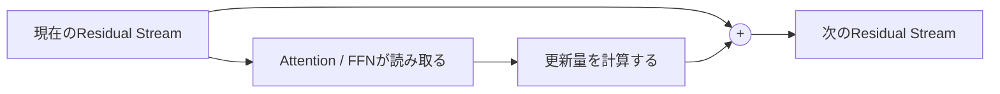

# 第1回：隣接層の類似性とResidual Stream――何が反復を示唆するのか
作成日：2026-11-03 / 更新日：2026-11-03

> **この回の問い：** Looped Transformerを説明する前に、通常のTransformerに見られる2つの観察を確かめる。重みの類似性は共有の可能性を、Residual Streamの連続性は状態更新としての解釈を示唆する。しかし、その2つだけでは重み共有が最適だとは結論できない。

## 1. 隣接層の重みの類似性と、その意味

ICLR 2025の[DOCS: Quantifying Weight Similarity for Deeper Insights into Large Language Models](https://proceedings.iclr.cc/paper_files/paper/2025/hash/a39a9aceda771cded859ae7560530e09-Abstract-Conference.html)は、重み行列の類似度を調べる指標DOCSを提案した。調査した複数の公開LLMでは、隣接層の重みがしばしば高い類似性を示し、深さ方向にクラスターを形成する傾向が報告されている。

ここでの「類似性」は、対象となる重み行列と指標を定めた上での**経験的な観測**であり、すべての層・すべてのモデルへ一般化してよいものではない。

この結果は「すべての層が交換可能」という意味ではない。DOCSは**重み行列の類似性**を測るもので、同じ入力に対する計算機能そのものを測る指標ではない。行列の対応づけ、正規化方法、パラメータ化の対称性によって類似度は変わり得るため、観測された相関から重み共有の最適性を直接導くことはできない。示唆されるのは、**層間の独立性が、パラメータの保持方法としては過剰かもしれない**という可能性である。

重みが似る理由については、学習上の制約、初期化、層同士が処理する表現の相関など複数の可能性がある。類似性だけから「同じアルゴリズムが反復されている」と逆算することはできない。

重要な反例的示唆もある。[Your Transformer is Secretly Linear](https://aclanthology.org/2024.acl-long.293/)では、小型モデルの事前学習において、層間表現の線形性を**下げる正則化**が一部のベンチマーク性能を改善した。したがって、層間の似通い方が高いほどよいとか、似た層なら必ず共有した方がよいとは言えない。重み共有の妥当性は、**冗長性の削減**と**計算の多様性・機能分化の維持**を両立できるかによって決まる。

たとえば、ある重み行列を

\\[
W_\ell=W_{\mathrm{shared}}+\Delta W_\ell
\\]

と分ける。層固有の差分が小さく、あるいは低ランクで近似できるなら、

\\[
\Delta W_\ell\approx A_\ell B_\ell
\\]

として共有重みと軽量な補正を組み合わせられる。これは完全に同じブロックを反復する前の、中間的な設計でもある。

| 構造 | 各層・各反復が保持するもの | 意味 |
| --- | --- | --- |
| 独立層 | 固有の重み一式 | 柔軟だが重みが増える |
| 部分共有 | 共有重み＋層固有差分 | 類似部分を再利用する |
| 完全共有 | 同じブロックの重み | 論理的な深さと重み数を分離する |
| 適応反復 | 共有ブロック＋停止規則 | 入力ごとに計算深度を調整する |

ただし、**パラメータの数値的な類似性≠機能的な類似性**である。ニューロンの並べ替えや表現空間の変換によって、重みの見かけ上の類似度は変わり得る。また、関数の入力状態が違えば、同じ重みでも異なる働きをする。

したがって、重みの類似性は「共有を試す動機」にはなるが、「共有しても性能が落ちない」という保証にはならない。実際に重みを共有して学習したモデルが高性能でも、それは事後的な層置換の成功と同じ証拠ではない。とくに、**重みの交換可能性**を調べるなら、同じ状態に対するブロック関数の比較だけでなく、元の層が実際に受け取る**自然な活性値分布**で置換したときの影響も測る必要がある。別の層へそのまま通すと、分布外入力による失敗を「共有不能」と誤認する可能性がある。

また、**学習済みの独立層を後から圧縮すること**と、**最初から共有ブロックを反復するよう事前学習すること**は別の問題である。前者は既存モデルの関数をどれだけ保持できるか、後者は重み共有を前提とした学習がどのようなアルゴリズムを獲得するかを問う。同じ評価表にまとめる場合も、学習条件を混同すべきではない。

## 2. Residual Stream：深さ方向の状態更新

Pre-Norm型の残差ブロックを単純化すると、

\\[
h_{\ell+1}=h_\ell+F_{\theta_\ell}(\operatorname{Norm}(h_\ell))
\\]

である。更新量を

\\[
\Delta h_\ell=F_{\theta_\ell}(\operatorname{Norm}(h_\ell))
\\]

とすれば、

\\[
\boxed{h_{\ell+1}=h_\ell+\Delta h_\ell}
\\]

となる。AttentionやFFNは既存の状態を読み、同じ残差空間へ変更を書き戻す。

[Transformer Circuitsの基礎研究](https://transformer-circuits.pub/2021/framework/index.html)は、Residual StreamをAttention HeadやMLPが読み書きする共通の通信経路として扱う。この視点からは、残差ストリームを**深さ方向の作業領域**と呼ぶことができる。

ただし、この呼び方には条件がある。Residual Streamは人間の作業記憶と同等の仕組みだと証明されているわけではない。通常の自己回帰生成では、深さ方向の中間状態が、そのまま次トークンへ永続保持されるわけでもない。トークン間の文脈アクセスには、入力列とKVキャッシュなどが別に関わる。

| 保存・参照する場所 | おおまかな役割 | 注意点 |
| --- | --- | --- |
| **モデル重み** | 学習された計算規則・知識 | 入力ごとに作られる作業状態ではない |
| **Residual Stream** | **現在の前向き計算**で層をまたぐ状態 | 後段の層が上書き・相殺し得る |
| **KVキャッシュ** | 過去のトークンに対するAttention用の参照情報 | Recurrent-Depthでは反復別の保持規則が必要になり得る |
| **外部メモリ・ツール** | 明示的に保存・検索・検証する情報 | モデル内部だけで完結するとは限らない |

この区別を曖昧にすると、Residual Streamを「トークンをまたいで永久に保持されるメモリ」と誤解しやすい。

### 2.1 隣接状態が似ていても、各層が無意味とは限らない

ACL 2024の[Your Transformer is Secretly Linear](https://aclanthology.org/2024.acl-long.293/)は、複数のDecoder-only Transformerで隣接層間の表現に強い線形的関係を報告した。ここにはResidual Connectionが大きく関わっている。

更新量\\(\Delta h_\ell\\)が元の状態\\(h_\ell\\)に直交し、\\(h_\ell\neq 0\\)である場合、

\\[
\cos(h_\ell,h_{\ell+1})
=\frac{1}{\sqrt{1+\|\Delta h_\ell\|^2/\|h_\ell\|^2}}
\\]

となる。更新量が相対的に小さいだけでも、隣接状態の類似度は自然に高くなる。

それでも、ある小さな部分空間の変化が最終的な予測を決定する可能性はある。また[LLM Layers Immediately Correct Each Other](https://proceedings.neurips.cc/paper_files/paper/2025/hash/cb574f092013f886fe0b93d295aa402e-Abstract-Conference.html)は、隣接層が互いの残差更新を打ち消す振る舞いを報告した。

つまり、**似た状態が続いていること**と、**計算していないこと**は異なる。Residual Streamは、情報の保存だけでなく、書き込み、修正、抑制が行われる場所として捉える必要がある。

### 2.2 2つの観察を統合する際の注意

ここまでの事実を並べると、次のように思える。

1. 隣接層のパラメータが似ている。
2. 隣接層の残差状態が似ている。
3. ならば、同じ演算器による状態の反復更新でよいのではないか。

3は**合理的な設計仮説**だが、1と2からの論理的帰結ではない。ここは本稿全体で最も重要な区別である。

例えば、隣接層がそれぞれ**候補の特徴を作る**役割と**その候補を打ち消す**役割を担うなら、最終状態がよく似ていても、両層を同じ重みに置換することは機能を損なう可能性がある。逆に、もともと異なる重みの層を、学習し直した共有Coreが代替できる可能性もある。**学習済みモデルの圧縮可能性と、共有を前提にした新規学習の能力は別に測る**必要がある。

---

**この回の結論：** 重みと活性値の類似性はRecurrent-Depthを試す理由にはなるが、同じ機能を実行している証拠でも、パラメータ共有による無損失圧縮の保証でもない。

[連載の目次へ](./) ｜ [第2回へ進む](02-recurrent-depth-foundations.md) ｜ [参考文献](references.md)
