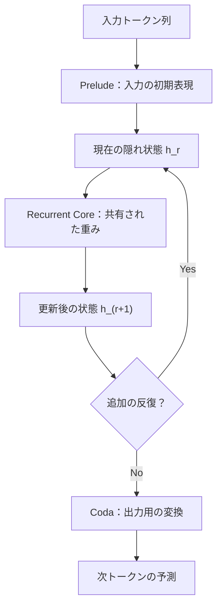

# 第2回：Looped Transformer / Recurrent-Depth Transformerの構造と研究史
作成日：2026-11-03 / 更新日：2026-11-03

> **この回の問い：** 同じ重みを深さ方向に再利用するとは何を意味するのかを定義する。Universal Transformer、ALBERT、Deep Equilibrium ModelsからHuginn、Ouro、既存モデルをループ化する近年の研究までを並べ、単なる重み圧縮と推論時計算量の拡張を区別する。

## 1. 深さ方向の反復とは何か

重要なのは、**出力トークンを追加せずに、同じ重みをもう1度使って計算できる**ことだ。計算の深さを変えるために、追加の独立パラメータを必ずしも用意する必要がなくなる。

標準的なTransformerは各層に固有のパラメータ\\(\theta_\ell\\)を割り当てる。

\\[
h_{\ell+1}=F_{\theta_\ell}(h_\ell)
\\]

対して、Looped Transformerでは共有したブロックを複数回適用する。

\\[
h_{r+1}=F_\theta(h_r)
\\]

同じ重みでも、毎回入力される\\(h_r\\)が変わるため、出力は同じではない。ここでの\\(h_r\\)は1トークンのベクトルとは限らず、通常は文脈中の複数トークンに対応する状態行列を含む。残差形式のCoreなら、たとえば

\\[
h_{r+1}=h_r+\Delta_\theta(h_r,c)
\\]

となる。ここで\\(c\\)は元の入力に由来する条件情報などを表す。

これはあくまで説明用の式であり、実装によってはゲート、正規化、入力再注入、反復状態の初期化が入る。特に、共有Coreが毎回同じ入力分布を受け取るとは限らない。

深さ方向に同じ演算器を再利用する点で、通常のRNNにも似ている。ただし、**トークン位置の時間方向に再帰するRNNと、Transformerブロックの深さ方向で再帰するモデルは同じではない**。同じモデルに両方の反復を入れることもできる。

### 1.1 Prelude–Core–Codaという設計

代表的な設計の1つは、前処理、共有Core、出力処理を分ける方式である。

概念的には、

\\[
z=P_\phi(x),\qquad
h_{r+1}=R_\theta(h_r,z),\qquad
y=\operatorname{Decode}(C_\psi(h_R))
\\]

と表せる。入力由来の情報\\(z\\)を各反復で再注入する設計もあり、反復中に入力の情報を利用し続けるための選択肢になる。

この形はHuginn系の設計を説明するもので、全Looped Transformerに共通する構造というわけではない。さらに入力条件\\(z\\)を毎回与えるかどうかによって、反復状態の保持と入力情報への回帰のバランスは変わる。PreludeやCodaを共有しないことで、**入力の解釈と出力の読み出し**を反復Coreとは別の機能として学習できる。一方、これらを増やせば非共有パラメータも増えるため、保持メモリと機能分化のトレードオフになる。

### 1.2 「物理的な層数」と「論理的な深さ」

仮にPreludeが2層、共有Coreが4層、Codaが2層で、Coreを32回実行するとする。保持するブロックは概念上8層分で、前向き計算の論理的な深さは

\\[
L_{\mathrm{logical}}=2+4\times32+2=132
\\]

になる。

これは**132個の独立した層を保持している**という意味でも、**132層モデルと同じ精度を保証する**という意味でもない。共有するのは重みであり、反復計算自体は32回必要だ。**論理的深さの増加は無料ではなく、推論・学習の計算グラフ、KVキャッシュ、逐次処理の深さに影響する。**なお「物理層数」は必ずしも半導体上の物理的な層を指さず、**保持する固有のTransformerブロック数**という慣用的な表現である。

Huginnの原論文が示す失敗例にも注意したい。ある初期化・正規化の構成では、モデルが再帰状態を十分活用せず、1回と32回の反復で検証Perplexityがほとんど変わらなくなった。**反復回路があることと、追加の反復を利用するよう学習できることは別**なのである。反復の途中で最終層相当の情報が既に十分形成されている可能性もあれば、深さを増やすことで有益な特徴を破壊する可能性もある。

### 1.3 「反復した状態」は必ず進歩するのか

共有Coreが同じ写像を何度も適用すると、状態が有用な段階的計算を進める場合だけでなく、ほとんど変わらない固定点に近づく場合、振動する場合、最初は正しかった予測を壊す場合もある。後者のような現象は *latent overthinking* と呼ばれる。

形式的には、共有更新を \\(H_{r+1}=F_\theta(H_r;c)\\) としたとき、\\(H_{r+1}\approx H_r\\) であることは、**状態の変化が小さい**という意味にすぎず、答えの正確性や推論の完了を意味しない。また、反復を増やしても同じような表現しか得られないなら、計算コストに見合う利益がない。

したがって、Looped Transformerの研究課題は重み共有だけでなく、**反復ごとの役割の分化・更新の安定化・適切な停止**に及ぶ。これが後のLoopMTPやAdaptive Depthの議論につながる。

### 1.4 先行する重み共有・固定点の研究との違い

深さ方向に重みを共有する考え方は、近年のReasoning Modelが突然生み出したものではない。歴史的には、次の研究を分けて理解するとよい。

| アプローチ | 重み共有・反復の位置づけ | Recurrent-Depthとの関係 |
| --- | --- | --- |
| **Universal Transformer**（2018） | 同じ変換を複数ステップ適用し、位置別の停止制御も扱う | 動的な深さ計算の先駆け |
| **ALBERT**（2019） | Transformer層間でパラメータ共有し、主にモデルを小さくする | **重み共有≠潜在推論の獲得**を示す具体例 |
| **Deep Equilibrium Models（DEQ）**（2019） | 重みを共有した深い変換の固定点を数値的に求め、陰関数微分で学習 | 有限回のループとは異なる、**収束・平衡点**を中心とした設計 |
| **Huginn / Ouro**（2025） | 深さ方向の共有反復を、**推論時計算量**として積極的に利用する | 現代のLooped Language Modelの代表例 |

ALBERTの[Google Researchによる解説](https://research.google/blog/albert-a-lite-bert-for-self-supervised-learning-of-language-representations/)では、層間共有により重み数を大きく減らせる一方、評価条件によっては精度が下がることも説明されている。

[Deep Equilibrium Models](https://papers.neurips.cc/paper_files/paper/2019/hash/01386bd6d8e091c2ab4c7c7de644d37b-Abstract.html)は、重みを繰り返し適用する状態が固定点へ近づく場合、その平衡状態を直接求める方向で研究された。しかし、**あらゆる有用な反復計算が固定点へ収束するわけではない**。段階的なアルゴリズムや探索の中間状態を使うには、単純な固定点の解釈だけでは不十分なことがある。

したがって「重み共有」「反復回数の可変化」「反復による意味のある段階的計算」「潜在推論」は、重なり合いながらも異なる性質である。

## 2. どのように発展してきたか

前節のUniversal Transformer、ALBERT、DEQはそれぞれ、**反復処理、層間重み共有、平衡点計算**という異なる目的を示している。その後、[Looped Transformers as Programmable Computers（ICML 2023）](https://proceedings.mlr.press/v202/giannou23a.html)は、共有Transformerを反復してアルゴリズム的な処理を構成できることを検討した。ここから、推論時計算量を増やすHuginn、事前学習から深さを割り当てるOuro、潜在状態とCoT教師信号を結ぶLOTUS、構成選択を比較する2026年の研究へつながる。

ここで重要なのは発表年の新しさではなく、研究の問いが**「重みを削減できるか」から「共有された演算器に、繰り返す価値のある計算を学習させられるか」**へ広がったことである。

### 2.1 Huginn：潜在状態で計算量を増やす

GeipingらによるHuginnは、約35億パラメータ・約8,000億トークンで学習したRecurrent-Depthモデルを報告した。通常の「追加の推論トークンを生成する」方式とは異なり、Coreの反復回数を増やして次の出力までの内部計算を増やせる。

注目点は、反復回数を事前学習時の固定深さに完全には拘束されずに変えられる可能性を、実モデルで検証したことだ。ただし無制限の反復が有効だと主張するものではない。

### 2.2 Ouro：Looped Language Modelを事前学習から設計する

ZhuらのOuroは、1.4Bおよび2.6BのLooped Language Modelを、約7.7兆トークンで学習した。反復計算や深さ配分を、後付けのCoT生成だけでなく事前学習そのものに組み込む方向を示している。

公開プロジェクトの[反復深さ別の結果](https://ouro-llm.github.io/)は、「もっと回せば常に良い」という期待への反証にもなる。Ouro-2.6Bについて、6ベンチマーク平均のスコアは学習した4反復で**77.44**、学習時より多い8反復では**76.44**だった。これは反復による能力向上を否定するものではなく、**学習時の深さを超えた単純な外挿が単調に改善するわけではない**ことを示している。

論文では、いくつかの比較ベンチマークでより大きなモデルに競争力のある結果を報告する。ただし、学習データ・学習FLOPs・推論FLOPs・推論レイテンシが揃わない比較から「共有重み構造そのものが常に優れている」とは言えない。**同じパラメータ数での比較**と**同じ推論計算量での比較**は、違う質問に答えるための実験である。加えて、学習を終了した独立層モデルの重みを共有化する「圧縮」と、初めから共有Coreを用いて学習する「構造選択」は別の実験として扱う。

### 2.3 2026年の構造比較：反復の場所も重要

Huangらの[Towards Looped Models Done Right, Part I](https://arxiv.org/abs/2610.23036)は、反復の位置、入力再注入、再帰状態の形式などの設計軸を切り分けて比較した。実験では、Prelude–Core–Coda構成や入力再注入の有効性が示され、MoEモデルへも結果が拡張された。

特に、**通常型Transformerの層をただコピーして同じ回数繰り返すだけでは、最適な設計にはならない**という点が重要である。何を共有し、何を層固有に残し、入力をどこで再参照するかが、モデルの能力に影響する。

同研究のMoE実験では、学習・推論FLOPsを揃えた比較で、Huginn型構成が112層のFeedforward MoEに対して**常駐パラメータ数を75%削減**し、DROPやGSM8Kで上回る結果を報告している。一方、すべてのベンチマークで優越したわけではない。MoEにおいても「全パラメータ数」「実際に活性化されるパラメータ数」「演算量」を分けて評価する必要がある。

**比較表の読み方も重要だ。** 同じ重み数で計算回数を増やした場合の利得と、同じ計算量で重み数を減らした場合の利得は別の結果である。前者は推論時計算量への投資、後者はモデルの保持効率を問う。両方を区別することで「モデルが小さいのに高精度」という宣伝的な一文へ還元せずに済む。

### 2.4 既存モデルのループ化と学習予算

Marchenkoらの2026年のプレプリント[Closing the Loop: Practical Training Recipes for Looped Language Models](https://arxiv.org/abs/2610.00673)は、ループ型モデルの学習を大規模な事前学習から始める方法に加え、既存のDenseモデルをループ型へ変換する方法も検討した。著者らは、1.4Bモデルを310Bトークンで学習するレシピと、Qwen3-1.7B-Baseを継続学習でループ化するレシピを報告している。比較対象やデータ量を揃えた実験では、各論文内のDenseベースラインに対して複数の評価で改善したという。

これは「ループ型モデルには数兆トークン規模の学習が必須」という見方を弱める結果だが、**単一のプレプリントが示す特定レシピの結果**であり、異なるモデル・データ・学習予算でも同じ改善が得られるとは限らない。特に、Ouroとのトークン数比較だけから学習効率を結論せず、同一データ・同一計算予算でのベースライン比較と、別条件での再現を分けて評価したい。

---

**この回の結論：** 共有した重みを繰り返すことで論理的な計算深度とモデルの重み数を分離できる。ただし、より深く実行すれば必ず性能が改善するわけではなく、共有する範囲や学習方式が重要になる。

[第1回へ戻る](01-weights-and-residual-stream.md) ｜ [第3回へ進む](03-depth-conditioning-and-history.md) ｜ [参考文献](references.md)
