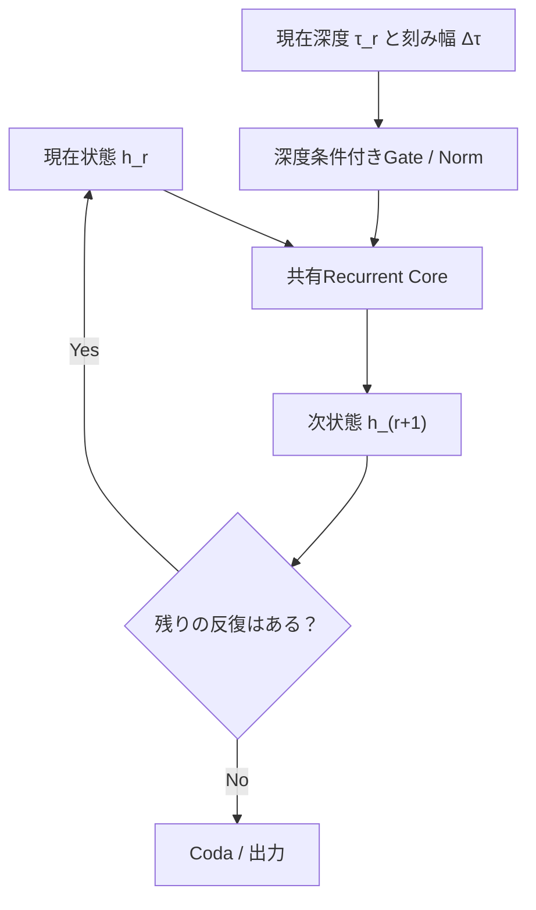
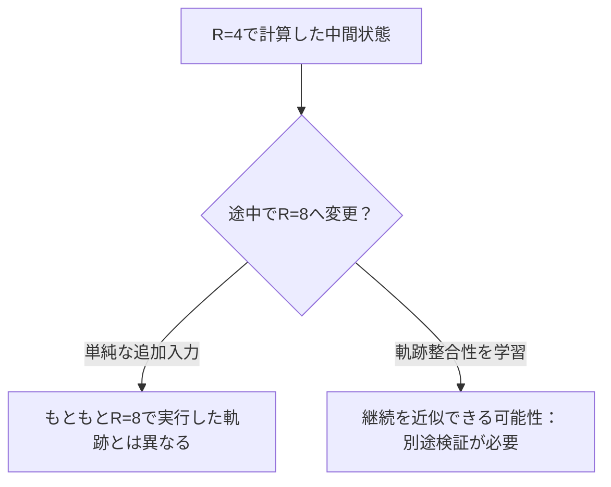

# 第3回：Depth Conditioningと状態履歴――共有Coreの機能を分化できるか
作成日：2026-11-03 / 更新日：2026-11-03

> **この回の問い：** 同じ共有Coreを繰り返しても、反復の役割は自動では分化しない。現在の深度、反復予算、直前の状態履歴を条件として与えることで、反復ごとに異なる計算を学習させられるのかを検討する。

## 1. Depth ConditioningとHistory-State Injection――反復段階と軌跡を共有Coreに伝える

通常のLooped Transformerでは、重みを共有しても状態そのものは毎回変わる。

\\[
h_{r+1}=F_\theta(h_r)
\\]

したがって**同じ重みでも反復ごとに異なる出力になり得る**。しかし、この式だけでは共有Coreに「いま何回目か」「全体のどの段階か」「残り何回の計算を予定しているか」を**明示的には**伝えていない。状態から反復回数を間接的に推定できる場合はあるが、それに依存する必要があるのかは別問題だ。

**Depth Conditioning（深度条件付け）**は、共有された計算規則に現在の計算段階を与える発想である。**重みが同じでも、条件が違えば計算される関数は異なる**。反復ごとに処理の強さや性質を変えられる可能性があり、「完全共有か、層ごとに独立か」という二分法の間に設計選択肢が生まれる。

### 1.1 深度を知らない反復と、深度を条件とする反復

現在の反復番号を\\(r\\)、要求する総反復回数を\\(R\\)として、正規化した時刻と刻み幅を

\\[
\tau_r=\frac{r}{R},\qquad \Delta\tau=\frac{1}{R},\qquad 0\le r<R
\\]

と置く。共有Coreの状態更新を、概念的には

\\[
h_{r+1}=F_\theta(h_r;\psi(\tau_r,\Delta\tau))
\\]

と書ける。\\(\psi\\)は反復段階を特徴量に変換する関数である。実装ではこの条件をAttention/MLPブランチのGate、正規化のスケール、またはCore全体の更新量へ作用させられる。

ここで**時刻\\(\tau_r\\)は文章中の生成位置ではない**。また、Block Diffusionにおける**ノイズ除去の時刻とも異なる**。これは、**同じ出力候補の内部計算をどこまで進めたか**を指定する深さ方向の座標である。

このような**時刻依存の状態更新**は、力学系でいう非自律的な更新とのアナロジーを持つ。\\(r\\)という絶対反復番号、\\(r/R\\)という正規化進行度、\\(1/R\\)という刻み幅、予定総予算\\(R\\)は互いに異なる情報であり、組み合わせによって挙動が変わる。しかし、単に\\(\tau\\)や\\(\Delta\tau\\)を入力しただけで、モデルがODEの解法になったり、任意の刻み幅に対して同じ終端状態へ収束したりするわけではない。特に、この条件付けは一般に**反復数の異なる実行が同じ軌跡の接頭部分を共有することを保証しない**。

### 1.2 軽量なGateからAdaLNまで：何を変えるのか

[Zhuangら（2026）](https://arxiv.org/abs/2609.36636)は、共有Coreの深度条件付けを次の3種類で比較した。

| 方式 | 条件付けするもの | 特徴 |
| --- | --- | --- |
| **Loop Gating（LG）** | Core全体を通した更新量 | 反復ごとのスカラー制御。追加学習パラメータは論文の実装で8個 |
| **Branch Gating（BG）** | 各層のAttention/MLPの残差ブランチ | 更新の種類ごとにスカラー制御。Core層数を\\(k\\)とすると追加パラメータは\\(16k\\)個 |
| **AdaLN型** | 正規化後の特徴量とブランチ出力 | チャネル単位のスケールとGate。より表現力が高いが重い |

同論文のLoop Gatingは、条件付き更新を

\\[
\begin{aligned}
g_r&=1+q^\top\psi(\tau_r,\Delta\tau),\\
h_{r+1}&=h_r+g_r\bigl(F_\theta(h_r)-h_r\bigr)
\end{aligned}
\\]

として実装する。追加Gateをゼロ初期化すれば\\(g_r=1\\)から始まるため、学習開始時には条件なしの反復と一致する。ここで\\(F_\theta\\)は**残差更新を含むCore全体の変換**であり、加算されるのはその入出力差である。

重要なのは、**AdaLNのように細かな条件付けが常に勝つわけではない**ことだ。対象論文ではQwen3-0.6B系の特定のCore配置\\(7\times4\\)、有効深度56でBGのOverallが**38.46**、条件なしBaseLoopが**36.59**、AdaLNが**38.01**だった。一方、別の構成・タスクでは改善が小さいか負になる。たとえば同論文のLlama系実験には、学習深度からの外挿でGatingを追加してもBaseLoopのReasoningを下回る例がある。したがって**現在深度を明示的に知らせるだけでは、反復に機能的な役割が自動的に生まれるわけではない**。これらは論文固有の平均正答率であり、商用モデル一般の比較ではない。**BaseLoopからの増分はこの設定で約1.87ポイント**であって、「AdaLNや深度条件を入れれば性能が大幅に向上する」という主張にはならない。重要なのは、わずかな条件付けが反復間の差を学習する足場になり得ることと、その効果が配置・タスク・総深度に依存することだ。

先行研究として、[Xu & Sato（ICML 2025）](https://proceedings.mlr.press/v267/xu25x.html)はTimestep Encodingに基づくループごとのスケーリングが表現力を改善できることを理論・実験の両面から検討した。[LoopFormer（ICLR 2026）](https://arxiv.org/abs/2602.11451)は現在時刻と刻み幅を条件として、**異なる予算で得る軌跡を整合させるShortcut-Consistency Training**へ進めた。Zhuangらの研究はさらに、**深度条件付けと状態履歴の組み合わせ**を比較対象にした。

### 1.3 現在深度だけでは不十分：History-State Injection

深さ方向の作業記憶をResidual Streamと見るなら、その**現時点の状態**だけでなく、**直前にどう変化したか**も次の計算に役立つ可能性がある。

Zhuangらは、初期状態\\(h_0\\)を毎回与える *Initial-State Injection* とは別に、直近の反復状態の差分を用いる *History-State Injection* を提案した。

\\[
\widetilde h_r=h_r+
\sum_{j=1}^{m_r}\mathcal B_j(h_{r-j}-h_r),
\qquad m_r=\min\{w,\max(r-1,0)\}
\\]

\\[
h_{r+1}=F_\theta(\widetilde h_r)
\\]

\\(w\\)は履歴窓の長さで、\\(\mathcal B_j\\)は遅延\\(j\\)に対応する学習可能なスカラー、チャネル別係数、または線形写像である。**論文の定義では初期状態\\(h_0\\)を履歴窓から明示的に除いている**ため、これを「初期入力の再注入」と同一視しない。

この差分は軌跡の局所的な変化を伝える。ただし、物理的な速度\\(dh/dt\\)を正確に計算しているわけではなく、\\(\Delta\tau\\)で割った時間微分とは区別される。

もう1つの重要な知見は、**初期状態の再注入が常に有効ではない**という点だ。論文では、容量の大きいDense型Initial-State Injectionが反復を延長したときにKnowledge性能を大きく損なう場合があった。逆に、履歴差分と深度条件付けを組み合わせると、その一部を緩和できた。これらの結果を「入力の再注入が一般に悪い」と読んではいけない。実装の容量、学習深度、評価範囲によって結論が変わる。

### 1.4 深く回すとReasoningは伸びてもKnowledgeは落ちる

2026年9月の[What Makes Recurrence Effective in Looped Language Models?](https://arxiv.org/abs/2609.36636)は、Llama3.1-1B系とQwen3-0.6B系の**アーキテクチャ設定を用い、重みはランダム初期化して事前学習した**比較実験である。既存の公開済みチェックポイントをそのまま深く実行した結果ではない。

Llama系のあるBaseLoop比較では、有効深度を20から40に増やすと、次のようになった。

| 論文中の集約カテゴリ | 有効深度20 | 有効深度40 | 変化 |
| --- | ---: | ---: | ---: |
| Reasoning | 28.52 | 31.49 | **+2.97ポイント** |
| Knowledge | 62.80 | 52.11 | **−10.69ポイント** |

*数値は該当ベンチマーク群の正答率の単純平均（%）。KnowledgeとReasoningは著者らによる課題群の分類であり、一般的な「知識能力」「推論能力」の完全な測定ではない。*

また、Qwen系BaseLoop\\(4\times7\\)で学習有効深度28を84まで延長した比較では、History-State InjectionとLoop Gatingの組み合わせ（H+LG）が**Overall 37.30**で、Initial-State＋Historyは**36.91**、Initial-State＋Loop Gatingは**36.33**だった。論文は、異なる反復間の計算依存性を測る *computational interaction* という介入的な指標も報告している。

ただし、これらは**限られたモデル規模・タスク群・学習条件の結果**である。反復数の増加や深度条件付けが必ずReasoningを改善することを示すものではない。特に、入力が難しいほど追加反復の利得が大きい、という単純な傾向も同研究では一貫していない。

### 1.5 反復予算を変更すると、途中状態の再利用は難しくなる場合がある

深度条件付けで忘れてはいけないのは、総反復回数\\(R\\)が**各ステップの入力条件そのもの**を変える場合があることだ。

たとえば、\\(R=4\\)の実行では時刻が\\(0,1/4,2/4,3/4\\)、\\(R=8\\)では\\(0,1/8,\dots,7/8\\)となる。最初の時刻\\(\tau_0=0\\)は同じでも、最初から\\(\Delta\tau=1/4\\)と\\(1/8\\)で条件付けが異なる。したがって、最初の4回を実行した後に「予算を8回へ変更して、残り4回だけ続ければよい」とは一般に言えない。\\(h_4^{[R=4]}\\)と\\(h_4^{[R=8]}\\)は、同じ入力から始めても一致する保証がない。

少なくとも次の方式を区別したい。

- **Prefix方式**：元の刻み幅を保ち、途中で終了する。既存の計算結果を利用しやすいが、学習済みの短縮軌跡との整合性は保証されない。
- **Rescaled方式**：要求する総反復回数に合わせ、最初から時刻格子を変える。可変予算に適応しやすい一方、途中で予算を変更した場合は既存状態と条件が整合しない。
- **Trajectory Consistency方式**：異なる刻み幅・反復回数から得る状態を近づけるよう訓練する。LoopFormerが検討した方向に近いが、途中予算変更への完全な保証ではない。

さらに、**深度条件付けとAdaptive Haltingは同じではない**。深度条件付けは通常、停止規則の判断材料を与えるものではあっても、停止規則そのものではない。反復段階を知らせることと、計算が実際に必要か、答えが正確かを判定することは別だ。深度は単なる進行度であり、課題の解決度ではない。また、実行を始める時点で総予算\\(R\\)が未確定なら、\\(r/R\\)による条件付けをどう定義するかも設計しなければならない。固定最大予算、予定予算の更新、接頭整合性を保つ学習などはそれぞれ別の解である。

### 1.6 MTP・Block Diffusionへつながる設計問題

反復段階の条件付けは、後半の2つの技術と異なる形で交わる。

- **MTP**：各反復を特定の将来トークン距離\\(k\\)と対応させるなら、「反復番号\\(r\\)」と「正規化された深度\\(r/R\\)」のどちらを教師信号の基準にするかを決める必要がある。
- **Block Diffusion**：ノイズ除去の進行度と、1回のノイズ除去器の内部反復深度は別の座標である。両方を条件付けする設計は可能だが、追加条件付けの有効性は未検証である。
- **可変予算の推論**：反復数を途中変更する場合、時刻条件付き状態をそのまま継続できるか、再計算が必要か、軌跡整合性を学習するかを決めなければならない。

この節で到達した結論は、**共有重み≠毎回まったく同じ機能**ということだ。モデルは**状態・深度・履歴**を使って、共有された更新規則を条件付きで実行できる。ただし、その自由度が本当に有効な計算の分化を生んだかは、後半で扱う介入実験・同一計算予算比較によって確かめる必要がある。

## 2. 深度条件付け・履歴・停止を混同しない

Depth Conditioningは**現在の計算段階を知らせる**。History-State Injectionは**直近の状態変化を参照可能にする**。Adaptive Haltingは**追加計算を実行するか決める**。さらに**予定総深度を条件に含む方式**と、単に**絶対反復番号を知らせる方式**では、途中から予算を変更した際の再利用可能性が異なる。これらは補完可能だが、どれも単独では最終回答の正しさを判定しない。

同様に、**反復番号を与えること**と**真に異なる役割を学習したこと**は別である。条件付きGateが計算上存在しても、そのパラメータがほぼ一定のままなら機能分化は起きていないかもしれない。後者を検証するには、反復状態の交換、深度条件のシャッフル、状態履歴の削除などを比較し、実測の予測分布やタスク精度がどう変わるかを確認する必要がある。

---

**この回の結論：** 深度条件と履歴の組み合わせは、同じ重みでも反復ごとに異なる処理を生む余地を与える。ただし、その更新が有用かどうかは深度介入とタスク評価で確かめる必要がある。

[第2回へ戻る](02-recurrent-depth-foundations.md) ｜ [第4回へ進む](04-adaptive-depth-and-fixed-points.md) ｜ [参考文献](references.md)
