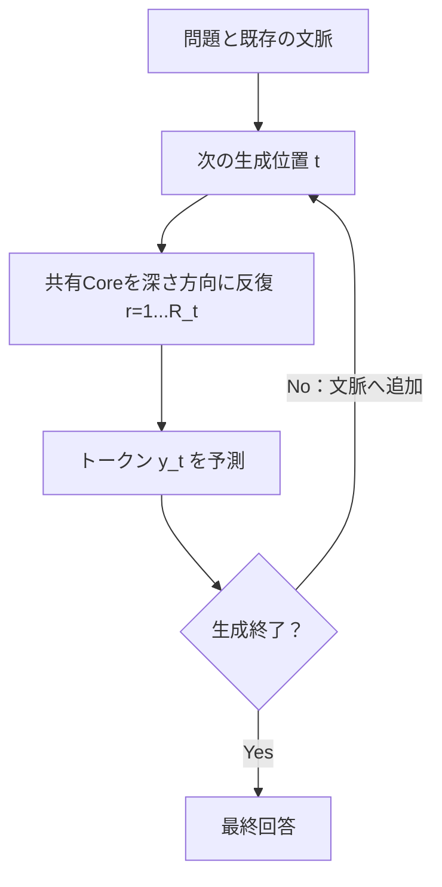
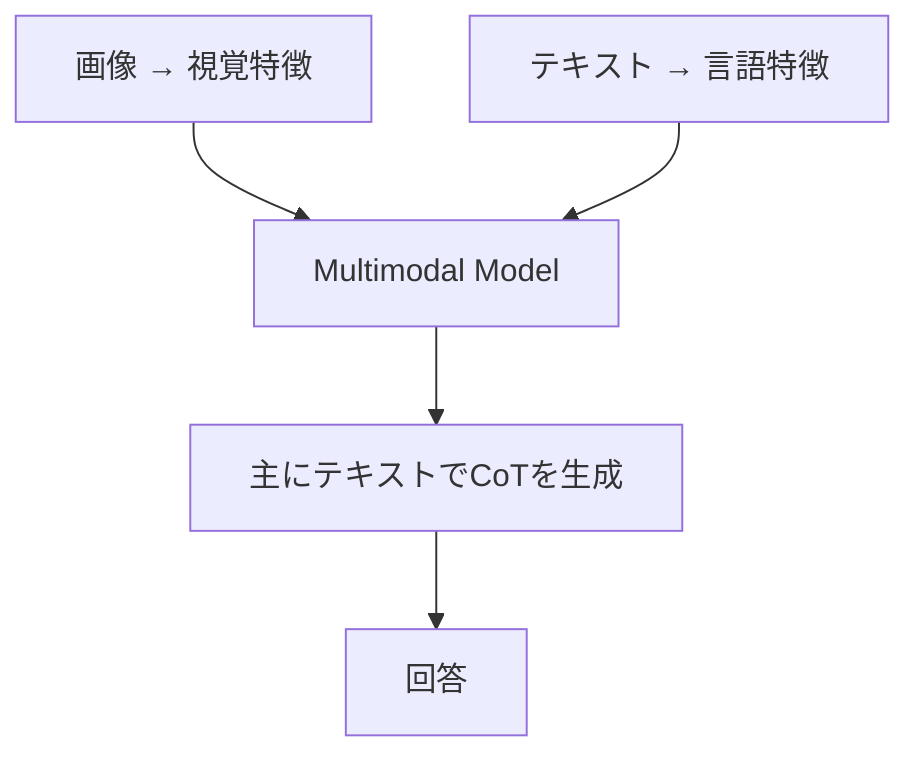
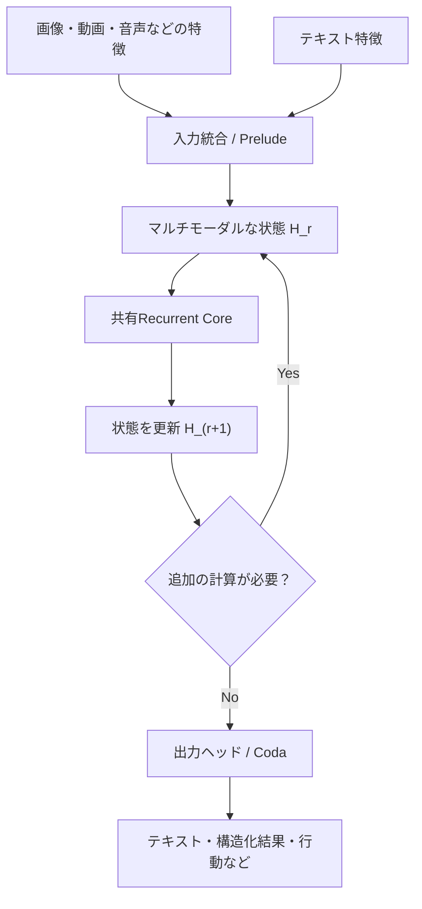

# 第5回：CoTと潜在推論、VLMの非対称性
作成日：2026-11-03 / 更新日：2026-11-03

> **この回の問い：** Chain-of-ThoughtはTransformerの層構造そのものではない。言語トークンを増やして考える方式と、隠れ状態を深さ方向に更新する方式は併用できる。さらにVLMでは、入力に視覚情報があるのに明示的な思考列はテキスト中心という非対称性が際立つ。

## 1. CoTはモデルアーキテクチャではない

本稿で扱う**明示的なText CoT**は、中間推論を生成トークン列として表現・再利用する手法である。2022年の[Chain-of-Thought Prompting](https://arxiv.org/abs/2201.11903)は、モデルの層構造を変えず、プロンプトに中間推論例を与えるだけで、一部の課題で性能が改善することを示した。

ここでいう「アーキテクチャに依存しない」は、**特定のTransformer層構造や重み共有を必須としない**という意味であって、どんな予測モデルにも同じCoTの生成手順を直接適用できるという意味ではない。明示的なCoTには、通常、中間記号を逐次生成・保持・再入力できるインターフェイスが必要である。

自己回帰型モデルなら、

\\[
\text{問題}\rightarrow z_1\rightarrow z_2\rightarrow\cdots\rightarrow z_T\rightarrow\text{回答}
\\]

として生成した中間トークンを次の予測の文脈に含められる。これにより、**アーキテクチャを改造しなくても推論時計算量を増やせる**。

ただし、「アーキテクチャ非依存」は無条件ではない。系列生成能力、文脈長、学習、デコード手順に影響されるし、CoTが有効になるとは限らない。正確には、**CoTの概念は特定のTransformer内部構造を必要としない**という意味である。

### 1.1 異なる「反復」と「予測」を分ける

| 反復の種類 | 進む方向 | 中間状態 | 代表例 |
| --- | --- | --- | --- |
| **生成系列の逐次反復** | 出力系列・生成ステップ方向 | 生成トークンと文脈、KV | Text CoT |
| **潜在トークン列の逐次更新** | 出力系列方向だが、途中は連続値 | 新しい潜在トークン | Coconut、Mirage |
| **深さ方向の反復** | 原則として次トークンの予測前・深さ方向 | 共有Coreを通る隠れ状態 | Huginn、Ouro |
| **Denoisingの反復** | 同じ出力位置の候補修正 | マスク・未確定トークンや潜在値 | Block Diffusion、LoopMDM |
| **複数の将来位置の予測** | 位置の先読み（反復とは限らない） | 将来トークン分布・候補・埋め込み | MTP、LoopMTP |

これらをすべて「内部で何回か考える」とまとめると、何が最適化されたのかが分からなくなる。特にMTPは**予測対象の距離を広げる**ものであって、必ずしも計算の反復回数を増やす方式ではない。

[Coconut](https://arxiv.org/abs/2412.06769)は、隠れ状態を次の入力埋め込みとして系列に戻す方式であり、共有ブロックを**深さ方向**に繰り返すRecurrent-Depthとは区別される。

### 1.2 CoTとRecurrent-Depthの組み合わせ

CoTの生成位置を\\(t\\)、その内側の反復を\\(r\\)とすると、

\\[
h_{t,r+1}=F_\theta(h_{t,r},c_t),\qquad
p(y_t\mid c_t)=\operatorname{Decode}(h_{t,R_t})
\\]

という二重ループを考えられる。

この場合、**テキストで追加の推論ステップを作ること**と、**1つのステップの内部計算を増やすこと**は、別々の制御変数にできる。ただし完全に独立ではない。追加トークンによって次ステップの文脈も変わり、深い内部反復はそのトークン選択に影響する。両方を増やしたときの効果は、単純な足し算にはならない。

### 1.3 LOTUS：CoTを捨てるのではなく、教師信号として利用する

CoTとRecurrent-Depthの関係を具体的に示すのが、Fanらによる2026年の[Bridging the Gap Between Latent and Explicit Reasoning with Looped Transformers（LOTUS）](https://arxiv.org/abs/2606.31779)である。

LOTUSは、質問と回答の間に複数の潜在スロットを置き、**それらを共有Transformerで反復的に、かつ並列に更新**する。さらに訓練時には、各スロットに対応するCoTステップのトークンを教師信号として使う。したがって、明示的なCoTをモデルの推論時出力から減らしつつ、**CoTによって得られる構造化された学習信号は活用する**設計である。

論文は3B規模の数学推論の比較で、明示的CoTに近い精度を維持しながら、**思考部分のレイテンシ**を対象条件下で2.5～6.9倍改善したと報告する。これは推論全体の応答速度が一般に同倍率で向上するという意味ではなく、評価課題と実装条件に依存する。重要なのは、言語CoTと潜在反復が単純な二者択一ではないという点だ。

### 1.4 潜在軌跡に何を学習させるか：結果だけでなく過程への報酬

Recurrent Coreを反復させるだけでは、途中の状態が「役に立つ計算過程」を学ぶ保証はない。これはアーキテクチャだけでなく、**学習目標**の問題でもある。

ICML 2026の[Prioritize the Process, Not Just the Outcome: Rewarding Latent Thought Trajectories Improves Reasoning in Looped Language Models](https://proceedings.mlr.press/v306/williams26b.html)は、Ouroを使い、最終状態だけを評価するのではなく、**反復中の潜在状態列へ報酬を配分する**RLTTを提案した。報告された数学ベンチマークで、比較した従来のGRPO方式より性能が改善した。

この研究は、潜在状態を反復するモデルでは、**計算の形（何回回すか）だけでなく、中間状態を改善するようどう学習するか**が重要であることを示す。一方、途中の状態へ報酬を与えれば必ず人間に理解可能な推論手順が生じる、と保証するものではない。

### 1.5 CoTを出したことは「忠実に思考を説明した」ことではない

生成されたCoTが、実際に回答へ至った因果的な経路を忠実に表現しているとは限らない。潜在状態についても同じである。

2026年の[Does Latent Chain-of-Thought Actually Reason?](https://arxiv.org/abs/2610.21182)は、潜在ステップが**読めるか**、**順序だった状態になっているか**、**最終回答に必要か**を区別することの重要性を示した。論理課題では潜在チェーンを削除しても回答がほとんど変わらない場合がある一方、算術課題ではチェーン内容への依存が観測された。さらに、削除による劣化があっても**内容の置換では回答が変わらない**場合があり、チェーンが単に計算ステップ数の足場として使われている可能性を排除できない。

**反復が存在すること、途中の特徴を解読できること、因果的な推論が成立していることは、異なる命題**なのである。

さらに、チェーンの削除で正答率が変わらないからといって、内部状態が一切利用されていないとまでは言えない。確信度、確率分布、頑健性など、最終的な正誤だけでは見えない差が残る可能性がある。削除・置換の介入も、通常の入力分布から外れた状態を作ることがあるため、対照実験が重要になる。

## 2. VLMでは「入力は複数モダリティ、CoTは主にテキスト」という非対称性がある

画像・言語モデル（VLM）では、視覚特徴とテキスト特徴を共通のTransformerで扱う構成が広く使われている。実装によって視覚特徴の連結やCross-Attentionなど、統合方法は異なる。

しかし、明示的な推論トレースは従来、主にText CoTとして出力されてきた。図形の回転、物体の追跡、位置関係の変換といった課題で、推論の途中を毎回自然言語に変換することは、必ずしも自然な設計ではない。

例えば、複数の図形を順に回転・移動する問題をテキストCoTだけで処理するなら、各段階の座標関係を文章で再記述する必要がある。潜在的な視覚状態を保持できれば、そのような言語化を減らせる可能性がある。ただし、**潜在状態が本当に空間配置を正確に保持するかどうか**は別の実証課題だ。

ここにも注意点がある。**テキストCoTを生成している間も、隠れ状態が画像情報を使えないわけではない。** 入力画像のトークンや視覚特徴をAttentionで参照し得る。非対称なのは、主に**追加の推論ステップを外部化する表現形式**である。

### 2.1 潜在視覚トークンと反復VLM

この制約に対して、2026年までに複数の方向が示された。ここでいう「視覚的な推論」は、最終的に画像を出力することとは異なり、途中の空間関係や視覚的特徴をどのような状態に保持し、更新するかという問題である。

- CVPR 2026の[Machine Mental Imagery（Mirage）](https://openaccess.thecvf.com/content/CVPR2026/html/Yang_Machine_Mental_Imagery_Empower_Multimodal_Reasoning_with_Latent_Visual_Tokens_CVPR_2026_paper.html)は、テキストに潜在視覚トークンを交え、画像を明示的にレンダリングせずに中間表現を扱う。
- 2026年の[RecursiveVLM](https://arxiv.org/abs/2602.09080)は、視覚と言語の特徴分布の違いを考慮した接続・学習機構を備え、マルチモーダルモデルに反復更新を導入する。
- CVPR 2026 Findingsの[Mull-Tokens](https://openaccess.thecvf.com/content/CVPR2026F/html/Ray_Mull-Tokens__Modality-Agnostic_Latent_Thinking_CVPRF_2026_paper.html)は、テキスト・画像の双方の中間情報を扱える、モダリティ非依存の潜在トークンを研究する。

これらは**同じアーキテクチャではない**。MirageやMull-Tokensの潜在トークン生成を、そのまま深さ方向のRecurrent-Depthと同一視してはいけない。共通しているのは、言語だけに思考の表現を限定しないという問題意識だ。

また、Visual CoTや潜在視覚トークンが有効だと報告されても、**画像に基づく中間計算が因果的に使われたか**は別途確認しなければならない。たとえば視覚特徴を局所的に変更した場合、後続の潜在状態が空間関係の変化を追跡し、答えも整合的に変わるかが検証の焦点になる。

## 3. マルチモーダルRecurrent Coreという仮説

ここまでを統合すると、将来の候補として次のような構造が考えられる。

\\[
H_{r+1}=H_r+F_\theta(H_r;X,V)
\\]

ここで\\(X,V\\)は言語・視覚の条件であり、\\(H_r\\)はその双方に関係する潜在状態を表す。状態を必ずテキスト用と視覚用に分ける必要はないし、逆に分割した方がよい場合もあり得る。

この考え方では、**知覚情報は入力で統合し、内部で状態を反復更新し、必要な結果だけを任意の形式で出力する**。ただし、言語・視覚・行動を同じ潜在空間へ統合しただけでは、各モダリティの情報を保ったり、必要な箇所へ読み書きしたりできるとは限らない。入力由来の視覚特徴を反復ごとに再参照できるか、途中の空間的な更新が出力へ因果的に寄与するかまで検証したい。

しかし、これは公開論文から機械的に導ける確定的な「次世代モデルの形」ではない。何を状態に保持し、どの演算器がどの情報を更新し、いつ停止するかを学習できなければ、単に反復するだけでは性能は向上しない。

---

**この回の結論：** CoT、潜在トークン、Recurrent-Depthは異なる計算軸である。マルチモーダルな内部状態の反復は有望だが、単に反復しただけで視覚的な推論が成立するわけではない。

[第4回へ戻る](04-adaptive-depth-and-fixed-points.md) ｜ [第6回へ進む](06-mtp-and-recurrent-depth.md) ｜ [参考文献](references.md)
