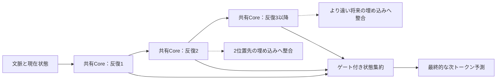

# 第6回：MTPとRecurrent-Depth――先読みは反復をどう変えるか
作成日：2026-11-03 / 更新日：2026-11-03

> **この回の問い：** Multi-Token Prediction（MTP）は複数トークンを一括確定することと同義ではない。この回は、学習時の将来予測、反復状態に対する教師信号、浅い状態を使うSpeculative Decodingを分け、LoopMTP・LoopSpec・LoopAheadの違いを検討する。

## 1. Multi-Token Predictionは「複数トークン生成」と同義ではない

Multi-Token Prediction（MTP）は、ある位置の表現から複数の将来位置を予測させる学習・予測の枠組みである。**予測範囲を広げること**と、**複数トークンを確定して出力すること**は区別したい。

Next-Token Prediction（NTP）は、たとえば

\\[
\mathcal L_{\mathrm{NTP}}
=-\sum_t\log p_\theta(x_{t+1}\mid x_{\le t})
\\]

のように、直後のトークンを予測する。独立した出力ヘッドをもつMTPの単純化した形は、系列長を\\(N\\)として、

\\[
\mathcal L_{\mathrm{MTP}}
=-\sum_{k=1}^{K}\lambda_k\sum_{t=1}^{N-k}
\log p_{\theta,k}(x_{t+k}\mid x_{\le t})
\\]

である。この式の各将来位置は**同じ観測済みプレフィックス**を条件とする。個別の周辺予測が正確でも、複数位置の候補を単純に並べた列の**同時整合性**まで保証されない。

これに対し、通常の自己回帰的な系列確率は

\\[
p(x_{t+1:t+K}\mid x_{\le t})
=\prod_{k=1}^{K}p(x_{t+k}\mid x_{\le t+k-1})
\\]

と分解される。こちらは前に確定した将来トークンを後続の条件へ含める。**独立ヘッド型のMTPで学習した周辺予測を掛け合わせること**は、この自己回帰的な同時分布をそのまま再現することではない。

ICML 2024の[Better & Faster Large Language Models via Multi-token Prediction](https://proceedings.mlr.press/v235/gloeckle24a.html)は、共有Trunkに複数の出力ヘッドを付けるMTPの学習効率と生成面の効果を検証した。対して[DeepSeek-V3 Technical Report](https://arxiv.org/abs/2412.19437)は、追加の予測モジュールを順次接続し、将来位置の因果依存をより明示的に扱う。**すべてのMTPが独立ヘッド方式というわけではない。** さらに、MTPによる学習時の補助予測と、生成時の複数トークンを一括確定するアルゴリズムは別物である。

ここで注意したいのは、**「MTPで訓練すること」と「複数トークンを1度に出すこと」は一致しない**点だ。学習時の将来予測損失は主として内部表現を変える。一方、Speculative DecodingはDraft候補をTargetが受理・補正する**推論アルゴリズム**で、DraftをMTPで学習したこと自体は分布保存の根拠にならない。DeepSeek-V3のように訓練補助モジュールとして利用し、通常の自己回帰推論では用いない設計もある。逆にSpeculative Decodingは、典型的なMTP損失を使わずとも実現できる。

MTPの少なくとも3つの役割を分ける必要がある。

| 役割 | 主な用途 | 何を出力・保持するか | Recurrent-Depthとの接点 |
| --- | --- | --- | --- |
| **補助学習目的** | 将来を見越した特徴を学習する | 将来位置に対する教師損失 | 中間反復状態の学習信号にできる |
| **Draft生成** | Speculative Decodingの候補を作る | 将来の離散トークン候補 | 浅い反復の状態を利用できる |
| **潜在的な先読み** | 計画・依存関係・将来制約を表現する | 連続値の先読み状態 | 反復状態へ将来情報を学習させる |

3番目は広い研究方向であり、内部に人間に理解できる計画が形成されたという保証ではない。

### 1.1 LoopMTP：反復ごとに異なる将来情報を学習させる

2026年8月の[LoopMTP: A Looped Transformer Guided by Latent Multi-Token Prediction](https://arxiv.org/abs/2608.03624)は、Looped Transformerが抱える**反復間の役割の不明瞭さ**や、過度な反復によって出力が悪化する問題に着目する。

提案の要点は、反復段階に応じて異なる将来位置のトークン埋め込みを教師信号に使い、**共有Coreの各反復に先読みの役割を持たせる**ことである。

論文のSoft Alignmentを記号を整理して書けば、反復番号\\(r=2,\dots,R\\)について、

\\[
\mathcal L_{\mathrm{align}}^{(r)}=
\frac{1}{N-r}\sum_{i=1}^{N-r}
\left[1-\cos\left(h_i^{(r)},\operatorname{sg}\left(E_{x_{i+r}}\right)\right)\right]
\\]

となる。ここで、\\(E_{x_{i+r}}\\)は将来トークンに対応する出力埋め込み、\\(\operatorname{sg}\\)はStop-Gradientである。式は論文の仕組みを簡略化したもので、比較するベクトルの次元合わせや損失係数を省いている。\\(r\\)は**反復番号に対応づけられた未来距離**であって、推論時に未来の正解トークンを見ているわけではない。さらに複数反復の状態をゲートで集約し、NTP損失と補助損失を組み合わせる。

重要なのは、**LoopMTPは各反復で複数トークンの完全な語彙分布を出力するわけではない**ことだ。論文自身も従来型MTPと区別し、将来埋め込みに対する表現正則化として説明している。各反復に語彙サイズの出力ヘッドを置く場合と比べ、学習の補助コストを抑えられる。

論文のGPT-2系小規模実験（約6.8Bトークンで学習）では、非ループ型との比較で平均正答率に最大**8.1%の相対改善**を報告し、最大15反復でも安定して学習できたとしている。ただし、単に「MTPだけを足せば8.1%改善」という意味ではない。共有構造、ゲート、補助正則化、比較モデル、計算予算が関係する。**反復段階を将来情報で訓練することの有望性**を示す結果と読むべきだ。とくに大きな反復数（11～15回）の安定性については、公開論文の根拠が限定された試行に依存するため、複数Seedにわたる頑健性まで確認されたと読まない。

破線は**訓練時の補助教師信号**を表す。推論時に将来の正解トークンを参照するわけではない。なお、この式は論文の *soft MTP alignment* に対応し、隠れ状態と出力埋め込みの次元を揃えた場合の定式化である。LoopMTPは、反復時の入力再注入・反復別正規化・ゲート付き状態集約も用いるため、**損失だけを追加した実験の改善値**と同一視してはいけない。

### 1.2 浅い反復をDraftに、深い反復をVerifyに使う

Looped Transformerの浅い反復状態が十分な予測能力を持つなら、それを候補生成器として利用できる。完全な反復を実行したモデルに候補を検証させれば、独立したDraftモデルを用意せずにSpeculative Decodingを実行できる可能性がある。

- [LoopSpec（2026）](https://arxiv.org/abs/2609.17184)は、浅い反復からの候補生成と、深い反復による検証をパイプライン化する。論文は対象条件で最大**6.83倍**の推論高速化を報告する。
- [LoopAhead（2026）](https://arxiv.org/abs/2610.21594)は、浅い反復状態に軽量Lookahead Drafterを組み合わせ、より遠くの将来候補を作り、深い反復からのフィードバックで無駄な候補分岐を抑える。論文は対象条件で最大**7.82倍**のデコード高速化を報告する。

両研究の重要な性質は、適切な受理・補正手続きを通じて**フル深度Targetモデルの出力分布を保存する**ことを目指している点だ。厳密な分布保存は、**提案分布とTarget分布、受理・棄却・補正の手続きが論文の条件を満たす場合**の性質であり、別のDraft方式やブロック修正器に置き換えても自動的に成り立つわけではない。ここでの「保存」は、同じ乱数列で毎回まったく同じ出力文字列が出ることではなく、指定されたサンプリング規則のもとでの確率分布が一致するという意味である。MTPで直接生成した候補を、検証なしに確定するのとは違う。また、報告される最大倍率はモデル・バッチサイズ・ハードウェア・生成条件に依存し、汎用的な速度保証ではない。

この系統では、反復の途中状態は「最後まで考え終わっていない状態」というだけでなく、**低コストの予測器**として活用できる。ただし、Depth Conditioningで総反復数を途中変更すると浅い状態とTargetの深い実行経路が一致しない場合がある。**Draft経路とTarget経路の整合性**も、単なる候補精度とは別の設計課題である。

### 1.3 将来トークンを正確に当てさせるべきか

MTPの補助損失は、通常のNTPに対して常に有利とは限らない。ICML 2026の[Predicting the Order of Upcoming Tokens Improves Language Modeling](https://proceedings.mlr.press/v306/zuhri26a.html)は、複数のモデル規模とベンチマークで、正確な将来トークンを予測するMTPが一貫して改善しない場合を報告し、将来の**相対的な順序**を学習するToken Order Prediction（TOP）を提案した。

したがって、反復状態に学習させるべきものは、正解トークンの埋め込みに限らない。候補集合、トークン順序、構文制約、部分的な計画、信頼度などを比較する余地がある。特に遠い未来の予測では、単一の将来トークンを確定的に近似させることが不適切な場合もある。

## 2. 中間反復状態の活用を比較する

### 2.1 似た名前でも、改善対象は違う

LoopMTP、LoopSpec、LoopAheadは「Recurrent-Depthの途中状態を役立てる」という点では近いが、機能を混同してはいけない。

| 方法 | 主要な工夫 | 主に改善したいもの | 結果を評価する軸 |
| --- | --- | --- | --- |
| **LoopMTP** | 反復段階と将来トークン埋め込みの対応を教師信号に使う | **学習された表現・下流精度** | 同じ学習条件での精度・安定性 |
| **LoopSpec** | 早い反復状態をDraft、深い反復をTargetに利用 | **デコードの逐次処理効率** | Target分布の保存と実測スループット |
| **LoopAhead** | 軽量Lookahead Drafterと、深い状態からの枝刈り信号を利用 | **将来候補の探索・検証効率** | 同上、候補受理率・余分な計算 |

LoopSpec・LoopAheadは広い意味で将来トークンの候補生成に関係するが、**標準的なMTP補助損失を採用することが必須条件ではない**。さらに、浅い状態から出したDraftが高品質でも、実際に速くなるかは候補の受理率・バッチング・検証コスト次第である。**完全な分布保存を主張できるのは、Targetのサンプリング分布を基準にした正しい受理・補正規則が実装されている場合**であり、Draftをそのまま採用する近似デコードとは異なる。

### 2.2 Depth Conditioningとの接点：反復番号と予測ホライズンをどう対応させるか

LoopMTP型の補助損失は、反復\\(r\\)の表現を将来位置\\(t+r\\)の埋め込みへ整合させる。これを可変反復数に拡張する際、**絶対反復番号と正規化進行度のどちらに予測上の役割を対応させるか**が問題になる。

たとえば、学習時の総反復数が\\(R=4\\)で「3回目に3位置先を予測」と習得したモデルを、\\(R=8\\)で実行するとしよう。同じ\\(r=3\\)でも正規化時刻は\\(3/4\\)から\\(3/8\\)へ変わる。**深度条件付けは変わるが、教師信号の未来距離が固定されていた**なら、反復の機能分化が予想どおりに外挿するとは限らない。

研究仮説としては、将来距離\\(k\\)を\\(k=\kappa(r,R)\\)と明示して学習する、各反復の予測距離を複数持たせる、あるいはLoopMTP型補助目的に異なる時刻格子の一貫性損失を加える方法がある。いずれも、**LoopMTPとZhuangらの深度条件付けを統合した効果が実証されたという意味ではない**。

また、浅い反復のDraftを使うLoopSpec型の方式では、**途中で反復予算を変えたときの状態再利用**が実装上の課題になる。正規化時刻を再設定する方式なら、既存の浅い状態を深いTargetの忠実な接頭状態としてそのまま使えるとは限らない。高速化においては、候補の受理率だけでなく、**深いTargetの状態を計算し直すコスト**も評価しなければならない。

---

**この回の結論：** MTPの学習目的、将来候補の生成、Target分布を保存する検証付き高速化は別の設計問題である。Recurrent-Depthの中間状態はそのいずれにも役立ち得るが、評価基準は同じではない。

[第5回へ戻る](05-cot-and-multimodal-reasoning.md) ｜ [第7回へ進む](07-block-diffusion-and-recurrence.md) ｜ [参考文献](references.md)
