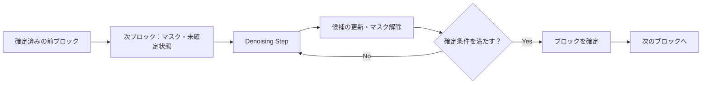

# 第7回：Block DiffusionとRecurrent-Depth――2種類の反復は補完するか
作成日：2026-11-03 / 更新日：2026-11-03

> **この回の問い：** Block Diffusionは未確定の複数出力位置を反復修正し、Recurrent-Depthは各計算ステップ内部の隠れ状態を反復更新する。この回では両者の違いを定式化し、LoopMDMや並列サンプラー、Denoising段階ごとの計算配分を考える。

## 1. Block Diffusionの基本構造

通常の自己回帰言語モデルは、確定済みトークンの後ろへ、通常は1位置ずつトークンを追加する。対してDiscrete / Masked Diffusion Language Modelは、**まだ確定していない複数位置の候補**を、ノイズ除去やマスク解除のステップを通じて更新できる。

[Block Diffusion: Interpolating Between Autoregressive and Diffusion Language Models（ICLR 2025）](https://proceedings.iclr.cc/paper_files/paper/2025/hash/7ede97c3e082c6df10a8d6103a2eebd2-Abstract-Conference.html)は、ブロック間を自己回帰的に、**ブロック内部を拡散的に**生成する設計を提案した。

系列を\\(x=(x^{[1]},\dots,x^{[B]})\\)という\\(B\\)個のブロックに分ければ、生成分布の分解は、

\\[
p_\theta(x)=\prod_{b=1}^{B}
p_\theta\left(x^{[b]}\mid x^{[<b]}\right)
\\]

となる。**ブロック間の依存**は順序を保つ一方、各条件付き分布をブロック内部のDenoisingでモデル化する。これは一般的なBlock Diffusionの説明であり、各論文の学習目的や逆遷移がすべて同一という意味ではない。また、**Block DiffusionとMasked Diffusionは同義ではない**。後者は離散的な拡散・マスク復元のより広い枠組みであり、必ずしもブロック単位の自己回帰生成を行わない。

ブロックサイズを1へ近づければ逐次生成に近くなり、大きくすれば多くの出力位置を1度に扱える。**ブロックの確定順序**と**ブロック内部の更新順序**を独立に考えられる点が重要だ。ただし、ブロックを大きくすれば必ず高速・高精度になるわけではない。Attentionの計算、Denoisingのステップ数、キャッシュの再利用、候補の品質が影響する。

### 1.1 深さ方向の反復とDenoisingの反復は違う

ここが本稿の中心となる区別だ。

| 軸 | 何を更新するか | どんな計算を追加するか | 例 |
| --- | --- | --- | --- |
| **Depth Recurrence** | 同じ生成ステップ内部の隠れ状態 | 同一Coreをさらに適用 | Huginn、Ouro |
| **Denoising / Refinement** | 同じ出力位置の候補・マスク状態 | ノイズ除去・逆遷移を追加 | Block Diffusion |
| **Token Lookahead** | 将来位置に関する候補・情報 | 予測距離・Draftを拡張 | MTP、LoopAhead |

Denoisingで用いられる遷移は、確率的なマスク解除や条件付き分布に依存する。一方、Recurrent Coreは通常、連続値の隠れ状態を更新する。したがって**Denoisingの1ステップ＝Coreの1反復**と置くことはできない。

もっとも、両者を組み合わせると、1つのDenoisingステップ内でRecurrent Coreを複数回実行できる。

\\[
H_{b,s,r+1}=F_\theta(H_{b,s,r};X_b^{(s)},C_{<b},s)
\\]

\\[
X_b^{(s-1)}\sim
Q_\theta\!\left(\cdot\mid H_{b,s,R_{b,s}},X_b^{(s)},C_{<b}\right)
\\]

ここで\\(s\\)はDenoisingステップ、\\(r\\)は内側の再帰深度である。これは組み合わせの概念式であって、特定論文の実装をそのまま表すものではない。重要なのは、**Denoisingステップ間の状態 \\(H_{b,s,R}\\) を次のステップへ持ち越すか、再計算するか**まで設計が必要だという点である。共有重みがあっても、その内部状態を保持することや、異なるノイズ水準間で安定して再利用できることは自動的には保証されない。

## 2. Denoisingの中にRecurrent-Depthを組み込む

### 2.1 LoopMDM：Block Diffusionに近いが異なる、Masked Diffusionでの直接実証

2026年の[Looped Diffusion Language Models](https://arxiv.org/abs/2605.26106)は、Masked Diffusion Modelの初期〜中間層の一部を選択的に反復させる**LoopMDM**を提案した。これは**離散的なMasked DiffusionとRecurrent-Depthを組み合わせた実証**であり、あらゆるBlock Diffusionの構造に同じ利点が現れることまで確認したものではない。

論文は複数の事前学習コーパスで、同程度のパラメータ数の非ループ型MDMと同等水準のモデル化性能に到達するまでの**学習FLOPsを最大約3.3分の1**に抑えたと報告している。また、対象とした数学推論ではGSM8Kが最大**8.5ポイント**改善した。条件を揃えた比較では、独立した層を単純に深くすることより、適切な層を繰り返すことが有利な場合も示された。

ここからの示唆は、Denoisingがすでに反復していても、**その内部のDepth Recurrenceが必ずしも冗長ではない**ということだ。ただし、「追加のDenoising 1ステップ」と「追加のCore 1反復」は計算コストが同じとは限らないため、効果の大小は**同一推論FLOPs・同一レイテンシ**で比較する必要がある。論文のAttention解析では、マスクされた位置同士の相互作用が反復に伴い増える傾向が報告されている。

さらに注目したいのは、**Denoising段階ごとに適した反復回数が異なる**ことだ。LoopMDMの研究では、初期・終盤よりも中間的なノイズ水準で追加ループが有効な傾向があり、適応的に反復回数を割り振る方式が検討されている。これは\\(R_{b,s}\\)を一定値としない設計を支持する。ただし、結果は研究対象のMDMと評価条件に依存する。

### 2.2 他の接続方法：並列潜在更新とDenoising Recursion

LoopMDMとは別のアプローチもある。

**[Efficient Parallel Samplers for Recurrent-Depth Models and Their Connection to Diffusion Language Models（ICML 2026）](https://proceedings.mlr.press/v306/geiping26a.html)** は、**既存のRecurrent-Depthモデル**に対してDiffusion Forcingの発想を用いた並列サンプラーを提案した。複数の生成位置について、潜在状態を異なる深度で同時に洗練する。追加学習なしで3.5Bモデルに適用し、対象条件で最大**5倍**の高速化を報告する。これは**Masked Block Diffusionモデルを新しく学習した研究ではない**。また、並列化による速度向上が、離散的なBlock Diffusionの逆過程と同じ確率分布を実装することを意味するわけでもない。両者の類似性を利用して推論スケジュールを再設計した研究として位置づけたい。

**[One Step Forward and K Steps Back: Better Reasoning with Denoising Recursion Models（ICML 2026）](https://proceedings.mlr.press/v306/cameron26a.html)** は、ノイズから構造化された解を得る際に、1回の修正だけでなく**複数ステップの再帰的なDenoising**を学習する。中間状態に適切な訓練課題を与えることで、学習時と推論時の過程の不一致を抑える。主な対象はARC-AGI系の構造化推論であり、その性能を一般的な言語のBlock Diffusionへそのまま外挿できない。

画像生成では[Looped Diffusion Transformer（2026）](https://arxiv.org/abs/2609.40305)が、Denoisingステップ内で共有Transformerブロックを反復する。中間反復への教師信号とAttention制御を導入し、単純なループが画像の局所情報を損なう問題へ対処した。これは**画像の連続値拡散**を対象とするため、離散的なMasked Language Diffusionとは分けて読む必要がある。

これらを合わせると、「拡散と反復はどちらもループだから同じ」という理解ではなく、**生成中の状態をどこで保持し、どのステップを学習・並列化するかを選択する設計**として捉えるのが適切だ。

| 研究系統 | 変更する対象 | 本稿での読み方 |
| --- | --- | --- |
| Block Diffusion | ブロック内の生成分布・確定過程 | 言語のブロック単位生成の基礎 |
| LoopMDM | Masked Diffusionモデルの内部層を共有反復 | **Masked Diffusion × 深さ方向再帰**の直接実証 |
| Diffusion Forcing Sampler | Recurrent-Depthモデルのサンプリング順序 | 別モデルを再学習せず並列性を引き出す方向 |
| Looped-DiT | 画像Denoising器の内部計算 | 連続値の視覚生成への応用。言語へ直結しない |
とくに、画像生成のLooped-DiTは**固定した推論計算予算の下では、ノイズ除去ステップの追加より内部Loopの追加が有利になった**と報告している。ただしこれは画像の連続値拡散の実験であり、言語の離散Block Diffusionへその優劣を外挿してはいけない。

### 2.3 ブロック境界と大域的一貫性

Block Diffusionには固有のトレードオフがある。多くの構成では、**すでに確定したブロックを、後続ブロックの生成時に自由には修正できない**。現在のブロックを深く計算できても、前ブロックの誤りや長距離の制約違反が自動で解消するとは限らない。

2026年の[Diffusion In Diffusion](https://arxiv.org/abs/2601.13599)は、小ブロックで下書きを作った後、より広い視野で再修正する方法を提案している。またICML 2026の[Set Diffusion](https://proceedings.mlr.press/v306/arriola26a.html)は、固定長ブロックではなく柔軟な位置集合を生成対象とし、生成順序やKVキャッシュ更新の自由度を広げる。

このため、Recurrent-Depthと組み合わせる際には、**深さを増やすべきか、ブロックを広げるべきか、確定済み領域の再修正を認めるべきか**を別々に評価する必要がある。特に、ブロックサイズを変更するとAttentionの並列性だけでなく、過去ブロックに依存する確率分解やキャッシュ再利用の機会も変わる。

### 2.4 2つの時刻：Denoisingの進行度と内部反復深度

Diffusionのノイズ除去器は、現在のノイズ水準を表す時刻\\(\sigma_s\\)を条件として受け取ることが多い。ここへRecurrent-Depthを導入すると、**ノイズ除去の進行度\\(\sigma_s\\)**と、**その時点の共有Core内部での反復進行度\\(\tau_r\\)**という2つの異なる座標が現れる。

\\[
H_{b,s,r+1}
=F_\theta\bigl(H_{b,s,r};X_b^{(s)},c_{<b},\sigma_s,\tau_r,\Delta\tau\bigr)
\\]

この式は設計仮説であって、LoopMDMの実装式を再掲したものではない。前者は「**どれくらいノイズが残っているか**」、後者は「**そのノイズ水準に対する内部計算がどこまで進んだか**」を伝える。両者は同じ実数範囲へ正規化できても、意味は異なる。

設計上は、両時刻を同じGateへ投入する、別々の条件付けモジュールを使う、履歴差分を直前のCore反復内に限定する、Denoisingステップをまたぐ潜在状態を保持する、といった選択肢がある。ただし、**Denoisingが進むと入力分布自体が変わる**ため、前ステップで有用だった隠れ状態をそのまま持ち越せるとは限らない。

評価では、同じ推論FLOPsの下で \\(R\\) を増やす場合と \\(S\\) を増やす場合を比較し、\\(\sigma_s\\)単独・\\(\tau_r\\)単独・両方の条件付けを切り分けたい。さらに、History-State Injectionの履歴が**同一Denoisingステップ内の状態差分**なのか、**ノイズ水準をまたぐ差分**なのかも明示すべきだ。後者には別の安定性検証が必要になる。

---

**この回の結論：** DenoisingとDepth Recurrenceは同じループではない。両方の反復を組み合わせる実証例はあるが、一般にどちらへ追加計算を配分すべきかは同一予算で比較する必要がある。

[第6回へ戻る](06-mtp-and-recurrent-depth.md) ｜ [第8回へ進む](08-joint-architecture.md) ｜ [参考文献](references.md)
