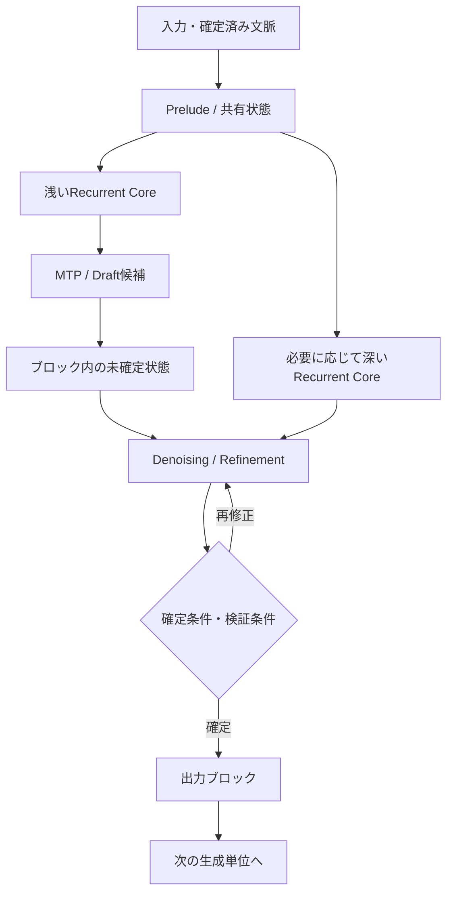

# 第8回：Recurrent-Depth × MTP × Block Diffusion――統合設計の条件
作成日：2026-11-03 / 更新日：2026-11-03

> **この回の問い：** 前3回で扱った技術を単純に積み重ねるだけでは、高性能な生成器は保証されない。ここではDepth・Draft・Block・Denoisingという異なる計算予算を整理し、段階的な統合とモジュール間の契約を提案する。

## 1. 3つを単純に積むだけでは不十分

ここまでの研究を並べると、Recurrent-Depth、MTP、Block Diffusionは**互いに異なるレベル**に作用することが分かる。この違いは、モジュールを足す際の「計算上の利益」と「正しさの保証」を切り離して考えるために重要だ。

| 観点 | Recurrent-Depth | MTP | Block Diffusion |
| --- | --- | --- | --- |
| 主要な目的 | 計算深度を増やす | 将来位置の情報を学習・候補化する | 複数出力位置を反復的に修正する |
| 計算の中心 | 共有Coreの潜在状態 | 未来への予測ヘッド・Draft | ノイズ除去器と確定規則 |
| 代表的な課題 | 追加反復の有用性、KV、安定性 | 遠い未来の誤差・候補整合性 | 多ステップ計算、ブロック境界 |
| 実証例 | Huginn、Ouro | LoopMTP、LoopSpec | Block Diffusion、LoopMDM |

これらを**区別して設計できる**ことと、**性能面でも互いに独立である**ことは異なる。特にMTPは、Recurrent-DepthやDenoisingと同じ意味での「反復軸」ではなく、**教師信号や候補生成の先読み範囲**という軸である。深い反復がMTPの候補品質を改善すれば、必要なDenoisingステップは減るかもしれない。反対に、Denoisingを十分に増やしたモデルでは、追加のRecurrent-Depthは費用に見合わない場合もある。

そこで、次の記号で計算予算を整理する。

- \\(B\\)：確定していくブロック数
- \\(n_b\\)：第\\(b\\)ブロックのトークン数（Block Size）
- \\(K_b\\)：MTP・Draftの先読み範囲（予測対象の未来距離）
- \\(S_b\\)：第\\(b\\)ブロックで実行するDenoisingステップ数
- \\(R_{b,s}\\)：ステップ\\(s\\)で用いるCoreの反復回数

このうち、\\(K_b\\)は\\(n_b\\)とは異なる。将来を\\(K_b\\)位置まで予測しても、実際に同時確定するブロック長が\\(K_b\\)とは限らない。また、ブロック数\\(B\\)とブロック長\\(n_b\\)は生成総長\\(N=\sum_b n_b\\)を通じて結びつくため、互いに完全に独立した「つまみ」ではない。

純粋なBlock Diffusion＋Recurrent Coreの素朴な直列実装なら、概念的な計算量は、

\\[
C_{\mathrm{base}}\approx
\sum_{b=1}^{B}\sum_{s=1}^{S_b}
\left[C_{\mathrm{fixed}}(n_b,c_b)
+R_{b,s}\,C_{\mathrm{core}}(n_b,c_b)\right]
\\]

と書ける。\\(c_b\\)は参照する文脈やキャッシュ条件である。MTPによるDraft生成・検証を追加すれば、それらの費用と**棄却・再実行**も加算する。Depth Conditioningや履歴保存を加える場合は、Gate・Adapter・履歴バッファのコストもゼロとは置かない。したがって\\(B\times S\times R\times K\\)を汎用的な演算量式として使うべきではない。\\(K\\)は独立Headで同時予測することもあり、反復回数と単純に掛け算できないからだ。

### 1.1 統合には少なくとも3段階ある

**段階A：学習時だけMTPで反復状態を指導する。**

LoopMTPに近い。生成器を自己回帰型に保ったまま、共有Coreの中間状態に将来情報を学習させる。ブロック拡散へ変更する必要はない。もっとも比較的リスクの低い統合方向である。

**段階B：既存の生成方式を保ったまま、サンプリングを並列化する。**

LoopSpec、LoopAhead、Diffusion Forcing Samplerに近い。モデルの出力分布を保つ検証過程を用意できれば、高速化を品質改変と切り離して評価しやすい。ただし各手法の分布保存条件は異なる。

**段階C：MTP Draft・Block Denoising・Recurrent Coreを単一の生成アーキテクチャに組み込む。**

たとえば浅いCoreの状態から\\(K\\)位置の候補を作り、ブロック内部でDenoisingを実行し、各Denoisingステップで必要に応じてCoreの反復を増やす。しかし、**この全体構造が学習・性能面で有利だという直接証拠は、ここで確認した研究からは得られない**。これは本稿独自の**提案的な設計仮説**である。

この図は**研究結果を統合したアーキテクチャ仮説の模式図**であり、既存の単一論文の構成を示すものではない。特にMTP由来の候補分布とDenoisingの逆遷移分布は一致するとは限らず、候補と修正器を整合させる学習が必要になる。

### 1.2 まず検証するなら、3方式の同時統合より2方式の最小構成から

提案した段階Cを1度に実装すると、精度や速度が変化した原因を分離しにくい。最初に試す構成としては、**Masked Diffusion＋Recurrent Core**を用意して反復回数とDenoising回数を独立に変更し、その次に**MTPによる補助教師信号だけ**を追加する方法がある。Draftを実際のブロック初期値へ流し込むのは、その効果を確かめた後でよい。

この順序なら、MTPを**学習時の正則化として使う効果**と、MTP Draftを**推論時の候補分布として使う効果**を切り分けられる。候補分布を変更する後者では、修正器の学習分布を揃える工程も必要になる可能性が高い。

### 1.3 「正しさ」の意味が違う：Speculative DecodingとDiffusion

Speculative Decodingでは、Draft候補をTargetモデルが検証し、必要に応じて受理・補正することで、**Targetの確率分布を保存**できる方式がある。LoopSpecやLoopAheadはこの性質を重視する。

一方、Block Diffusionに対してMTP候補を初期値として与え、その後にDenoisingで修正する操作は、**別の生成分布**を定める可能性がある。分布保存には追加の理論・アルゴリズム・検証が必要で、Speculative Decodingの保証をそのまま移すことはできない。

したがって、統合設計の評価では、**出力分布保存（速度だけを変える）**と、**生成分布自体の再設計（品質・制御性を変える）**を必ず区別したい。

とりわけ、MTPで作った離散的なDraftをBlock Diffusionの途中状態へそのまま渡す設計には、次の問題がある。

- **初期分布の不一致：** 学習時に用いたマスク・ノイズ分布と、MTP由来のDraft分布が異なる可能性がある。
- **共同整合性の欠如：** 独立した将来位置の予測を並べるだけでは、同一ブロック全体の同時分布を再現できない。
- **状態の持ち越し：** 反復Coreの潜在状態をDenoisingの段階間で再利用できるとは限らない。
- **検証の意味：** 自己回帰TargetのSpeculative Decodingによる分布保存と、拡散モデルの条件付き逆遷移の正しさは別の条件である。

したがって最初の実証では、Draftを単純に投入する方法に加えて、**Draftをマスク確率や条件付けとして変換し、修正器を再学習する方法**を比較すべきだ。

### 1.4 Adaptive Computationは「どこに計算を配るか」の問題

複数の計算軸があると、単純に反復数を最大化するよりも計算配分が重要になる。

- **深さ方向**：難しい入力・Denoising段階だけ\\(R\\)を増やす。
- **将来予測方向**：Draftの信頼度や依存関係に応じて\\(K\\)を変える。
- **出力位置方向**：1度に扱うブロック長や位置集合を変える。
- **修正方向**：必要な位置・段階だけDenoisingを追加する。

これらの共同最適化を抽象化すると、

\\[
\min_{\pi}\ \mathbb E_{x\sim\mathcal D}
\left[\mathcal L_{\mathrm{quality}}(x;\pi)
+\lambda\,C_{\mathrm{inference}}(x;\pi)\right]
\\]

と表せる。\\(\pi\\)は計算予算の配分ポリシーである。品質と計算量は単位が異なるので、\\(\lambda\\)や制約条件の設定に依存する。実務的にはFLOPsだけでなく、GPUでのレイテンシ、スループット、メモリ、バッチ間の負荷ばらつきも含めるべきだ。

特に、**LoopMDMで中程度のノイズ水準に計算を集める**研究や、**LoopSpecで浅い反復の結果をDraftに使う**研究は、「計算を全場所に均等配分しない」設計の個別の実証例として読める。

## 2. モジュールを接続する前に、契約を定義する

3方式の統合を検証するなら、各モジュールの境界で**何が保存され、何が近似され、何が変わるか**を先に定義したい。とくに、深度条件付けを含むRecurrent Coreと、将来トークンのDraft・Denoisingをつなぐ場合、次の4つの契約が必要になる。

| 境界 | 先に決めるべき契約 | 契約が曖昧な場合の失敗 |
| --- | --- | --- |
| Core ↔ Draft | どの深度・どの状態から候補を出すか。Targetとの経路は整合するか | 浅い状態を再利用できず、検証の再計算が増える |
| Draft ↔ Denoising | Draftを確定値、初期候補、確率条件のどれとして使うか | 学習時のノイズ分布と実際の初期状態がずれる |
| Denoising ↔ Core | ノイズ時刻\\(\sigma_s\\)と内部時刻\\(\tau_r\\)をどう区別するか | 同じ反復数でも入力分布の変化で不安定になる |
| Core ↔ History / KV | 同じステップ内の履歴か、生成ステップをまたぐキャッシュか | メモリが増え、状態の意味も混同する |

特に、**「どの段階か」**（反復番号・時刻・予算）と**「どこまで進んだか」**（信頼度・出力整合性・因果的に有用な更新）は別物である。Zhuangらの深度条件付けは前者を与え、状態履歴は軌跡の変化を参照させる。しかし、どちらも正解への到達を保証する停止判定器ではない。

もう1つの見落としやすい契約は、**何をターゲット分布と呼ぶか**である。自己回帰Targetを保つためのSpeculative Decodingと、Block Diffusionを学習して新しい分布を作る設計では、保証しようとしている確率モデルそのものが違う。品質の向上を示す場合にも、分布を変えない高速化を示す場合にも、基準となる生成器を先に固定する必要がある。

ここでの契約は実装上のAPI仕様だけではない。**入力状態の分布、更新・停止の意味、キャッシュの有効期間、Target分布との一致条件**まで含む。設計段階で曖昧にすると、後の実験で性能改善の原因と、不正な状態再利用の影響を分離できない。

次回は、この設計契約を**比較実験へ落とし込む方法**を扱う。単独方式から2方式・3方式の統合へ進む順番、Depth×Denoisingの交互作用、同一計算予算での比較は[第9回](09-evaluation-and-outlook.md)にまとめる。

---

**この回の結論：** 3者統合は設計仮説であって実証済みの最適解ではない。計算配分、DraftとDenoisingの分布整合、状態再利用、出力分布保存を明確に定義してから比較する必要がある。

[第7回へ戻る](07-block-diffusion-and-recurrence.md) ｜ [第9回へ進む](09-evaluation-and-outlook.md) ｜ [参考文献](references.md)
