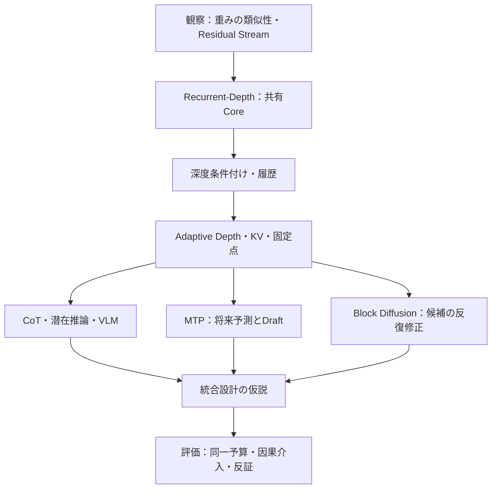

# Transformerの深さは「反復」に変わるのか
作成日：2026-11-03 / 更新日：2026-11-03

調査対象資料：2026-11-03時点。

> **副題：** Looped Transformer / Recurrent-Depth Transformerから、CoT・MTP・Block Diffusionの交点を考える。

Transformerを「異なる重みを持つ層の列」としてだけでなく、**共有された状態を更新する計算系**として読めないだろうか。本連載はその問いから出発し、Recurrent-Depthを中心に、深度条件付け、状態履歴、CoT、マルチモーダル推論、将来トークン予測、ブロック単位の反復生成を考える。

テーマは「すべてのモデルをループへ置き換えるべきだ」という主張ではない。**何を共有し、どの状態を更新し、どの計算予算を増やし、いつ出力を確定するのか**を分離して設計できる可能性と、その限界を検討する。

## 最初に結論

本連載の主軸は**Recurrent-Depthというアーキテクチャ**である。重み共有と状態更新から出発し、深度条件付け・計算効率を検討した後、CoT、MTP、Block Diffusionとの接点を探る。**中間計算を増やすこと**と**出力トークンを増やすこと**、**生成途中の候補を修正すること**は混同しない。なお、完全統合は未検証の設計仮説として扱う。

連載の中核は第2～4回。CoT・VLMの読者は第5回、MTP・Speculative Decodingの読者は第6回、Diffusion系の読者は第7回から読み始めてもよい。第8回は提案アーキテクチャの設計条件、第9回は実証計画を扱う。**各回の「この回の問い」から読み始められる**ようにしている。

## この連載の見取り図

## 目次（全9回）

- [第1回：隣接層の類似性とResidual Stream――何が反復を示唆するのか](01-weights-and-residual-stream.md)
- [第2回：Looped Transformer / Recurrent-Depth Transformerの構造と研究史](02-recurrent-depth-foundations.md)
- [第3回：Depth Conditioningと状態履歴――共有Coreの機能を分化できるか](03-depth-conditioning-and-history.md)
- [第4回：Adaptive Depth・KVキャッシュ・固定点――反復をどう効率化するか](04-adaptive-depth-and-fixed-points.md)
- [第5回：CoTと潜在推論、VLMの非対称性](05-cot-and-multimodal-reasoning.md)
- [第6回：MTPとRecurrent-Depth――先読みは反復をどう変えるか](06-mtp-and-recurrent-depth.md)
- [第7回：Block DiffusionとRecurrent-Depth――2種類の反復は補完するか](07-block-diffusion-and-recurrence.md)
- [第8回：Recurrent-Depth × MTP × Block Diffusion――統合設計の条件](08-joint-architecture.md)
- [第9回：何を実証すればよいのか――評価設計と今後の展望](09-evaluation-and-outlook.md)
- [参考文献・一次資料](references.md)

## なぜ9回に分けたのか

第1回は**観察**、第2回は**共有反復の構造**、第3回は**深さによる処理の変調**、第4回は**実効コストと収束**を扱う。特に第3・4回はどちらも反復回数に関係するが、前者が「**何を計算するか**」、後者が「**いくらで計算できるか**」という別の問いを扱うため分けた。

第5〜7回は、CoT・MTP・Block Diffusionをそれぞれ独立した**外部化・先読み・候補修正**の方法として整理する。第8・9回を分けるのは、**設計が成立する条件**と**成立を確かめる実験**を混同しないためだ。これ以上の統合は各回を長くし、細分化は前提記事の往復を増やす。

## 読み方と主張の強さ

本連載では次の区別を徹底する。

| 種類 | 内容の例 | 読み方 |
| --- | --- | --- |
| **観察** | 隣接層の重み・残差状態の類似性 | 特定モデル・測定条件で得られた結果 |
| **公開実証** | Huginn、Ouro、LoopMTP、LoopMDMなど | 各論文の規模・学習・評価条件に依存 |
| **設計仮説** | MTP Draft＋Block Denoising＋Recurrent Coreの統合 | 効果が実証されたとみなさない |

研究には査読済みの会議論文とプレプリントが混在する。**「公開論文にある数値」と「本連載で提案する設計式」は、同じ実証水準ではない。**論文の最大高速化倍率や精度改善を横断的な性能ランキングとして扱わない。**重みの共有は計算の省略そのものではなく、状態の反復が高度な推論の存在を意味するわけでもない。**

## 先に押さえたい区別

| 技術 | 主に変える対象 | 変えない・保証しないもの |
| --- | --- | --- |
| **Recurrent-Depth** | 内部計算の反復深度 | 追加の反復で正答率が必ず上がるとは限らない |
| **CoT** | 中間推論を外部化するトークン列 | 特定のTransformer層構造は必須でない |
| **MTP** | 将来位置への予測・教師信号 | 複数トークンの一括確定を自動的には保証しない |
| **Block Diffusion** | 未確定の出力位置の反復修正 | Depth Recurrenceと同じ操作ではない |
| **Depth Conditioning** | 反復段階に応じたCoreの振る舞い | 計算が正解へ到達したという判定ではない |

## 関連記事

- [Transformerの現代的解釈：Residual StreamとComputational Branch](../deep-learning-paradigm-shifts/06-residual-stream.md)
- [1回の予測から長い推論と画像生成へ](../prediction-as-interface/03-iteration-and-generation.md)
- [マルチモーダルを統合するTransformer](../prediction-as-interface/04-unified-transformer.md)

## AI利用と検証範囲

本連載の文章・構成はAIによる草案作成と編集の支援を利用した。各論文の数値と結論は、引用元のモデル・学習方法・評価条件の範囲に限って読む。非公開商用モデルの内部構造は、公開資料で確認できない限り性能や振る舞いから断定しない。
