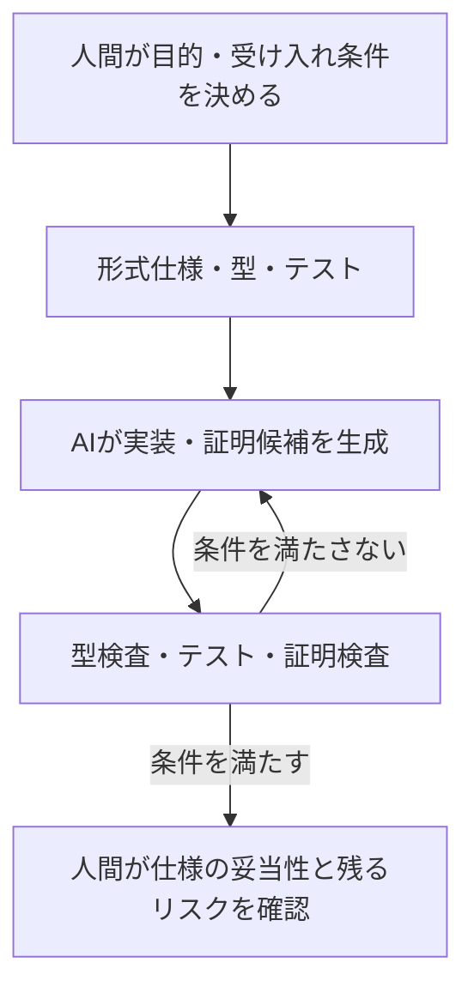

# AI時代、情報科学の数学的な本質が再び見えてきた

> **シリーズ「AI時代に再発見する情報科学の数学的本質」第1章：総論**  
> 本章だけでも読めます。続く各章では数学史、誤差逆伝播、依存型、形式検証をそれぞれ掘り下げます。

Deep Learningは、人間が処理規則を一つずつ書かなくても、数学的な最適化によって有用な計算を獲得できることを示しました。

一方、AIコーディングは、人間がコードを一つずつ書くという作業そのものを変えつつあります。

前者では「どうすれば複雑な計算を学習できるのか」、後者では「生成された計算が正しいと、どうすれば判断できるのか」が問われます。

この二つの変化を並べてみると、あることに気づきます。

**情報科学の数学的な基盤が、異なる二つの方向から、再び私たちの目の前に現れているのではないか。**

この章では、その見方を整理します。ここで述べる未来像は予言ではなく、現時点の技術を踏まえた仮説です。

## シリーズ全7章の目次

この章は総論です。それぞれのテーマは単独の記事として深掘りします。

| 回 | テーマ |
|---:|---|
| 1 | **総論：二つの数学的な転換（本章）** |
| 2 | [歴史：数学と計算機工学の合流](02-math-foundations-ai-history.md) |
| 3 | [Deep Learning：逆モード自動微分](03-math-foundations-ai-backprop.md) |
| 4 | [AIコーディング：仕様と設計](04-math-foundations-ai-coding.md) |
| 5 | [依存型：型で表す仕様と証明](05-math-foundations-ai-dependent-types.md) |
| 6 | [言語比較：保証の種類と選定](06-math-foundations-ai-languages.md) |
| 7 | [形式検証：未信頼コードと信頼境界](07-math-foundations-ai-proof-verification.md) |

## コンピュータ科学は「コードを書くこと」から始まったわけではない

電子計算機の普及に先立ち、数学者たちは「そもそも計算とは何か」「何が計算できて、何が計算できないのか」を研究していました。

アロンゾ・チャーチのラムダ計算、アラン・チューリングの計算可能性理論は、その代表例です。クルト・ゲーデルの不完全性定理は、形式体系と証明の限界を考えるうえで重要でした。

その後、ジョン・フォン・ノイマンらが計算機の論理設計と実際の工学を結びつけ、科学技術計算や汎用コンピュータの発展につなげていきます。もちろん計算機の成立には、多数の電子工学者・技術者の寄与がありました。

情報科学は「数学だけから生まれた」というより、**数学・数理論理学と計算機工学などが合流して発展した分野**です。

そしてソフトウェア産業が発展すると、OS、プログラミング言語、ライブラリ、フレームワーク、クラウドによって、基礎理論を毎回意識せずにシステムを作れるようになりました。

数学が不要になったのではありません。**抽象化の成功によって、数学が実務の表面から見えにくくなった**のです。

## Deep Learningが再び目立たせた数学

ニューラルネットワークは、パラメータを持つ非線形写像として捉えられます。

\\[
f_\theta:\mathbb{R}^n\rightarrow\mathbb{R}^m
\\]

モデルの構造、データ、損失関数などを設計し、学習によってパラメータ \\( \theta \\) を調整します。

\\[
\theta_{t+1}=\theta_t-\eta\nabla_\theta\mathcal{L}(\theta_t)
\\]

ここで大きな役割を果たすのが、**誤差逆伝播（逆モード自動微分）**です。多数のパラメータに対する勾配を、計算グラフと連鎖律を利用して効率よく求められます。

現代のDeep Learningにおいて、線形代数、微分積分、最適化、確率といった数学は、単なる理論的背景ではありません。実際にモデルの能力を成立させる中心的な仕組みです。

ただし「学習すれば、何でも正しくできる」という意味ではありません。学習された振る舞いの信頼性、データへの依存、目的関数の設計、分布外の入力への対応などは別の問題として残ります。

## AIコーディングが再び目立たせる数学

では、AIがコードを書けるようになると、どのような問題が重要になるでしょうか。

例えばAIに「リストをソートする関数を書いて」と依頼したとします。結果が昇順であることだけを確認すると、全要素を同じ値に書き換えた実装まで合格してしまいます。

本来は、少なくとも次の両方が必要です。

- **順序条件**：出力が昇順に並んでいる。
- **要素保存**：入力と出力の要素が、重複個数も含めて一致する。

前者は次のように表現できます。

\\[
\forall i<j,\quad y_i\le y_j
\\]

後者は、多重集合の一致です。

\\[
\operatorname{multiset}(x)=\operatorname{multiset}(y)
\\]

「正しくソートする」という曖昧な要求を、機械的に判定可能な性質へ近づけられました。

型システム、契約、リファインメント型、依存型、モデル検査、定理証明といった技術は、こうした**正しさの定義と検証**を扱います。

ただし、形式的に正しいことが証明できても、**形式仕様そのものが人間の要求を十分に表しているか**は別です。この区別はAI時代に一層重要になります。

## 「計算を獲得する数学」と「計算を規定する数学」

二つの方向性を、少し大胆に対比してみます。

| 観点 | Deep Learning | 型理論・形式手法 |
|---|---|---|
| 代表的な数学 | 線形代数、微分、最適化 | 数理論理学、型理論、離散数学 |
| 主な役割 | 有用な計算の振る舞いを学習する | 計算が満たすべき性質を表現する |
| 成果 | 学習済みモデル | 仕様、プログラム、証明・検査結果 |
| 課題 | 一般的な振る舞いを厳密に保証しにくい | 仕様化と証明構築に費用がかかる |

これは教育的な整理です。実際の機械学習にも論理・離散数学は関係しますし、形式手法にも数値計算の理論を使います。「連続」と「離散」で完全に分離できるわけではありません。

重要なのは、両者が**互いの弱点を補える可能性**です。

AIが実装候補や証明候補を生成し、人間が仕様を確認し、型検査器や証明器が定められた条件への適合を確認する。そうした協調が考えられます。

## だから依存型が面白い

依存型では、型が値に依存できます。

例えば「長さ \\( n \\) のベクトル」を型として表せます。さらに、Curry–Howard対応の考え方を通じて、命題を型、証明をその型の項として扱えます。

つまり、**仕様とプログラムと証明を、共通の数学的な表現の中で結びつけられる**わけです。

依存型は近年突然発明されたものではありません。Martin-Löf型理論など、長い研究の歴史があります。革新的なのは、AIによって実装・証明候補を生成するコストが変わり、この古くからの発想が新しい経済性を持つかもしれないことです。

もちろん、すべてのソフトウェアをLeanで書く必要はありません。多くの現場ではテスト、通常の型検査、契約、SMTベースの検証などを組み合わせる方が合理的でしょう。

## 本当に形式手法の時代が来るのか

ここから先は仮説です。

AIによってコード生成の限界費用が下がれば、生成物をどう評価・統合するかが相対的に重要になる可能性があります。しかし、AIがテスト生成やレビューも効率化すれば、形式証明の導入動機が必ずしも強まるとは限りません。

形式仕様そのものを作成・レビュー・維持する費用も残ります。**「検証の価値が高まる」と「依存型言語が広く普及する」は、別の主張**です。

だからこそ、技術的可能性と将来予測を分けて考えたいと思います。

## おわりに

Deep Learningは、数学的最適化によって複雑な変換を獲得する領域を広げました。AIコーディングは、コードを記述する費用を変え、仕様や正しさを定義することの重要性を浮かび上がらせる可能性があります。

**情報科学は数学へ「回帰」するのではありません。数学の上に積み重なった技術が成熟することで、その数学的本質が再び見えてきた。**

これが本シリーズの出発点です。

次章以降は、コンピュータ科学の数学的な起源、誤差逆伝播の革新性、依存型による仕様と証明の接続を、それぞれ独立した話として掘り下げます。

## 参考資料

- [Turing, *On Computable Numbers* (1936)](https://www.cs.virginia.edu/~robins/Turing_Paper_1936.pdf)
- [Rumelhart, Hinton & Williams, *Learning representations by back-propagating errors* (1986)](https://doi.org/10.1038/323533a0)
- [Lean: Theorem Proving in Lean 4](https://lean-lang.org/theorem_proving_in_lean4/)

---

## 章ナビゲーション

- **次章：** [第2章｜歴史：数学と計算機工学の合流](02-math-foundations-ai-history.md)

全記事の一覧は冒頭の目次を参照してください。
