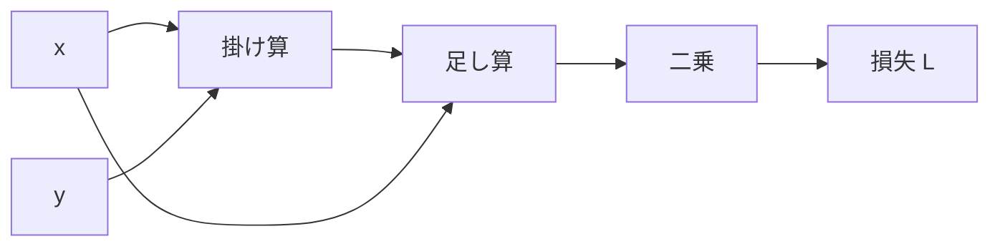

# 誤差逆伝播はなぜ革命的なのか？ 逆モード自動微分から理解するDeep Learning

> **シリーズ「AI時代に再発見する情報科学の数学的本質」第3章：Deep Learning**  
> 数学的な最適化が、膨大なパラメータを持つモデルの学習を可能にした理由を考えます。

Deep Learningの成功を考えるとき、Transformerなどのモデル構造や大規模な学習データが話題になります。

しかし、もっと根本的なところに、驚くほど強力な仕組みがあります。

**膨大な数のパラメータを、実用的な計算量で調整できること**です。

それを支えているのが、誤差逆伝播（backpropagation）と、その数学的な基盤である逆モード自動微分（reverse-mode automatic differentiation）です。

## 問題はパラメータが多すぎること

学習対象を、パラメータ \\( \theta \\) を持つ関数 \\( f_\theta \\) として考えます。

\\[
f_\theta:\mathbb{R}^n\rightarrow\mathbb{R}^m
\\]

学習では、出力が望ましい振る舞いに近づくように損失関数 \\( \mathcal L \\) を小さくしたいとします。

\\[
\theta_{t+1}=\theta_t-\eta\nabla_\theta\mathcal L(\theta_t)
\\]

単純な勾配降下法の式ですが、問題は勾配 \\( \nabla_\theta\mathcal L \\) をどのように計算するかです。

パラメータが10億個あるとします。各パラメータをわずかに動かし、損失を測り直す方法を考えると、少なくともパラメータ数に比例する多数の評価が必要です。

有限差分なら概念的に次の式です。

\\[
\frac{\partial \mathcal L}{\partial \theta_i}
\approx \frac{\mathcal L(\theta+\varepsilon e_i)-\mathcal L(\theta)}{\varepsilon}
\\]

しかも、有限差分には丸め誤差と刻み幅の選択という問題もあります。

**勾配が必要なのに、勾配を求めるだけでモデルを膨大な回数評価していては学習できない。** ここが最初の壁です。

## 計算をグラフとして見れば、答えが変わる

例えば、次の計算を考えます。

\\[
\begin{aligned}
u &= xy\\\\
v &= u+x\\\\
L &= v^2
\end{aligned}
\\]

これは \\( L=(xy+x)^2 \\) を小さな演算に分解したものです。

順方向では、\\( x,y \\) から \\( u \\)、\\( v \\)、\\( L \\) の順に計算します。

逆方向では、連鎖律に従って、まず \\( \partial L/\partial v=2v \\) を計算します。

\\[
\frac{\partial L}{\partial x}=2v(y+1),\qquad
\frac{\partial L}{\partial y}=2vx
\\]

重要なのは、途中で得た \\( v \\) や \\( 2v \\) といった値を**複数の偏微分の計算で共有できる**ことです。

巨大なヤコビアン行列をすべて明示的に作る必要はありません。スカラー損失から各中間変数へ、局所的な微分を逆向きに伝えていけばよいのです。

## なぜ「逆モード」が適しているのか

自動微分は数値微分と異なり、プログラムの演算に微分の規則を適用します。記号式全体を手で展開し続ける必要もありません。

大まかに、順モードと逆モードを比較すると次のようになります。

| 観点 | 順モード自動微分 | 逆モード自動微分 |
|---|---|---|
| 基本的な伝播 | 入力側から微分を伝える | 出力側から感度を伝える |
| 効率のよい典型例 | 入力が少なく出力が多い | 入力が多く出力が少ない |
| 重要な計算 | JVP（Jacobian-vector product） | VJP（vector-Jacobian product） |
| NNのスカラー損失 | 活用できるが、通常は不利 | 特に適している |

ニューラルネットワークでは、パラメータが膨大でも、最後に最適化したい損失はしばしばスカラーです。

そこで、**一つのスカラー出力から多数の入力パラメータへ感度を伝える逆モード**が効きます。

適切な演算モデルの下で、全パラメータの勾配に必要な演算量を、順伝播の定数倍程度に抑えられます。Baur–Strassenの計算量に関する結果は、その数学的な背景の一つです。

ただし「計算量が定数倍」という言い方は、すべての実装が同じ速度という意味ではありません。実際のGPU計算ではメモリアクセス、並列性、再計算、通信などが影響します。

## 計算量の代わりにメモリが必要になる

逆モード自動微分には重要なコストがあります。

逆伝播を行う際、順伝播での中間値が必要になることが多いのです。層が深く、大きなバッチを使うモデルでは、この保存コストが大きくなります。

そこで実務では、activation checkpointingのように、一部の中間値を保存せず必要時に再計算する手法が使われます。

つまり、**演算回数とメモリ使用量のトレードオフ**が存在します。

この点も、誤差逆伝播を数学だけでなく計算機工学の視点で見る理由になります。

## 誤差逆伝播の歴史は1986年から始まったわけではない

1986年のRumelhart、Hinton、Williamsらの論文は、ニューラルネットワークの内部表現を学習する方法として誤差逆伝播を広く知らしめました。

しかし、逆方向に導関数を計算する考え方の歴史はそれ以前にもあります。

- **1970年**：Seppo Linnainmaaが、計算過程の導関数を機械的に扱う研究を学位論文で展開。
- **1976年**：Linnainmaaが、自動微分に連なる成果を論文として発表。
- **1983年**：BaurとStrassenが、多数の偏導関数の計算量について理論的な結果を示す。
- **1986年**：Rumelhartらが、ニューラルネットワークの誤差逆伝播を広く知らしめる。

特定の一論文がすべてを突然発明したというより、**自動微分の数学とニューラルネットワークの学習研究が合流した**と見るのが適切です。

## では、人間は何を設計しているのか

Deep Learningにおいて、人間は個々の重みを手動で設定しません。しかし、学習が勝手にすべてを解決するわけでもありません。

モデルの構造、損失関数、データ、最適化手法、正則化、学習カリキュラム、評価指標などは依然として設計の対象です。

そのうえで、誤差逆伝播が大規模なパラメータ探索を実行可能にします。

**「処理規則を直接書く」ことから、「望む振る舞いを学習させるための計算構造と目的を設計する」ことへ。**

## おわりに

この変化は、情報科学における人間の役割を考えるうえで重要です。

そして別の方向から、AIコーディングが「プログラムの実装記述」を変えようとしています。次章は、そこで人間に何が残るのかを考えます。

## 参考文献

- [Linnainmaa, *Taylor expansion of the accumulated rounding error* (1976)](https://doi.org/10.1007/BF01931367)
- [Baur & Strassen, *The Complexity of Partial Derivatives* (1983)](https://doi.org/10.1016/0304-3975(83)90110-X)
- [Rumelhart, Hinton & Williams, *Learning representations by back-propagating errors* (1986)](https://doi.org/10.1038/323533a0)

---

## 章ナビゲーション

- **シリーズの総論：** [第1章｜総論：二つの数学的な転換](01-math-foundations-ai-overview.md)
- **前章：** [第2章｜歴史：数学と計算機工学の合流](02-math-foundations-ai-history.md)
- **次章：** [第4章｜AIコーディング：仕様と設計](04-math-foundations-ai-coding.md)
