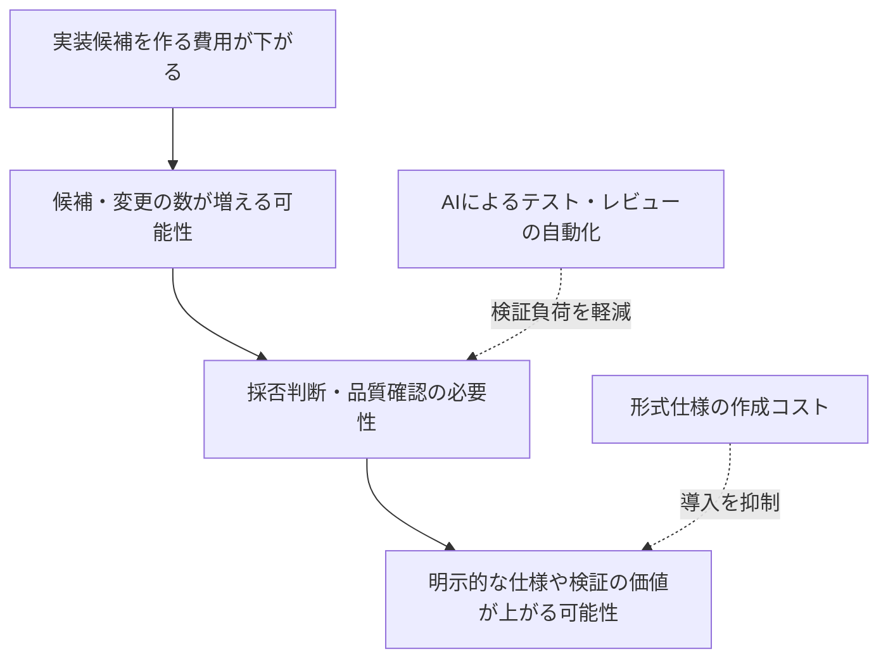

# AIがコードを書く時代、人間は何を設計するのか

作成日：2026-10-12 / 更新日：2026-10-12

> **シリーズ「AI時代に再発見する情報科学の数学的本質」第4章：AIコーディング**  
> コード生成の自動化が、要求、設計、レビュー、検証の関係をどう変えるかを考えます。

AIコーディングの進歩によって、コードを書くという行為の費用は変わりつつあります。

しかし、コードが速く生成されるからといって、正しいソフトウェアが自動的に完成するわけではありません。

では、**コードを書く作業が安価になったとき、人間の仕事は何へ移るのでしょうか。**

私は、その一つが「正しいと認める条件を設計すること」だと考えています。

## 「実装」には、もともと多くの設計判断が含まれていた

従来の開発では、コードを書く過程で大量の判断をしていました。

- この処理の責任はどのモジュールに置くか。
- APIの失敗をどう表現するか。
- データの整合性をどこで保証するか。
- 何を許可し、何を拒否するか。
- 想定外の入力をどう扱うか。

これらは単に文字列としてのコードを書く仕事ではありません。設計判断です。

AIがコードを書けるようになると、逆に、**以前は実装作業に埋もれていた設計判断が見えるようになる**のではないでしょうか。

例えば「ユーザー登録機能を作って」という要求には、アカウントの重複を許すのか、メール確認はいつ必要なのか、途中で失敗した場合にどこまでロールバックするのか、といった未決定事項があります。

コードが生成できても、そうした判断がなければ、単に一つの解釈がコード化されるだけです。

## 仕様が曖昧なままなら、生成速度だけが上がる

「ユーザー登録機能を作って」という要求を例にします。画面、API、データベース操作は生成できても、次のことは要求だけでは決まりません。

- 同じメールアドレスで複数のアカウントを作れるのか。
- 大文字・小文字や前後の空白を、重複判定でどう扱うのか。
- 登録処理を再送したとき、二重作成しないために何を保証するのか。
- メール送信に失敗した場合、登録済みとして扱うのか。

例えば「登録前に重複がないか問い合わせ、なければINSERTする」という実装は、一見正しく見えます。しかし、**同時に2件のリクエストが到着すると、どちらも『まだ存在しない』と判断する競合**が起こり得ます。

この場合、アプリケーションの事前確認だけではなく、正規化の定義、データベースの一意制約、トランザクション境界、再送時の振る舞いといった仕様上の判断が重要になります。なお、メールアドレスの正規化では、事業者ごとの差異や利用者への影響を考慮する必要があり、単純な文字列の小文字化が常に正解とは限りません。

**生成されたコードの見た目より先に、『何を不変条件として守るのか』を決めなければ、実装の速さだけが増える**のです。

## AIコーディングと、DDD・TDD・設計原則

既存の開発手法も、AI時代に別の意味を持ちます。

### DDD：何をモデル化するか

ドメイン駆動設計（DDD）が重視するのは、単にクラスをきれいに分割することではありません。

業務概念、用語、境界、ルールを明示し、コードの構造とモデルを対応させることです。

AIは文脈からコードを生成できますが、プロジェクト内で「注文確定」や「決済完了」が何を意味するかは、人間とチームが定義しなければなりません。

ドメインモデルが明確なら、AIに与える制約も明確になります。

### TDD：何を成功条件にするか

テスト駆動開発（TDD）は、実装より前に期待する振る舞いを具体化する習慣として見ることができます。

AIにコード生成を依頼する場合も、期待する入出力、エラーケース、境界条件が先に整理されていれば、生成後の判定が容易になります。

ただし、AIがテストと実装を同時に作る場合、両方が同じ誤解を共有する危険があります。テストの独立性と、要求への適合性のレビューは依然として重要です。

### 型・契約・形式仕様：一歩進んだ受け入れ条件

型は、設計上の不正な状態を表現しにくくするための道具です。

契約は、関数やモジュールに期待する事前・事後条件を表現します。

形式仕様は、それらを機械で検査しやすい数学的な形まで厳密にしたものです。

すべての開発で形式証明が必要なわけではありません。重要なのは、**要求のリスクと検証費用に応じて、適切な保証方法を選ぶこと**です。

## 生産性研究から何が言えるか

「AIコーディングで生産性が上がる」という主張には、実証的な裏付けがある一方で、反対方向の結果もあります。

例えばPengらの実験では、特定の課題についてGitHub Copilotを使用した群が、使用しない群より**55.8%速く**完了したと報告されています。

一方、METRによる2025年の経験豊富なOSS開発者を対象とする実験では、当該条件でAI利用時に作業時間が増加したと報告されました。2026年の後続報告では、AIを使わない条件で研究に参加することを避ける開発者がいるなど、測定における選択バイアスの難しさが説明されています。

これらを単純に平均して「AIは何%速い」と結論づけることはできません。**課題、対象者、ツールの世代、レビューや手戻りを含めた測定方法が異なる**からです。

重要なのは、コード生成の速度と、システム全体の品質・開発費用は別の指標だということです。

## 「仕様の価値が高まる」という仮説

私が注目しているのは次の連鎖です。

ここで大切なのは、矢印のそれぞれが**条件付き**だという点です。

AIによってテストやレビューも十分に安くなれば、形式証明を導入する必要性はそれほど増えないかもしれません。業務要求そのものが曖昧で形式化しにくい領域もあります。

「検証が重要になる」と「Leanのような依存型言語が主流になる」は同じ話ではありません。

## 役割分担の一案

AI支援開発で考えられる役割分担を、あえて単純化すると次のようになります。

| 主体 | 主に担う仕事 |
|---|---|
| 人間・チーム | 目的、境界、リスク、承認済み仕様の設計 |
| AI | 設計案、実装、テスト、証明候補の生成・修正 |
| 静的解析・テスト・証明器 | 定められた条件への機械的な適合判定 |
| 人間・チーム | 仕様の妥当性、未検証リスク、運用上の責任の確認 |

この構造を使う場合、AIに仕様と検証設定を自由に変更させてしまうと、都合のよい条件へ書き換えて「成功」させる危険があります。

だから、**実装候補を生成する権限と、受け入れ条件を確定する権限は分けたい**のです。

## おわりに

AIコーディングによって、ソフトウェア開発から設計が消えるとは考えていません。

むしろ、コードを書く作業が自動化されるほど、これまでコードの中に埋もれていた設計判断が、より明示的に求められる可能性があります。

**人間が設計するのは、単なる実装手順から、目的・制約・受け入れ条件へ。**

そこに、型理論や形式手法という数学的な分野が接続します。次章は、その中でも特に興味深い「依存型」を扱います。

## 参考文献

- [Peng et al., *The Impact of AI on Developer Productivity* (2023)](https://arxiv.org/abs/2302.06590)
- [METR, *Measuring the Impact of Early-2025 AI on Experienced Open-Source Developer Productivity*](https://arxiv.org/abs/2507.09089)
- [METR, *We are Changing our Developer Productivity Experiment Design* (2026)](https://metr.org/blog/2026-02-24-uplift-update/)
- [Hoare, *An Axiomatic Basis for Computer Programming* (1969)](https://doi.org/10.1145/363235.363259)

---

## 章ナビゲーション

- **シリーズの総論：** [第1章｜総論：二つの数学的な転換](01-math-foundations-ai-overview.md)
- **前章：** [第3章｜Deep Learning：逆モード自動微分](03-math-foundations-ai-backprop.md)
- **次章：** [第5章｜依存型：型で表す仕様と証明](05-math-foundations-ai-dependent-types.md)
