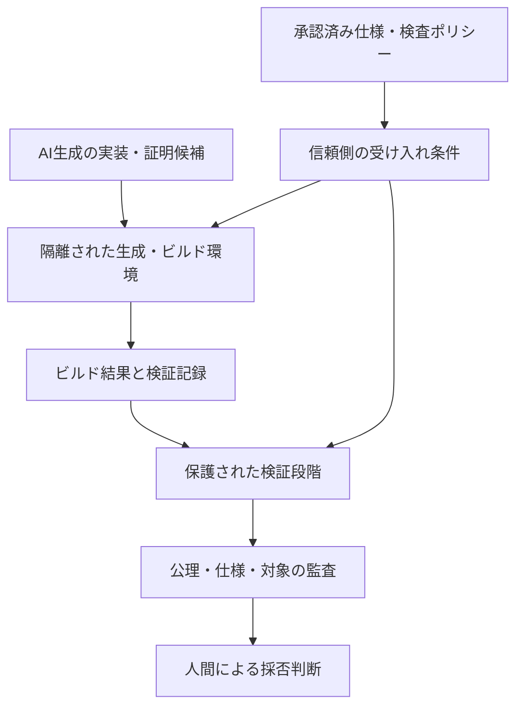

# AI生成コードは数学的に検証できるのか？ Lean・Kani・Verusと信頼境界

作成日：2026-10-12 / 更新日：2026-10-12

> **シリーズ「AI時代に再発見する情報科学の数学的本質」第7章：生成と検証**  
> AIが作ったコードや証明を、何を根拠に受け入れるべきなのかを考えます。

AIにコードを書かせ、AIにそのコードをレビューさせる。今では自然な開発フローです。

しかし、AIの回答が「問題ありません」だったとしても、それは数学的な保証にはなりません。

そこで、次のような発想が出てきます。

**AIには実装と証明の候補を作らせ、正しさの判定は機械的な検証器へ委ねる。**

魅力的な考え方です。ただし、本当に安全に使うには、型検査が成功したという事実の周囲にある「信頼境界」を理解する必要があります。

## 最初の区別：「通った」と「正しかった」は違う

例えば、二つの口座の間で残高を移動する小さなプログラムを考えます。手数料も外部への入出金もない、単純化したモデルなら、少なくとも次の性質を仕様として考えられます。

- 送金額は非負で、送金元に十分な残高がある。
- 送金が成功したら、送金元から指定額が減り、送金先へ同額が加算される。
- このモデル内では、**送金前後で二口座の残高合計が変わらない**。

ここで「合計額が変わらない」だけを証明しても、送金先を間違える実装は排除できません。残高が負になる、送金に失敗したのに片方だけ更新される、という問題も別途考える必要があります。

さらに、このモデルで証明が成功しても、現実の決済システムには**同時実行、権限、永続化、外部銀行との連携、通貨単位、障害からの復旧**といった前提があります。

**形式証明は、形式化された命題に対する証明です。人間の要求が十分に形式化されていることや、モデル外の環境の安全性まで自動的に保証するものではありません。**

したがって、少なくとも次の三つは区別する必要があります。

| 対象 | 確認すべきこと |
|---|---|
| 仕様 | 人間が求める性質を十分に表し、重要な前提を明示しているか |
| 証明 | 指定した前提・形式体系の中で、仕様を満たすことが示されたか |
| 実行物 | 検証した対象と実際の配布物が対応し、環境上の前提が成立するか |

この三つを混同すると、「証明済み」という言葉だけが独り歩きします。

## Lean：命題と証明項をカーネルが検査する

Lean 4では、命題と証明を型理論で扱います。

例えば、次の命題を示せます。

```lean
example (n : Nat) : n + 0 = n := by
  simp
```

タクティクが証明項を構築し、カーネルが型を検査します。

この構造の利点は、**AIが証明候補を作っても、AIの自己評価をそのまま信頼する必要がない**ことです。

ただし、カーネルが検査したことだけで、すべてが保証されるわけではありません。

### 「公理を追加して通す」という抜け道

例えば、未承認の仮定を導入すれば、本来導けない命題を形式上は証明できてしまいます。

```lean
axiom unproved : False

theorem bogus : 1 = 2 :=
  False.elim unproved

#print axioms bogus
```

これは、**誤った命題を正当化する例ではなく、未承認の公理を信頼すると何が起きるかを示す反例**です。カーネルが証明項の型を確認したとしても、その証明が何を前提としているかは別途監査しなければなりません。

Leanの`#print axioms`などで依存公理を確認し、`sorryAx`や未承認公理への依存を受け入れない運用が重要です。

なおLean標準の`propext`、`Classical.choice`、`Quot.sound`のような公理を、すべて一律に不正とするのも適切ではありません。どの前提を許容するかは、検証方針に従って決めます。

### 「型検査」「公理監査」「再検査」は別の工程

| 段階 | 主な確認内容 | なお残る問題 |
|---|---|---|
| 型検査 | 宣言と証明項の型が合うか | 仕様や追加公理の妥当性 |
| 公理監査 | 何を無条件の前提にしているか | 仕様の意味やビルド対象の同一性 |
| 保存済み証明の再検査 | `.olean`等を再びカーネルで調べる | 同一カーネルの欠陥を独立に除外できない |
| 別実装・別権限での検査 | 一部の信頼基盤を多重化する | 検証外の環境や仕様の十分性 |

例えば`leanchecker`は、使用するLeanのバージョンに応じて保存済み宣言を再検査する道具です。しかし、**同じLeanカーネルによる再検査を、別実装による独立証明と呼ぶべきではありません**。

## Kani：モデル検査で何を保証するのか

KaniはRustプログラムの性質をモデル検査するためのツールです。

ハーネスで入力や確認したい性質を設定し、到達可能な経路に対してアサーションなどを検証します。

重要なのは、**どの入力とどのループ展開範囲を検査したか**です。

典型的なbounded model checkingでは、有限の展開範囲で検査した結果を、そのまま無条件の全入力に対する証明とは呼べません。

Kaniには不変条件などを使った実験的なループ契約もあります。ループが終了した場合の正しさ（部分正当性）と、停止性まで含む正しさ（全正当性）は別であり、実験的機能の既知の制限を確認する必要があります。

## Verus：SMTによる証明と「前提」の管理

VerusはRustに近い言語で、関数の事前条件・事後条件・不変条件などを指定し、SMTソルバによる検証を利用します。

Leanとは異なるアプローチですが、ここでも信頼境界が重要です。

例えば`assume`、外部コードを信頼するための機構、`assume_specification`などは、適切に使えば必要な道具です。一方、AIが証明できない箇所を「仮定すること」によって検証を通してしまえば、何を保証できているかが変わります。

**証明が成功したかに加えて、何を仮定したから成功したのか**を確認しなければなりません。

## AI生成コードを受け入れるときの失敗パターン

| 失敗モード | 起こり得ること | 対応方針 |
|---|---|---|
| 仕様の弱体化 | 検証しやすい条件へ勝手に変更 | 承認済み仕様を別管理する |
| 公理・仮定の追加 | 証明義務を回避 | 依存公理と仮定を監査する |
| 対象のすり替え | 別の関数を検証する | 対象宣言・ビルド対象を固定する |
| 検査の無効化 | CIの検査をスキップ | 検証設定を候補から保護する |
| 成果物の差し替え | 検証済みソースと配布物が異なる | ビルドと成果物の来歴を管理する |
| 外部環境の見落とし | FFI・外部APIで前提が崩れる | モデル化範囲と実環境テストを併用する |

形式検証においても、セキュリティ設計においても、**「何を信頼しているか」を明示すること**が欠かせません。

## さらに注意：未信頼Leanコードは実行され得る

Leanには証明を記述するための言語機能だけでなく、メタプログラミング機能もあります。

つまり、未信頼のソースを処理するとき、**証明を読むだけのつもりでも、メタコードが実行される場面がある**ことに注意が必要です。

型検査や証明検査を行うからといって、そのプロセスを無条件に信頼されたホスト環境で動かしてよいわけではありません。

教育用の構成例として、次のような分離が考えられます。



コンテナのネットワーク遮断、非root実行、読み取り専用マウント、資源制限、承認済みイメージの使用などは、リスクを減らすための有効な要素です。

しかしDockerなどの隔離は、それ単体で**証明の正しさを保証しません**。また、コンテナランタイムやホストの欠陥、ビルド成果物の一時改変などのリスクも残ります。

形式的保証のための検査と、未信頼コード実行のための隔離は別の問題です。

> **注意**
>
> **「形式検証ツールが成功した」と「安全な受け入れ基盤が完成した」は別です。**
>
> 未信頼のAI生成コードを扱う場合、検査対象の固定、許容公理、隔離実行、成果物の来歴、仕様の承認権限をそれぞれ確認する必要があります。

## どこまでやれば実用的か

すべてのアプリケーションに証明カーネルや多段階の隔離CIが必要なわけではありません。

通常の開発では、型検査、ユニットテスト、プロパティベーステスト、静的解析、コードレビューを組み合わせることが合理的です。

そのうえで、重要なデータ変換、安全性の高い制御、資金を扱う計算など、**誤りの影響が大きく、性質を形式化しやすい部分**に対して形式検証を追加することが考えられます。

AIが生成するコード量が増えたとしても、検証する対象と保証する性質を選ぶという設計判断は残ります。

## おわりに

AIによるコード生成と、数学的な形式検証の組み合わせには確かな可能性があります。

しかし、重要なのは「AIが作った証明をAIが褒める」ことではありません。

**人間が承認した仕様に対して、候補を機械的に検査し、その検査自体が何を信頼しているかを明確にすること**です。

この役割分担が成立すれば、コード生成が高度に自動化されても、人間は「正しさとは何か」「何を受け入れるか」という設計に集中できます。

本シリーズを通じて見えてきたのは、数学がソフトウェア開発から一度消えて再び戻ってきたのではなく、**数学的な計算と検証の仕組みが、AI時代の新しい課題に対して再び表面化している**ということです。

## 参考文献

- [Lean: Validating a Lean Proof](https://lean-lang.org/doc/reference/latest/ValidatingProofs/)
- [Lean: Axioms](https://lean-lang.org/doc/reference/latest/Axioms/)
- [Lean 4.34.1 Release Notes](https://lean-lang.org/doc/reference/latest/releases/v4.34.1/)
- [Kani: Loop Unwinding](https://model-checking.github.io/kani/tutorial-loop-unwinding.html)
- [Kani: Loop Contracts (experimental)](https://model-checking.github.io/kani/reference/experimental/loop-contracts.html)
- [Verus: Trusted Components](https://verus-lang.github.io/verus/guide/tcb.html)
- [Verus: Using LLMs to Develop Proofs](https://verus-lang.github.io/verus/guide/llmforverusproof.html)

---

## 章ナビゲーション

- **シリーズの総論：** [第1章｜総論：二つの数学的な転換](01-math-foundations-ai-overview.md)
- **前章：** [第6章｜言語比較：保証の種類と選定](06-math-foundations-ai-languages.md)

これで全7章のシリーズは完結です。各記事はそれぞれ単独でも読めます。
