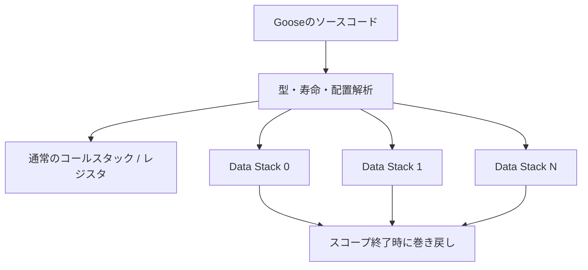

# 第1部：設計思想とData Stack

作成日：2026-11-02 / 更新日：2026-11-02

[← シリーズ目次](./) · [第2部 →](02-features-and-limits.md)

> Gooseの言語設計と、非移動配列・Root・一括解放の仕組みを詳しく見る。

## 1. 各言語は何を優先しているのか

| 言語 | 中心的な設計方針 | メモリ管理の基本 | 重要な強み | 主な代償 |
|---|---|---|---|---|
| **Goose** | Speed → Safety → Expressiveness | 静的に割り当てられる複数Data Stack | インライン配置、移動しない伸長、スコープ単位解放 | 値の配置・寿命に強い制約 |
| **Rust** | 安全性と低レベル制御の両立 | 所有権、借用、RAII、必要に応じたAllocator | 広い表現力、`no_std`、堅牢な型システム | 学習とAPI設計の複雑さ |
| **Go** | 単純さ、開発効率、並行サービス | スタック割当＋GC管理ヒープ | Goroutine、標準ライブラリ、安定したツール | GCのコスト、低レベル制御の範囲 |
| **Zig** | 明示性と制御 | 呼び出し側が渡すAllocatorなど | Freestanding、C相互運用、構成可能性 | 所有権・寿命の安全性を主に開発者が管理 |
| **C++** | 性能、汎用性、既存資産との互換 | RAII、手動メモリ管理、Allocator | 多様な抽象化、巨大なライブラリ資産 | 言語の複雑さ、未定義動作の危険 |

Gooseの「Safety」は、境界外アクセス、型不一致アクセス、解放済み領域への参照を防ぐという意味であり、Rustと同じ排他的借用規則を採用するわけではない。仕様は、型として安全だが論理的に古くなった値の参照を、一定条件で許容することも明示している。[1](references.md#ref-1)

この違いは「安全性を目指す」という共通点より重要である。**Rustは多様な所有関係を安全に扱おうとする。Gooseは許される所有・配置パターンを限定し、そこから効率を取り出そうとする。**

## 2. GooseのData Stackは何を自動化するのか

### 2.1 スタックとヒープの二分法では説明できない

Gooseでは固定サイズのローカル値は通常のコールスタックやレジスタにも配置される。一方、動的な値の多くは、コンパイラが必要本数を計算する独立したData Stackに配置される。[1](references.md#ref-1)[2](references.md#ref-2)



Data Stackは原則として、**予約された仮想アドレス領域**とBump Pointerからなる。新しい値を追加するときには先頭ポインタを前進させ、寿命が終われば巻き戻す。領域を移動しないため、伸長前に取得した要素への参照を維持しやすい。

ここでいう「予約」は、即座に同量の物理RAMを消費することではない。公式CLIが説明するネイティブ実装では、Data Stackごとの予約領域はデフォルトで**2 GiB**（2,147,483,648バイト）であり、`--stack-reserve`で変更できる。物理ページの使用やコミットはOSの仕組みに依存する。これは64bit OSのユーザー空間には適した方針だが、Kernel、UEFI、Wasm、MCUへの移植にそのまま使える設計ではない。[2](references.md#ref-2)[4](references.md#ref-4)

本質的な不変条件は、**一つのData Stackでは、同時に生存する伸長可能な値を最大一つだけ、常に最上部に置く**ことである。別々の値が同時に伸長するなら、別のData Stackが必要になる。逆に、寿命が重ならない値は同じ領域を再利用できる。[1](references.md#ref-1) この制約が再帰・複雑な寿命・Poolの設計に及ぼす影響は、[第2部の第4章](02-features-and-limits.md)で扱う。

この制約をコンパイラが検証することで、一般的な動的配列で必要になりがちな再確保と移動を避けられる。**ただし、Data Stackの予約上限、メモリ不足、OSのページフォールトは別問題**である。

さらに、Data Stackの**本数にも上限**がある。実装ノートではコンパイル時に必要本数を解析し、`GS_MAX_STACKS`の既定上限を1,024としている。Worker数の目安を返す`hardware_threads()`は、Data Stack用の仮想アドレス予算（実装ノートでは既定を32 TBと表記）を考慮するが、**この予算はランタイムで強制される上限ではない**。単純な「2 GiB × 配列数」とは限らず、Worker・グローバル領域・スコープの同時生存関係によって変わる。`goose check --stacks`で実際の配置見積もりを確認できる。[2](references.md#ref-2)[19](references.md#ref-19)

<a id="nonmoving-array-example"></a>

### 2.2 Rustの`Vec`とGooseの伸長配列

概念的には、次の違いがある。

```rust
// Rust：容量を使い切ると、バックバッファが移動する場合がある。
let mut values = Vec::new();
for i in 0..100_000 {
    values.push(i);
}
```

```goose
// Goose：この種類の配列はData Stack上で伸長する。
fn main() {
    var values: i64[>..] = [];
    for i in 100000 {
        values.push(i);
    }
    print(values.len);
}
```

Rustでも事前に容量を指定したり、チャンク型配列、Arena、仮想アドレス予約を使う独自コンテナなどを採用すれば、再配置の問題を抑制できる。ただし、通常の`Vec`自体に「伸長しても既存要素のアドレスを維持する」という保証はない。

Gooseの利点は、そうした特性が**専用の最適化ライブラリではなく、言語が用意した配列型の性質**であることだ。ただし、すべての配列が伸長可能なのではなく、配列型ごとに許される操作と配置場所が異なる。また、**アドレスが安定することと、値の所有権を自由に移せることは別**である。

```goose
// 公式の非移動配列の例に沿った短い説明用コード。
struct Entry { score: i64 }
fn main() {
    var entries: Entry[>..] = [];
    let first .= entries.push(Entry { 10 });
    entries.push(Entry { 20 });
    first.score += 1; // push後も先頭要素への参照は有効
    print(entries[0].score);
}
```

Rustの通常の`Vec`では、後で使用する要素の借用を保持しながら`push`する操作は拒否される。容量が十分なら実行時には再配置しないが、借用規則は実行時の空き容量には依存しない。Gooseの`[>..]`では、**伸長しても元の要素が動かないという契約を言語が保証する**。対照的に、次のRustコードは借用が`push`の後まで続くためコンパイルできない。

```rust
// これは意図的にコンパイルできないRustの例。
let mut values = vec![10];
let first = &values[0];
values.push(20);  // firstを後で使うため借用規則に抵触
println!("{first}");
```

ただし、これは**Gooseなら一般にRustより速い**ことの証明ではない。Rust側でも、用途に応じてインデックスや安定アドレスのコンテナを選べる。Gooseの説明用コードは公式例を基に構成したもので、**配布版v2026.3での実行結果を確認したものではない**。[1](references.md#ref-1)[12](references.md#ref-12)[17](references.md#ref-17)

**Rustの`Pin`と混同しないこと。** `Pin<&mut Vec<T>>`などで`Vec`オブジェクト自体の移動を制限しても、`push`に伴う**要素バッファの再確保**までは防げない。Rustで要素アドレスの維持を求める場合は、容量を固定したバッファ、チャンク型ストレージ、適切なPoolなど、利用条件に合う設計が必要になる。`Pin`は「どの値を動かさないか」に関する仕組みであり、**`Vec`の容量伸長時に要素を動かさないアロケータ**ではない。これはGooseの`[>..]`が型として提供する性質との重要な差である。

### 2.3 一括解放はなぜ速いのか

概念的なBump Allocatorは、以下のように単純化できる。

```text
alloc(n):
    result = top
    top += align(n)
    return result

end_scope():
    top = saved_top
```

各オブジェクトに対する一般的な`malloc`/`free`や、追跡型GCによる到達可能性の解析が不要になる。ただし、これは**通常のデータ値の管理**についての説明であり、Gooseのランタイム内部がOS資源やヒープ割当を一切使わないという意味ではない。たとえばWorker間キューの実装には内部アロケーションがある。[2](references.md#ref-2)

また、スタックポインタを戻しても、直ちに物理メモリがOSへ返されるとは限らない。再利用用にページが残ることがあり、未使用ページの返却には`trim_memory()`等の仕組みが用意されている。**「解放が定数時間に近い」ことは、常に物理メモリ使用量が最小になることや、レイテンシの上限が保証されることを意味しない**。[1](references.md#ref-1)[2](references.md#ref-2)

### 2.4 インライン可変長データと相対参照

Gooseは可変長の文字列や構造体を、連続したデータ領域に配置できる。Rustの`String`や`Vec<T>`を組み合わせた構造と比べ、別々の領域への間接参照や個別割当を減らせる場合がある。

```text
一般的な所有ポインタ型の表現（模式図）
[レコード] ──→ [文字列]
       └────→ [要素配列] ──→ [別の文字列]

Gooseのコンパクトな表現（模式図）
[ヘッダ | 文字列 | 要素1 | 要素2 | ...]
```

加えて、相対参照を使えば、絶対ポインタより小さいオフセットでノード同士を接続できる場合がある。連続配置・相対参照は、パーサー、構文木、コンパクトな保存形式などで魅力的だ。[1](references.md#ref-1)[3](references.md#ref-3)

ただし、可変長要素を密に詰めた配列では、各要素の先頭位置が固定幅で決まらず、一般的な固定幅配列のようなO(1)の任意要素アクセスが成立しない場合がある。必要ならオフセット表などを別途設計する。また、密な配置は容量削減に有利でも、アラインメントやベクトル化では不利になり得る（[第2部・第4.5節](02-features-and-limits.md)）。

### 2.5 値のコピーと所有権移動

**コピーも型のサイズ区分で扱いが異なる。** Gooseで固定サイズの値を代入・値渡しすれば、その値は暗黙にコピーされる。サイズが大きい固定長配列や構造体では、**意味論上のコピー**が性能問題になり得る。ただし、コンパイラが不要と証明できる物理的なコピーまで必ず発生するわけではない。一方、**可変長・伸長可能な値は暗黙にディープコピーされない**。一般的な変数束縛や型を指定しない引数では参照を渡し、別の独立した値が必要な場面では`copy`を明示する。関数の新しい戻り値は構築先へ直接配置できる。[1](references.md#ref-1)[17](references.md#ref-17)

```goose
// 可変長の値の複製は明示する（公式チュートリアルに基づく例）。
fn main() {
    var a: i64[>..] = [1, 2, 3];
    var b = copy(a); // bは独立した値。コピー量は要素数に比例する。
    b.push(4);
    print(b);
}
```

Rustでは`Vec<T>`の所有権をムーブすると、通常はバッファ本体を複製せずに小さな管理情報を移せる。Gooseでは**関数の戻り値を最終配置先へ構築する場合や、関数内のローカル値を`return`で移す場合**に不要な複製を回避できる一方、既存の伸長配列を汎用的に別の所有者へ移す操作はまだない。必要に応じて**参照・直接構築・明示的な`copy`**を選ぶ。これは「Gooseでは可変長値が毎回コピーされる」という意味ではない。[1](references.md#ref-1)[17](references.md#ref-17)

### 2.6 「高効率な既定のメモリモデル」と「万能の自動最適化」は違う

ここが本稿の最も重要な留保である。**Gooseの特徴は「効率の良い確保・配置方式を標準的なプログラミングモデルにする」ことであり、任意のプログラムをコンパイラが魔法のように高速化することではない。**

Gooseはメモリ**確保・配置に関する規則**を言語に組み込むが、アプリケーションに適した**データ構造の選択**まで自動化するわけではない。木構造にPoolと相対参照を使うか、疎グラフをCSRで表現するか、ランダムアクセスを優先するか、といった設計判断は残る。開発時に減る可能性があるのは主に「アロケータの実装・選択・解放処理」に関する作業であり、設計・測定・チューニング全般ではない。**高速化の一部を実現しているのは最適化パスだけでなく、「そもそも使用できる配置を限定する型・寿命規則」である。** そのため、汎用ヒープの動的管理は減る一方、コンパイラ側にはWhole-program解析や呼び出しごとの特殊化が必要になる。制約に合わないアプリケーションではデータ構造の作り替えも必要だ。

したがって、正確な主張は次のようになる。

> Gooseは、メモリ管理の手動最適化を**一部不要にする**。ただし、データ構造・アルゴリズム・所有期間についての設計判断まで不要にするわけではない。

| 論点 | Gooseが言語として支援・自動化すること | なお開発者が決めること |
|---|---|---|
| 確保と解放 | Data Stackの割当、Bump、スコープ終了時の巻き戻し | データを保持するスコープと生存期間 |
| 伸長配列 | 既存要素を動かさず領域を伸長 | どの配列型を選ぶか、縮小・再利用の要件 |
| データ配置 | 可変長フィールドのインライン配置を可能にする | インデックス、相対参照、キャッシュ効率の設計 |
| 複雑な寿命 | 静的制約で危険な所有関係を拒否 | `root struct`やPoolを使った構造化 |
| 計算性能 | Bounds-check Eliminationなどの最適化 | アルゴリズム、Aliasの影響、SIMD向けのループ形状、測定 |

「Gooseが言語として支援・自動化すること」列は**言語が用意する機構**であって「コンパイラが最速のデータ構造を自動選択する」という意味ではない。例えば、`root struct`に複数の配列を持たせられても、それをCSRにするかLinked Listにするかは開発者が決める。[3](references.md#ref-3)[13](references.md#ref-13)

### 2.7 配列の種類と「Root」の制約

Gooseでは配列の伸長・縮小能力が型に表れる。[1](references.md#ref-1)

| 記法 | 概念 | メモリ設計上の意味 |
|---|---|---|
| `T[k]` | 固定長配列 | 大きさがコンパイル時に確定 |
| `T[]` | 構築後に長さが固定される配列 | 可変長データを密に並べられる |
| `T[..k]` / `T[..]` | 容量上限付き配列 | 構築後の成長上限が明確 |
| `T[>..]` | 伸長中心の配列 | 既存要素のアドレスを保って伸長 |
| `T[>..<]` | 伸長・縮小可能な配列 | 縮小時の参照の有効性にも制約 |

通常の構造体では伸長可能な値を末尾に置く制限があるが、`root struct`なら複数の独立した伸長フィールドを同じ所有寿命の下にまとめられる。とはいえ、Root自体は一般の値のように配列の要素として自由に格納できない。**複数の伸長可能な値を任意にネストしたり動的生成できるわけではない**。この制約が、通常のヒープを持つ言語との大きな差になる。

頻繁な削除・再利用には`slot_pool<T>`や`slice_pool<T>`がある。旧`reusable` / `reusable[]`は非推奨だが、**新APIは全機能の完全な置換ではなく**、Workerへの状態転送などに互換性上の差が残る。新規コードでは後継APIを優先しつつ、必要な動作を確認したい。[1](references.md#ref-1)[2](references.md#ref-2)[13](references.md#ref-13)

### 2.8 `root struct`が解決すること、解決しないこと

初期の説明だけを読むと、Gooseでは「一つの構造体に伸長配列を一つしか持てない」と誤解しやすい。現在は**`root struct` v1が実装済み**で、複数のフィールドが独立したData Stackを使用できる。[13](references.md#ref-13)

```goose
root struct ParserState {
    tokens: i64[>..] = [],
    scratch: i64[>..<] = [],
    position: i64 = 0
}

fn main() {
    var state = ParserState { .. };
    state.tokens.push(10);
    state.scratch.push(20);
    print(state.tokens.len, " ", state.scratch.len);
}
```

上記は公式の`root struct`の`ParserState`例を簡略化した**説明用コード**であり、この記事の執筆時にはGooseコンパイラで実行検証していない。`root struct`の各伸長フィールドは独立した記憶領域を持ち、同一の所有寿命に束ねられる。**フィールドが同一の連続メモリ領域に密に格納されるわけではない**。ただし、そのOwner全体のコピー、ネスト、直列化、Workerへの自動転送はv1では未対応である。「複数の伸長配列をひとまとめにできる」ことと「任意のオブジェクトグラフを作れる」ことは同義ではない。[13](references.md#ref-13)

---

[← シリーズ目次](./) · [第2部 →](02-features-and-limits.md)
