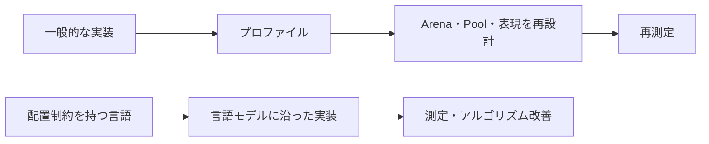

# 第5部：エコシステムとAIコーディング

作成日：2026-11-02 / 更新日：2026-11-03

[← 第4部](04-benchmarks.md) · [第6部 →](06-lessons-for-rust.md)

> ツール、標準ライブラリ、FFI、AIによる開発工数への影響を扱う。

## 7. エコシステムと開発体験

| 観点 | Goose | Rust | Go | Zig | C++ |
|---|---|---|---|---|---|
| 公式ビルド／パッケージ機能 | あり、発展途上 | Cargo | Go Modules | Zig Build | CMake等、多様 |
| IDE・補完 | LSPあり | rust-analyzer等 | gopls等 | ZLS等 | 多数 |
| Web・ネットワーク基盤 | 限定的 | 豊富 | 非常に豊富 | 発展途上 | 豊富 |
| GUI | 小規模な独自基盤等 | 複数 | 複数 | 限定的 | Qt等で成熟 |
| 組込み・Kernel実績 | 限定的 | 拡大中 | TinyGo等 | 拡大中 | C/C++資産 |
| 長期互換性と企業実績 | 未確立 | 高い | 非常に高い | 発展途上 | 非常に高い |

Gooseには仕様書、コンパイラ、LSP、フォーマッタ、標準ライブラリ、Windows/macOS/Linux向けのテスト体制が存在する。詳細なAPI一覧は公式Language Referenceにまとまっている。[17](references.md#ref-17) 単なる構想だけの言語ではない。一方、Whole-program解析を使うC++製コンパイラはまだ初期段階であり、言語仕様もドラフトである。ネイティブ実行ファイルはGoose→C→Cコンパイラという経路で生成され、TinyCCによる試行実行モードもあるが、**試行実行モードと最適化済みネイティブビルドを同じ性能基準で比較してはいけない**。[1](references.md#ref-1)[2](references.md#ref-2)[5](references.md#ref-5)

開発者の採用判断では、性能だけでなく、ライブラリの成熟、脆弱性対応、ABI、テスト、長期メンテナンス、他プラットフォームへの移植可能性も重要になる。

なお、GooseのコンパイラがCを生成できることと、すべてのCライブラリをGooseの通常値として安全・容易に扱えることは別の問題である。FFI境界では配置・寿命・ABI・エラー処理を個別に確認する必要がある。

**特にGooseを既存アプリケーションへライブラリとして組み込む場合**は、`export fn`の引数・戻り値の型に制限がある。次は、公式仕様にあるエクスポート構文に基づく最小例である。[1](references.md#ref-1)[17](references.md#ref-17)

```goose
// example.goose: C ABIで公開する関数（公式仕様に基づく最小例）
export "c_sum" fn sum(a: i32, b: i32) -> i32 { a + b }
```

```c
// host.c: 生成したヘッダーを使う最小のCホスト
#include "example.h"
#include <stdio.h>

int main(int argc, char **argv) {
    goose_init(argc, argv);
    int result = c_sum(2, 3);
    printf("%d\n", result);
    goose_exit(); // Gooseランタイムの終了処理
    return result == 5 ? 0 : 1;
}
```

```bash
# GooseからCコードとヘッダーを生成
goose --standalone --header example.h -o example.c example.goose
# Linux上の単純な例。ほかのOSではリンカ引数が異なる
cc -O2 host.c example.c -o host -lm -pthread
./host  # 期待出力: 5
```

これは**公式の`export fn`構文・生成オプションに基づいた構成例**である。`--header`モードではGooseの`main`は必須ではなく、C側が初期化処理を呼ぶ。生成物の具体的なリンク方法や追加ライブラリは対象OSとCツールチェーンで確認する。

ホストは生成ヘッダーの宣言に従って`goose_init(argc, argv)`を**公開関数の利用前に呼び出す**（初期化は同一スレッド上で冪等）。使用後は`goose_exit()`で終了処理を行う。この初期化時には、Gooseプログラムに`main`があればその処理も実行されるため、ライブラリ用途では`main`の副作用を明示する。`export fn`はトップレベル・非Genericで、引数や戻り値に使える型にも制約がある。**呼び出しは初期化したスレッド上で行う必要があり、公開APIは一般にスレッドセーフではない**。Rustから呼び出す場合でもC ABI境界の寿命・表現・初期化契約を設計し、Goose内部の可変長値やRootをそのまま越境させられるとは想定しない。[1](references.md#ref-1)[17](references.md#ref-17)

**FFIは障害隔離を自動的に提供しない。** Goose側がメモリ不足や致命的なエラーでプロセスを終了するなら、同一プロセス内のRust/C++ホストも影響を受け得る。高い可用性を要求するサービスでは、単なるC ABI呼び出しではなく、別プロセス化や外部入力の上限設定も比較する必要がある。

### 7.1 2026年時点での実務的なリスク

| 確認項目 | Gooseでの主な論点 | Rust・Go等との比較 |
|---|---|---|
| API・仕様の安定性 | v4ドラフト、Poolの移行が進行中 | Rust・Goは比較的安定した互換性方針を持つ |
| C ABI / FFI | 値の配置・寿命・スレッド境界の検証が必要 | RustやZigにもFFI注意点はあるが事例が豊富 |
| CIと配布 | ターゲット環境でCランタイムとCコンパイラを検証 | Cargo、Go、C++等は成熟した配布資産が豊富 |
| 脆弱性対応 | 依存関係の監査と保守体制を個別に確保 | Rust/Goは既存の解析・監査ツールが充実 |
| 長期保守 | 仕様変更・実装規模・貢献者体制の影響が大きい | 導入実績の差が大きい |

言語仕様上のメモリ安全性は、製品のセキュリティ・可用性・長期保守を自動的に保証しない。入力に伴うメモリ予算超過の対処は、[第2部・第4.2節](02-features-and-limits.md#memory-exhaustion)のとおり別途必要になる。

## 8. AIコーディング時代には、この設計が有利なのか

これは、Gooseの型・配置規則がAIによる最適化の負担を下げるという仮説である。効果を評価するには、同じ課題に対する開発工数や修正回数などを比較する必要がある。

Gooseは効率的な配置と寿命規則を既定とするため、AIも人間も初期実装でアロケータ最適化に費やす作業を減らせる可能性がある。一方で、**Goose固有の配置制約を満たすAPIやデータ構造への再設計が、その節約を相殺する可能性もある**。



検証には同じ仕様を「Rust通常実装」「Rust最適化実装」「Goose通常実装」に与える。AIが利用可能なドキュメントと許容される実装時間を揃え、少なくとも次を記録したい。

| 評価軸 | 計測項目 | 何を区別できるか |
|---|---|---|
| 正確性 | 初回コンパイル成功、テスト合格率 | 言語・ツールの扱いやすさ |
| 最適化工数 | 性能目標までの修正回数・所要時間 | アロケータ設計の省力化と制約対応コスト |
| 到達性能 | 実行時間、Peak RSS、アロケーション回数 | 最終的な機械語・データ配置の性能 |
| 変更容易性 | 仕様変更後の修正量、回帰テスト結果 | 長期保守への影響 |

Gooseのライブラリ不足や独特の制約がコンパイルエラー・表現変更を増やす可能性もあるため、**「少ないコードで速い」だけでなく、性能目標に到達するまでの総工数**で比較する必要がある。

---

[← 第4部](04-benchmarks.md) · [第6部 →](06-lessons-for-rust.md)
