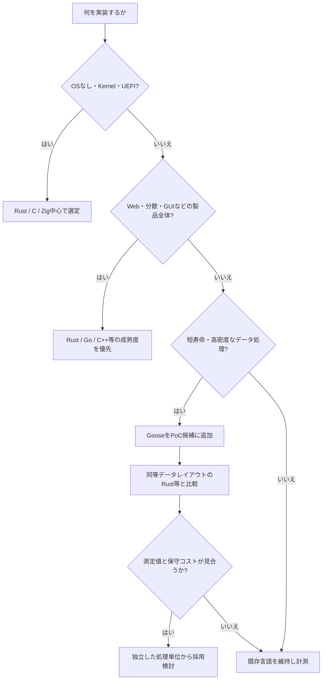

# 第7部：Gooseの将来と採用判断

作成日：2026-11-02 / 更新日：2026-11-03

[← 第6部](06-lessons-for-rust.md) · [参考資料 →](references.md)

> Goose自身の進化、標準ライブラリの成熟、採用条件を総括する。

## 10. Goose自身は成熟し、標準ライブラリや開発基盤が整うのか

ここからは**2026年10月31日に確認できる現状**と、今後の進化についての**条件付きの見通し**を分けて論じる。標準ライブラリや利用者が増えることは十分にあり得るが、普及や実装予定が確定しているわけではない。

### 10.1 標準ライブラリは既に存在するが、成熟度は機能数だけでは決まらない

現行の専用リファレンスには、`std`、`dictionary`、`slot_pool`、`slice_pool`、`vec`、`math`、`os`、`ffi`、`binary`、`base64`、`csv`、`json`、`regex`、`audio`、`gfx`、`physics`、`ui`、`exception`の**18モジュール**が記載されている。[24](references.md#ref-24) Gooseだけで記述された部分に加え、OSやグラフィックス等では`extern fn`を通じてCや外部パッケージの機能を利用する。とくに`gfx`・`ui`・`audio`は外部の`goose_gfx`、`physics`は`goose_physics`のネイティブ実装にも依存する。**18モジュールが、すべて追加のネイティブ依存なしに単体で使えるという意味ではない**。移植性・ビルドの再現性・パッケージの保守はモジュールごとに評価すべきである。[24](references.md#ref-24)[19](references.md#ref-19)

ただし、**公開ドキュメント間ではモジュール数の説明が揃っていない**。例えば公式トップページでは14、ドキュメント索引では16、専用標準ライブラリリファレンスでは18と記載されている。[5](references.md#ref-5)[26](references.md#ref-26)[24](references.md#ref-24) これは版の違いや文書更新のずれで説明し得るが、本稿は「現行の専用リファレンスには18件掲載されている」と限定して記述する。**v2026.3の配布物に全て含まれることまでは実機で確かめていない。**

そもそも標準ライブラリの質は、名前が並んでいるだけでは評価できない。例えば`json`が存在しても、ストリーミング入力、巨大ファイル、DoS耐性、スキーマ変更時の互換性、エラーの詳細、実運用時の性能まで成熟しているとは限らない。`gfx`や`physics`に機能があっても、それが一般的なHTTPサーバー、DBクライアント、GUIフレームワークの代替を意味するわけではない。

実行効率に関しては、公式ベンチマークに**標準ライブラリの関数を手書き実装へ置き換えた場合の比較**がある。ただし、これは結果ページの**過去の分析節に保存されたA/B測定**であり、2026年10月16日の全ケースを新規に測り直した数字ではない。大規模ケースで、**手書き版の実行時間 ÷ ライブラリ版の実行時間**で計算した倍率は次のとおりである（1.00超ならライブラリ版が高速）。[3](references.md#ref-3)

| 置き換えた処理の例 | MSVC | Clang | 解釈上の注意 |
|---|---:|---:|---|
| `strlist` の`each_split` | 1.04 | 1.07 | 小差のため測定誤差を考慮 |
| `words` の分割・ハッシュ等 | 1.01 | 1.03 | ハッシュ関数の実装は後に更新されている |
| `graph` / `graph_csr` の`fill` | 0.98 | 1.04 | データ構造全体の性能ではない |
| `particles`等の`vec`の`float3` | 0.99 | 1.00 | 数値カーネル全般への一般化はできない |

これは**「標準ライブラリの抽象化が必ず重いとは限らない」ことを示す限定的な材料**であり、全モジュールの性能保証ではない。言語とライブラリが一体で最適化される設計はGooseの魅力になり得るが、今後も版を固定した回帰ベンチマークを継続しなければ実用上の強みとは評価しきれない。

「ライブラリが整備された」と判断するには、次の段階を区別したい。これは**本稿が提案する評価枠組み**であり、Goose公式の成熟度区分ではない。

| 段階 | 証拠として必要なもの | まだ証明しないもの |
|---|---|---|
| **機能の存在** | モジュール一覧・API宣言 | 配布版に同梱されること、実行可能なこと |
| **利用可能性** | バージョンを固定したサンプル、サポート対象OSでのテスト | 大量入力・異常系への強さ |
| **運用可能性** | ファズテスト、資源上限、エラー復旧、互換性検証 | 多様な製品での長期実績 |
| **長期成熟** | 複数環境での継続利用、移行ポリシー、脆弱性修正体制 | 全用途への適性 |

18モジュールという**文書上の存在**だけで後半の段階へ到達したとは判断しない。特に、巨大・不正な入力への上限処理、キャンセル時の資源解放、配布版でのコンパイル成功、版間の互換性を継続的に検証する必要がある。

**この言語らしい標準ライブラリ**を設計する難しさもある。Gooseの標準ライブラリ設計文書は、スライスや既存の配列への操作、結果を呼び出し側の構築先に直接配置する規約、隠れた確保・コピーを避ける方針を重視している。[25](references.md#ref-25) 単にRust・GoのAPIを移植すればよいわけではなく、Data StackとRootの規則の範囲で扱いやすいAPIを設計する必要がある。

特に、標準ライブラリが成熟したかを測るには、**APIの網羅性、型と寿命の使いやすさ、障害時の振る舞い、実運用時の検証**を分けるべきだ。例えば、短命のJSONパースが十分高速でも、長寿命接続やキャッシュを持つHTTPサーバーに必要な中断・キャンセル・部分失敗の契約まで解決したことにはならない。`os`や`ffi`の機能数だけでは、入力制限、メモリ枯渇、スレッド境界、エラー復旧の品質を判定できない。

### 10.2 現実的な発展経路と、難しい領域

| 発展の方向 | 強化されると何が変わるか | 主な課題・前提 |
|---|---|---|
| **コアコンテナ** | Arena/Pool/密な配列/相対参照をより一貫したAPIで扱える | 寿命と参照の契約、要素削除、エラー時の復旧 |
| **OS・ネットワーク** | CLIやファイル処理からHTTPクライアント・サーバー等へ用途が広がる | C連携、非同期I/O、接続・キャッシュの長い寿命 |
| **データ処理** | JSON/CSV/Binaryに加え、実用的なCodec・DB接続を組み立てやすくなる | 大量入力への耐性、ストリーミング、互換性、独立ベンチマーク |
| **ビルド・配布・テスト** | CI、依存関係管理、クロスプラットフォームでの運用が容易になる | Cツールチェーン依存、再現可能なビルド、診断と回帰テスト |
| **他言語連携** | Rust・C++などの既存ソフトウェアで部分採用しやすくなる | C ABI、初期化、スレッド、安全な値の受け渡し |
| **実行環境の拡張** | Wasm、特殊なOS、より動的な値管理への応用範囲が広がる | 既存のData Stack不変条件や仮想メモリ予約モデルとの整合 |

最後の項目は、既に実装が確定した予定としては扱えない。公式の設計文書には、Wasm、Column Arrays、動的Extern、Coroutineなどの**提案・検討事項**が掲載されているが、ここから機能追加の時期や確実性を推定することはできない。[26](references.md#ref-26)[4](references.md#ref-4)

今後、APIの充実より先にボトルネックになり得るのは、**複雑な寿命のデータ構造と、サービスが継続して動く環境**である。これはライブラリ不足だけでは解決せず、必要なら言語機構やコンパイラ解析の改良が要求される。反対に、短命のParser・Codec・Index Builderなどでは、標準ライブラリとサンプルを積み上げるだけでも使い勝手が大きく改善する可能性がある。

### 10.3 三つのシナリオ：普及だけが成功ではない

| シナリオ | 到達イメージ | 注目すべき指標 | 注意点 |
|---|---|---|---|
| **専門用途で定着** | パーサー、バイナリ処理、短命データ処理で採用される | 再現可能な高速化、保守される実アプリ、API安定性 | 広範な用途でRust・Goを置き換える必要はない |
| **他言語へ設計思想が波及** | Rust等で配置志向のライブラリ、診断、設計パターンが洗練される | 外部実装、技術的議論、比較実験 | **似た仕組みの登場だけでGooseの影響だとは証明できない** |
| **汎用言語として拡大** | OS・ネットワーク・GUI等のライブラリが増え、大規模製品にも使われる | クロスプラットフォームCI、長期互換性、複数保守者、重要な依存パッケージ | メモリモデルの制約をどう扱うかという難題が残る |

これは優劣や予言ではなく、**何が確認できれば成長を評価できるか**を整理したものである。GitHubの注目度や単一のベンチマークだけで成熟を判定しない。

### 10.4 今後の進化を検証する観測項目

将来の判断を更新する際には、**配布版を固定した動作確認**、**独立した性能・障害試験**、**外部利用者による保守実績**を優先して観測する。具体的には、サンプルの版間互換性、ファズテスト、異なるOS・CPUでの性能、FFIの異常系、主要パッケージの維持状況を記録する。

ここでは**Goose自身の製品採用の進展**と**他言語に対する実証された設計上の影響**を別の指標として追う。片方の成果から、もう片方を自動的に推定しない。

## 11. 選定を実際に進めるなら

言語選定では「全体をGooseに置き換えるか」という二択にしない方がよい。例えば、次の三つの導入単位を比較できる。

| 単位 | 適した判断 | 主な確認事項 |
|---|---|---|
| 全体の実装言語 | Webサービス、OS、GUI等の製品全体 | OS対応、ネットワーク・UI・ライブラリ、長期保守 |
| 独立した計算ライブラリ | Parser、Index、圧縮・変換など | C ABI、コピーコスト、プロファイル、失敗時の復旧 |
| アイデアの移植 | RustのArena、Pool、Offset構造等 | 既存の設計とAPIを壊さず効果が出るか |

特に、**Gooseで実装した処理が速くても、FFI境界でデータを大量にコピーしてしまえば全体の性能が改善するとは限らない。** まず処理単位の独立性を確かめ、C ABIに適した固定サイズの値やバイト列を使うインターフェースを設計し、初期化・コピー・エラー復旧を含むEnd-to-Endベンチマークで判断すべきだ。

製品への**採用前のゲート**は少なくとも三つある。(1) 対象配布版で必要なAPIをコンパイル・実行できる、(2) 採用目的に見合う性能・開発工数の改善を同等条件で確認する（「Rustより速い」と主張するなら最適化済みRustも対照に含める）、(3) 長時間運用・メモリ不足・FFI異常系で許容できる挙動を確認する。満たせなければ、設計思想だけを既存言語へ持ち帰る選択肢がある。

### 11.1 採用判断の簡易フロー

このフローは採用の推奨順位ではなく、**Gooseを評価するコストに見合う場面を探すための実務的な入口**である。

## 12. 結論：「最速の言語」ではなく「高効率を既定にする言語」

汎用的な製品開発では、当面はRust・Go・Zig・C++の成熟した強みを使い分けるのが現実的である。Gooseは、短命のデータを大量に構築・走査・破棄する処理や、相対参照を活かしたコンパクトな表現の**研究・PoC候補**として評価したい。

Gooseが示すのは、**高効率なメモリ配置のための手作業の一部を、言語の通常のデータモデルへ移せる**という可能性である。しかし、所有期間が複雑なデータや頻繁に更新される構造では、Pool・コピー・アルゴリズムの設計負担が残る。

これは無償の最適化ではない。Gooseは所有関係や動的データ構造の自由度を制約し、仮想アドレス予約に依存する実行環境を選ぶことで実現している。大きな値のコピー、Alias解析、SIMD向けアラインメントなどの性能課題も残る。

> **Gooseが投げかける本当の問いは、すべての用途でRustを上回れるかではない。プログラミング言語は、開発者に最適化を要求する前に、どこまで効率的な実装を既定として提供できるか、である。**

この意味で、GooseはRustやGoの現実的な全面代替というより、**汎用性を制限した先に何を言語が標準化できるか**を示す重要な研究対象である。

さらに、Gooseが長期的にどれだけ普及するかと、Gooseが他言語の進歩に役立つかは同じ問いではない。Rustには既にArenaや非移動型コンテナがあり、さらにRegion InferenceやGNU obstacksなどの先行研究もあるため、その存在をGooseに帰属させることはできない。それでも、**「高効率な配置を開発者が特別な技術として選ばなくてもよい状態を、どこまで作れるか」**という比較基準を共有することには意味がある。

Gooseの将来は、機能数よりも**メモリモデルに合ったAPI、互換性、テスト、異常時の挙動**を積み上げられるかにかかっている。専門用途にとどまっても、その検証結果は他言語の設計に役立ち得る。

---

[← 第6部](06-lessons-for-rust.md) · [参考資料 →](references.md)
