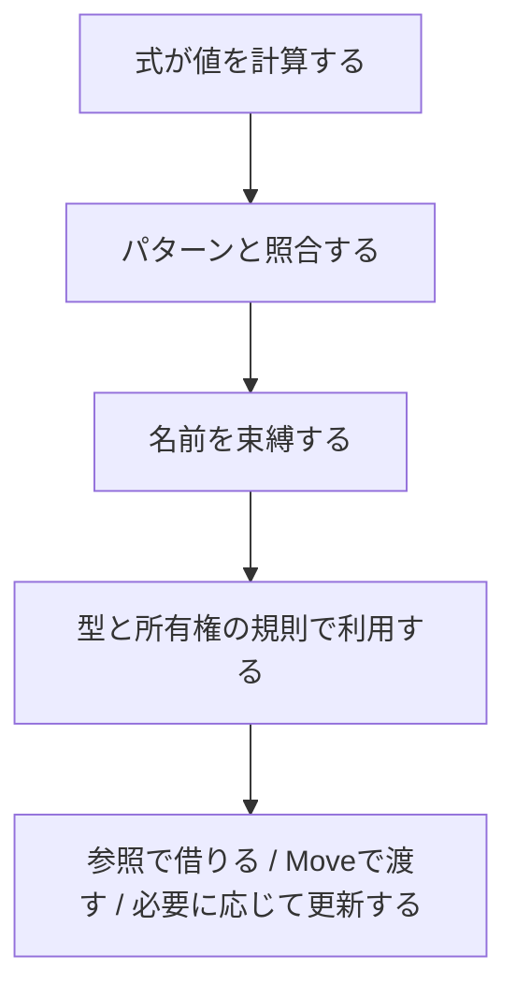

# 第1部：Cの構文とMLの思想

作成日：2026-10-15 / 更新日：2026-10-15

[← シリーズ目次](./)

## 1. Rustは「安全になったC」ではない

Rustの魅力をメモリ安全性だけで説明すると、言語設計の重要な部分を取りこぼしてしまう。

確かにRustは、CやC++が開発者に委ねてきたメモリ管理上の重要な不変条件を、所有権（Ownership）と借用（Borrowing）の仕組みで型検査の対象にした。**その前提には、`let`による名前の束縛と、値・格納場所・所有権を区別する変数観がある。**これは大きな転換である。しかし同時に、Rustは高水準言語で育ってきた表現も積極的に取り込んでいる。

- **システムプログラミングの側面**：明示的な所有関係とリソース管理、値のメモリ配置を意識できる設計、FFI、`unsafe`、`no_std`。
- **静的型付け言語の側面**：型推論、Generics、Trait、Associated Type・GAT、代数的データ型、網羅的なパターンマッチ。
- **関数型言語的な側面**：不変性を基本とする変数、クロージャ、Iteratorの合成、値を返す式と分岐、`Option`/`Result`による明示的な分岐。
- **コンパイラ基盤の側面**：Rust側の型・借用検査とLLVM側の高度な最適化・コード生成の役割分担。
- **実用言語としての側面**：Cargo、rustfmt、Clippy、テスト、ドキュメント生成、非同期プログラミング、豊富なクレート。

ここで興味深いのは、これらの機能が単に並んでいるのではなく、**抽象化が別の機能の前提や制約にまで接続している**点だ。式志向の`match`は借用したデータを分解でき、Traitの関連型はIteratorの要素型を伝え、型推論はそれらの契約を具体的なコードへ適用する。その統合の巧みさを、本稿では「美しく噛み合う」と表現する。

Rustを理解するうえで、中心になるのは次の問いである。

> **低水準の実行制御を失わずに、高水準な抽象化と強い静的保証をどこまで言語に組み込めるか。**

## 2. Cの皮を被ったML/OCaml――外見と設計思想の二重性

Rustのコードは、一見するとCやC++に近い。波括弧`{}`でスコープを囲み、セミコロンで文を区切り、構造体やポインタに似た概念を使う。ネイティブ実行、明示的なリソース管理、FFIといった用途も、C/C++の文化と連続している。

しかし、言語機能を少し深く見ると印象が変わる。`let`、`enum`、`match`、型推論、値を返す分岐――これらは**ML、Standard ML（SML）、OCamlなどの関数型言語を知る人にとって、馴染み深い発想**である。

ここから、少し挑発的だが有用な表現が生まれる。

> **Rustは、C言語の皮を被ったML/OCaml系の言語にも見える。**

もちろん、これは厳密な言語分類ではなく、**構文上の印象と、型・データ表現・制御構造に見られる思想の対比**を強調する比喩だ。RustはMLの直接的な後継でも、GC付きOCamlの別構文版でもない。実際にはC++・Haskell・ML Kit・Cycloneなどからの影響も受けており、単一の「血統」に還元できない。

この比喩で重要なのは、**表面の文法ではなく、プログラムを構成するときの発想**である。`let`とパターンで値を分解し、`enum`と`match`で状態を表し、Traitで振る舞いと関連する型を抽象化する。その一方で、所有権やメモリ配置は低水準の現実から切り離されない。

### 2.1 Rust公式資料が示す、複数の言語からの継承

[Rust Referenceの「Influences」](https://doc.rust-lang.org/reference/influences.html)は、SML・OCamlの影響として**代数的データ型、パターンマッチ、型推論、セミコロンによる文の区切り**を挙げている。さらにC++からRAII・参照・Move Semantics・単相化など、Haskellから型クラス・型ファミリーに関する発想、ML Kit・Cycloneから領域ベースのメモリ管理に関する発想を取り込んだことも示している。

そして、[Rustコンパイラ開発ガイド](https://rustc-dev-guide.rust-lang.org/building/bootstrapping/intro.html)によれば、**最初のRustコンパイラはOCamlで書かれていた**。これは現在のRustがOCaml上で動いているという意味ではないが、初期の開発史を象徴する事実である。

| 見えてくる系統 | Rustに見られる要素 | 重要な違い |
| --- | --- | --- |
| C/C++系 | 波括弧中心の構文、低水準操作、RAII、Move、FFI | C++のクラス継承を中核に据えていない |
| ML/OCaml系 | `let`、代数的データ型、パターンマッチ、型推論、式志向 | Rustの所有権モデルはOCamlの通常のGCモデルと異なる |
| Haskell系 | Traitに関連する型クラス的抽象化、関連型 | Rustは純粋関数型言語ではない |
| 領域・所有権研究 | 参照の生存範囲、所有権・別名参照の制約 | 1つの先行言語の仕組みをそのまま移植したわけではない |

複数の系統が混ざっているという事実は、Rustを「つぎはぎの言語」にするとは限らない。むしろ、**異なる研究成果を同じ安全性の制約のもとで再構成したこと**に注目したい。

### 2.2 `enum`と`match`は、ML系のDNAを最も見つけやすい場所

たとえばOCamlで、処理状態を次のように表せる。

```ocaml
type status =
  | Waiting
  | Active of int
  | Done of string

let describe = function
  | Waiting -> "waiting"
  | Active progress -> Printf.sprintf "%d%%" progress
  | Done output -> output
```

Rustでは、対応するデータ構造を次のように書ける。

```rust
enum Status {
    Waiting,
    Active(u8),
    Done(String),
}

fn describe(status: &Status) -> String {
    match status {
        Status::Waiting => "waiting".to_owned(),
        Status::Active(progress) => format!("{progress}%"),
        Status::Done(output) => output.clone(),
    }
}
```

双方にあるのは、**「状態の種類と、それぞれが持つデータ」を型として定義し、パターンで分解する**という思想だ。これはCの`enum`や`switch`を単純に拡張しただけの理解では捉えにくい。

しかし違いも現れる。Rustでは`status: &Status`として借用し、`Done(output)`の束縛も借用に沿って扱われる。戻り値に所有権のある`String`を要求するため、ここでは`clone()`で明示的に複製している。Rustの`match`は、**ML系の構造的なパターンマッチと、所有権・借用の規則が交わる場所**になっている。

Rust公式ブログの[「Mixing matching, mutation, and moves in Rust」](https://blog.rust-lang.org/2015/04/17/Enums-match-mutation-and-moves/)も、代数的データ型とパターンマッチを命令型プログラミング、Move、Borrowと組み合わせる設計を説明している。

### 2.3 ただし、Rustの型推論をOCamlと同一視しない

ML系の言語には、Hindley–Milner型推論やLet多相を背景とする強い型推論の伝統がある。一方、Rustではローカルな文脈・Trait制約などを使って推論し、名前付き関数の引数・戻り値など通常は明示的に書く境界も多い。

「両者は型推論を持つ」は正しい。しかし、**同じ推論アルゴリズムや同じ多相性の規則を備えるという意味ではない**。Rustは表現力だけでなく、エラーメッセージ、コンパイル時間、APIの明示性、所有権の検査などとの均衡を取っている。

**RustはC/C++に近い領域を扱いながら、プログラムを構成する発想にはML/OCamlの影響が色濃い。** 続く章では、その接点として`let`によるパターン束縛とMove/Borrowを考える。TraitとAssociated Typeに見られる型クラス的な発想は第8章で扱う。

## 3. 「変数に値を入れる」から「名前を束縛する」へ

RustをC/C++の延長として読むとき、意外に見落としやすいのが、**束縛（Binding）と代入（Assignment）の違い**である。どちらの言語にも変数や格納場所はあるため、「Cは箱、Rustは名前だけ」という二分法は正確ではない。

C言語に慣れていると、「変数は型を持つメモリ領域であり、その中に値を代入する」という図式を思い描きやすい。しかしRustでは、`let`によって**式の結果をパターンに対応させ、名前を導入する（Binding、束縛）**という説明が、言語の多くの機能を自然につないでくれる。

ここでの「束縛」はソースコードの意味論の説明であり、データがメモリ配置から独立して浮遊しているという意味ではない。これはCに束縛の概念がないという主張でもない。Cでも識別子はオブジェクトなどを指し、宣言によって名前と対象が結び付く。違いは、**Rustでは新しい束縛、値のMove/Copy、参照による借用、既存の場所への代入を明確に使い分けることが、プログラムの意味を理解する中心に置かれている**という点だ。

### 3.1 `let x = ...`は代入ではなく、新しい束縛を導入する

まずCのコードを考える。

```c
int x = 10;  // xというオブジェクトを宣言し、初期化
x = 20;      // 同じオブジェクトへの代入
```

Rustにも既存の格納場所へ代入する構文はある。しかし、`let`はそれとは異なる。

```rust
let x = 10; // xという新しい束縛を導入
let x = 20; // 同名の別の束縛を導入（Shadowing）

assert_eq!(x, 20);
```

2回目の`let`は「古い`x`を上書きして可変にした」のではない。**同じ名前を使って別のローカル変数を導入し、以前の束縛を隠す**操作である。

[Rust ReferenceのLet statements](https://doc.rust-lang.org/reference/statements.html#let-statements)は、`let`を「パターンによって新しい変数群を導入する文」と説明している。公式の[`let`キーワードの説明](https://doc.rust-lang.org/std/keyword.let.html)にも、値を変数に束縛するという説明がある。

「式を評価し、結果をパターンへ束縛する」という見方は、**Rustのソースを理解するための有力なモデル**だ。ただし、これは「値がメモリ上に独立して先に存在し、変数は後から名前だけ付ける」という意味ではない。Rustにも変数の格納場所があり、`let`の初期化と、Move/Copy、参照の扱いは別々に定義される。

### 3.2 ShadowingとMutationは根本的に異なる

次の2つは、最終的に同じ整数を得ても、意味論が違う。

**束縛の更新ではなく、新しい束縛：**

```rust
let count = 10;
let count = count + 1; // 新たなcountを導入
assert_eq!(count, 11);
```

**既存の変数の格納場所への再代入：**

```rust
let mut count = 10;
count = count + 1; // 既存のcountへ代入
assert_eq!(count, 11);
```

違いがもっと分かりやすいのは、型が変わる場合だ。

```rust
let input = "42";                      // &str
let input = input.parse::<u32>().unwrap(); // u32
let input = input + 1;                 // u32

assert_eq!(input, 43);
```

`let`を繰り返すことで、**同じ名前を使いながら、処理段階に応じた異なる型の値を扱える**。一方、同じ変数への代入であれば、通常は元の型との整合性が必要になる。

このスタイルは「入力文字列 → 解析済みの整数 → 計算結果」というデータ変換の段階を自然に記述できる。不変な束縛を積み重ねるため、関数型言語的な書き味にもつながる。

ただしShadowingは、以前の束縛が直ちに破棄されることや、メモリ領域が必ず新しく確保されることを意味しない。たとえば同じスコープで`let resource = ...; let resource = ...;`と書いても、先の値がその時点で必ず`Drop`されるとは限らない。**名前の隠蔽・所有権の移動・破棄の時点を同一視しないこと**が重要だ。

### 3.3 束縛の対象は「変数名1個」とは限らない――パターンを使う

Rustの`let`は、単なる`変数名 = 値`の形だけではない。**左辺にパターンを置ける**ことが、ML/OCaml系の思想につながる。なお`let x: T;`のような遅延初期化も可能であり、すべての`let`がその場で初期化式の値を受け取るわけではない。

```rust
let (x, y) = (10, 20);
assert_eq!(x + y, 30);

struct User {
    name: String,
    active: bool,
}

let user = User {
    name: String::from("Ada"),
    active: true,
};

let User { name, active } = user;
assert!(active);
assert_eq!(name, "Ada");
```

後半では、`User`という値の構造に対してパターンを対応させ、**`name`と`active`という2つの名前を一度に導入**している。これは「1個の変数へ値を代入する」という図式よりも、「パターンを通じて複数の変数を導入する」と考えた方が説明しやすい。

同じパターンの考え方が`match`、`if let`、`while let`、`for`のループ変数、関数の引数などにも及ぶ。

```rust
fn show(maybe: Option<u32>) {
    let Some(value) = maybe else {
        return;
    };
    println!("{value}");
}
```

ここで`let ... else`は、パターンが成功すれば新しい`value`を束縛し、失敗した場合は`return`などによってその場を離れる。通常の`let`では、必ずマッチするパターン（Irrefutable Pattern）が必要なことにも注目したい。

そしてパターンによる分解も、所有権と切り離されていない。前の`User`の例では、`String`を持つ`name`を`user`から取り出すことで、そのフィールドがMoveされる。一方で`&user`のような参照を対象にパターンマッチすると、マッチエルゴノミクスによってフィールドを参照として束縛できる場合がある。**パターンは形を分解するだけでなく、Move・Copy・Borrowと組み合わさる**。

### 3.4 束縛と所有権：値の移動は「コピー代入」とは違う

```rust
let original = String::from("hello");
let renamed = original; // CopyではなくMove

println!("{renamed}");
// println!("{original}"); // Moveされた束縛は使えない
```

ここでは**新しい束縛へ`String`の値がMoveされる**。元の`original`は使用できなくなる。`String`のヒープ上の文字列バッファを複製する処理ではない。

ただし、Moveが必ず実行時のメモリ転送命令を意味するわけではない。コンパイラの最適化によって具体的なメモリ配置や命令は変わり得る。重要なのは、**どの束縛を通じて値を使用できるかという静的な規則**だ。

一方、`i32`など`Copy`な型は、束縛時にも値をコピーして元を継続利用できる。

```rust
let a = 10_u32;
let b = a;
assert_eq!((a, b), (10, 10));
```

こうして、**`let`という束縛の構文は同じでも、値の型に応じてMoveかCopyかが異なる**。その違いを型システムが支えている。

### 3.5 `mut`は「名前」だけでなく、アクセスの許可を考える入口になる

`let mut x`では、変数の値への再代入や可変借用などが許される。一方で、**束縛自体が不変でも、それが保持する可変参照を通じて参照先を変更できる**。

```rust
let mut count = 1;
let access = &mut count; // accessという束縛自体は不変
*access += 1;           // &mut i32を通じて参照先を変更
assert_eq!(count, 2);
```

`access`は`let mut access`ではない。それでも、`access`が保持しているのは**排他的な可変参照**であり、その参照先の値は変更できる。逆に、`let mut`の有無だけで、あるデータへのすべてのアクセス権を説明することもできない。

共有参照`&T`も、対象データが物理的に一切変化しないという万能な保証ではない。Rustには`UnsafeCell`を基盤とする**内部可変性（Interior Mutability）**があり、`Cell`、`RefCell`、`Mutex`などが用途に応じて変更可能性を管理する。

```rust
use std::cell::Cell;

let counter = Cell::new(1); // 束縛はmutではない
counter.set(2);           // 内部可変性を持つ型のAPIで変更
assert_eq!(counter.get(), 2);
```

この例ではRustの借用規則を破っていない。むしろ**変更の責任を型とAPIに持たせる**ことで、言語の制約と実用的な可変状態が両立している。`Cell`は複数スレッドからの共有変更に使う同期手段ではない点にも注意したい。

ここには少なくとも、次の区別が存在する。

| 概念 | 問うこと | 例 |
| --- | --- | --- |
| 束縛（Binding） | 新しい変数を導入し、どの名前で値を扱うか | `let x = ...` |
| 再代入可能性 | その格納場所を更新できるか | `let mut x`、`x = ...` |
| 所有権（Ownership） | 値のMoveとDropの責任をどの場所が担うか | `let next = original` |
| 借用（Borrow） | 所有権を移さず、どのアクセスを許すか | `&x`、`&mut x` |
| ライフタイム | 参照が有効であるための期間の関係 | `&'a T` |

この区別を踏まえると、所有権・借用・ライフタイムは、変数に後付けされた厳しいルールではなく、**「名前を通じて値やリソースへアクセスする」とはどういうことかを精密化する仕組み**として理解できる。

### 3.6 厳密には「格納場所（Place）」と「値（Value）」も区別される

「Rustでは値に名前を束縛する」という説明は有用だが、1段深く理解するにはRust公式仕様の**Place Expression**と**Value Expression**が重要になる。

- **Place Expression**は、メモリ上の格納場所を表す。ローカル変数、フィールドアクセス、添字アクセス、参照外しなどが該当する。
- **Value Expression**は、計算によって得られる値を表す。値が必要な文脈では、PlaceからCopyやMoveによって値が取り出されることがある。
- **代入**は書き込み先となる場所に作用するが、**`let`**は初期化式とパターンに基づいて新たな束縛を導入する。

```rust
let mut point = (10, 20);
let value = point.0; // i32なので、フィールドの値をCopyする
point.0 = 30;        // フィールドというPlaceを更新する

assert_eq!((value, point.0), (10, 30));
```

この区別は、Rustが単なる関数型の「値の世界」へ寄り切っていないことも示している。**名前の束縛と値の合成を重視しつつ、格納場所とその更新も言語仕様の中で明示的に扱っている**。だからこそ低水準なシステムプログラミングにも対応できる。

[Rust Referenceの「Place Expressions and Value Expressions」](https://doc.rust-lang.org/reference/expressions.html#place-expressions-and-value-expressions)は、この区別とMove/Copyの条件を定義している。Cにも左辺値（lvalue）と右辺値（rvalue）の区別があり、Rust固有の発明とするのは正しくない。違いは、Rustがその区別を所有権・借用・パターン束縛にまで一貫して組み合わせている点だ。

### 3.7 変数観の転換が、残りの言語機能をつなぐ

「変数という箱へ値を入れる」から「式の結果をパターンで受け取り、名前・所有権・借用を管理する」へ。こう考えると、その後のRustの設計が自然につながる。



この図は言語の全実行経路を表したものではなく、束縛の理解を助ける模式図である。既存の格納場所への代入は新しい`let`束縛なしでも行える。

**式志向・パターンマッチ・不変性・型推論・Move/Borrowが驚くほど美しく噛み合う理由は、値をどう作り、どの名前で扱い、どの権限でアクセスするかが、別々の思いつきではなく共通の設計問題になっているからだ。**

---

[シリーズ目次](./) ｜ [参考資料](references.md)
