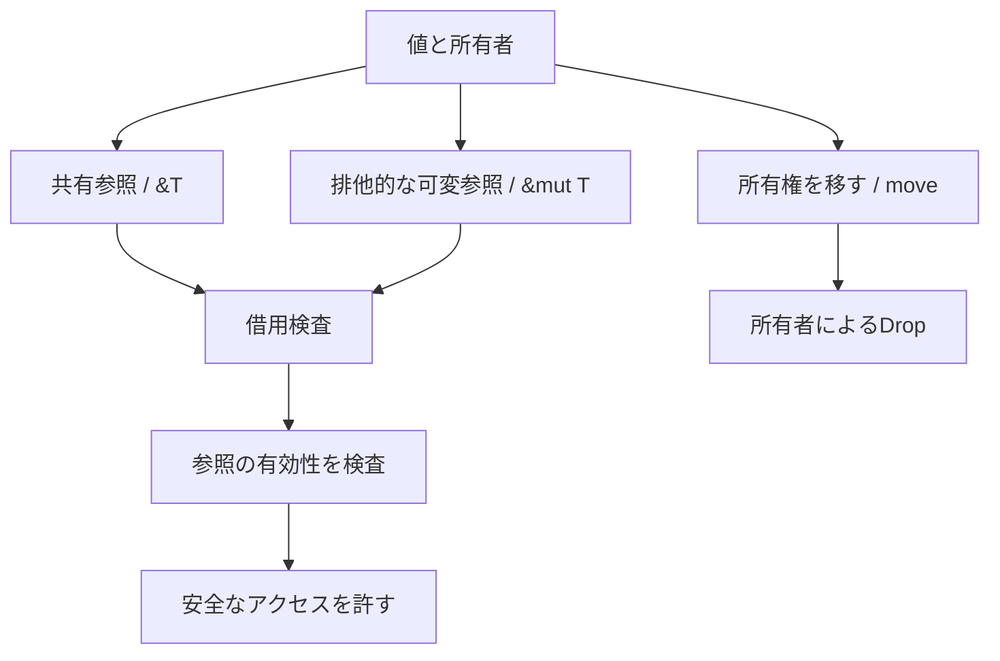

# 第2部：所有権・式志向・型推論

作成日：2026-10-15 / 更新日：2026-10-15

[← シリーズ目次](./)

## 4. 所有権：リソース管理を言語の意味論へ取り込む

前節では、Rustが`let`で新しい束縛を導入し、Copy・Move・Borrowを区別して値を扱うことを確認した。ここではそのうち、**値の所有者を誰に定め、どの期間にどのアクセスを許すか**を掘り下げる。

### 4.1 `malloc`/`free`の呼び出し方を改善しただけではない

Cではヒープメモリの確保・解放を明示的に扱える一方、解放後の参照、二重解放、解放漏れなどを避ける責任がプログラマーに残る。

Rustでは典型的な所有権を持つ値について、所有者がスコープを抜けるときに後始末が行われる。たとえば次のコードには明示的な`free`がない。

```rust
fn main() {
    let message = String::from("hello");
    println!("{message}");
} // 通常のスコープ終了時にStringのDrop処理が走る
```

これはGCによる「どこからも参照されなくなったら回収する」というモデルとは異なる。Rustは所有権の移動とスコープ、型ごとの`Drop`処理を使う。

```rust
let first = String::from("Rust");
let second = first; // Stringの所有権が移動する（move）

println!("{second}");
// println!("{first}"); // コンパイルエラー：移動後の値を使おうとしている
```

一方、`i32`のように`Copy`を実装する型では、束縛の初期化や代入で値がコピーされる。この違いも型で表される。

**重要な注意：** `Drop`は通常のスコープ終了で働くが、すべての実行状況で後始末が必ず走るという意味ではない。強制終了、abort、`mem::forget`、参照カウントの循環などを含め、一般のリソース解放を無条件に保証するわけではない。

### 4.2 借用：所有権を移さずにアクセスする

Rustでは値を丸ごと渡すだけでなく、参照を一時的に借りられる。

```rust
fn length(text: &str) -> usize {
    text.len()
}

fn main() {
    let text = String::from("hello");
    let count = length(&text);
    println!("{text}: {count}"); // 所有権はmain側に残っている
}
```

基本的な借用規則は、同じデータへの参照について概ね次のように整理できる。

- 共有参照`&T`を複数持つことはできる。
- 排他的な可変参照`&mut T`を使う間、競合する参照を同時に使用してはならない。
- 参照の有効期間を超えて、その参照を使ってはならない。

これは単なる「`const`を付ける習慣」ではない。**アクセス権そのものに静的制約を与える**仕組みである。例外的に、`Cell`、`RefCell`、`Mutex`などの内部可変性を使う型では、変更可能性の管理を別の仕組みで実現する。

次の例では、借用はソースコード上のスコープ末尾まで機械的に続くわけではない。

```rust
fn main() {
    let mut names = vec![String::from("Ada")];

    let first = &names[0];
    println!("{first}"); // firstの最後の使用

    names.push(String::from("Grace")); // この位置なら可変操作が可能
}
```

Rustの借用検査は、参照が**最後に使われる位置**などの制御フローを考慮する。古い「変数のスコープ全体で借用が続く」という理解では、現在のRustを正確に説明できない。

### 4.3 ライフタイム：所有者がどれだけ長く生きるかを「指定する」ものではない

ライフタイム（Lifetime）は、参照の有効性や、複数の参照同士の生存期間の関係を扱う仕組みである。

```rust
fn longer<'a>(left: &'a str, right: &'a str) -> &'a str {
    if left.len() >= right.len() {
        left
    } else {
        right
    }
}
```

この`'a`は「参照先を`'a`まで延命する命令」ではない。返す参照が、入力の両方について妥当な期間に限って使われるようにする**関係の契約**である。引数の実際の寿命を伸ばす仕組みではない。

多くのライフタイムは推論・省略できる。明示が必要になるのは、引数と戻り値の参照関係を省略規則だけでは伝えられない場面などだ。公開APIでも省略できる場合は多い。

所有権、借用、ライフタイムの関係は、次のように考えると整理しやすい。



### 4.4 所有権はメモリだけの概念ではない

`File`、`MutexGuard`、ソケット、トランザクションなど、リソースを持つ値を考えると、所有権モデルの意味はさらに広がる。

Rustでは、リソースを誰が保持し、いつ移動し、どの範囲で借りているかをAPIの型として扱える。後始末そのものは型の`Drop`実装などに依存するが、**リソースの所有関係をプログラムの契約にできる**点が重要である。

## 5. 式志向：制御構文も値を作る

束縛されるのは単なるリテラルに限らない。Rustでは、分岐やブロックそのものが値を生み出す。そのため`let`による束縛と式志向の構文が自然に結び付く。

Rustの構文を洗練されていると感じる理由の1つが、**Expression-oriented（式志向）**な設計である。

Cでは`if`や`switch`を文として使い、値を取り出すために代入先の変数を用意する場面が多い。Rustでは`if`や`match`、ブロック自体が式になれる。

```rust
fn category(score: u32) -> &'static str {
    if score >= 80 {
        "excellent"
    } else if score >= 60 {
        "good"
    } else {
        "retry"
    }
}
```

分岐ごとに変数へ代入してから返す必要がない。`if`式の値がそのまま関数の返り値になる。

```rust
let label = match 3 {
    0 => "zero",
    1..=3 => "small",
    _ => "large",
};
assert_eq!(label, "small");
```

`match`も値を返す式であり、対応するパターンが網羅されているかをコンパイラが検査する。

### 5.1 ブロックも式である

```rust
let area = {
    let width = 8;
    let height = 5;
    width * height
};

assert_eq!(area, 40);
```

最後の`width * height`にセミコロンがないことが重要だ。末尾に`;`を付けると、そのブロックの値は通常`()`（Unit）になる。

これは表面的な省略記法ではない。**制御の構造と値の構成を、同じ構文体系で組み立てられる**という設計上の特徴である。

ただし、Rustがすべてを式にしたわけではない。`let`束縛は基本的に文であり、`for`や`while`が一般の計算結果をそのまま返すわけでもない。`loop`は`break 値`で値を返せる。したがって、Rustは**式志向の強い言語**であって、純粋な式だけから構成される言語ではない。

## 6. 関数型言語的な側面：不変性・高階関数・合成

Rustは純粋関数型言語ではない。しかし、関数型プログラミングを実用的にする多くの要素が、日常的な書き方へ深く組み込まれている。

### 6.1 不変を基本にする

```rust
let x = 10;
// x += 1; // 再代入できない

let mut y = 10;
y += 1;
assert_eq!(y, 11);
```

Rustでは変数束縛がデフォルトで不変である。変更したい場所だけ`mut`を明示する。

不変性は関数型プログラミングに親和的だが、Rustは副作用を排除していない。`mut`や内部可変性、I/O、共有状態は普通に使える。「不変が基本」と「純粋関数型である」は異なる。

### 6.2 クロージャとIteratorの合成

```rust
fn main() {
    let numbers = [1_u32, 2, 3, 4, 5, 6];

    let total: u64 = numbers
        .iter()
        .copied()
        .filter(|n| n % 2 == 0)
        .map(u64::from)
        .map(|n| n * n)
        .sum();

    assert_eq!(total, 56); // 2² + 4² + 6²
}
```

これは「偶数を選び、2乗し、合計する」というデータ変換を、処理の組み合わせとして書いた例だ。

`filter`や`map`は高階関数であり、`|n| ...`がクロージャ。一般にIteratorアダプタは遅延的で、最後の`sum`のような消費処理によって評価が進む。途中で必ず中間配列が作られるわけではない。

Rustのクロージャは周囲の環境をキャプチャでき、必要な操作に応じて`Fn`、`FnMut`、`FnOnce`というTraitに関係づけられる。ここで**高階関数の表現力と、所有権によるリソース管理が接続する**。

```rust
let greeting = String::from("hello");
let read = || greeting.len();         // 読み取りだけならFnとして呼べる
assert_eq!(read(), 5);

let mut count = 0;
let mut increment = || { count += 1; count }; // FnMutとして呼べる
assert_eq!(increment(), 1);
assert_eq!(increment(), 2);

let message = String::from("bye");
let consume = move || drop(message);  // キャプチャした値を消費するFnOnce
consume();
```

`Fn`・`FnMut`・`FnOnce`は相互に無関係な3種類ではなく、呼び出し時に環境をどのように扱うかを表す**段階的な契約**である。すべての`Fn`は`FnMut`と`FnOnce`の要求も満たし、すべての`FnMut`は`FnOnce`も満たす。一方、値を消費するクロージャは、一般に再呼び出しできない。

### 6.3 パターンマッチと代数的データ型

`enum`は単なる整数定数の列ではない。異なる形のデータを持つ選択肢を、1つの型として表現できる。

```rust
enum Task {
    Queued,
    Running { progress: u8 },
    Completed { output: String },
}

fn describe(task: &Task) -> String {
    match task {
        Task::Queued => "queued".to_owned(),
        Task::Running { progress } => format!("{progress}%"),
        Task::Completed { output } => output.clone(),
    }
}
```

状態と付随するデータが同じ型定義の中で結び付く。`match`に網羅性検査があるため、新しい状態を追加すれば、対応していない分岐がコンパイル診断で見つかりやすい。

これは代数的データ型のうち、**直和型（Sum Type）**にあたる考え方である。Cの`enum`は整数定数を列挙するのに対し、Rustの`enum`では各バリアントに異なるデータを持たせられる。`struct`やタプルは、複数の要素を同時に持つ**直積型（Product Type）**の例として理解できる。

こうした型設計は「あり得ない状態を表現できなくする」というAPI設計に直結する。ただし、型が表せる範囲の制約であり、任意の業務ルールを自動で保証するわけではない。

### 6.4 `Option`と`Result`：失敗や不在も通常の値

```rust
fn parse_port(input: &str) -> Result<u16, std::num::ParseIntError> {
    let port = input.parse::<u16>()?;
    Ok(port)
}
```

`?`は失敗を無視する演算子ではない。概念的には`Result`の成功値を取り出し、失敗時には変換規則に従って早期リターンする。

`Option<T>`は「値がある／ない」、`Result<T, E>`は「成功／失敗」という状態を型で表す。エラーが制御フローの外へ隠されるのではなく、関数の返り値の一部になる。

Rustにも`panic!`は存在するので「絶対に例外的な終了が起こらない」ということではない。それでも、**回復可能な失敗を戻り値で表現する文化**はRustの特徴的な部分だ。

### 6.5 なぜRustはHaskellそのものではないのか

Rustには、高階関数、不変性、パターンマッチ、`Option`/`Result`などの関数型言語的な要素がある。一方で次の違いは大きい。

| 観点 | Rust | 純粋関数型言語の代表的な設計 |
| --- | --- | --- |
| 副作用 | 通常の関数からI/O・変更が可能 | 純粋性を型などで厳密に区別する設計がある |
| 変更 | `mut`で明示的に許す | 不変データ構造を中心に置くことが多い |
| 所有権 | Move・Borrowが中核 | Rustと同じ所有権モデルとは限らない |
| 高階抽象化 | クロージャ、Trait、Generics | 型コンストラクタ等を使う別種の抽象化もある |
| 実行モデル | ネイティブ・組込み等を強く意識 | 実行時系やGCを重視する言語もある |

Rustを「関数型言語」と単純に分類するより、**式志向・代数的データ型・高階関数というML系の表現技法を、可変状態と低水準操作を持つ命令型の世界へ取り込んだマルチパラダイム言語**と表現する方が正確だろう。

## 7. 強い型推論と、明示的なAPI契約

Rustでは静的型検査が厳しい一方、日常のコードで型注釈を大量に書く必要はない。

```rust
let name = String::from("Ferris");
let lengths = ["A", "Rust", "Language"]
    .into_iter()
    .map(str::len)
    .collect::<Vec<_>>();
```

`name`の型は`String`、`lengths`の型は`Vec<usize>`として推論される。

```rust
let values: Vec<_> = (0..5).map(|n| n * n).collect();
```

`Vec<_>`ではコンテナの形だけを指定し、要素型は他の制約から推論させる。

また、Rustの型推論は初期化式の右辺だけを見ているわけではない。引数、戻り値、Trait制約、使用位置などの型情報が推論の手がかりになる。

ただし、**プログラム全体のすべての型が省略可能なわけではない**。

- 名前付き関数の引数型と戻り値型は、通常明示する。
- Genericsの型引数や`collect()`の出力型など、文脈が足りない場合は型注釈が必要になる。
- 公開APIの型を明示することは、実装と利用者の契約を安定させる意味も持つ。

したがってRustの特徴は「型を書かなくてよい」ではなく、**公開される境界では型を明示し、ローカルな実装の冗長さは推論で減らす**という均衡にある。

---

[シリーズ目次](./) ｜ [参考資料](references.md)
