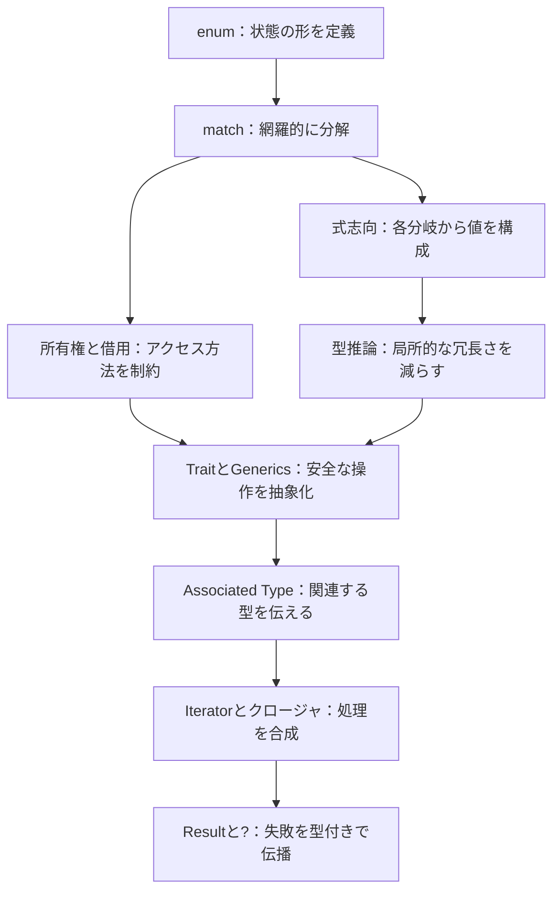

# 第4部：言語機能が噛み合う理由

作成日：2026-10-15 / 更新日：2026-10-15

[← シリーズ目次](./)

## 9. 言語機能が驚くほど美しく噛み合う理由

ここまで説明した機能を、実際のコード上で組み合わせて見る。

### 9.1 `let` × 式志向 × パターン × 所有権：変数観が接着剤になる

たとえば`let (name, count) = (String::from("Ada"), 3);`という1行には、式で値を構成し、パターンを照合して複数の名前を導入し、`String`については所有権を持つ束縛を作るという、複数の設計が詰まっている。

そして次の`let name = name.to_uppercase();`は、古い名前への再代入ではなく、新しい値を同じ名前に束縛する。型推論は新たな束縛の型を追跡し、所有権の規則は古い値をどこで使えるかを検査する。**Rustの美しさは、抽象的な束縛・型付けと、具体的なメモリ・リソース管理が同じ記法の中で協調することにある。**

### 9.2 `enum` × `match` × 式志向 × 型検査

`enum`でデータが取り得る形を列挙し、`match`で構造に沿って分岐する。しかも`match`は式なので、各分岐から同じ型の値を組み立てられる。

```rust
enum Connection {
    Disconnected,
    Connecting,
    Connected { peer: String },
}

fn label(connection: &Connection) -> &str {
    match connection {
        Connection::Disconnected => "offline",
        Connection::Connecting => "connecting",
        Connection::Connected { peer } => peer.as_str(),
    }
}
```

ここでは同時に次のことが起きている。

1. `enum`が状態の選択肢を限定する。
2. `match`が選択肢を網羅し、`peer`を構造的に取り出す。
3. `match`の各分岐が`&str`という値を返す。
4. `&Connection`を受け取ったため、`peer`は所有権を奪わず借用される。
5. 戻り値の参照が入力の有効期間を超えないことを、ライフタイム省略規則と借用検査が支える。

もし`Connected`に別のフィールドや状態を追加したら、型とパターンの関係が変更箇所を教えてくれる。**データ構造・分岐・戻り値・所有権が、同じコードの中で整合性を要求し合う**。

### 9.3 パターンマッチ × 所有権：同じデータを借りても、移動してもよい

先ほどの`Connection`を、今度は値として受け取る。

```rust
fn into_peer(connection: Connection) -> Option<String> {
    match connection {
        Connection::Connected { peer } => Some(peer),
        Connection::Disconnected | Connection::Connecting => None,
    }
}
```

`label(&Connection)`では内部の`String`を**借りた**。`into_peer(Connection)`では内部の`String`を**所有権ごと取り出した**。

同じ`enum`と`match`で、「観察するAPI」と「消費するAPI」を表現できる。見かけ上のパターンは似ていても、所有権の契約はシグネチャから読み取れる。ここに関数型的な分解と、低水準のリソース管理が自然に接続している。

### 9.4 Iterator × クロージャ × Trait × 型推論

次の処理は、文字列を数値に変換して偶数のみ合計する。文字列の解析に失敗した場合だけでなく、**整数加算がオーバーフローする場合**も、型付きのエラーを返す。

```rust
use std::num::ParseIntError;

#[derive(Debug)]
enum SumError {
    Parse(ParseIntError),
    Overflow,
}

impl From<ParseIntError> for SumError {
    fn from(error: ParseIntError) -> Self {
        Self::Parse(error)
    }
}

fn sum_even(lines: &[&str]) -> Result<i64, SumError> {
    lines.iter().try_fold(0_i64, |sum, line| -> Result<i64, SumError> {
        let value = line.trim().parse::<i64>()?;
        if value % 2 == 0 {
            sum.checked_add(value).ok_or(SumError::Overflow)
        } else {
            Ok(sum)
        }
    })
}
```

この小さな関数には、複数の言語機能が集まっている。

- **借用**：`&[&str]`を読み取り、入力の所有権を奪わない。
- **Trait**：`.iter()`と`.try_fold()`はIteratorの共通インターフェイスに基づく。
- **クロージャ**：処理内容を値として渡し、段階的に合成する。
- **型推論**：累積値や各クロージャ引数の型の多くを文脈から推論する。
- **式志向**：`if`の各枝が`Result`を返し、分岐全体をクロージャの結果にできる。
- **`Result`と`?`**：解析エラーは`From`によって`SumError`に変換され、`try_fold`が失敗時に反復を中断する。
- **`checked_add`**：数値のオーバーフローも`SumError::Overflow`として明示する。

これは「便利な機能を6つ並べたコード」ではない。**入力の所有権を奪わずに、型で制約された高水準な計算を合成し、失敗も通常の値として扱っている**。

例えば`sum_even(&["2", "3", "4"])`は`Ok(6)`、不正な文字列を含めば`Err(SumError::Parse(_))`、`sum_even(&["9223372036854775806", "2"])`では`Err(SumError::Overflow)`を返す意図の例だ。いずれかのエラーが起これば、それ以降の要素は評価されない。

この例では、`SumError`によって**解析失敗とオーバーフローの2種類を1つの戻り値にまとめている**。`From<ParseIntError>`は解析エラーを`SumError::Parse`へ変換し、オーバーフローは`checked_add`の結果から`SumError::Overflow`へ変換する。`SumError::Parse`の中身を呼び出し元で使わない場合でも、元の解析エラー情報を保持できる。ただし、コード例は仕様上それぞれの結果を返す想定であり、コンパイル・実行で確認した結果ではない。また、高水準なIterator記法が手書きループと同じ機械語になる保証もない。

### 9.5 `?`と`Result`：エラー処理を型と制御フローで支える

`?`は「エラーなら早期リターンする便利記号」として紹介されがちだ。しかし、直前の`sum_even`に見るように、`Result`や`Option`といった型、関数の返り値、`From`を介したエラー型の変換規則と協調する。`?`は`Result`専用の魔法ではなく、現在の安定版Rustでは`Result`や`Option`など、対応する型の制御フローとして使える。`Result`と`Option`を無条件に相互変換できるわけではない。

このため、「回復可能な失敗を値として表す」という方針と「ネストした分岐を簡潔に記述したい」という実用上の要望を、同じ仕組みで両立しやすい。

**`?`の短さより、その分岐が戻り値の型と整合していなければ通らないこと**が重要なのである。

### 9.6 Trait × Associated Type × Iterator：振る舞いだけでなく型も伝播する

第8章で見た`Iterator`は、Rustの言語機能が噛み合うことを示すもう1つの好例だ。`Iterator`という**振る舞い**には、`Item`という**関連型**が結び付く。`map`、`filter`、`collect`、`sum`などの操作は、その型の情報を失わずに合成できる。

さらに、`Iterator<Item = T>`という制約で要素型までAPIに明示でき、`impl Iterator<Item = T>`で具象的なIterator型を外部へ隠すこともできる。必要なら`dyn Iterator<Item = T>`で実行時の多態性も選べる。複数の型レベルの仕組みが、**1本の処理パイプラインを安全かつ簡潔に記述する**ために連携している。

### 9.7 個々の機能ではなく、組み合わせが設計思想を表す

ここまでの関係を、概念のつながりとしてまとめる。



矢印は必須の処理順序ではない。「状態を表す」「処理を組み立てる」「アクセスを制約する」「抽象化する」という関心が、Rustの言語機能で相互に結び付くことを示したものだ。

| 噛み合う機能 | 統合によって得られる性質 |
| --- | --- |
| `enum` ＋ `match` ＋ 式志向 | 状態ごとの結果を網羅的に構成する |
| パターンマッチ ＋ Move/Borrow | データを分解しつつ所有関係を保つ |
| 不変性 ＋ `&mut` ＋ 借用検査 | 変更可能性とアクセス権を明示する |
| Generics ＋ Trait ＋ 型推論 | APIの契約を保ちつつ記述を簡潔にする |
| Trait ＋ Associated Type ＋ Iterator | 操作に関連する型の関係を保持しながら処理を合成する |
| GAT ＋ ライフタイム ＋ Borrow | 借用する値の型を借用期間に応じて抽象化する |
| Iterator ＋ クロージャ ＋ 単相化 | 高水準な合成と静的な最適化の余地を両立する |
| `Result` ＋ `?` ＋ `From` | エラーを型で表現しながら制御フローを簡潔にする |
| `unsafe` ＋ 安全な抽象化 | 検証できない前提を限定された実装境界に集める |

これを「驚くほど美しく噛み合っている」と表現したくなる。ただし、それは全機能間に摩擦がないという意味ではない。非同期処理と借用、自己参照構造、複雑なTrait境界、Pinなどは、複数の規則が交差するがゆえに難しくなる代表例だ。

**Rustの美しさは、複雑さが消えることではなく、複雑さの多くを暗黙の慣習ではなく明示的な契約へ移していること**にある。

---

[シリーズ目次](./) ｜ [参考資料](references.md)
