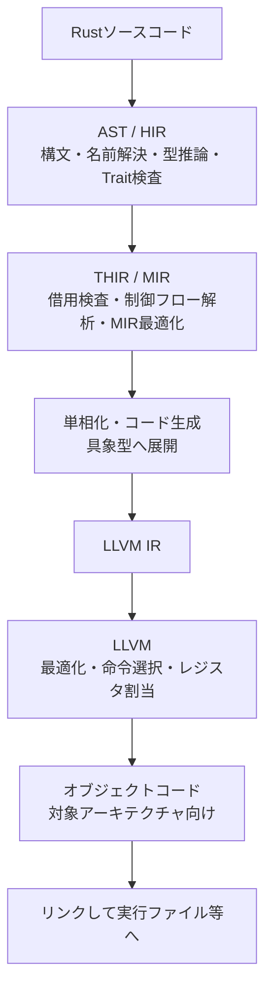

# 第5部：低水準制御・LLVM・応用領域

作成日：2026-10-15 / 更新日：2026-10-15

[← シリーズ目次](./)

## 10. 並行性：所有権をスレッド間の契約へ広げる

メモリ安全性の議論は並行プログラミングでも重要になる。

Rustには`Send`と`Sync`という自動Traitがあり、型をスレッド間で移動・共有できる条件を表す。より厳密には、`Send`は値を他スレッドへ移せること、`Sync`は`&T`を他スレッドへ共有できることに対応する。共有可変状態には`Mutex`などを使う設計が基本となる。これらのTraitの健全性には、ライブラリ内の`unsafe`実装が正しいことも前提となる。

```rust
use std::sync::{Arc, Mutex};
use std::thread;

fn main() {
    let count = Arc::new(Mutex::new(0_u32));

    let workers: Vec<_> = (0..4)
        .map(|_| {
            let count = Arc::clone(&count);
            thread::spawn(move || {
                let mut guard = count.lock().expect("mutex poisoned");
                *guard += 1;
            })
        })
        .collect();

    for worker in workers {
        worker.join().expect("worker panicked");
    }

    assert_eq!(*count.lock().unwrap(), 4);
}
```

ここで`Arc`は共有所有権、`Mutex`は排他的アクセスの管理、`move`クロージャはスレッドに渡す値の所有関係にかかわる。

Safe Rustはデータ競合（Data Race）を防ぐ強い保証を持つ。しかし**競合状態（Race Condition）のすべて、デッドロック、飢餓、論理的に誤った同期**まで排除するわけではない。

同様に、Rustの`async`/`.await`は非同期処理を記述する言語機能だが、一般的なアプリケーションのタスク実行やI/OにはTokioなどのランタイムや周辺ライブラリが関わる。言語機能と実行環境を分けて理解する必要がある。

## 11. `unsafe`：低水準の力を、監査可能な境界へ集める

Rustは完全に安全な機能だけでシステムプログラミングを実現することを目指していない。ハードウェアやOS、Cとの相互運用には、コンパイラが十分に検証できない操作が必要になる。

`unsafe`はそのための仕組みである。`unsafe`を使っても、Rustの型システムが無効になるわけではない。ただし、コンパイラが保証できない安全性の不変条件を、実装者が守らなければならない。

```rust
fn first_element(slice: &[u8]) -> Option<u8> {
    slice.first().copied()
}
```

このような標準の安全なAPIで実現できる処理に、`unsafe`は必要ない。

一方、Raw Pointerの参照外しや`unsafe`なFFI関数の呼び出しなど、コンパイラが安全性を自動保証できない操作には`unsafe`ブロックなどを用いる。`unsafe fn`や`unsafe impl`も安全性の責務を表すが、用途と規則は同一ではない。`unsafe`は型検査を全面的に無効化するスイッチではなく、**特定の操作の安全条件をプログラマー側が保証する境界**だ。

特に重要なのは、安全な公開APIの実装内部に必要最小限の`unsafe`を閉じ込められる点である。ただしその内部に欠陥があれば、安全な呼び出し側にも未定義動作の影響が及び得る。`unsafe`を小さくしただけで正しさが保証されるわけではなく、仕様・不変条件・テスト・監査が欠かせない。

## 12. LLVMという強力なバックエンド――高水準の表現を機械語へつなぐ

ここまでRustの言語設計を中心に見てきた。しかし、Rustが**システムプログラミング言語として現実に成立している背景**には、言語機能だけでなく、成熟したコンパイラ基盤の存在がある。その代表が**LLVM**だ。

標準的なコンパイル経路では、`rustc`がRust固有の構文、型、Trait、所有権を解析し、後段の最適化・ターゲット向けコード生成にLLVMを利用する。LLVMはClangなどにも使われるコンパイラ基盤であり、多数の解析・最適化・命令選択の機構を持つ。

重要なのは、RustがLLVMを単に「最後に機械語へ変換する部品」として呼び出しているだけではないことだ。**高水準の言語機能をRust側で整理し、その結果をLLVMが最適化可能な中間表現として受け取る**。この役割分担が、Rustの高水準な抽象化を実用的な機械語生成へつなぐ。

### 12.1 RustコンパイラとLLVMの役割分担

コンパイルの処理を簡略化すると、次のようになる。



これは理解のための模式図であり、実際のコンパイラの処理順序・クエリ・内部表現はもう少し複雑だ。[Rust Compiler Development Guideのコンパイラ全体像](https://rustc-dev-guide.rust-lang.org/overview.html)と[コード生成の説明](https://rustc-dev-guide.rust-lang.org/backend/codegen.html)を参照。

この図では、少なくとも3つの異なる仕事を区別できる。

| 段階 | 主な責務 | ここで誤解したくないこと |
| --- | --- | --- |
| Rustの前段・中間段 | 型推論、Trait解決、借用検査、MIR上の解析・最適化 | **所有権の安全性をLLVMが保証しているわけではない** |
| Rustのコード生成段 | Genericな処理を具体的な型へ展開し、コード生成IRへ下ろす | 最適化のすべてをLLVMが実施するわけではない |
| LLVM | IR上の最適化、対象CPU向け命令選択、レジスタ割当、コード出力 | 最適化によって高性能が必ず保証されるわけではない |

ここは、Rustを「LLVMの上に乗った言語」とだけ表現したときに見落としがちな部分だ。**型・借用検査を含むRust独自のフロントエンドと、LLVMの強力な最適化基盤は、役割が違うからこそ補完し合う**。

### 12.2 LLVMはRustの抽象化をどう支えるか

LLVMには、インライン化、不要な計算の削除、ループ最適化、条件に応じたベクトル化、対象CPUの命令への変換、レジスタ割当など、多様な最適化・コード生成機構がある。[LLVMの構成](https://llvm.org/docs/GettingStarted.html)と[ターゲット非依存コード生成](https://llvm.org/docs/CodeGenerator.html)で、その役割を確認できる。

Rustの表現と組み合わせると、次のような期待が生まれる。

- **GenericsとTrait**：Rust側で単相化した具体型のコードを、LLVMが最適化できる。
- **Iteratorとクロージャ**：高水準の合成として記述した処理について、最適化によって関数呼び出しや中間処理のオーバーヘッドを減らせる場合がある。
- **所有権・借用の意味論**：Rust側で安全性を検査したうえで、コード生成へ必要な情報を渡せる。ただし借用規則そのものをLLVMが証明するわけではない。
- **複数アーキテクチャへの出力**：LLVMのターゲット別コード生成を利用し、対応環境向けの機械語やWebAssemblyを生成できる。

とりわけ、**関数型言語を思わせるIteratorの記法から、ネイティブ向けに最適化されたコードを生成できる**という構図は、Rustの性格をよく表している。

```rust
pub fn sum_of_squares(values: &[u32]) -> u64 {
    values
        .iter()
        .copied()
        .map(u64::from)
        .map(|n| n * n)
        .sum()
}
```

これは分かりやすいデータ変換として書かれているが、最終的にどのような命令列へ変換されるかは、最適化設定、対象CPU、Rust・LLVMのバージョン、周辺コードなどによって変わる。**高水準のIteratorが常に手書きループと同じ機械語になる、必ずSIMD化される、といった保証はない**。確認したい場合は実際の生成コードとベンチマークを見る必要がある。

### 12.3 最適化と移植性――C/C++と共有できる強い基盤

LLVMはRust専用ではない。Clangなど他のコンパイラも利用している。そのためRustは、バックエンドの最適化技術をゼロから独自開発することなく、成熟した機械語生成基盤を活用できる。

この点で、Rustの独自性は「C/C++より優れた最適化器を独占していること」ではない。むしろ、**C/C++にも共通する強力なコンパイラ技術を使いながら、その前段に所有権やML系の表現力を備えた言語を設計したこと**に価値がある。

ただし、LLVMが対応しているターゲットならRustの標準ライブラリまで必ず使える、というわけではない。Rust側のターゲット定義、ABI、リンカ、ランタイム、ライブラリなどの対応状況も必要になる。WebAssemblyも「LLVMがWasmへ変換できる」ことと「Webフロントエンドのすべてが自動的に完成する」ことは別問題だ。

### 12.4 自分でLLVM IRを確認できる

通常のRust開発でも、LLVMによる最適化を間接的に利用している。Cargoでリリースビルドを行うなら、一般に次のコマンドを使う。

```bash
cargo build --release
```

リリースプロファイルの設定は`Cargo.toml`から変更できる。

```toml
[profile.release]
opt-level = 3
lto = "thin"
```

`opt-level`は最適化レベル、`lto`はリンク時最適化の設定だ。これらは万能の推奨設定ではなく、コンパイル時間、生成コードの大きさ、実行性能のトレードオフを変えるための選択肢である。

小さなサンプルを`example.rs`として保存した場合、LLVM IRの出力を試せる。

```bash
rustc --crate-type=lib -O --emit=llvm-ir example.rs
```

この場合、通常は`example.ll`というLLVM IRを含むファイルが生成される（実行場所や出力オプションによって異なる）。生成物はコンパイラ内部の表現を知るためのもので、これだけで最終的な機械語性能を判断できるわけではない。詳細は[`rustc`のCodegen Options](https://doc.rust-lang.org/rustc/codegen-options/index.html)を参照。

### 12.5 LLVMの強さは、そのままトレードオフにもなる

LLVMによる高度な最適化は実行速度やコード品質に有利な場合がある反面、コンパイル時間やメモリ使用量を増やすことがある。Rust自身のGenericsの単相化、依存クレートの多さ、リンク時最適化も、その負担に影響する。

また、LLVMはRustに不可欠な言語仕様そのものではない。Rustコンパイラはバックエンドを抽象化しており、**CraneliftやGCCを利用する代替コード生成バックエンド**も開発されている。ただし、利用可能性や対応ターゲット、成熟度が標準のLLVM経路と同じとは限らない。[Rust Compiler Development Guideのコード生成の章](https://rustc-dev-guide.rust-lang.org/backend/codegen.html)には、この複数バックエンドの構造が説明されている。

したがって、より正確には次のように捉えたい。

> **Rustの革新の中核は言語と型・所有権の設計にある。しかし、その高水準な表現を現実的なネイティブコードへ落とし込むうえで、LLVMという成熟したコンパイラ基盤は非常に重要な推進力になっている。**

これは、既存の「言語機能が美しく噛み合う」という議論を、言語仕様の内側から**コンパイラ全体の設計**へ拡張する視点でもある。

## 13. 組込みからWebフロントエンドまで：なぜ利用領域が広いのか

Rustはシステムプログラミング言語としての性格を持ちながら、アプリケーションの多くの層で使われている。

| 領域 | 主な使い方 | Rustの特徴と注意点 |
| --- | --- | --- |
| OS・カーネル | カーネル機能、ドライバ等 | `unsafe`、FFI、制約の強い実行環境への対応 |
| 組込み | マイコン、ファームウェア | `no_std`、割り込み、環境固有の周辺ライブラリ |
| CLI・開発ツール | ファイル処理、解析、ビルドツール | ネイティブ実行、Cargo、エラーの型付け |
| サーバー | Web API、ネットワークサービス | 非同期処理、型付きAPI、Tokio等のエコシステム |
| デスクトップ | GUI、クロスプラットフォームアプリ | iced、Slint、Dioxus等の選択肢 |
| Webフロントエンド | ブラウザー内UI、Wasmモジュール | Leptos、Yew、Dioxus、`wasm-bindgen`等 |
| ライブラリ | C ABIを介した共有ライブラリ等 | 他言語との連携が可能だがABIと所有権境界の設計が必要 |

ここには2つの異なる利点がある。

第1に、低水準のリソース制御や所有権モデルを持ちながら、アプリケーション開発にも耐える抽象化が用意されていること。

第2に、言語だけでなく、ツールチェーン・標準ライブラリ・クレートのエコシステムが、複数の領域を支えていることだ。

### 13.1 ブラウザーでRustが動くとはどういうことか

RustはWebAssembly（Wasm）向けにコンパイルできる。ブラウザー内でRust由来の処理を動かし、JavaScriptやWeb APIと連携させられる。

ただし、**Rustを書けばHTML・CSS・JavaScriptがすべて不要になる**わけではない。DOM、Web API、ビルドパイプライン、JSとの境界、バンドルサイズ、デバッグ、ブラウザー対応の事情は残る。

LeptosやYewのようなフレームワークはRustでWeb UIを構築する選択肢を与える。DioxusのようにWeb以外のターゲットも視野に入れるフレームワークもある。

Webフロントエンドという、従来C言語とは遠かった領域にまでRustが届いているのは、言語設計の射程を考えるうえで象徴的である。

### 13.2 Linuxカーネルと組込み

Linuxカーネルの公式ドキュメントにはRustでの開発手順があり、Rustをカーネル開発へ取り込むための取り組みが進められている。ただし、カーネル全体がRustに置き換わったわけではない。

組込みでは`no_std`により、通常の標準ライブラリに依存しない構成を取れる。もっとも、メモリ確保、割り込み、panic処理、対象チップのサポートには、用途ごとの設計が要る。

ここでも「Rustならあらゆる環境でそのまま動く」のではなく、**対象環境に応じて必要なものを選択・削減できる**ことが利点となる。

---

[シリーズ目次](./) ｜ [参考資料](references.md)
