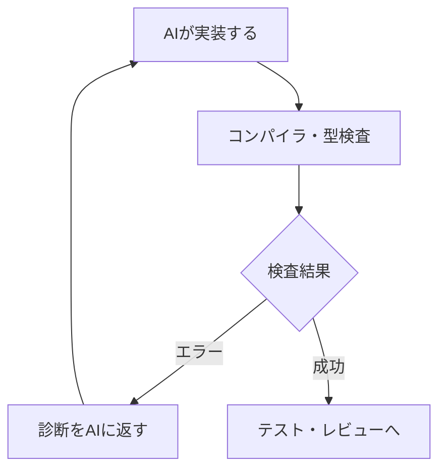

# AIコーディング時代、静的型付けは本当に有利なのか？ 21言語から考える

AIにコードを書かせるとき、どちらが有利でしょうか。**すぐ実行できるPython**か、それとも**コンパイル時に厳しく検査されるRust**か。

人間が書くなら、厳しい型検査は作業の負担にもなります。しかしAIエージェントなら、その診断を受け取って自分で修正を繰り返せます。この違いは、言語選定の基準を変えるかもしれません。

私の仮説は次のとおりです。

> **AIによるコード生成が容易になるほど、生成したコードを独立に、機械的に検証できる言語とツールチェーンの価値が相対的に高まる。**

とはいえ「静的型付けなら正しい」「動的型付けは危険」と言いたいわけではありません。まず短いコード例から考え、本文では代表6言語の特徴を比較します。残りも含む21言語・22区分の一覧は、別の補足ページにまとめました。

> **注意：** 2026年10月12日時点の仕様・公開資料をもとにした**考察と仮説**です。AIコーディングでの言語間の品質差を実験で実証した記事ではありません。

## コンパイラのエラーは、AIにとって何なのか

例えばTypeScriptで、処理の状態を次のように表現します。

```typescript
type Job =
  | { kind: "queued" }
  | { kind: "running"; progress: number }
  | { kind: "done"; result: string };

function formatJobStatus(job: Job): string {
  switch (job.kind) {
    case "queued": return "waiting";
    case "running": return `${job.progress}%`;
    case "done": return job.result;
    default: {
      const unreachable: never = job;
      return unreachable;
    }
  }
}
```

ここに`{ kind: "failed"; reason: string }`を追加したのに、`formatJobStatus`の修正を忘れるとどうなるでしょう。

`never`への代入が成立しなくなり、TypeScriptは未対応の状態があることを指摘します。修正すべき場所が、コンパイラの診断として現れます。[TypeScript Handbookの型の絞り込み](https://www.typescriptlang.org/docs/handbook/2/narrowing.html)でも説明されているパターンです。

人間中心の開発では、この診断を読んで直すのも人間の作業です。しかしAIエージェントなら、次のループを自動化できます。



ここで重要なのは、**AI自身の「たぶん正しい」という判断とは独立した判定**が得られることです。

型には、少なくとも三つの役割があります。

- **生成時の制約**：引数、戻り値、取り得る状態を明示する。
- **生成後の検査**：不整合を実行前に検出する。
- **変更時の手がかり**：API変更や状態追加による修正漏れを浮かび上がらせる。

ただし、AIが`any`、強引な型アサーション、警告抑制を追加すれば、エラーだけを消すことも可能です。**型検査の成功は、設計の良さや仕様の正しさと同じではありません。**

## では、動的型付けは不利なのか

そう単純ではありません。例えばPythonなら、生成した小さな処理をすぐ実行して、結果を見て、修正できます。探索的なデータ分析、機械学習の実験、自動化スクリプトでは、ライブラリの豊富さと実行の手軽さが大きな利点です。

```python
# 注釈はあるが、Python実行系はこの型を自動強制しない
def double(x: int) -> int:
    return x * 2

print(double("A"))  # "AA" と表示される
```

一方、この呼び出しはPyrightやmypyの厳格な設定では型不整合として指摘できます。Pythonは「静的検査が一切できない言語」ではありません。[Pythonの型注釈の公式資料](https://docs.python.org/3/library/typing.html)も参照できます。

| 観点 | 静的型付け言語 | 動的型付け言語 |
|---|---|---|
| 型の整合性 | 通常はビルド時に検査 | 型チェッカーなどで補強可能 |
| 初期の試行錯誤 | 型制約が負担になる場合もある | 対話的に試しやすい |
| 大きな仕様変更 | 型エラーが変更漏れの手がかり | テストと補助解析が重要 |
| AIへのフィードバック | 型・所有権・フロー診断など | 実行結果・例外・テスト・静的解析 |

静的型付けの優位が大きくなるという仮説は、**型検査の追加コストをAIの修正ループがどこまで吸収できるか**にも依存します。コンパイルに長時間かかったり、AIが修正を迷走したりすれば、逆効果もあり得ます。

## 「型安全」「メモリ安全」「仕様の正しさ」は別物

ここは言語の比較で最も重要な区別です。

| 概念 | 対象 | 例 |
|---|---|---|
| 型安全 | 値と操作が型規則に従うこと | 型検査・網羅性検査 |
| メモリ安全 | 不正なメモリアクセスの防止 | Safe Rust、管理ランタイム |
| 仕様に対する正当性 | 定めた性質を満たすこと | 契約検証・モデル検査・証明 |

例えば、C++は静的型付けですが、一般のC++プログラムでメモリ安全が保証されるわけではありません。Pythonは動的型付けでも通常は管理ランタイムを使います。RustのSafe Rustはメモリ安全性に強い保証を提供しますが、売上集計の計算式が要求どおりかまでは自動で保証しません。

> **注意：** 型検査成功 ≠ メモリ安全の一般保証 ≠ 仕様の正しさ。形式証明でも、誤った仕様を正しく証明する可能性があります。

## 現代の言語をどう比較するか

言語を人気順・優劣順に並べるのではなく、**何を機械的に検査でき、その診断をAIが使えるか**で考えます。まず代表例に絞ります。

| 言語 | 特に注目したい仕組み | AIコーディングでの論点 |
|---|---|---|
| Python | 型注釈、Pyright／mypy、実行テスト | 柔軟性と任意検査の両立 |
| TypeScript | `strict`、判別共用体、`never` | 型の穴と実行時入力の境界 |
| C# | nullable解析、パターンマッチ、Roslyn | 言語世代と警告設定の差 |
| Rust | 所有権、借用、`Send`／`Sync` | 安全性と検査回避の監査 |
| Swift | actor isolation、`Sendable` | Swift 6の並行性診断 |
| Lean 4 | 依存型、証明項、カーネル | 型検査から命題の証明へ |

C#は特に興味深い例です。.NET Framework時代にも静的型付けとCLRによる管理メモリがありましたが、近年はnullable reference types、records、パターンマッチなどで制約を表現しやすくなりました。[Microsoftのnullable解析の解説](https://learn.microsoft.com/en-us/dotnet/csharp/nullable-references)に詳しく説明されています。

つまり**「静的型付けかどうか」だけでなく、同じ言語のどの世代・どの設定を使うか**も重要です。

21言語の一覧は長いため、別ページへ分離しました。C#は歴史的対照として旧世代と現在を分け、21言語・22比較区分です。

全21言語・22区分の確認ポイントは、[主要言語の補足一覧](language-overview.md)にまとめています。

この一覧は機能の存在を示したもので、AIが実際に高品質なコードを書ける順位ではありません。詳細な保証には、ツールの適用範囲、ライブラリ、実行時境界、設定を確認する必要があります。

## RustとSwiftに見る「実行前の安全性」

Rustの所有権・借用と、Swift 6の厳格な並行性検査には共通点があります。どちらも、実行前の静的検査である種の危険な操作を防ぐことを狙っています。

RustではSafe Rustのメモリ安全やデータ競合防止が特徴的です。一方Swift 6では、actor isolationや`Sendable`による言語上の並行性規則が重要です。ただし両者の保証の仕組み・範囲は同じではありません。[Rustの借用](https://doc.rust-lang.org/book/ch04-02-references-and-borrowing.html)と[Swift 6への移行資料](https://developer.apple.com/documentation/Swift/AdoptingSwift6)を比較すると違いが見えてきます。

AIがコンパイルを通すために、Rustで不要な`unsafe`を加えたり、Swiftで`@unchecked Sendable`に頼ったりしていないか。こうした**安全性を弱める修正**も評価すべきです。

## 型検査の先へ：契約・モデル検査・形式証明

一般的な型だけでは「結果は必ず正」「ソート結果は昇順」「禁止した状態遷移は起こらない」といった仕様を十分に表せません。

そこで外部の形式検証ツールや、依存型を持つ言語が重要になります。

| 検証方法 | できること | 保証を読むときの注意 |
|---|---|---|
| 型検査 | 型規則への整合性 | 業務仕様の証明とは別 |
| 実行テスト・ファジング | 実際の入力で動作を確認 | 未実行経路は残る |
| シンボリック実行 | 反例・境界入力を探索 | 反例未発見は通常、証明ではない |
| 有界モデル検査 | 指定範囲で性質を検査 | 境界外まで自動保証しない |
| 契約の演繹的検証 | 事前・事後条件等を検証 | 仕様と仮定・対応範囲に依存 |
| 証明項の型検査 | 命題の証明項を検査 | 公理と信頼基盤の監査が必要 |

ここで依存型が重要になります。値に関する条件を型で表し、命題と証明をプログラムと同じ体系で扱えるからです。ただし、**依存型がなくても形式検証は可能**です。

後編では、Lean 4の具体例を通じてその違いを説明します。

## AIコーディングに向いた言語は、どう実験すれば分かるか

初回生成の成功率だけではなく、**独立した受け入れテスト・残存する欠陥・修正コスト**を測る必要があります。

例えば同じ言語の中で型検査の厳格さを変えれば、言語ごとの学習データ量やエコシステムの違いをある程度制御できます。異なる言語間を比較する場合は、ライブラリやAIモデルの習熟度も交絡要因になります。

私なら次の指標を併せて記録します。型検査／契約検証で検出した不具合、AIの修正回数、トークン数、経過時間、人間のレビュー工数、そして`any`や`unsafe`などによる保証回避の頻度です。

重要なのは、**生成の容易さだけでなく、品質を確かめるまでの総コスト**を比較することだと思います。

## おわりに

AIがコードを書く時代には、厳密な型検査が単なる障害ではなく、AIを導くフィードバックになり得ます。

しかし、それだけで静的型付け言語があらゆる用途で優位と決まるわけではありません。Pythonの実験速度も、TypeScriptの型診断も、Rustの安全性も、それぞれ異なる強みです。

**選ぶべきなのは「最も厳しい言語」ではなく、作りたいものに対して、必要な性質を十分に検証できる言語とツールチェーン**ではないでしょうか。

**次の記事：** [依存型・Lean 4・形式証明――AIが証明を書く時代](02-dependent-types-and-formal-verification.md)

### 参考資料

- [TypeScript Handbook: Narrowing](https://www.typescriptlang.org/docs/handbook/2/narrowing.html)
- [Python typing](https://docs.python.org/3/library/typing.html)
- [C# nullable reference types](https://learn.microsoft.com/en-us/dotnet/csharp/nullable-references)
- [The Rust Book: References and Borrowing](https://doc.rust-lang.org/book/ch04-02-references-and-borrowing.html)
- [Apple Developer: Adopting Swift 6](https://developer.apple.com/documentation/Swift/AdoptingSwift6)
- [Lean 4: Dependent Type Theory](https://lean-lang.org/theorem_proving_in_lean4/Dependent-Type-Theory/)

※ 技術的特徴の整理は公式資料などに基づきます。掲載コードすべてのコンパイル・形式検証を実施したわけではありません。
