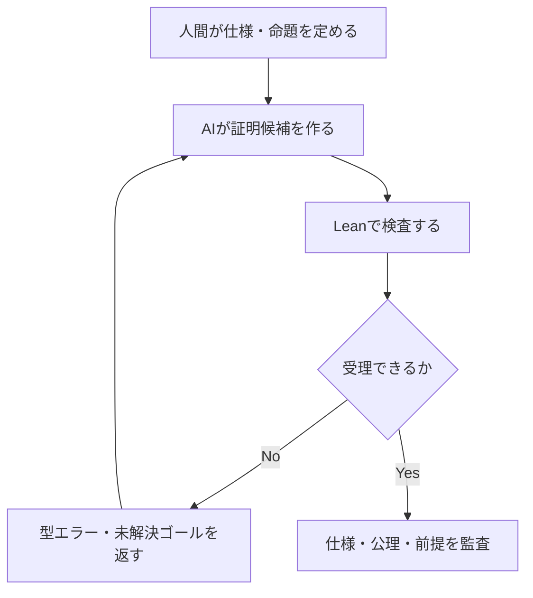

# AIにコードだけでなく証明も書かせる時代へ：依存型・Lean 4・形式検証を考える

「AIが書いたコードを、どうやって信頼するのか」。前編では、型検査をAIの自動修正ループに組み込むという発想を考えました。

では、その先に進んで、**コードが仕様を満たす証明までAIに書かせたら**どうなるでしょうか。

そこで重要になるのが、依存型（dependent types）と形式証明です。

**前の記事：** [AIコーディング時代、静的型付けは本当に有利なのか？](01-type-systems.md)

> **注意：** 本記事は形式手法の考え方を紹介する**技術的考察**です。コード例は説明用であり、全サンプルを実際のLean・Verus等の環境で検証済みという意味ではありません。

## 普通の型では、どこまで言えるのか

通常の型は、例えばこんな関数を表せます。

```text
add : Nat → Nat → Nat
```

自然数を二つ受け取り、自然数を返す。ここまでは分かります。でも、返り値が本当に**二つの引数の和**なのか、この型からは分かりません。

また、配列から値を取り出す関数なら「添字は配列長より小さい」という条件を表現したくなります。

普通の型では難しいこれらの条件を、型の中へ持ち込めるのが依存型です。

## 依存型の実例①：配列の添字を型で制約する

Lean 4では、値に依存した型を使えます。

```lean
-- i は xs.size 未満である、という条件が型に含まれる
def safeGet {α : Type} (xs : Array α) (i : Fin xs.size) : α :=
  xs[i]

#eval safeGet #[10, 20, 30] ⟨1, by decide⟩
```

`Fin n`は`0`以上`n`未満の値を持つ型です。上の関数の添字`i`は、単なる整数ではなく、**渡された配列に対して範囲内であることを保証する値**として扱われます。

実行時に外部から受け取った任意の整数を`Fin xs.size`にするには、範囲の確認が必要です。依存型は検査の手間を魔法のように消すものではありません。一度確認した条件を、**関数の入口から内部へ型として伝える**ことに意味があります。

## 依存型の実例②：「必ず大きくなる」を返り値の型にする

添字の安全性だけではありません。例えば「入力より大きい自然数を返す」という仕様を、返り値の型に書けます。

```lean
-- 返り値の自然数mは、入力nより大きいことを要求する
def strictlyLarger (n : Nat) : { m : Nat // m > n } :=
  ⟨Nat.succ n, Nat.lt_succ_self n⟩

#eval (strictlyLarger 41).val
```

`{ m : Nat // m > n }`は、自然数`m`と、命題`m > n`の証拠を組にした**部分型（subtype）**です。

`⟨値, 証明⟩`という形で、値と証明を一緒に返しています。単にコメントで「大きくなります」と書くのではなく、**その性質を満たさなければ関数定義を受理できない**構造です。

上記は標準ライブラリの名前を利用した概念例です。公開前の実行確認は別途必要ですが、依存型の本質はこの形に現れています。

長さ付きベクトル`Vector α n`や、入力長の和を返り値の長さとして表現する連結関数も、同じ発想です。値に関する条件が型に現れます。[Leanの依存型の解説](https://lean-lang.org/theorem_proving_in_lean4/Dependent-Type-Theory/)も参考になります。

## Curry–Howard対応：命題も型として扱う

もう一段先へ進むと、命題そのものを型で表す発想につながります。

| 論理 | Lean 4での表現 |
|---|---|
| 命題`P` | `P`自体が、その証明項の型として扱われる |
| `P`が命題である | `P : Prop`という型判断 |
| `P`の証明`h` | `h : P`という項 |
| `P → Q` | `P`の証明から`Q`の証明を作る関数 |
| `∀ x, P x` | 各`x`に対して`P x`の証明を作る依存関数 |

ここで`P : Prop`は「`P`が命題である」という判断です。命題`P`そのものが証明の型となり、`h : P`は「`h`が`P`の証明である」と読みます。

Lean 4の短い例を見てみます。

```lean
-- 命題Pを仮定すると、その証明hの型はP
example (P : Prop) (h : P) : P := h

theorem keepLeft (P Q : Prop) : P → Q → P := by
  intro hp hq
  exact hp

-- 任意の自然数nについて、n + 0 = n
theorem addZeroAll (n : Nat) : n + 0 = n := by
  simp
```

AIに`by`以下の証明を生成させることもできます。しかし受理するかどうかはAIの自己評価ではなく、Lean側の検査で決まります。

ここで重要なのが**依存関数型（Π型）**です。入力`x`に応じて結果の型`P(x)`を変えられるので、「すべての`x`で`P(x)`が成り立つ」という全称命題の証明を表現できます。

**依存型は「型が強い」だけでなく、仕様と証拠を同じ形式体系で扱うための基盤**でもあります。[Leanの命題と証明の章](https://lean-lang.org/theorem_proving_in_lean4/Propositions-and-Proofs/)に詳しい説明があります。

## AIが証明を作り、Leanが検査する



これはAIコーディングと相性のよい構造です。証明候補の生成は不確実でも、形式的な受理は定義済みの規則で判断できます。

ただし、**詳細なエラー表示を作るエラボレータ・タクティクスと、最終的に証明項を受理するカーネルは別**です。

さらに、検証の信頼境界には注意が必要です。例えばLeanでは、証明が依存する公理を確認できます。

```lean
#print axioms addZeroAll
```

`axiom`や`sorry`による穴埋め、ネイティブ評価を利用した証明が加える信頼の前提、元の命題のすり替えがないかも監査しなければなりません。

より厳密に確かめる方法として、ビルド済みの証明を再検査する`leanchecker`（旧`lean4checker`）があります。これは**Leanのカーネルを使った再検査**であり、別の論理体系による完全に独立した証明ではありません。さらに悪意ある証明生成を想定する場合は、信頼できる命題と提出物を照合し、隔離された環境や別実装のチェッカーを利用する方法も検討します。詳しい信頼境界は[Lean公式の証明検証ガイド](https://lean-lang.org/doc/reference/latest/ValidatingProofs/)にまとめられています。

どの確認手段でも、**証明器が受理した命題の意味が、本来求めていた仕様と一致するか**は別途レビューする必要があります。

> **注意：** **証明が受理されたことと、現実の要求が正しかったことは別です。** 間違った仕様を忠実に証明しても、望むソフトウェアにはなりません。

## 依存型がなくても、形式検証はできる

依存型は強力ですが、形式検証の必要条件ではありません。別の手法にも重要な役割があります。

| 手法 | 言語・ツールの例 | 主な注意点 |
|---|---|---|
| 有界モデル検査 | Rust＋Kani、C＋CBMC | 指定した境界の外を自動保証しない |
| 契約の演繹的検証 | Rust＋Verus、Java＋OpenJML | 契約・仮定・対応コード範囲に依存 |
| 精密化型 | Haskell＋LiquidHaskell | 対応する論理とソルバーの範囲 |
| 静的な契約検証 | Python＋Nagini | 対応するPython部分集合と仕様が対象 |
| シンボリック実行 | Python＋CrossHair、.NET＋V# | 反例未発見は一般の証明ではない |
| 依存型と証明項 | Lean 4、Idris 2、Agda | どの命題・公理を受理したかが重要 |

例えばRust向けの[Kani](https://model-checking.github.io/kani/)は通常、有界モデル検査が中心です。実験的なLoop Contractsもありますが、あらゆるループの停止性を自動保証するわけではありません。一方[Verus](https://verus-lang.github.io/verus/guide/overview.html)は`requires`／`ensures`などとSMTを使った契約検証を行います。

Pythonでも[Nagini](https://github.com/marcoeilers/nagini)は型注釈付きPythonの対応部分集合を静的に検証できます。[CrossHair](https://crosshair.readthedocs.io/en/latest/introduction.html)は主にシンボリック実行による反例探索です。動的型付けだから形式的な検査が一切不可能、ということではありません。

C#にもCode Contracts／Spec#の歴史があり、現代の.NETにはRoslyn、ZenLib、V#、Coyoteなど異なる検証手段があります。また[Dafny](https://dafny.org/latest/DafnyRef/DafnyRef.html)からC#へコード生成できることと、任意の既存C#コードを直接証明できることは違います。

**大切なのはツールの名前ではなく、その検証成功が何を意味するかです。**

## 形式証明にも、三つの落とし穴がある

まず、**事前条件が満たせない**場合です。極端に`requires false`とすれば、その関数を正当に呼び出せる入力がなく、事後条件が空虚に成立することがあります。

次に、**部分正当性と全正当性**の違いです。「停止したなら仕様を満たす」という証明だけでは、必ず停止することまで保証しません。

最後に、**検証結果の混同**です。Leanが証明候補を拒否した`rejected`、モデル検査が反例を見つけた`counterexample`、探索が時間切れになった`timeout`、証明が受理された`pass`は別の結果です。

AIエージェントが検証を利用するなら、こうした情報を残し、**型検査・テスト・有界検証・証明検査の成功を同一の「証明済み」フラグに集約しない**ことが重要です。

## では、AIにとって本当に有利なのか

ここまでは仕組みの説明です。実際に品質が向上するかどうかは、実験で確かめる必要があります。

私なら、例えばLeanで同じ命題を与えたAIに、①フィードバックなし、②成功・失敗のみ、③詳細な診断あり、という三条件を試します。

詳細診断により証明完成率が上がるとしても、入力トークン数・検証回数・実行時間が増えれば費用対効果が変わります。**最終的に検査に受理された証明の割合と、そこまでの総コストを同時に測る**のがよさそうです。

また、AIが命題を弱めたり、`sorry`を使ったりして達成した「成功」を集計しては意味がありません。承認された命題や使用可能な公理は、生成・修正対象とは別に管理する必要があります。

詳細な実験設計やCIの証拠管理は、本記事の対象外とします。ここでは、**AIが証明を書くことと、AIに証明成功を自己申告させることは違う**という点を強調したいと思います。

## おわりに

依存型は、通常の型を単に厳しくしたものではありません。**値の性質を型で表し、命題と証明をプログラムと同じ形式体系で扱える**ことに本質的な価値があります。

AIコーディングでは、証明を構築する人間のコストをAIが一部肩代わりできるかもしれません。そうなれば、形式手法の適用範囲が広がる可能性があります。

ただし、最終的に重要なのは「何を証明するか」です。**仕様を定義し、正しさの前提をレビューする役割**は、これまで以上に重要になるでしょう。


### 参考資料

- [Lean 4: Dependent Type Theory](https://lean-lang.org/theorem_proving_in_lean4/Dependent-Type-Theory/)
- [Lean 4: Propositions and Proofs](https://lean-lang.org/theorem_proving_in_lean4/Propositions-and-Proofs/)
- [Lean 4: Validating a Lean Proof](https://lean-lang.org/doc/reference/latest/ValidatingProofs/)
- [Kani: Rust Verifier](https://model-checking.github.io/kani/)
- [Verus: Overview](https://verus-lang.github.io/verus/guide/overview.html)
- [Nagini](https://github.com/marcoeilers/nagini)
- [CrossHair](https://crosshair.readthedocs.io/en/latest/introduction.html)
- [Dafny Reference Manual](https://dafny.org/latest/DafnyRef/DafnyRef.html)

※ Leanを含め、すべてのコード例について実際のコンパイラ・検証器での確認を完了したものではありません。再現用のLeanプロジェクトを別途同梱しています。
