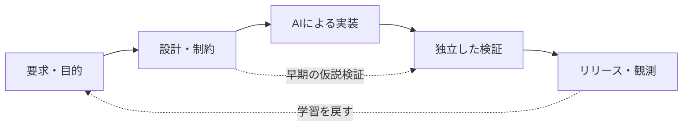

# AIコーディング時代のシフトレフト：コード生成前から品質を設計する

AIエージェントに機能の実装を依頼する。しばらくすると、数十ファイルの変更と大量のテストができあがる。ビルドも成功し、テストも通っている。

しかしレビューすると、**そもそも要求の解釈が違う**。あるいは、通常の入力では動くが、大量データや競合状態では破綻する。

こうしたとき、問題はAIのコード生成能力だけにあるのでしょうか。

私はむしろ、**「何を正しいとするか」「何を先に設計すべきか」「どう確かめるか」を決めないまま生成に進める開発プロセス**に注目したいと考えています。

そこで重要になるのが、**シフトレフト（Shift Left）**です。

この連載の総論となる第1章では、シフトレフトを「テストの前倒し」より広く捉え、AIコーディングにおける**要求・設計・品質・検証の前倒し**として考えます。Performance by Design、DDD、TDD、型・形式手法とのつながりも取り上げ、最後に既存リポジトリへ小さく導入する方法を示します。


> **注記**
> **この記事の主張**
>
> AIにコードを書かせる前に、すべてを詳細設計する必要はありません。ただし、**変えにくい判断、重要な品質制約、合否を決める根拠**は早い段階で明確にすべきです。


## 「シフトレフト」はテストを早く実行することだけではない

シフトレフトは、開発ライフサイクルの後半に集中しがちな品質活動を、より早い段階から始める考え方です。よく知られているのは *Shift-Left Testing* ですが、対象はテストに限りません。

たとえば、要求の曖昧さを減らすこと、認可境界を設計時にレビューすること、性能のボトルネックをコード生成前にモデル化することも、広い意味でのシフトレフトです。



ここで大切なのは、開発工程を一方向に固定しないことです。実際には、**小さな「要求 → 設計 → 生成 → 検証」の循環**を何度も回します。

また、シフトレフトだけでは十分ではありません。実際の利用者や負荷を観測し、設計へ戻す**シフトライト（Shift Right）**が補完的に必要です。

### Verification と Validation は別の問い

この違いを明確にすると、AIコーディングの失敗を整理しやすくなります。

| | 問い | よくある失敗 |
|---|---|---|
| **Validation（妥当性確認）** | 作ろうとしているものは、利用者の目的に合っているか？ | 間違った要求を精巧に実装する |
| **Verification（検証）** | 作ったものは、定義した仕様・制約を満たすか？ | 実装とテストが同じ仕様誤解を共有する |

たとえば「ファイル一覧を全件描画する」という仕様を忠実に実装しても、利用者の目的が「大量のファイルから目的のものへ素早く到達すること」なら、要求そのものが適切とは限りません。

逆に、目的に合う設計を選んでも、実装が並行処理の競合によって古い一覧を表示してしまうなら、仕様適合性に問題があります。

**正しいものを作ることと、ものを正しく作ること。両方に早く取り組む**のが、ここでいうシフトレフトです。[NASAのシステムズエンジニアリング解説](https://www.nasa.gov/reference/2-4-distinctions-between-product-verification-and-product-validation/)も、VerificationとValidationを区別しています。

## AIコーディングで何が変わるのか

従来も、要求と設計を先に考える重要性は知られていました。しかしコード生成が安く・速くなると、**設計の曖昧さを大量のコードへ変換する速度**まで上がります。

たとえばAIは、次のようなことを一度に進められます。

- アーキテクチャを十分に確認せず、新しい層や抽象化を追加する
- 既存のドメイン規則を推測して実装する
- 実装内容に合わせてテストの期待値を作る
- 小さな機能追加のために広範囲のファイルを変更する

もちろん毎回そうなるわけではありません。問題は、**生成が成功したという事実だけでは、仕様や品質の妥当性を判断できない**ことです。

[DORAの2025年レポート](https://dora.dev/research/2025/dora-report/)も、AIが組織の強みと弱みを増幅し得るという観点を提示しています。AIを導入するほど、開発プロセス側の品質が重要になると考えられます。

### 生成前に決めたい4つのこと

AIへ作業を依頼する際、最低限次の4点を区別したいところです。

1. **目的**：誰のどんな問題を解決するのか。今回は何をしないのか。
2. **受入条件**：どの振る舞いなら正しいと判断するのか。異常系・境界条件は何か。
3. **設計上の制約**：守るべき責務境界、データ構造、性能、認可、互換性は何か。
4. **検証方法**：何をテスト・計測し、誰がどの証跡で判断するのか。

すべての変更に長い設計書を要求する趣旨ではありません。コメントの修正と、永続データ形式の変更で必要なレビューの重さが違うのは当然です。

**重要度と後戻りの難しさに応じて、考えるべきことを先に考える**のが実務的な適用方法です。

## 具体例：Rust製ファイルマネージャーに機能を追加する

ここからは説明用の架空のケースです。特定リポジトリにおける実装や測定結果ではありません。

ディレクトリAを開いてファイルを列挙している途中で、ユーザーがディレクトリBへ移動したとします。Aの列挙が遅れて完了すると、**Bを表示しているはずの画面にAの結果が混じる**可能性があります。

### コード生成先行の依頼

> ディレクトリを非同期で読み込む機能を実装してください。

これだけでは、キャンセル、結果の順序、画面切替時の整合性が曖昧です。

### シフトレフトを取り入れた依頼

> **目的**：ディレクトリ切替中も、現在選択中のフォルダの結果だけを表示する。
>
> **受入条件**：Aの読み込み中にBへ移り、Aが後から完了しても、Aの結果でBの表示を上書きしない。キャンセルが失敗した場合も同様。
>
> **設計制約**：UIスレッドをブロックしない。既存の状態管理の責務を尊重する。
>
> **検証**：完了順序を制御できるテストを、通常系・遅延完了・キャンセル失敗の条件で用意する。期待値は実装から逆算しない。

設計案として、読み込みタスクに**世代ID**を付け、現在の世代と一致する結果だけをUIへ反映する方式が考えられます。

ここで重要なのは、世代IDという実装パターンそのものではありません。

**「古い結果が画面を上書きしない」という不変条件を先に定め、それを破るテストケースを考えてから実装する**ことです。

この順序なら、AIは設計案の提案・テストコード生成・実装を支援でき、人間は高リスクの判断と受入条件の妥当性をレビューしやすくなります。

## 「By Design」はシフトレフトを品質ごとに具体化する

ここまでの考え方を一般化すると、品質を完成後の検査だけでなく、**設計時からの制約として扱う**という発想につながります。

- **Correctness by Design**：守るべき不変条件・契約・状態遷移を明示する
- **Security by Design**：認証・認可、信頼境界、秘密情報の扱いを設計する
- **Performance by Design**：想定負荷、アルゴリズム、I/O、性能予算を設計する
- **Reliability by Design**：失敗・再試行・キャンセル・復旧を設計する
- **Accessibility by Design**：キーボード操作、フォーカス、支援技術などを最初から考慮する

これらは同じ標準規格に含まれる統一された手法名、という意味ではありません。**品質を後付けにせず、設計上の意思決定へ取り込む**という共通する見方です。

### Performance by Design：遅くなってから直す、では遅い場合がある

性能の問題はコードの局所的な最適化で解決できるとは限りません。

先ほどのファイルマネージャーで、10万件の項目を扱うとします。

- 全件列挙が終わるまで何も表示しないのか、それとも段階的に表示するのか
- 10万行分のUI部品を作るのか、可視範囲だけ描画するのか
- メタデータを一括取得するのか、必要時に取得するのか
- ワーカーを無制限に増やすのか、同時実行数・キュー長を制限するのか

これらは、実装の細部というより**アーキテクチャとデータフローの設計判断**です。

性能要求も「高速で軽量」では合否を判断できません。例えば次のように書き換えます。

> 指定した検証PCとテストデータで、10万件を含むローカルディレクトリを開いた際、最初の項目表示までの時間をp95で500ms以内とする。列挙中もUIの操作を継続可能とし、ピークメモリとスクロール時の応答性は別に測定する。


> **注記**
> 500msや10万件という値は**説明用の仮目標**です。実際の性能基準は、利用者の要求、ハードウェア、入力規模、測定条件から設定します。


ここでいうPerformance by Designは、単なる早期最適化とは異なります。**大きな構造的な問題は早期に検討し、細かな高速化は計測に基づいて行う**という区別が重要です。

Performance by DesignはAI時代に生まれた新語ではありません。Software Performance Engineeringの系譜に位置づけられ、[Menascéらの同名書籍（2004年）](https://books.google.com/books/about/Performance_by_Design.html?id=sxE931Medm4C)にも見られる考え方です。

性能予算・Amdahlの法則・Littleの法則・測定の再現性は、[Performance by Designの章](./03-ai-coding-shift-left-performance.md)で詳しく説明します。ここでは「データ量と環境を含めて性能の合格条件を決める」という原則が重要です。

### DDD・TDD・型・形式手法も「早期に誤りを減らす」道具になる

性能以外にも、早期に問題を見つける手法はあります。

**DDD**は、ドメインの言葉と責務境界の認識を揃える助けになります。**TDD**は、期待する振る舞いを小さく記述し、短いフィードバックを作ります。**Design by Contract**は、事前条件・事後条件・不変条件を明示します。

さらに、静的型・所有権・借用検査、プロパティベーステスト、モデル検査、依存型・定理証明は、種類の異なる誤りを早期に排除・発見するための手段です。

例えばRustの所有権・借用検査は一定のメモリ安全性・並行性の問題を防げますが、**業務仕様が正しいことや性能目標を満たすことまでは保証しません**。Leanなどによる形式証明も、保証するのは**形式化した命題とその前提の範囲**です。

どの手法も万能ではありません。重要なのは、特定の手法名を増やすことより、**どの誤りを、どの段階で、どんな根拠によって減らすのか**を選ぶことだと思います。

## AIが書いたテストが通っても、それだけでは十分ではない

生成コードと生成テストが、同じ誤解を共有する場合があります。

例えば仕様が「範囲の終了位置は**含まない**」なのに、実装もテストも「終了位置を**含む**」ものとして書かれていれば、テストが成功しても仕様どおりではありません。

だから、AIを複数使えば独立検証になる、という話でもありません。重要なのは**テストが何を根拠に正解を判断しているか**です。

- 期待値を、先に合意した受入条件や外部仕様から決める
- 正常系に加えて、境界値、異常系、競合、権限不足を確認する
- 型検査・静的解析・テスト・人間のレビューを組み合わせる
- 高リスクな変更では、検証基準の変更そのものをレビューする

特に、AIが「テストを通すために期待値を書き換える」「失敗する検査を`skip`する」「CIを無効化する」といった変更を行う場合は、**実装の修正ではなく、検証ルールの変更**として扱う必要があります。

### 品質ゲートは「ルールを書いた」だけでは機能しない

たとえば `AGENTS.md` に「テストを必須とする」と書いても、失敗したPRをそのままマージできる設定なら、実際には防げません。品質ルールは**文書上の方針、CI等による強制、例外の承認**に分けて設計する必要があります。

また、AIが書いたテストであっても、期待値を書き換えたり検査を無効化したりすれば「緑色のCI」は簡単に作れてしまいます。検証基準の変更はコード修正とは区別してレビューします。詳細は[独立検証](./05-ai-coding-shift-left-verification.md)と[品質ゲート](./06-ai-coding-shift-left-quality-gates.md)の章で扱います。

## 既存リポジトリに導入するなら、まず1件だけ

最初から長い設計書、レビュー文書、品質規約を大量に増やす必要はありません。既存のIssueや課題表、PR、CIを使い、**重要な変更1件**で以下を試すのがよいと思います。

1. **要求を明確化する**：目的・非目標・受入条件を書く
2. **妥当性とリスクを確認する**：本当に必要な変更か、どこが壊れ得るかを見る
3. **設計案を比較する**：変えにくい部分を優先し、必要に応じてADRを残す
4. **検証方法を先に決める**：どのテスト・解析・測定で合否を決めるか書く
5. **AIに小さく実装させる**：大きく一括生成せず、レビュー可能な差分に分ける
6. **証跡で判断する**：対象コミット、CI実行結果、未検証事項、承認をつなぐ
7. **運用結果を戻す**：障害・性能回帰・使いづらさを要求と検証へ反映する

### AIへの依頼は、この程度から始められる

以下はIssueに添える依頼文の一例です。

```md
## 目的
何を改善するのか。今回の非目標は何か。

## 受入条件
正常系・境界条件・異常系を具体例で記載する。

## 設計制約
既存アーキテクチャ、変更範囲、性能・安全性など。

## 検証計画
どの受入条件を、どのテスト・測定で検証するか。
期待値は実装から逆算しない。

## AIへの作業指示
コード生成前に、懸念点・設計案・トレードオフを提示する。
重要な設計判断はレビューを受ける。
変更を小さく実施し、テスト結果を報告する。
未実施の検査は未実施と明記する。
```

Rustのプロジェクトであれば、たとえば次のような検証をCIに含めることが考えられます。

```bash
cargo fmt --all -- --check
cargo clippy --workspace --all-targets -- -D warnings
cargo test --workspace --all-targets
```

これはあくまで基本的なチェックの例です。安全性・性能・UI/UX・実環境での振る舞いをこれだけで保証できるわけではありません。

### 「正本」を増やさない

課題をGitHub Issuesで管理するのか、`ISSUES.md`などのMarkdown課題表で管理するのか、どちらでも構いません。ただし、**要求や進捗の正本は原則1つにする**べきです。

- Issue / 課題表：目的、受入条件、状態の正本
- ADR：変更しにくい設計判断の記録
- PR：差分、議論、レビューの記録
- CI：機械的に実行した検査の証跡
- `AGENTS.md`：AIエージェント向けの入口と作業制約

役割を分ければ、複数ファイルへの手動同期を減らせます。`REVIEW.md`や`QUALITY_GATES.md`も、既存の仕組みで足りるなら新設する必要はありません。

## シフトレフトを形骸化させないために

導入後は「設計書の枚数」や「テスト本数」より、**重要な問題が早く見つかり、後戻りが減ったか**を見ます。

まず観測するなら、次の4点で十分です。

- **追跡可能性**：重要な受入条件に検証方法と結果がひも付いているか
- **未検証事項**：重大なリスクが曖昧なまま残っていないか
- **リリース後の回帰**：仕様誤解や設計不備による手戻りは減ったか
- **リードタイム**：品質活動を増やした結果、開発が過剰に遅くなっていないか

もちろん、早期設計ですべてを予測することはできません。性能の実測、利用者の操作、障害や復旧の経験は、リリース後も学び続ける必要があります。

**シフトレフトは、シフトライトの代わりではなく、その成果を次の設計へ還元する仕組み**だと考えています。

## おわりに

AIコーディングでは、実装の前後にあった作業の重みが変わりつつあります。

コードを生み出すことが容易になるほど、むしろ次の問いが重要になります。

> 何を作るべきか。どんな品質を要求するか。何を根拠に正しいと判断するか。

シフトレフトは、この3つの問いを**コード生成の前から扱う**ための考え方です。

DDD、TDD、形式手法、Performance by Design、Security by Designは、それぞれ異なる品質リスクを早期に扱う手段としてつながります。ただし、どの手法もそれだけで製品全体の正しさを保証するものではありません。

まずは一つの課題について、要求・受入条件・設計判断・検証結果をつなげてみる。そこで実際に起きた手戻りと効果を観察し、少しずつ導入範囲を広げる。

**品質を設計し、その品質を検証し、品質を検証する仕組み自体も確かめる。**

AIコーディング時代のシフトレフトを、私はそういう開発プロセスとして捉えています。

## 参考資料

- [IBM: What is Shift-left Testing?](https://www.ibm.com/think/topics/shift-left-testing) — シフトレフトの一般的な説明
- [DORA: 2025 State of AI-assisted Software Development](https://dora.dev/research/2025/dora-report/) — AI支援開発と組織的な改善
- [NASA: VerificationとValidationの違い](https://www.nasa.gov/reference/2-4-distinctions-between-product-verification-and-product-validation/) — 要求の妥当性と仕様適合性
- [NIST: Secure Software Development Framework（SSDF）1.1](https://csrc.nist.gov/pubs/sp/800/218/final) — セキュア開発の体系
- [Microsoft: Performance Efficiency design principles](https://learn.microsoft.com/en-us/azure/well-architected/performance-efficiency/principles) — 性能を設計するための原則
- [Menascé et al.: Performance by Design（2004）](https://books.google.com/books/about/Performance_by_Design.html?id=sxE931Medm4C) — 性能工学の参考書


> **注記**
> **注記**：この文章は、既存の品質工学・テスト・形式手法をAIコーディングへ接続するための実務上の整理です。リスク分類や性能目標の例は筆者が説明用に設定したものであり、普遍的な標準値や特定プロジェクトでの実測結果ではありません。

---

[← シリーズトップ](./) ｜ [次章：要求・DDD・TDD・形式手法 →](./02-ai-coding-shift-left-requirements.md)
