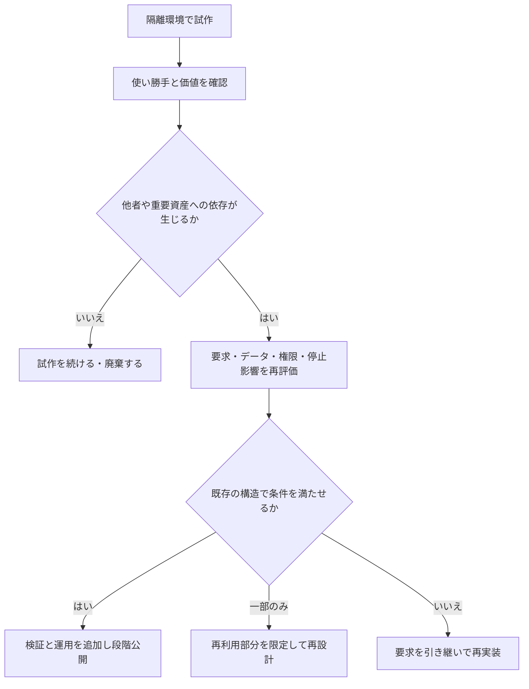
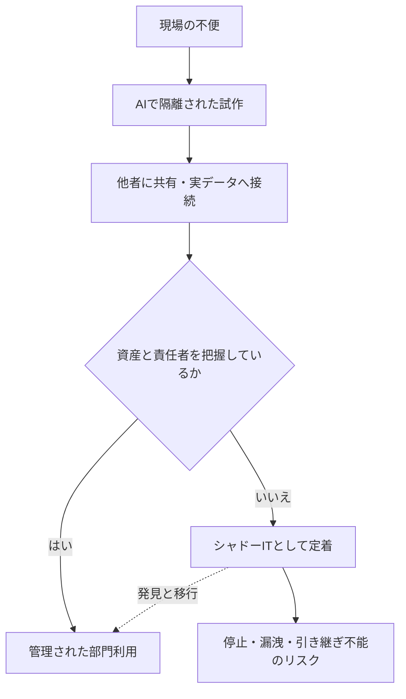

# バイブ・コーディングの可能性と限界

作成日：2026-10-16 / 更新日：2026-10-16

> **概要：** バイブ・コーディングは、ソフトウェアを試作する障壁を大きく下げうる。しかし、試作品を素早く作れることと、他者が依存するプロダクトを継続的に提供できることは別である。本稿ではその可能性と限界を、個人開発と企業プロダクトの違い、技術的負債、業務現場でのシャドーITという3つの側面から考える。
>
> **本稿の立場：** AIによるコード生成自体を批判するものではない。「AIに生成させること」と「生成物を何を根拠に受け入れるか」を分けて考える。理解・検証を省略する探索手法が合理的な局面はあるが、その進め方を他者が依存するソフトウェアの開発原則にはできない。
>
> **対象読者：** 個人開発者、AIコーディングを実務へ導入する開発者・設計者・意思決定者。
>
> **情報の基準日：** 2026年10月16日。研究結果は対象条件と限界を示し、独自の考察は研究で実証された事実とは区別する。

## はじめに：「作れた」と「届け続けられる」の間

欲しかったツールの機能を自然言語で説明する。AIがコードを書き、実際に動かしてみる。うまくいかなければエラーを渡し、修正を繰り返す。数時間前には存在しなかったアプリケーションが形になっている。

これは魅力的な体験だ。プログラミングの知識が十分でなくても、自分の困りごとをソフトウェアで解決する入口が開く。熟練した開発者にとっても、AIはアイデアを試す費用を下げうるとともに、探索できる選択肢を増やしうる。**この変化は、単に「開発が速くなった」という話ではない。従来の費用では実現しづらかった小さな需要にも、ソフトウェアという解決策を選べる可能性が広がることに意味がある。**

では、そのアプリケーションを明日から顧客に提供し、来年も使える状態を維持すると約束したらどうだろう。

- 利用者のデータが消えたとき、誰が復旧するのか。
- 別の利用者の情報が見えてしまったとき、誰が原因を調べ、説明するのか。
- 新機能を追加した結果、既存機能が壊れたことをどう検出するのか。
- 作成者がいなくなった後、誰が変更し続けるのか。
- そもそも、利用者にとって本当に必要な機能を作れているのか。

どれも、コードが1回動いたという事実だけでは答えられない。

**バイブ・コーディングは「作る自由」を広げる。しかし「使われ続けることへの責任」を消すわけではない。**

本稿では、**「試すための成功」と「依存されるための成功」**を分けて考える。会社と個人という肩書ではなく、他者への影響と、引き受ける責任を軸にする。

## 1. バイブ・コーディングとは何か

### 1.1 元来の意味は、単なるAIコード生成ではない

2025年2月2日（米国時間）、Andrej Karpathyは自然言語でAIに指示し、生成されたコードの差分をほとんど読まず、エラーをAIに貼り付けながら進める方法を「vibe coding」と表現した。本人は、使い捨ての週末プロジェクトでの楽しさという文脈でも語っている。[^karpathy]

Simon Willisonは同年3月、**AI支援プログラミングのすべてをバイブ・コーディングと呼ぶべきではない**と論じた。AIにコードを書かせた後、その挙動や実装を調べ、テストし、説明できる状態にする開発は、元来の意味から区別される。[^willison]

本稿での用語を整理しておこう。

| 用語 | 本稿での扱い |
| --- | --- |
| **バイブ・コーディング** | 生成された実装の詳細な理解やレビューより、対話と外部から見た動作を頼りに探索を進めるスタイル |
| **AI支援ソフトウェア開発** | AIが仕様案・設計案・コード・テストなどを生成しても、それらの受入条件と検証・承認・運用を管理する開発 |

これは人を2つに分ける分類ではない。同じ開発者が午前中は試作品をバイブ・コーディングで作り、午後には試作品を評価し直し、仕様と検証を伴う開発プロセスへ移行することもある。現在では「AIを使う開発全般」をバイブ・コーディングと呼ぶ用法もあるが、本稿では議論を明瞭にするため、元来の「コードを十分に追わず、挙動を頼りに進める」意味を採る。

**境界は「AIを使ったか」ではなく、「生成物をどの根拠で受け入れるか」である。**

### 1.2 レビューを省くことと、理解を分担することは違う

大規模なシステムのコードを、すべての担当者が逐一把握するのは現実的ではない。人が書いたコードであっても、ライブラリ・コンパイラ・OSの内部実装をすべて読んでから利用するわけではない。必要な契約や検証済みの性質に依拠し、理解を分担している。

したがって、「AI生成コードを1行ずつ自分で書き直していない」こと自体が問題なのではない。**誰が仕様を定め、どこまでの挙動を確認し、何を未確認のまま受け入れるのか**が重要になる。

例えば、変更が小さく、インターフェイスの契約、型検査、再現性のあるテスト、変更差分の検査が揃っていれば、すべての内部実装を人が熟読しなくても合理的に受け入れられる場合がある。逆に、AIが整然としたコードを出力し、その説明まで生成してくれても、その説明だけでは仕様適合性や安全性の独立した証拠にならない。

この区別を踏まえ、本稿では**バイブ・コーディングを、実装の理解と検証を意識的に後回しにして、外から見た手応えを頼りに進める探索スタイル**として扱う。厳格に仕様を定めてAIに実装を任せる手法まで一括して批判しない。

## 2. 可能性：バイブ・コーディングは何を変えるか

### 2.1 商業的には成立しなかった、小さな需要に応える

大量の利用者に売れるわけではないが、本人にとっては便利なものがある。個人用のファイル整理ツール、特定の形式だけを扱う変換器、趣味のデータ可視化、実験用の小さなGUIなどだ。

従来は、作るための学習や環境構築に見合うほどの価値がないとして諦められがちだった。AIによる生成は、こうした**極めて小さな需要をソフトウェアへ変える初期費用**を引き下げうる。

これは、完成済みの商用ソフトウェアが増えることとは別の種類の価値である。

### 2.2 仕様を考えるより先に、触って確かめられる

画面の使いやすさや作業の流れは、頭の中で仕様を考えているだけでは分からないことがある。動く試作品は、曖昧な要求を発見するための道具になる。

この意味で、バイブ・コーディングは「設計を不要にする」のではなく、**設計判断に必要なフィードバックを安く得る**手段にもなる。

企業におけるPoC、画面案の比較、限定環境でのユーザーテストにも十分に価値がある。ただし、試作品を試作品として管理することが前提になる。

### 2.3 熟練者の探索範囲も拡大する

新しいライブラリを試す、既知のアルゴリズムを可視化する、複数のUI案を作り比べる。その成果を捨てても困らない状況では、丁寧な設計よりも試行回数を優先した方が合理的なこともある。

「知識のない人が作れる」だけでなく、「知識のある人が、より多くの仮説を安く試せる」ことにも意義がある。

### 2.4 完成品だけでなく、学習の入口にもなる

生成したものを触り、壊し、疑問を調べ、少しずつ内部を読む。こうした使い方なら、ソフトウェアに関心を持つ入口にもなり得る。

ただし、動作した結果を眺めるだけで、設計や不具合解析の技能まで自動的に身につくわけではない。**探索の容易さと、理解の深さは別の軸**である。

### 2.5 「完成品を作る」以外の価値を評価する

個人が趣味で作る道具に、企業向けの品質管理と同じ費用を求めれば、そもそも作る意義が失われる。特定の実験を1回成功させること、考えを画面で共有すること、未知の技術を試すことも、それ自体で価値を持つ。

**本番利用に向かないことは、試作として価値がないことを意味しない。** この点を認めなければ、バイブ・コーディングが生み出した創造的な可能性を正当に評価できない。

## 3. 限界：何が見えなくなりやすいのか

### 3.1 正常系のデモは、正しさの証明ではない

ボタンを押して期待どおりの画面が表示された。それは、その入力と状態で1回うまく動いたことを示す。しかし次のことは分からない。

- 異常な入力、境界値、権限不足にどう反応するか。
- 同時操作や通信断、ディスク容量不足で破綻しないか。
- データが一部だけ更新されたとき、どのように復旧するか。
- 変更前に満たしていた仕様を、変更後も維持しているか。

**デモの成功、要求への適合、運用上の信頼性は、それぞれ別の判断である。**

これはAI固有の問題ではない。人間が手書きした試作品にも同じ欠落はある。生成の高速化は、**実際に検証した範囲よりも広く「もう完成した」と感じる**危険を増やし得る。

### 3.2 局所的な「直った」が、全体の整合性を壊す

「このエラーを直して」と指示するたび、AIは提示された局所的な状況に応じて修正案を作る。個々の修正はもっともらしくても、例外処理、データの責任範囲、認可、再試行の規則が少しずつばらばらになる可能性がある。

例えば、ファイル名の重複を避けるため、ある画面では末尾に番号を付け、別の画面では上書きを許し、APIではエラーを返す。すべての画面で個別の操作は「動く」のに、**同じ製品の中で同じ操作の意味が一致していない**。

これはモデルが必ず間違うという意味ではない。**仕様に空白があると、AIも人間も、その空白を何らかの実装上の判断で埋めざるを得ない。** 短い生成・修正の反復で異なる判断を採用し続ければ、決めていないはずの仕様がコードの各所に散らばる。

必要なのは単にプロンプトを長くすることではない。どの規則が正本で、変更してよい部分と守るべき不変条件は何かを明確にし、コードの振る舞いと照合することだ。

### 3.3 技術的負債は、コード量より「変更の難しさ」に現れる

短いコードでも、仕様や責務が曖昧なら修正しにくい。大量のコードでも、境界とテストが明確なら変更しやすい。したがって、生成行数やファイル数を技術的負債の量と同一視すべきではない。

ここでいう技術的負債は、当面の選択によって後の変更・理解・保守に追加費用が生じる状態を指す。試作品をすぐに捨てる予定なら、将来の保守性を犠牲にして試行速度を得る判断は合理的になり得る。**負債が問題になるのは、返済せず長期の依存対象として使い続ける場合**だ。

バイブ・コーディングが技術的負債を必ず生むわけではない。また、コードの読みにくさと技術的負債は同義ではない。欠陥、不必要な複雑さ、将来の選択肢を狭める設計判断は区別して評価する必要がある。**暫定的な判断を把握せず、利用期間や依存関係だけを広げること**が、後からの修正を高くつかせる。

ここには逆説もある。コード生成が安くなれば、書き直しの費用は下がる。一方、既存の顧客データ、外部API、運用手順、他システムとの結合は、コードだけ作り直しても消えない。**生成できるコードの安さと、変えられるシステムの安さは同じではない。** 再生成によって書き直せる部分と、データ移行・業務調整・検証・信頼回復が必要な部分を分けて見積もる必要がある。

### 3.4 コーディングエージェントには、生成コードとは別の危険がある

今日のAI支援開発では、コードを提案するだけでなく、コマンドを実行し、依存関係を追加し、ファイルを編集し、外部サービスへ接続するエージェントも使われる。

この場合、完成したプログラムの安全性とは別に、**開発中のエージェント自体の権限**が問題になる。秘密情報へのアクセス、意図しないファイル変更、外部文書に埋め込まれた悪意ある指示などへの対策が必要だ。OWASPはAI支援コーディングの脅威モデルで、エージェントのサンドボックス化、権限の最小化、差分の監査、人的な説明責任などを扱っている。[^owasp]

これは元来のバイブ・コーディングに限った脅威ではない。より広い**エージェント型AI開発のリスク**として分けて考えるべきである。

### 3.5 もう1つの落とし穴：判断理由が引き継がれない

ソフトウェアは、コードだけではなく「なぜその設計にしたのか」という判断の積み重ねでもある。例外を握りつぶした理由、データ形式を選んだ理由、性能より一貫性を優先した理由が残らなければ、後任者はコードを読めても変更の妥当性を判断しにくい。

AIに設計理由を説明させることはできる。しかし**後から生成した整合的な説明**と、当時実際に比較・合意した設計判断の記録は別物だ。重要な判断は、短い設計メモやADR（Architecture Decision Record）として、前提と却下した選択肢を残す方がよい。

この問題は従来開発にもある。ただし、生成と修正が短時間で繰り返されるほど、意図の記録を置き去りにしやすい。

### 3.6 生成できることと、配布できることも違う

試作では動作の確認が主目的でも、公開や商用利用では**第三者のコード・画像・ライブラリの利用条件、依存パッケージの更新、データの取り扱い**も確認対象になる。AIの出力に含まれた実装や依存関係を、出所や利用条件を調べずにそのまま製品へ組み込む判断は慎重であるべきだ。

これは「AI生成コードには必ず権利問題がある」という主張ではない。**動く実装を得る工程と、それを合法的かつ継続的に提供できると確認する工程は異なる**という整理である。

## 4. 個人開発と企業プロダクトの「決定的な違い」

個人開発が「自由」で企業開発が「厳格」という説明は不十分だ。個人でも顧客向けの有償サービスを提供すれば継続的な責任が生じるし、企業でも隔離された1日限りの試作なら軽量な手順が合理的である。

**本質的な境界は、失敗の影響と、作成者以外の人がそのソフトウェアにどれだけ依存しているか**にある。

### 4.1 自分で引き受けられる失敗と、他者へ波及する失敗

自分だけが使い、データを保全している小さなツールなら、仕様を変える、作り直す、利用を諦めるといった判断を本人ができる。探索に時間を使うよりも、動くものを早く試すことが合理的な場合も多い。

ところが、他者が利用し始めると同じ自由度は残らない。データを消してやり直すには利用者への説明が要る。突然停止すれば業務に影響する。仕様変更には互換性や移行が問題になる。**「作成者が自由に変えられる道具」から「利用者が当てにしている仕組み」へ、性質が変わる。**

| 判断軸 | 本人だけの短命な試作 | 継続的に提供するプロダクト |
| --- | --- | --- |
| 仕様変更 | 本人の裁量で変えられる | 利用者の期待・互換性・契約などを考慮する |
| 失敗の帰結 | 本人が主な影響を引き受ける | 顧客・同僚・取引先へ波及する |
| 終了の自由 | 廃棄・再作成を選びやすい | 告知・データ移行・代替手段が必要になり得る |
| 継続性 | 完成せず終了してもよい | 障害対応・更新・問い合わせが継続する |
| 知識の所在 | 作成者に集約しやすい | 担当者が変わっても変更・復旧できる必要がある |
| 受入基準 | 本人の確認で足りる場合がある | 仕様・検証結果・運用状況が判断の根拠になる |

いずれも典型例であり、法的な責任の大小を一律に定める表ではない。個人用でも秘密情報や重要資産を扱えば慎重な設計が必要だ。

### 4.2 企業では、責任を個人から組織へ移せなければならない

さらに企業プロダクトでは、コードの品質とは**別に、組織が責任を継承できるか**が問題になる。

「このツールの仕様を承認したのは誰か」「障害時に誰が停止を決めるか」「担当者が異動した後、誰がAPIの権限を失効できるか」。これらはソースコードを読めば自動的に解決する問いではない。必要なのは、業務責任者・技術担当・運用上の連絡先・権限・判断記録である。

「AIが書いたので詳細は分からない」は、組織の引き継ぎや事故対応を省く理由にはならない。一方で、人間の担当者がコードを1行ずつ熟読することだけが引き継ぎの手段でもない。契約・自動検証・可観測性・運用手順を通じて、**必要な判断を再現できる状態**を作ることが重要だ。

### 4.3 境界を決めるのは会社名ではなく、影響と継続性

| | 一時的な利用 | 長期の利用 |
| --- | --- | --- |
| **本人への影響が中心** | 隔離された個人実験。試行速度を重視しやすい | 自分用ツールでも保全・更新・復旧が重要になる |
| **他者や重要資産へ影響** | 社内PoCでも実データ・強い権限があれば保護策が必要 | 顧客向け・基幹業務向けのシステム。仕様と運用責任が中心になる |

これは単純な2軸の見取り図であり、詳細なリスク評価に代わるものではない。扱うデータ、操作権限、障害の取り返しやすさによって、短命な試作でも厳しい対策が必要になる。

**プロトタイプからプロダクトへの変化は、完成度の上昇だけではない。作成者の裁量で処理できた不確実性が、他者への約束へ変わることでもある。**

## 5. 具体例：同じファイル管理ツールを作っても、設計は同じにならない

AIに「ファイルの一覧を表示し、名前を変更できるツールを作って」と頼む。数分で画面ができ、名前変更も成功したとする。

### 5.1 個人の実験としての成功

自分の作業用フォルダーを操作するだけで、元データはバックアップ済み。使いにくければ捨てられる。この条件なら、UIを素早く試すこと自体が大きな成果だ。

それでも、重要ファイルを直接操作する前にバックアップを取り、対象パスや削除範囲を限定するのは合理的である。**使い捨てのコードでも、失われたデータまでは使い捨てにできない。**

### 5.2 企業の共有ストレージ向けツールになると

見た目が同じでも、次の問いに答える必要がある。

- **認可：** 操作権限のないファイルを参照・変更できないか。APIを直接呼び出しても回避できないか。
- **同時実行：** 2人が同時に同じ名前へ変更したら、どうするか。確認と更新の間に状態が変わっても安全か。
- **障害：** サーバーが変更を受け付けた直後に通信が切れたら、UIは何を表示するか。
- **整合性：** ストレージ側の成功と検索インデックス側の更新失敗が食い違ったら、どうするか。
- **監査：** 誰が、どのファイルを、いつ変更したか記録する必要があるか。
- **運用：** 既存データとの互換性、バックアップの復元確認、更新・切り戻し手順をどうするか。

これらは、画面を美しく仕上げても解決しない。コードをたくさん生成しても、要求として未決定なら正解は決まらない。

例えば「通信タイムアウト」は、変更失敗を意味するとは限らない。処理は成功し、応答だけが届かなかった可能性がある。安易に同じ操作を再送すると、別の不整合が生じる設計もある。これは単なるエラー表示の問題ではなく、**操作の意味、再試行、状態の確認方法をどう設計するか**という問題だ。

### 5.3 「動いた」を、検証可能な受入条件へ変換する

同じ「ファイル名を変更する」機能を、外から見た操作の成功だけで受け入れないようにする例を考えよう。

| 受入条件の例 | 独立した確認方法の例 |
| --- | --- |
| **AC-01：** 編集権限のない利用者は、他者のファイル名を変更できない | 認可テスト。画面だけでなくAPIへ直接要求する |
| **AC-02：** 名前の競合時には、勝手に既存ファイルを上書きしない | 競合操作を並行実行し、ストレージ側の状態と結果を確認する。事前確認のみで済ませない |
| **AC-03：** 通信タイムアウト後、成功・失敗・未確定を誤表示せず成否を再確認できる | 応答を意図的に遮断し、状態照会・再試行時の重複作用・UI表示を確認する |
| **AC-04：** ファイル情報と検索結果に不整合が起きた場合、検知・修復できる | 検索インデックス更新を意図的に失敗させ、検知・再処理・収束までの手順を確認する |

これは**設計・テストの例であって、実際の製品に対して検証を実施した結果ではない**。名称変更の競合時にエラーを返すか、条件付き更新を採用するか、検索結果に遅延を許すかなどは仕様として選ぶ必要がある。AC-02では、確認後に他の操作が割り込む競合（TOCTOU）を想定し、必要なら原子的な更新や条件付き操作を利用する。AC-04では、ストレージと検索インデックスに即時の完全一致を要求するのでなく、許容する不整合時間と修復条件を決めてもよい。検証項目が揃っても未知の欠陥がゼロになるわけではないが、「良さそうに動いた」より具体的な議論ができる。

ここで提供者側が担うべき中心的な仕事は、コードを手で入力することではない。**選択肢を比較し、期待動作を確定し、その判断と検証結果に責任を持つこと**だ。仕様案・テスト案をAIに作らせても、この役割は失われない。

## 6. 試作品を本番へ「そのまま昇格」させる落とし穴

バイブ・コーディングが不得意だからではなく、**試作と本番では、最初に置いた前提が異なる**。短期間で捨てる予定なら省略できた記録、保守、データ管理も、利用が拡大すると必要になる。



### 6.1 昇格を見直す引き金

「PoC」と呼び続けていても、**実データを入力する、組織の資格情報で接続する、他者へ配布する、定期実行する、停止すると業務が困る**といった変化があれば、当初の試作前提を見直すべきだ。

これは「どれか1つが起きたら必ず本番認定」という規則ではない。審査・相談を始める合図である。機密データを扱う場合には、試作段階から別途保護策が必要になる。

### 6.2 再利用か、部分改修か、再実装か

| 選択肢 | 判断の目安 | 気を付けること |
| --- | --- | --- |
| **構造を生かして強化** | 責務分離が妥当で、検証と運用の追加で条件に届く | 未検証範囲や暫定仕様を記録する |
| **一部を再利用** | UI・独立した処理は良いが、認可・保存などは再設計が必要 | 安全境界を明示する |
| **再実装** | 設計前提が要求に合わず、局所修正では安全性を示せない | 試作で発見した要求や利用者の反応は捨てない |

「AI生成だから作り直す」「動いているから使い続ける」のどちらも短絡的だ。コードを作り直せても、既存データ、外部連携、ユーザー教育、移行と検証の費用は消えない。

### 6.3 本番移行に必要な最小の説明

組織が依存を引き受ける前に、少なくとも次を説明できる状態にする。

- **何のためのツールか：** 対象利用者、仕様、保証しない範囲。
- **何に触れるか：** データ、秘密情報、業務API、外部サービスと権限。
- **壊れたらどうするか：** 停止、連絡、復旧、切り戻しと必要な記録。
- **何を確認したか：** 独立した受入条件、テストと未検証事項。
- **誰が続けるか：** 業務責任者、技術担当、次回見直し日。

長い設計書が必要という意味ではない。影響が小さければ数項目のメモで足りるかもしれない。重要なのは、**「完成したか」ではなく「どの前提と証拠で他者に使ってもらうか」**を判断できることだ。正式リリース前に業務で使われ始める問題は、次のシャドーITの章にもつながる。

## 7. バイブ・コーディングが加速し得るシャドーIT

**コードの品質を調べる以前に、組織がそのソフトウェアの存在を把握していない。** 企業では、これが独立したリスクになる。

シャドーIT（Shadow IT）は、組織が承認・把握・管理する仕組みの外で業務に利用されるIT資産やサービスを指す。部門独自のSaaS、Excelマクロ、Accessデータベース、スクリプトなどは以前から存在した。生成AIはシャドーITの発明者ではない。しかし、**現場で独自のアプリや連携処理を生成する障壁を下げる**ため、未管理の業務システムが生まれる経路を増やし得る。

### 7.1 便利な試作が、誰も管理しない業務基盤になる

営業担当者が、ダミーデータで案件一覧アプリを試作したとする。好評なので同僚に配布し、共有データを取り込み、ついには顧客管理APIへ接続する。プログラムは個人アカウントで動き、APIキーも作成者が保持している。担当者の異動後に停止して初めて、チームの業務がこのアプリに依存していたと判明する。

これは仮想例であって事故報告ではない。失敗の本質はコードの出自ではなく、**業務依存が拡大したのに、組織の資産台帳・権限管理・保守責任が更新されなかった**ことにある。



### 7.2 「シャドーAI」と「AI生成アプリ」は同じではない

| 区分 | 問題の所在 |
| --- | --- |
| **シャドーIT** | 未管理のアプリ・スクリプト・クラウドサービスを業務に使う |
| **シャドーAI** | 未承認・未管理のAIサービスやエージェントを業務に使う |
| **AI生成アプリ** | 作成手段がAIであるという事実。適切に登録・運用されていればシャドーITとは限らない |

例えば、未承認AIサービスに顧客データを入力してコードを生成する問題と、完成したアプリを未管理で本番運用する問題は分けて扱う必要がある。後者のアプリ自体がAIを実行するとは限らない。

### 7.3 コード品質と組織統治は、別の2軸である

シャドーITを「AIが雑なコードを生成するから危険」と説明すると論点を取り違える。**技術的に優れたツールでも、誰が使い何のデータへアクセスするか分からなければ、組織としては管理できない。** 一方、正式登録されたツールでも、脆弱な実装なら問題は残る。

| | **組織が把握・管理している** | **組織が把握・管理していない** |
| --- | --- | --- |
| **技術的な品質を十分に確認した** | 適切な管理状態に近い。ただし継続的な見直しは必要 | 良いコードでもシャドーIT。所有者・権限・廃止の問題が残る |
| **技術的な品質を確認していない** | 登録済みでも検証不足。品質ゲートとリスク対応が必要 | 品質も統治も未確認。利用影響に応じて調査・是正を優先する |

この表は記事独自の整理であり、監査・認証基準ではない。品質と統治は二者択一ではなく、**両方を満たす必要がある**。

OWASPのCitizen Development向け資料は、設定不備や機微データの取り扱いをリスクとして挙げる。[^owasp-citizen-misconfig][^owasp-citizen-data] また、NIST CSF 2.0はソフトウェア・サービス等のインベントリ管理（ID.AM-02）とライフサイクル管理（ID.AM-08）を扱い、実装例のID.AM-08 Ex3にはシャドーITの発見が明記されている。これはあらゆる組織に特定の申請フローを義務づける記述ではない。[^nist-csf]

### 7.4 一律禁止でも、自由放任でもない

現場が自作へ向かう背景には、既存システムの小さな不便や、正規の変更・調達が遅いといった事情もあり得る。ただし、全てのケースの原因がそれだという実証ではない。

申請を重くしすぎれば、公式の経路を通るより隠れて作る方が簡単になるおそれがある。逆に、利便性を優先して本番資格情報や個人情報を自由に扱わせることもできない。必要なのは、**低リスクの実験は容易に、リスクの高い利用は早期に相談できる正規経路**である。

例えば、承認済みのAIツール、ダミーデータ、分離された実験環境、費用・外部通信・アクセス権限の上限を標準で用意する。次のような変化が起きたら、利用者に分かりやすい窓口から評価・登録へ進める。

| 利用に起きた変化 | 移行・対応の例 |
| --- | --- |
| 顧客情報・機微データを使う | データ分類、保存先、外部送信、削除方法を確認する |
| 業務API・組織の資格情報に接続する | 管理されたサービスID、最小権限、失効・ローテーションを用意する |
| 同僚へ配布・定期実行する | 台帳へ登録し、用途・責任者・停止方法を明確にする |
| 止まると業務に支障が出る | 復旧・監視・代替手段・引き継ぎを整える |
| 外部へ提供する | 利用規約・契約・セキュリティ・サポートを用途に応じて確認する |

機微データや危険な権限は、利用人数が少なくても強い保護が必要だ。これらは記事独自の運用提案であり、NIST・OWASPが定めた認証段階ではない。

### 7.5 台帳は「存在を知る」ための最小単位から始める

最初から長い申請書を要求する代わりに、部門利用のツールには**用途、利用者、業務責任者、技術担当、実行場所、データ分類、主な接続先、次回の見直し日**を登録できるようにする。重要度に応じて、ソース管理場所、復旧・廃止手順、バックアップの確認結果などを追加する。

- **業務責任者：** 利用の必要性、許容リスク、停止・廃止の判断を担う。
- **技術担当：** 接続、変更、障害切り分け、引き継ぎに必要な情報を維持する。
- **IT・セキュリティ担当：** 共通の実行環境・認証基盤・監査方法を提供する。

小規模組織では1人が複数の役割を兼ねてもよい。ただし役割が存在しないこととは区別する。登録完了までの時間や、重要ツールで担当者・停止手順が分かる割合を確認し、**管理が実際に使える経路になっているか**を評価する。登録件数だけを増やすことは目的ではない。

Power Platformの管理センターが提供するInventory、Usage、Monitor、Actionsは、作成を認めつつ資産と運用の可視性を保つ具体例である。ただし、特定製品の機能であり、すべての自作アプリに同じ仕組みが自動的に適用されるわけではない。[^microsoft-governance]

### 7.6 すでに業務へ定着したものを見つけたら

原則は、**発見 → 影響と権限の確認 → 管理下へ移す・置き換える・廃止する**の順で考える。未承認だからと直ちに停止すると、かえって重要業務が止まる場合もある。一方、情報漏洩や不正利用の疑いがあるなら、被害の封じ込めを優先する。

所有者、扱うデータ、稼働場所、資格情報、利用者、停止影響、バックアップ、代替手段を確認する。維持するなら管理されたアカウントと変更・復旧の仕組みへ移す。廃止するならデータ移行と権限失効を伴わせる。

シャドーIT対策とは、現場の創造性を罰することではない。**ソフトウェアを作る自由に、組織が依存関係を把握する能力を追いつかせること**である。

## 8. 生成速度と、プロダクトの生産性は同じではない

コード生成が速くなっても、要求の確定、検証、統合、デプロイ、障害対応、将来の変更まで同じように速くなるとは限らない。

費用を考えるため、便宜的に次のように分けてみる。

```text
開発・提供の総費用（概念図）
  = 要求の整理と設計
  + 生成・修正
  + レビュー・検証
  + 統合・公開・運用
  + 将来の変更・引き継ぎ
  + 障害に伴う期待損失
```

これは厳密な会計式でも、各項目が独立に加算できるという主張でもない。特定の活動だけが高速化したとき、**別の活動へ負担が移る可能性**を確認するための見取り図である。

### 8.1 調査は何を示し、何を示していないか

2025年のDORA調査は、AI導入が組織の強みと弱みを増幅するという見方を示した。[^dora2025] また2026年3月のDORAによる**質的分析**では、2025年第3四半期に集めたGoogleのソフトウェアエンジニアによる自由回答1,110件をもとに、コード作成の短縮と監査・検証負担の関係、技能形成との緊張、試作と本番統合の隔たりを論じている。[^dora2026] ただし、自由回答を対象とする分析には回答者の選択や設問の影響があり、各企業や開発者への因果効果の大きさをこの分析だけで決めることはできない。

一方、METRが2025年前半に実施したランダム化比較試験では、経験豊かなOSS開発者16人・246タスクの条件で、**AI利用を許可されたタスク**の所要時間が、許可されなかったタスクより平均19%長かった。これはタスクごとに利用可否を無作為割当した研究であり、当時のツール、開発者、本人がよく知る既存リポジトリという限定条件の結果である。AI全般が常に遅いという結論ではない。[^metr2025]

その後の2026年2月のMETR報告では、より新しいツールで開発者が速くなっている可能性が示された。一方、AIなしで作業することを避ける参加者やタスクの選択、並列エージェント利用時の時間測定などの問題から、**その効果量は信頼して確定できない**としている。[^metr2026] 2025年の遅延率も2026年の暫定的な高速化率も、現在の一般的な開発にそのまま当てはめるべきではない。

**これらは「バイブ・コーディングそのものの生産性」や「個人開発と企業開発の優劣」を比較した研究ではない。** より広いAI支援開発に関する知見として、個別作業の速度と製品としての成果を混同しないために紹介している。

### 8.2 企業が見るべきなのは、生成量ではなく価値と変更可能性

生成したコード行数、PR数、プロンプトの回数は活動量を示しても、顧客価値や信頼性を直接示すわけではない。

むしろ、次のような問いを組み合わせた方がよい。

| 観点 | 確認すること |
| --- | --- |
| **顧客価値** | 解くべき問題を解決したか。利用者が実際に使えるか |
| **開発の流れ** | 変更の着手から安全な提供までの時間はどうか |
| **品質** | 重要な不具合、障害、手戻りはどう変わったか |
| **保守性** | 別の担当者が理解・修正できるか |
| **運用** | 障害を検知し、復旧し、再発を防げるか |

AIによる生産性向上を判断するには、作成したファイルの数だけでなく、**価値ある変更を安全かつ継続的に届けるための時間・費用・品質がどう変わったか**を確認する必要がある。

なお、レビュー件数や不具合数などの数字も単独では誤解を招く。測定するなら、製品の重要度・規模・変更の種類を揃え、導入前後の観測条件を記録して比較する必要がある。

もう1つ、**チームの技能形成**を成果指標から外してはならない。短期の生成速度だけを褒めれば、経験の浅い担当者が設計理由を学ぶ機会や、障害を自力で切り分ける能力が育たないこともある。逆に、AIを教材や仮説生成に使えば学習を促進できる。重要なのは「AIを使ったか」ではなく、将来の担当者が独立して判断できるかどうかである。

## 9. 実務上の判断：バイブ・コーディングから、いつ切り替えるか

ここまでの議論から、「AIを使う／使わない」ではなく、**探索の成果をどんな証拠で受け入れるか**を決めるのが現実的だと分かる。

| 利用形態 | 向いている進め方 | 避けたい思い込み |
| --- | --- | --- |
| ローカルで完結する短命な実験 | 安全な環境で大胆に試す | 使い捨てコードなら重要データも無防備でよい |
| 企業内の隔離PoC | 試作を速め、要求を発見する | PoCと名付ければ本番データを自由に使える |
| 個人の公開サービス | AI生成を活用し、仕様とリスクに応じて検証する | 個人だから利用者への責任は発生しない |
| 顧客向けの継続提供 | 仕様・検証・保守・運用を組み込む | AI生成コードなら必ず全面再実装が必要 |

新たな依存が生じたときには、次の4問をもう一度確認すればよい。

1. **誰が困るか：** 障害・停止・漏洩で誰にどんな影響があるか。
2. **何を約束するか：** 成功・失敗・復旧時の受入条件は何か。
3. **何を証明できるか：** テスト、静的解析、ログなどの検証結果は何か。何が未確認か。
4. **誰が引き受けるか：** 変更・停止・事故対応の判断権限と引き継ぎ先は明確か。

### 9.1 設計・レビュー・テストもAIへ委ねれば十分ではないか

仕様案、設計案、テスト案、コード、障害解析をAIが生成する範囲は広がっている。すべての変更を人が1行ずつ精読することを永久不変のルールにする必要はない。独立した自動検証、明確な契約、監視を通じて、確認方法そのものを改善できる。

しかし、**同じ曖昧な要求からAIが実装とテストを生成した場合、双方が同じ誤解を共有する**可能性は残る。別のモデルにレビューさせるだけでも、独立した期待値の根拠にはならない。仕様の出典、許容するリスク、検査できない範囲を定めることは、生成作業とは別の活動だ。

将来AIが検証や運用をさらに自動化できれば、人間が担う手順の量は変わるだろう。変わらないと断定すべきなのは工程ではなく、**提供者が受入基準と事故時の対応を説明できる必要がある**という責任の構造である。

セキュリティ上の要求を開発・保守の手順へ取り込む参考枠組みとして、NISTのSecure Software Development Framework（SSDF）も利用できる。[^nist]

具体的な品質ゲート、AGENTS.md、CIの設計手法は、Commonplaceの[「AIコーディング時代のシフトレフト」](../ai-coding-shift-left/)へ委ねる。本稿はその実践手順よりも、なぜ境界を定める必要があるのかを扱った。

## 10. 結論：可能性を広げ、責任を引き受ける

バイブ・コーディングが広げる可能性の1つは、**試すための費用を引き下げ、これまでなら作られなかった小さな道具や発想に実体を与えうること**だ。試作品には試作品としての価値がある。すべての小さなプログラムに企業向けの開発工程を要求すれば、この魅力は失われる。

一方、他者がそのソフトウェアに依存し始めると、問題の中心は変わる。必要なのは、画面が動くことだけではなく、仕様・データ・権限・変更・障害に対して、関係者が説明できる根拠を持ち続けることだ。そこでは、開発者が個人か企業かよりも、**誰が失敗の影響を受け、誰が責任を引き受けるか**が重要になる。さらに、社内で知らないうちに広がるツールは、品質以前に**存在・権限・責任者を誰も把握していない**というシャドーITの問題を生む。

コード生成の高速化は、ソフトウェア工学が扱ってきた設計・検証・保守の課題を消してはいない。それどころか、現場で生まれた小さな道具が業務の基盤へ成長する速度を高め、**設計だけでなく、IT資産をどう把握して責任を引き継ぐか**という組織の課題も目立たせる。

**試すときには大胆に使い、誰かに届けるときには約束に見合う根拠を加える。** 「作れた」ことは創造の成功であり、「届け続けられる」ことは設計と運用の成功である。両者を混同しなければ、AIコード生成の自由と、ソフトウェア工学の厳密さは両立できる。

---

## 参考資料

[^karpathy]: Andrej Karpathy (2025-02-02), [Vibe Codingを紹介した投稿](https://x.com/karpathy/status/1886192184808149383)。用語の初期の用法。使い捨ての週末プロジェクトを例示。

[^willison]: Simon Willison (2025-03-19), [*Not all AI-assisted programming is vibe coding (but vibe coding rocks)*](https://simonwillison.net/2025/Mar/19/vibe-coding/)。元来のVibe Codingと責任あるAI支援開発の区別。

[^dora2025]: DORA (2025), [*State of AI-assisted Software Development*](https://dora.dev/research/2025/dora-report/)。AIが開発組織の既存の強み・弱みを増幅するという研究上の見方。

[^dora2026]: DORA (2026-03-10), [*Balancing AI tensions: Moving from AI adoption to effective SDLC use*](https://dora.dev/insights/balancing-ai-tensions/)。2025年第3四半期のGoogleソフトウェアエンジニアの自由回答1,110件を用いた質的分析。検証負担、技能形成、本番移行などのトレードオフ。

[^metr2025]: METR (2025-07-10), [*Measuring the Impact of Early-2025 AI on Experienced Open-Source Developer Productivity*](https://metr.org/blog/2025-07-10-early-2025-ai-experienced-os-dev-study/)。限定された開発者・タスク・ツール条件下のランダム化比較試験。

[^metr2026]: METR (2026-02-24), [*We are Changing our Developer Productivity Experiment Design*](https://metr.org/blog/2026-02-24-uplift-update/)。追跡調査の選択バイアスと、新しいツールの効果推定の難しさ。

[^owasp]: OWASP Cheat Sheet Series, [*Secure Coding with AI Cheat Sheet*](https://cheatsheetseries.owasp.org/cheatsheets/Secure_Coding_with_AI_Cheat_Sheet.html)。AIコーディングエージェントの権限、サンドボックス、プロンプトインジェクション、承認など。

[^owasp-citizen-misconfig]: OWASP, [*Citizen Development Top 10 Security Risks — CD-SEC-07: Security Misconfiguration*](https://owasp.github.io/www-project-citizen-development-top10-security-risks/content/2022/en/CD-SEC-07-Security-Misconfiguration)。ローコードやAI支援開発で生じ得る設定不備、公開API、秘密情報の露出など。掲載パスの「2022」は本文で参照したAI事例の記述時点を保証するものではない。

[^owasp-citizen-data]: OWASP, [*Citizen Development Top 10 Security Risks — CD-SEC-04: Sensitive Data Leakage and Handling Failures*](https://owasp.github.io/www-project-citizen-development-top10-security-risks/content/2022/en/CD-SEC-04-Sensitive-Data-Leakage-and-Handling-Failures)。データ取り扱いと情報流出リスク。

[^nist-csf]: NIST (2024), [*Cybersecurity Framework 2.0*](https://www.nist.gov/cyberframework) および [*CSF 2.0 Implementation Examples*](https://www.nist.gov/document/csf-20-implementations-pdf)。ID.AM-02はソフトウェア・サービス・システムの台帳を、ID.AM-08はライフサイクル管理を扱う。後者の実装例Ex3には非公式な技術利用（“shadow IT”）の発見が明示されている。参照先はNISTが公開した実装例のドラフト資料であり、要求事項を一律に義務づける規格本文ではない。

[^microsoft-governance]: Microsoft Learn (2026), [*Power Platform Center of Excellence (CoE) Starter Kit transition to Power Platform admin center*](https://learn.microsoft.com/en-us/power-platform/guidance/coe/starter-kit)。現在は管理センター側へ機能が移行しており、旧CoE Starter Kitの新規保守は行われていない。インベントリ、利用状況、監視、管理機能の具体例として参照。

[^nist]: NIST (2022), [*SP 800-218: Secure Software Development Framework (SSDF), Version 1.1*](https://csrc.nist.gov/pubs/sp/800/218/final)。セキュア開発の実践をソフトウェア開発ライフサイクルへ組み込む枠組み。

> **執筆・検証範囲：** 本稿は公開資料に基づく技術解説と筆者による考察であり、AIによる調査・草稿作成・編集支援を利用している。参照する公開資料の主要な記述・日付は確認したが、独自の生産性測定、製品開発の比較実験、コード検証は実施していない。受入条件の表やフロー、シャドーITに関する段階管理の表は説明用の例で、すべての開発形態に一律に適用する規則ではない。具体的な法令・契約上の義務は製品と管轄により異なる。
