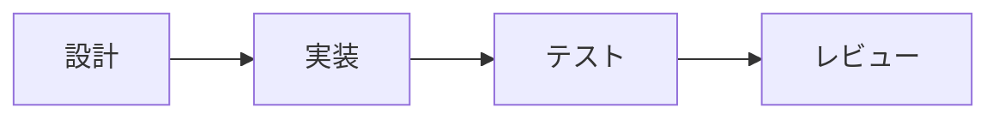

# 記事タイトル

> **概要:** この記事で扱う内容と要点を短く記します。

<!-- 必要なら作成日・最終更新日を記載します。 -->

## はじめに

背景、対象読者、前提を記します。

## 本文

記事の内容に合わせて見出しを追加・変更してください。

処理の流れや構成を図にする場合は、可能な限り編集可能なMermaid記法を使い、図の前後に読み方や伝えたい点を説明します。

````markdown

````

フローチャート、シーケンス図、クラス図、状態遷移図、ER図などを記述できます。複雑な図は分割し、ラベルや線が読みやすい大きさになるようにします。

## まとめ

要点や残った課題を記します。

## 参考資料・出典

- [資料名](https://example.com/) — 該当する主張や参照箇所

## 関連記事

- [関連記事のタイトル](relative-path.md)

## AI利用に関する注記

必要な場合のみ、実際の利用内容と人による確認範囲を記します。実態を確認せず例文をそのまま掲載しないでください。
